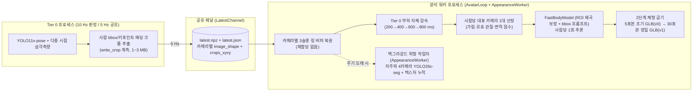

# 아바타 스트림의 Tier 0 부하 간섭 제거 및 리깅 메시 생성 복구 (S15P31A101-650)

세션 14(`live-20261112-135633`, L40S 48 GB 단일 GPU, 4카메라 1080p 2명)에서 상시 HMR 아바타 스트림을 함께 돌렸을 때 Tier 0 `judge lag p95`가 49~80 ms에서 112~405 ms로 치솟아 `AvatarAdmissionGate`(`AVATAR_JUDGE_BUDGET_MS = 100`, 10초 지속 초과 차단)가 9회 닫히고(`resets.over_budget = 9`), 그 결과 `avatar_asset`(리깅 메시 GLB)가 한 번도 생성되지 못한(`assets = 0`, 뷰어 `NO_ASSET` 캡슐 고정) 원인을 제거한다.
Tier 0 보호 기준(`AVATAR_JUDGE_BUDGET_MS = 100`)은 느슨하게 풀지 않고, 아바타 스트림이 Tier 0을 느리게 만들지 않도록 추론량·공유 채널 I/O·체형 굽기 단계·부하 감속을 재설계한다.

## 관련 명세 절

| 절 | 내용 | 이 문서에서 |
|---|---|---|
| 3.2 | Tier 0가 위치·판정의 정본, 한 시점에 GPU 인스턴스는 하나이며 Tier 0가 자원을 먼저 씀. 상시 HMR 아바타 스트림은 Tier 0 지연 초과·모름이면 멈추고 뷰어는 캡슐로 복귀 | `AVATAR_JUDGE_BUDGET_MS = 100` 유지, `AvatarAdmissionGate` 차단 전 단계적 자체 감속(200→400→600→800 ms) 추가 |
| 5.2 · 5.6 | Tier 0가 World XYZ·검증된 관절·RiskEvent 정본, HMR 관절은 `joint_source: "inferred"` | 대표 카메라 1대 HMR 추론에서도 root 위치·접지는 Tier 0 `world_state`가 정본이며 HMR은 관절 회전·체형만 제공 |
| 13.1 · 13.2 | 사람 표현(캡슐 기본, EXP-02 메시 구동)과 폴백 | 초기 5표본 굽기(`appearance_version = 0`)로 ~1초 내 리깅 메시를 먼저 올리고 30표본에서 정밀 체형(`appearance_version = 1`)으로 승격 |
| 20.3 | 외형 누적과 `IDENTITY_UNCERTAIN`·근접(`avatar_update_hold`) 시 외형 갱신 보류 | 동일 `identity_revision` 동안 근접·ID 불확실 구간에서는 `stable` 카운터를 0으로 초기화하지 않고 일시 정지 |
| 20.4 | 아바타 구동: root·접지는 Tier 0, HMR은 관절 회전·체형만, 기준(초기값 500 ms) 넘게 늦거나 끊기면 캡슐로 복귀 | 5 Hz 공유 채널 주기와 자체 감속을 수용하도록 포즈 허용 나이(`DEFAULT_MAX_AGE_MS`, `AVATAR_STALL_MS`, `AVATAR_LATE_MS`)를 500 ms에서 1000 ms로 조정 |

## 코드·시험 위치

| 구분 | 경로 | 역할 |
|---|---|---|
| 공유 채널 | `ai/src/simai_ai/io/avatar_channel.py` | 사람 bbox/키포인트 패딩 ROI 크롭 NPZ 저장(`write_crop` 계측) + 읽기 측 카메라별 3슬롯 링 버퍼 전체 프레임 복원 |
| Tier 0 기록 계측 | `ai/services/tier0/perception.py` | `timing.measure("avatar_share")` 및 `avatar_share_offered`/`avatar_share_throttled` 카운터 기록 |
| PPE 소비자 정렬 | `ai/services/ppe/loop.py` | 크롭 채널 복원 프레임 호환 유지 + 관측 인원 없는 카메라(`not obs.persons`)에서 GPU 검출기 추론 생략 |
| 부하 게이트·감속 | `ai/src/simai_ai/gpu/admission.py` | `AVATAR_JUDGE_BUDGET_MS = 100` 유지, Tier 0 예산 대비 부하 비율(`pressure`) 기반 권고 주기(`recommended_interval_ms`: 200/400/600/800 ms) 산출 |
| HMR 프롬프트·런타임 | `ai/src/simai_ai/hmr/prompt.py`, `ai/src/simai_ai/hmr/runtime.py` | 카메라별 `HmrImageMap` 캐시 재사용 및 bbox 주변 패딩 ROI 부분 왜곡 보정(`roi_box`) |
| HMR 포즈·체형 루프 | `ai/src/simai_ai/hmr/stream.py` | 사람당 대표 카메라 1대 선정(`select_representative_observation`), 포즈 루프에서 전체 프레임 세그멘테이션 제거, `duplicate_inputs`/`stale_inputs` 분리, `stable` 일시 정지 및 2단계 체형 굽기(5표본 → 30표본), 자체 감속 적용 |
| 백그라운드 외형 누적 | `ai/src/simai_ai/hmr/appearance_worker.py`, `ai/src/simai_ai/hmr/appearance_stream.py` | 저주파 백그라운드 외형 작업자에서만 4카메라 전체 프레임 세그멘테이션(`YOLO26x-seg`) 실행 및 다중 카메라 텍스처 누적 |
| 뷰어 폴백 정책 | `front/apps/admin/src/features/viewer3d/people/avatarMeshPolicy.ts`, `scenarios.ts` | `AVATAR_STALL_MS = 1000`, `AVATAR_LATE_MS = 1000` 갱신 및 개발 시나리오(`AVATAR_LATE_LAG_MS = 1300`) 정렬 |
| 단위·통합 시험 | `ai/tests/services/tier0/test_avatar_channel.py`, `ai/tests/ppe/test_service_loop.py`, `ai/tests/hmr/test_avatar_loop.py`, `ai/tests/hmr/test_segmentation.py`, `ai/tests/gpu/test_avatar_admission.py`, `front/apps/admin/src/__tests__/features/viewer3d/avatarMesh.test.tsx` | 크롭 채널·링 버퍼·PPE 스킵·대표 카메라 선정·2단계 굽기·자체 감속·뷰어 1000 ms 폴백 검증 |

## 세션 14 원인 진단 (`live-20261112-135633`)

1. **과도한 GPU 추론 작업량**: 매 스텝(2명 × 4카메라)마다 `YOLO26x-seg` 전체 프레임 4장 추론 + `Fast SAM 3D Body`(DINOv3 ViT-H/16) 8회 추론을 같은 L40S GPU에서 실행해 스텝당 평균 452 ms가 걸렸고, CUDA 커널·메모리 대역폭 경합으로 Tier 0의 YOLO11x-pose 추론 지연이 2~4배로 증가했다.
2. **Tier 0 공유 채널 직렬화 부하**: Tier 0 메인 루프가 0.2초(5 Hz)마다 1920×1080×3 BGR 원본 4장(`4 × 6.22 MB = 24.9 MB`, base64/NPZ 기록 시 스냅샷당 약 35.8 MB, 약 125 MB/s)을 동기식으로 디스크/메모리에 직렬화하면서 `judge` 루프 주기를 직접 갉아먹었다.
3. **폴링 주기와 포즈 만료 임계값 불일치**: Tier 0은 `0.2 s`(5 Hz)마다 공유 채널을 갱신하는데 아바타 루프는 `0.05 s`(20 Hz)로 폴링해 `stale_inputs=658` 중 대부분이 단순 중복 폴링이었으며, 452 ms 스텝 시간 때문에 완료 시점에는 `capture_time_ms` 나이가 `500 ms`를 넘겨 `poses_sent=129` 대비 `dropped_poses=106`이 버려졌다.
4. **체형 고정(`freeze_frames=30`) 도달 불가**: 30회 연속 유효 표본(~13.5초)을 요구하는 동안 2인 교차·근접(`avatar_update_hold`) 또는 게이트 차단(`over_budget`)이 한 번이라도 끼어들면 `state.stable = 0`으로 초기화되어 `assets = 0`에 머물렀다.

## 아키텍처 변경 요약

### 1. 사람당 대표 카메라 1대 HMR 추론 및 포즈/외형 경로 분리
- **대표 카메라 선정 (`select_representative_observation`)**: Tier 0이 삼각측량에 사용한 사람의 카메라별 관측(`per_camera`) 가운데 다른 사람 bbox와의 교차 비율(`occlusion_ratio`), 유효 2D 관절 수(`observed_joints`, confidence ≥ 0.3), bbox 면적(`area`)을 조합해 가장 잘 보이는 대표 카메라 1대만 고른다.
- **포즈 루프 경량화**: 5 Hz 포즈 루프(`AvatarLoop._step`)에서는 전체 프레임 `YOLO26x-seg`를 호출하지 않고 대표 카메라의 bbox 프롬프트와 ROI 부분 왜곡 보정(`HmrImageMap.prepare_image(..., roi_box=...)`)만 사용해 사람당 1회만 `FastBodyModel.infer`를 수행한다(2명 기준 스텝당 HMR 호출 8회 → 2회, 세그멘테이션 4장 → 0장).
- **백그라운드 외형 누적 유지**: `YOLO26x-seg` 전체 프레임 세그멘테이션과 4카메라 시점 색 누적은 저주파 백그라운드 스레드(`AppearanceWorker._run`, 기본 1~2초 주기)에서만 실행하며, `AppearancePipeline.update`는 포즈 루프가 1대만 추론하더라도 `rig.cameras`의 4대 카메라 관측을 모두 활용해 다중 시점 텍스처를 누적한다.

### 2. Tier 0 ↔ 아바타/PPE 공유 채널 경량화 및 3슬롯 링 버퍼
- **패딩 ROI 크롭 저장 (`_camera_crop_boxes`)**: `metadata["world"]["tracks"]`에 사람별 카메라 관측(`bbox` 및 `keypoints_2d`)이 있을 때 주변 패딩(`DEFAULT_CROP_PAD_RATIO = 0.35`, 최소 `48 px`)을 더한 크롭 영역만 잘라 `frames[cid] = {"image_shape": [H, W, 3], "crops_xyxy": boxes, "crop_0": ...}` 형태로 저장한다. 4카메라 1080p 2명 기준 기록 크기가 약 24.9 MB(raw)에서 약 1~3 MB로 줄어든다.
- **3슬롯 링 버퍼 복원 (`DEFAULT_RING_SLOTS = 3`)**: `LatestChannelReader`는 카메라별 고정 3슬롯 `(H, W, 3)` uint8 링 버퍼를 재사용해 매 스텝 대형 배열 할당/GC를 막으면서도, 포즈 루프(`AvatarLoop`)가 읽는 현재 슬롯과 백그라운드 외형 작업자(`AppearanceWorker`)가 비동기로 읽는 직전 슬롯이 서로 덮어쓰이지 않게 보장한다.
- **PPE 소비자 정렬 (`ai/services/ppe/loop.py`)**: 같은 공유 채널을 읽는 PPE 서비스도 복원된 `(H, W, 3)` 프레임을 그대로 소비하며, 관측된 사람이 없는 카메라(`not obs.persons`)에서는 GPU 검출기(`detector.infer`) 호출을 건너뛰고 빈 `FrameDetections`만 판정기에 전달해 불필요한 GPU 점유를 추가로 줄인다.

### 3. 주기 정렬 · 카운터 분리 · 포즈 허용 나이(`1000 ms`) 갱신
- **카운터 분리**: 기존 `stale_inputs` 하나에 섞여 있던 "이미 처리한 동일 `t_latest_global` 재폴링"(`duplicate_inputs`)과 "실제 촬영 시각 만료(`age > max_age_ms`)"(`stale_inputs`)를 분리해 진단 가능성을 확보했다.
- **포즈 허용 나이(`1000 ms`)**: Tier 0의 위치·접지·위험 판정은 `world_state`(10 Hz)가 정본이고 아바타 스트림은 시각적 관절 회전만 담당한다. 5 Hz 공유 채널 주기(200 ms) + 대표 카메라 HMR 추론 + 부하 시 자체 감속(최대 800 ms) + 중계 지터를 감안해 워커(`DEFAULT_MAX_AGE_MS`)와 뷰어(`AVATAR_STALL_MS`, `AVATAR_LATE_MS`)의 기준을 `500 ms`에서 `1000 ms`로 맞춘다.

### 4. `stable` 일시 정지 및 2단계 체형 굽기 (5표본 → 30표본)
- **`stable` 일시 정지**: `identity_revision`이 바뀐 경우에만 체형 누적과 `state.stable`을 초기화하고, 동일 `identity_revision` 내에서 일시적 근접(`avatar_update_hold` / `hold_appearance_update`)이나 `IDENTITY_UNCERTAIN`이 발생한 프레임에서는 그 프레임의 체형 반영만 건너뛰고 기존 `state.stable` 카운터는 보존한다.
- **2단계 체형 굽기**:
  - **1단계 (`initial_freeze_frames = 5`, 약 1초)**: 5회 유효 표본이 모이면 초기 체형 평균으로 첫 리깅 메시 GLB를 구워 업로드하고 `avatar_asset`(`appearance_version = 0`, `shape.frozen = False`, `frames_used = 5`)을 발행한다. 뷰어는 `NO_ASSET` 캡슐 상태에서 즉시 벗어나 스키닝 메시를 렌더링한다.
  - **2단계 (`freeze_frames = 30`, 약 6초)**: 이후 표본을 계속 모아 30회 유효 표본에 도달하면 정밀 체형 평균으로 GLB를 다시 구워 `appearance_version = 1`(`previous_appearance_version = 0`, `shape.frozen = True`, `frames_used = 30`)로 무중단 승격한다.

### 5. Tier 0 부하 기반 아바타 자체 감속 (`AvatarAdmissionGate`)
- `AvatarAdmissionGate`의 차단 예산(`AVATAR_JUDGE_BUDGET_MS = 100`, `AVATAR_DETECT_BUDGET_MS = 150`, `T_block = 10s`)은 그대로 유지한다.
- 차단 임계에 도달하기 전에 Tier 0 `judge`/`detect` p95의 예산 대비 비율(`pressure = max(judge_p95 / 100, detect_p95 / 150)`)을 읽어 아바타 포즈 추론 주기를 단계적으로 늦춘다(`AvatarLoop.throttled`, `skip_reasons["self_throttle"]`):
  - `pressure ≤ 0.70`: `200 ms` (5.0 Hz)
  - `0.70 < pressure ≤ 0.85`: `400 ms` (2.5 Hz)
  - `0.85 < pressure ≤ 1.00`: `600 ms` (1.67 Hz)
  - `pressure > 1.00` (단발 스파이크, `T_block` 차단 전): `800 ms` (1.25 Hz)

## 명세에 없어 정한 수치와 근거

| 항목 | 수치 | 근거 |
|---|---|---|
| 크롭 패딩 비율 / 최소 픽셀 | `0.35` / `48 px` | 팔·발끝이 bbox 경계 밖으로 살짝 나가거나 왜곡 보정 리맵 시 가장자리가 잘리지 않도록 여유를 두면서도 1080p 전체 프레임 대비 면적을 10~20% 수준으로 제한 |
| 카메라별 복원 링 버퍼 슬롯 수 | `3` | 포즈 루프 현재 프레임(슬롯 1) + 백그라운드 외형 작업자 처리 중 프레임(슬롯 2) + 읽기 교체 여유(슬롯 3)로 락 없이 배열 덮어쓰기 경합 방지 |
| 대표 카메라 선정 가중치 | `(1 - 0.7 × occlusion) × (1 + 0.12 × joints) × √area` | 다인원 교차 시 가림(`occlusion_ratio`)이 적은 카메라를 최우선으로 고르고, 관절 가시성과 해상도(`√area`)를 함께 반영 |
| 초기 체형 굽기 표본 수 | `initial_freeze_frames = 5` | 5 Hz 기준 약 1초 만에 첫 스키닝 메시(`appearance_version = 0`)를 뷰어에 표시해 초기 `NO_ASSET` 공백을 최소화하고, 30표본(`freeze_frames = 30`)에서 최종 체형으로 고정 |
| 아바타 포즈 허용 나이 | `1000 ms` (`DEFAULT_MAX_AGE_MS`, `AVATAR_STALL_MS`, `AVATAR_LATE_MS`) | 5 Hz 공유 채널 간격(200 ms) + 자체 감속 최대 주기(800 ms) 동안에도 캡슐 깜빡임 없이 마지막 두 포즈 사이를 안정적으로 보간(위치·위험 판정은 Tier 0 10 Hz 유지) |
| 자체 감속 구간 | `≤70%: 200ms`, `≤85%: 400ms`, `≤100%: 600ms`, `>100%: 800ms` | Tier 0 `judge lag p95`가 70 ms를 넘기 시작할 때부터 아바타 GPU 점유율을 선제적으로 1/2 ~ 1/4로 낮춰 100 ms 초과(`over_budget` 차단) 자체를 예방 |

## 버린 대안

1. **`AVATAR_JUDGE_BUDGET_MS`를 100 ms에서 200~250 ms로 완화하는 안**: 아바타 스트림 때문에 Tier 0 위험 판정 지연을 용인하는 것은 AGENTS 규칙 1("Tier 0가 위치·판정의 정본이며 자원을 먼저 쓴다")에 위배되므로 기각했다.
2. **공유 채널 해상도를 640×360으로 일괄 다운스케일하는 안**: 전체 프레임을 줄이면 전송량은 줄지만 사람 영역의 픽셀 해상도가 1/9로 떨어져 HMR 손·발 회전 정밀도와 외형 텍스처(얼굴 30~50 px 물리 한계)가 함께 열화된다. 원본 해상도의 사람 크롭만 전달하는 방식이 화질 손실 없이 크기를 85% 이상 줄인다.
3. **체형 고정 표본 수를 30에서 5로 영구 축소하는 안**: 5표본만으로 체형을 영구 고정하면 입장 직후 구부정한 자세나 부분 가림 상태에서 부정확한 체형이 굳어질 수 있다. 5표본 초기 굽기(`frozen=False`) 뒤 30표본 정밀 고정(`frozen=True`)의 2단계 방식이 즉시성과 체형 정확도를 모두 만족한다.

## 목표 지표 (세션 14 대비)

| 지표 | 세션 14 실측 (`live-20261112-135633`) | 변경 후 목표 |
|---|---|---|
| Tier 0 `judge lag p95` (아바타 동시 실행 시) | `112 ~ 405 ms` | `≤ 100 ms` 유지 |
| `AvatarAdmissionGate` 차단 횟수 (`resets.over_budget`) | `9회` (97초 중 대부분 차단) | `0회` |
| 아바타 스텝 추론 시간 (`step_ms` 평균, 2명 기준) | `452 ms` (4카메라 seg + 8회 HMR) | `≤ 120 ms` (대표 카메라 1대 × 2명 HMR) |
| 공유 채널 기록 크기 (`last_written_bytes`) | `~24.9 MB` raw (`~35.8 MB` 스냅샷) | `1 ~ 3 MB` (사람 크롭만 저장) |
| 초기 리깅 메시(`avatar_asset` v0) 생성 시각 | 미생성 (`assets = 0`) | 트랙 확정 뒤 `1 ~ 2초` 이내 (`5표본`) |
| 포즈 드롭 비율 (`dropped_poses / poses_sent`) | `106 / 129` (`82%`) | `< 5%` |

## GPU 녹화 재생 검증 절차 (`live-20261112-135633`)

단일 GPU(L40S 48 GB 이상) 검증 환경에서 세션 14 녹화본(`live-20261112-135633`)을 재생해 다음 순서로 실측 확인한다.

1. **Tier 0 + 공유 채널 재생 실행**:
   - `SIMAI_AVATAR_CHANNEL_DIR=/tmp/simai-avatar-channel`을 설정하고 `live-20261112-135633` 녹화 세션을 Tier 0 리플레이 모드로 구동한다.
   - Tier 0 주기 로그에서 `timing.avatar_share` 평균/최대 시간과 `avatar_share_offered` 카운터를 확인하고, `/tmp/simai-avatar-channel` 스냅샷 크기가 3 MB 이하인지 확인한다.
2. **아바타 스트림 워커 동시 실행**:
   - 같은 GPU에서 `simai_ai.services.avatar` 워커를 기동하고 90초 동안 함께 돌린다.
3. **종료 요약 로그(`AvatarLoop stopped`) 확인**:
   - `gate.resets`에서 `over_budget`이 `0`인지 확인한다.
   - `assets >= 2`(사람별 초기 메시 `appearance_version=0` 및 30표본 정밀 메시 `appearance_version=1` 발행)인지 확인한다.
   - `dropped_poses`가 `poses_sent`의 5% 미만이고, `duplicate_inputs`와 `stale_inputs`가 분리 집계되는지 확인한다.
4. **뷰어 확인**:
   - 관리자 3D 뷰어(`/topic/avatar`)에서 두 트랙이 입장 후 약 1~2초 내 `NO_ASSET` 캡슐에서 스키닝 메시로 전환되고, 교차 구간 이후에도 캡슐로 고착되지 않는지 확인한다.

## 잔여 위험 및 넘긴 일

- **잔여 위험**: 4대 카메라 모두에서 3명 이상이 완전히 한 덩어리로 겹쳐 모든 카메라의 `occlusion_ratio`가 높을 때는 대표 카메라 1대에서도 관절 회전 추정 오차가 커질 수 있다. 이때도 위치·접지·위험 판정은 Tier 0 `world_state`가 정본이며, `IDENTITY_UNCERTAIN`이면 뷰어가 즉시 캡슐로 폴백하고 `stable` 카운터는 일시 정지된다.
- **넘긴 일**: 실제 GPU Pod에서 `live-20261112-135633` 녹화 재생을 통한 실측 Run 기록(`contracts/experiments/run_record.schema.json`) 수집은 GPU 검증 큐 실행 시점에 수행한다.
