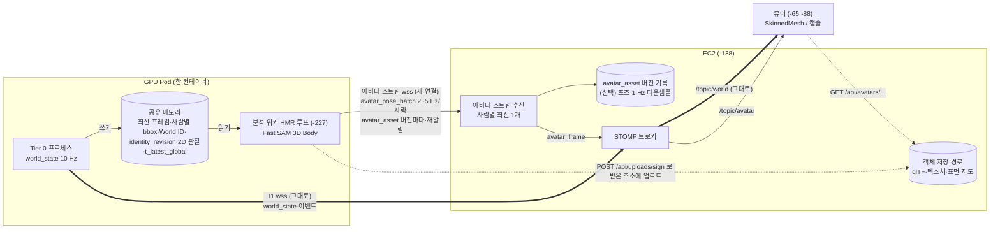

# EXP-02 아바타 포즈 스트림 계약 (S15P31A101-249)

2026-10-23 사용자 결정으로 EXP-02(MHR 리깅 메시 + 포즈 스트림)를 시연 범위로 올렸다. 뷰어는 MHR 리깅 메시(Three.js SkinnedMesh)를
포즈 스트림으로 움직인다. 3DGS 는 쓰지 않고, 얼굴은 관측 픽셀만 쓰며(생성 안 함), 위치 정본은 Tier 0 다.
같은 날 결정으로 참여자 동의 제한은 없고(SSAFY 관계자 허가), 관측된 얼굴 픽셀은 흐림 없이 써도 된다. 금지는 안 보이는 얼굴을 지어내는 생성형 복원뿐이다.
EXP-02 를 시연 범위로 올렸으므로 LIVE 관제 중에도 스트림을 돌린다(Tier 0 보호는 아래 'LIVE 중 실행').
분석 워커의 I5 작업 대여(배치)는 사람별 2~5 Hz 갱신을 실을 수 없고, I1 `world_state` 에 섞으면 경보 전달이 느려진다.
그래서 이 티켓은 I1 과 분리된 아바타 스트림의 메시지 계약(스키마·예시·생성 타입)과 전송·보간·되돌아가기 규칙을 정한다.
워커·EC2·뷰어 구현은 각 티켓 몫이다(아래 '담당').

## 관련 명세

| 절 | 내용 | 이 문서에서 |
|---|---|---|
| 3.2 | Tier 0 가 위치·판정의 정본, 분석 워커는 같은 Pod 의 별도 프로세스(자원 상한), 대형 EXP Job 은 LIVE 관제 시간에 돌리지 않음 | 스트림은 워커 프로세스가 연다. LIVE 중 실행 허용과 보호 조건은 'LIVE 중 실행', 문구 변경은 명세 반영 요청 1 |
| 5.6 | HMR 관절은 inferred, 표면 관측/보간/미관측 구분, canonical_motion·native_pose 분리 | `joint_source` inferred 고정, `surface_source`, 스트림은 native 만 |
| 12.1·12.2·12.4 | 봉투, 구간 목록, I2 토픽 | 새 메시지 3개, `/topic/avatar` |
| 13.1·13.2 | 사람 표현(MVP 캡슐, EXP-02 채택 시 메시), 관측 상태 표시 | 뷰어 되돌아가기 조건 |
| 20.3 | 외형 누적(명세는 동의 뒤), IDENTITY_UNCERTAIN·ID 교정 직후 누적 멈춤, 보이지 않는 면·얼굴 생성 금지(명세는 원본 얼굴 픽셀 저장도 금지) | `avatar_asset` 규칙. 동의·얼굴 픽셀 문구는 2026-10-23 결정과 달라 명세 반영 요청 11 |
| 20.4 | 아바타 구동: root·접지는 Tier 0, HMR 은 관절 회전·체형만, 기준(초기값 500 ms) 넘게 늦거나 실패하면 캡슐 | 보간·되돌아가기 |

## 결정 요약

1. `experiments/human_mesh_output`(2.0.0)은 옮기지 않고 EXP-02 오프라인 Run 기록으로 그대로 둔다. 스트림은 `messages/` 에 새 메시지 3개(1.0.0)를 둔다.
   - 근거: 기록은 Run 단위 감사(`reproducibility`, 품질 지표, 카메라별 입력, 진단용 COCO17 위치)이고 스트림은 작고 버려도 되는 사람별 갱신이다. 한 스키마로 묶으면 스트림이 기록의 필수 필드를 매 프레임 싣거나, 기록이 봉투를 갖게 된다.
   - `human_mesh_output` 예시는 `ai/tests/providers/test_provenance.py`·`ai/tests/calibration/test_contract_versions.py` 가 이름으로 읽는다. 옮기면 이름·생성 모델(`HumanMeshOutput`)이 바뀌어 메이저가 된다. 그대로 두면 깨지는 것이 없다.
2. 회전 표현은 축각(rotation vector, 라디안) 하나다(공통 `axis_angle`). 쿼터니언·행렬·오일러는 싣지 않는다.
   - 근거: 명세 12.1 '각도는 라디안', 기존 `human_mesh_output.canonical_motion.rotations` 도 축각 라디안이라 기록과 스트림이 같은 표현이 된다(기록 스키마를 메이저로 바꾸지 않음). 관절마다 3개 값이라 쿼터니언(4개)보다 25% 작다.
   - 뷰어는 받은 축각을 쿼터니언으로 바꿔(`Quaternion.setFromAxisAngle`) slerp 한다. π 근처 축각의 불연속은 쿼터니언으로 바꾼 뒤 최단 경로 보간이라 문제가 되지 않는다.
3. 포즈는 위치를 싣지 않는다. 사람별 포즈 객체는 닫아서 `pelvis_xyz`·`ground_anchor_xyz`·HMR translation 같은 필드가 끼어들 수 없다(invalid 예시로 확인). 관절 출처는 `inferred` 상수다.
4. 아바타 스트림은 I1 과 다른 연결이다: 분석 워커 프로세스가 EC2 로 여는 WebSocket(wss, 워커 토큰).
5. EC2 는 사람별 최신 포즈만 남기고 `/topic/avatar` 로 다시 싣는다. 포즈는 저장하지 않는 것이 기본이고, 자산은 버전마다 한 번 기록한다.
6. 동의 기록 필드(`consent_ref`)는 두지 않는다. 참여자 동의 제한이 없어 가리킬 기록이 없고, 형식만 남은 ID 는 동의가 있는 것처럼 읽힌다. 입력 출처는 `input_provenance` 가 남긴다. `texture` null 은 '아직 텍스처 없음'만 뜻한다.
7. 얼굴은 `face_policy` OBSERVED(관측 픽셀 그대로, 생성 없음)가 기본이고 BLURRED·EXCLUDED 를 고를 수 있다. 얼굴 영역은 `surface_source.face_ratios`(관측·미관측, 보간 없음)로 따로 싣는다. 생성형 얼굴을 뜻하는 값은 계약에 없다.

## 경로

공유 메모리(Tier 0 → 워커)는 같은 컨테이너 안 프로세스 사이 구조라 이 계약 밖이고 -227 이 정한다. 워커가 읽는 시각(`t_latest_global`)과
`identity_revision` 을 포즈에 그대로 싣는 것만 이 계약이 요구한다.

## 메시지

| msg_type | 방향 | 주기 | 내용 |
|---|---|---|---|
| `avatar_pose_batch` 1.0.0 | 워커(`worker-01`) → EC2 | 사람마다 2~5 Hz, 한 묶음에 여러 사람 | `stream_epoch`(워커 스트림 프로세스 시작 시각 ms, 재접속으로는 안 바뀜), `batch_sequence`, `calibration_version`, `scene_version`(선택), `model_version`, `input_provenance`(tracks 필수), `dropped_poses`, `poses[]` |
| `avatar_asset` 1.0.0 | 워커 → EC2 (같은 연결) | 처음 한 번 + `appearance_version` 이 바뀔 때, 재접속 직후·10초마다 재알림 | `world_id`, `stream_epoch`, `identity_revision`, `appearance_version`·`previous_appearance_version`, `mesh`(glTF 객체 주소·sha256·크기·정점·면, `GLTF_Y_UP`), `skeleton`(관절 순서), `shape`, `texture`(아직 없으면 null), `surface_source`(지도·비율·얼굴 영역 `face_ratios`), `face_policy`(OBSERVED 기본·BLURRED·EXCLUDED) |
| `avatar_frame` 1.0.0 | EC2(`ec2`) → 뷰어 `/topic/avatar` | 받은 묶음마다(사람별 최신, 밀리면 버림) | `input_provenance`, `avatars[]`: 포즈 + 그 포즈가 가리키는 자산(`asset`, 아직 없으면 null): `stream_epoch`·`identity_revision`(자산 생성 때 차수), 메시·텍스처·표면 출처 지도 내려받기 경로(`mesh_url`·`texture_url`·`surface_source_url`), 관절 수·순서 해시·pelvis 관절, 표면·얼굴 비율, `face_policy` |

사람별 포즈(`poses[]`·`avatars[]` 공통): `world_id`, `identity_revision`(계산 때 본 Tier 0 값), `capture_time_ms`(원본 프레임 촬영 시각 =
그 Tier 0 상태의 `t_latest_global`), `appearance_version`, `joint_source: "inferred"`, `pose`(`mhr_pose`). 뷰어 쪽에는 `received_at_ms`(EC2 수신, 진단용)와
`calibration_version` 을 더한다.

뷰어 메시지가 자산 경로를 포즈마다 함께 싣는 이유: 메시지 하나로 그릴 수 있어야 늦게 구독한 뷰어가 REST 조회 없이 시작하고, 드롭 허용 토픽에서
자산 알림 하나를 잃어 메시를 못 그리는 일이 없다. 대가는 사람당 약 0.4 KB 다.

### 스키마로 막는 것 (invalid 예시 19개)

| 규칙 | invalid 예시 |
|---|---|
| 포즈에 위치·접지·HMR translation 불가(닫힌 객체) | `avatar_pose_batch.position_included`, `avatar_pose_batch.root_translation`, `avatar_frame.position_included` |
| 관절 출처는 inferred 만 | `avatar_pose_batch.observed_joint_source` |
| 회전은 축각 3개 값, 성분 [-π, π](쿼터니언·도 불가) | `avatar_pose_batch.quaternion_rotation`, `avatar_pose_batch.degrees_rotation` |
| 원본 프레임 촬영 시각 필수 | `avatar_pose_batch.missing_capture_time` |
| 얼굴 처리는 OBSERVED·BLURRED·EXCLUDED 만(생성형 값 없음) | `avatar_asset.face_policy_generated` |
| 얼굴 영역은 관측·미관측만(보간 없음, 안 보이는 얼굴을 채우지 않음) | `avatar_asset.face_interpolated` |
| EXCLUDED 면 얼굴 관측 비율 0(뷰어 자산도 같음) | `avatar_asset.face_observed_when_excluded`, `avatar_frame.face_observed_when_excluded` |
| 텍스처가 있으면 표면 출처 지도 필수(뷰어는 `surface_source_url`) | `avatar_asset.texture_without_mask`, `avatar_frame.texture_without_surface_map` |
| 한 메시지 최대 64명, `model_version`·`rig_source` 256자 | (시험 `test_people_per_message_are_capped`) |
| 텍스처가 없으면 관측·보간 비율 0·얼굴 관측 0, 지도 null(추정 외형을 실측으로 표시 금지) | `avatar_asset.observed_without_texture`, `avatar_asset.face_observed_without_texture`, `avatar_frame.observed_without_texture`(뷰어 `texture_url` null) |
| 자산 주소는 객체 주소(s3://)만, 서명 HTTPS 불가 | `avatar_asset.signed_https_mesh` |
| 뷰어 주소는 `/api/avatars/…` 같은 출처 경로만(스킴·쿼리·퍼센트 인코딩·점으로 시작하는 마디 불가) | `avatar_frame.s3_mesh_url`, `avatar_frame.path_traversal` |

`root_rotation` 은 null 이 될 수 없다(몸 방향을 모르면 포즈를 보내지 않는다). 관절 회전은 모르면 null 이다(아래).

### 스키마 밖 규칙 (`ai/tests/contracts/test_avatar_stream.py`)

- 회전 길이(회전각) ≤ π. 성분 범위만으로는 [3, 3, 0] 같은 값을 못 막는다.
- `joint_rotations` 길이 = 묶인 자산의 `skeleton.joint_count`, 관절 0 회전 = [0, 0, 0].
- `pelvis_joint_index` < `joint_count`, `appearance_version` 0 이면 `previous_appearance_version` null·그 밖에는 현재보다 작음.
- 자산 `identity_revision` ≤ 포즈 `identity_revision`(아래 'ID 교정 뒤 외형'). 뷰어 자산의 `stream_epoch` = 포즈 묶음의 `stream_epoch`.
- 다른 자산 키 `(world_id, stream_epoch, appearance_version)` 는 파일 주소·REST 경로를 같이 쓰지 않는다(덮어쓰기 금지, AGENTS 규칙 6).
- 한 묶음·한 메시지 안 `world_id` 유일, 표면 비율(`ratios`·`face_ratios`) 합 1.
- EC2 는 같은 촬영 시각의 포즈를 바꾸지 않고 다시 싣는다.
- 포즈는 같은 `(world_id, stream_epoch, appearance_version)` 의 자산에만 묶는다(워커 재시작 뒤 버전을 0 부터 다시 세도 이전 자산과 섞이지 않음).
- 같은 `stream_epoch` 안에서 `batch_sequence`·`dropped_poses`, 같은 `(world_id, stream_epoch)` 안에서 `appearance_version` 은 줄지 않는다(송신 측 시험, -227).

## 포즈 표현

| 항목 | 정의 |
|---|---|
| 관절 순서 | MHR 자산(`mhr_model.pt`)의 관절 인덱스 순서. 127개. glTF 내보내기는 `skin.joints[i]` = MHR 관절 i 로 둔다. 인덱스가 기준이다. 자산에 관절 이름이 있다(`get_joint_names()`, 0 `body_world`(바닥 원점), 1 `root`(pelvis, 92.4 cm), 42 `r_wrist`, 43 `r_pinky0` …, glTF 노드 이름에 넣음. S15P31A101-88 `docs/design/mhr-skinned-gltf.md` 가 확인해 선행 PoC `COMPATIBILITY.md` 의 ‘이름 없음’을 정정). 공식 코드에서 확인된 인덱스: 40·76 하완, 41·77 손목 비틀림, 42·78 손목(R·L). 43~64·79~100 은 손가락(이름으로도 맞음) |
| 순서 고정 | `skeleton.joint_parents_sha256` = 부모 배열(root −1)을 공백 없는 JSON 으로 적은 UTF-8 바이트의 sha256. 선행 PoC 자산(sam-3d-body@b5c765a) 값 `sha256:46ebaa1f…5225`. 뼈 길이는 사람마다 달라(scale 파라미터) 넣지 않는다. `rig_source` 에 자산 출처를 적는다(HF `facebook/sam-3d-body-dinov3@11aaa34`, 코드 저장소 커밋이 아님) |
| 관절 회전 | 부모 기준(local) 축각, glTF 노드 회전과 같은 뜻. 관절 0 은 [0, 0, 0] 이고 몸 전체 방향은 `root_rotation` 에 넣는다(두 번 돌리지 않게). MHR 은 몸 방향을 관절 1(pelvis)에 걸므로 그것을 root 로 옮긴 결과 관절 1 도 늘 [0, 0, 0] 이다 |
| 모르는 관절 | null. body 모드는 손가락을 추정하지 않으므로 43~64·79~100 은 null, 뷰어는 그 관절의 bind 회전을 둔다. 손을 펴진 자세로 지어내지 않는다 |
| `root_rotation` | 리그 모델 좌표(glTF Y-up)를 World(m, 오른손, +Z)로 돌리는 회전. 워커가 HMR `global_rot`(카메라 기준)에 보정 R(World → 카메라)의 역을 곱해 만든다. 그래서 `calibration_version` 이 world_state 와 다르면 쓰지 않는다. 똑바로 선 사람 = Rz(ψ)·Rx(+π/2) |
| 위치 | 없음. 뷰어가 Tier 0 `pelvis_xyz` 에 `skeleton.pelvis_joint_index` 관절을 맞추고, 접지가 VALID 면 발을 `ground_anchor_xyz` 높이에 맞춘다(13.2). HMR `pred_cam_t` 는 버린다 |
| 단위·반올림 | 라디안, 소수 넷째 자리(약 0.006°, 1 m 팔 끝에서 0.1 mm) |
| Three.js | 뷰어 어댑터 한 곳에서 `quat(A)·quat(root_rotation)` (A = World → Three (x, z, −y), 곧 Rx(−π/2)). 똑바로 선 사람은 Three Y 축 회전만 남는다 |

**canonical_motion 은 스트림에 싣지 않는다.** 공통 관절(COCO17)의 정본은 world_state 의 Tier 0 `skeleton`(observed/inferred 표시 포함)이고,
뷰어 캡슐도 그것으로 그린다. HMR 이 낸 COCO17 위치는 G5·한 카메라 제외 재투영 같은 평가에만 쓰므로 오프라인 기록
(`human_mesh_output.pose_frame.canonical_motion`)에 남긴다. 기록의 `native_pose.params` 에 스트림과 같은 `mhr_pose` 를 싣는 것은 -227 이
기록 스키마 마이너로 더할 수 있다(이 티켓은 기록 스키마를 바꾸지 않음).

### 표면 출처 지도

워커가 텍스처와 함께 만드는 지도(`avatar_asset.surface_source.mask_uri`, 뷰어는 `viewer_asset.surface_source_url`)의 형식이다. 텍스처가 있으면 필수, 없으면 null.

| 항목 | 정의 |
|---|---|
| 파일 | 무손실 PNG, 8비트 단일 채널(그레이스케일). 압축 손실·색 변환이 없어야 값이 보존된다 |
| 대응 | 텍스처(`texture.resolution`)와 같은 해상도, 같은 glTF UV(TEXCOORD_0). 텍셀 (u, v) 의 값이 같은 텍셀의 출처다 |
| 값 | 2 = OBSERVED(관측 픽셀), 1 = INTERPOLATED(주변 관측으로 보간), 0 = UNOBSERVED(관측 없음, 기본 재질) |
| 얼굴 영역 | 얼굴 영역 텍셀은 128 을 더한다: 130 = 얼굴 관측, 128 = 얼굴 미관측. 129(얼굴 보간)는 쓰지 않는다(안 보이는 얼굴을 채우지 않음). 얼굴 영역은 MHR 메시의 머리 앞면 정점 집합(-227 이 정점 목록을 자산 판과 함께 고정)을 UV 로 칠한 것 |
| 그 밖의 값 | 0·1·2·128·130 외의 값은 없다. 뷰어는 모르는 값을 UNOBSERVED 로 읽는다 |
| 비율 | `ratios` = 얼굴 포함 전체 텍셀에서 값 2·1·0(얼굴 비트 무시) 비율, `face_ratios` = 얼굴 텍셀 중 130·128 비율 |
| 뷰어 | 최근접 샘플링(보간 없이)으로 읽어, UNOBSERVED 텍셀은 텍스처 대신 기본 재질, INTERPOLATED 는 관측과 구분되는 표시(예: 채도 낮춤)로 그린다. 정확한 표시 방식은 -88 |

### ID 교정 뒤 외형

자산은 만든 때의 `identity_revision` 을 갖고, 포즈는 계산 때의 `identity_revision` 을 갖는다. 명세 20.3 은 IDENTITY_UNCERTAIN·교정 직후 누적을 멈추고 마지막 확정 외형을 유지하라고 한다.

| 경우 | 외형 |
|---|---|
| 자산 차수 = 포즈 차수 | 그대로 쓴다 |
| 병합: 남은 ID(교정 뒤 차수 증가) | 남은 ID 가 교정 전에 가진 자산을 계속 가리켜도 된다(자산 차수 < 포즈 차수). 합쳐진 ID 의 자산은 쓰지 않는다(다른 `world_id` 라 키가 다르다) |
| 분할: 원래 ID | 교정 전 자산을 계속 가리켜도 된다. 누적은 멈추고, 다시 안정되면(IDENTITY_UNCERTAIN 이 아니고 `identity_revision` 이 30 프레임 동안 그대로) 새 차수로 새 버전을 누적한다 |
| 분할: 갈라져 나간 새 ID | 원래 ID 의 자산을 물려받지 않는다. 자기 자산이 생길 때까지 캡슐 |
| 자산 차수 > 포즈 차수 | 쓰지 않는다(교정 뒤 자산을 교정 전 포즈에 입히면 다른 사람 외형일 수 있다). 워커는 이렇게 보내지 않고 EC2 는 `asset` null 로 싣는다 |
| 교정 뒤 외형이 틀렸다고 판단(워커가 누적 이상치로 거절 등) | 그 자산을 더 가리키지 않고(폐기는 '참조 중단'이지 기록 삭제가 아님, 규칙 6) 새 버전을 처음부터 다시 누적한다. 그동안 캡슐 |

뷰어 되돌아가기 3 의 'identity_revision 이 트랙 값과 다름'은 포즈 차수와 world_state 트랙 차수의 비교이고, 자산 차수가 작은 것은 되돌아가기 사유가 아니다.

### 크기 (예시 생성기로 잰 압축 JSON)

| 경우 | 사람 1명 | 10명 × 5 Hz |
|---|---|---|
| body 모드(손가락 44개 null) | 2.4 KB | 약 117 KiB/s(≈ 0.96 Mbit/s) |
| 127 관절 모두 | 3.2 KB | 약 158 KiB/s(≈ 1.3 Mbit/s) |
| 뷰어 `avatar_frame`(자산 경로 포함) | 약 3.0 KB | 약 150 KiB/s, 뷰어마다 |

world_state 10 Hz 와 비슷한 차수다. EC2(t3.xlarge) 망은 여유가 있다. 줄여야 하면 WebSocket permessage-deflate 를 먼저 켠다(숫자 텍스트라 크게 준다).
관절 부분집합 전송 같은 형식 변경은 실측 뒤에 한다.

## 전송

**별도 연결로 한 이유.** I1 연결은 Tier 0 프로세스의 TLS 단일 스레드(`serial_tls`)가 가진다. 같은 WebSocket 의 다른 메시지 종류로 실으면
(1) HMR 워커가 Tier 0 프로세스로 IPC 해야 해서 프로세스 분리(3.2 장애 격리)가 깨지고, (2) 초당 100 KiB 넘는 포즈가 같은 송신 큐에서
`risk_event_transition`·`world_state` 앞을 막는다(head-of-line). 별도 연결이면 워커가 죽거나 밀려도 I1 은 그대로다.

| 항목 | 규칙 |
|---|---|
| 연결 | 워커 → EC2 `wss://<ec2>/ws/worker/avatar`(기본안, 경로 확정은 -138 OpenAPI). 워커 토큰 인증(I5 와 같은 토큰). Pod 로 들어오는 포트 없음. 위로만 보내고 응답 메시지는 없다 |
| 송신 버퍼 | 워커는 사람마다 보내지 않은 포즈 1개만 둔다. 새 포즈가 오면 바꾸고 `dropped_poses` 를 올린다. 재접속 때 밀린 포즈를 다시 보내지 않는다 |
| 재접속 | 끊기면 1초부터 두 배씩 최대 10초 간격으로 다시 연다. `stream_epoch` 는 그대로, `batch_sequence` 는 이어 간다(끊긴 동안 보낸 묶음이 없으니 빈칸은 전송 중 잃은 것만). 워커가 재시작하면 새 `stream_epoch` 와 `batch_sequence` 0. 연결 직후 살아 있는 사람의 현재 `avatar_asset` 을 먼저 보낸다 |
| 자산 재알림 | 10초마다 살아 있는 사람의 현재 `avatar_asset` 을 다시 보낸다. EC2 는 `(world_id, stream_epoch, appearance_version)` 으로 한 번만 기록하고, 같은 키에 다른 sha256 이 오면 처음 것을 두고 로그를 남긴다 |
| 순서 역전·중복 | EC2 는 `msg_id` 로 중복을 버리고, 사람별로 `(identity_revision, capture_time_ms)` 가 지금 값보다 클 때만 바꾼다(같거나 작으면 버림). 연결이 바뀌어도 촬영 시각으로 비교하므로 늦게 도착한 이전 연결의 묶음이 새 값을 덮지 않는다. `batch_sequence` 빈칸은 잃은 묶음 집계에만 쓴다 |
| 사람 제거 | EC2 는 `/topic/world` 에서 사라진 `world_id`(LOST 뒤 빠짐)의 최신 포즈를 지운다. 30초 넘게 포즈가 없는 사람도 지운다 |
| 뷰어 토픽 | `/topic/avatar` 는 받은 묶음마다 갱신된 사람만 싣는다. 브로커 큐가 밀리면 오래된 `avatar_frame` 을 버린다(사람별 최신만 의미가 있다). `/topic/world`·`/topic/events` 의 송신 순서·우선은 바꾸지 않는다 |
| 저장 | 포즈는 저장하지 않는다(기본). 리플레이용으로 사람별 1 Hz 다운샘플 저장은 선택이고 -138 이 표·보관 기간과 함께 정한다. 자산 알림은 버전마다 한 줄 추가(덮어쓰지 않음). 파일은 `POST /api/uploads/sign` 으로 받은 주소에 먼저 올린다(워커 토큰 허용 여부는 -138). 객체 키와 REST 경로에는 자산 키 셋을 모두 넣는다(예: `s3://<bucket>/<world_id>/e<stream_epoch>/v<appearance_version>/mesh.glb`, `/api/avatars/<world_id>/epochs/<stream_epoch>/versions/<appearance_version>/mesh.glb`). 워커가 재시작해 같은 버전을 다시 써도 파일이 겹치지 않는다 |
| 크기 한도 | 한 메시지 최대 64명(스키마), 메시지 본문 최대 512 KiB(EC2 수신·STOMP 송신 한도, 넘으면 그 메시지를 버리고 센다). 64명 × 127 관절 전부 ≈ 210 KB 의 두 배 여유 |
| 알림 | 알림 채널이 아니다(AGENTS 규칙 5와 무관). 위험 판정에 넣지 않는다(규칙 1·4) |

## LIVE 중 실행

EXP-02 를 시연 범위로 올린 결정(2026-10-23)이라 아바타 스트림은 LIVE 관제 중에도 돈다. Tier 0 는 이렇게 지킨다.

- HMR 루프는 분석 워커 GPU 상한(`simai_ai.gpu.budget`) 안에서 돈다. I5 대여 작업이 아니라 상시 루프다.
- 루프는 추론 전마다 -60 의 Tier 0 표시 파일(`$SIMAI_ROOT/state/tier0.live` 의 `gpu_priority.load`, `AdmissionGate` 와 같은 판정)을 읽고, Tier 0 지연이 목표를 넘거나 모르면 새 추론을 멈춘다. 지연이 돌아오면 다시 시작한다.
- 멈추면 새 포즈가 나가지 않으므로 뷰어는 0.5 s 뒤 캡슐로 돌아간다(아래 되돌아가기 1). 경보·판정 경로는 영향을 받지 않는다.
- 지금 -60 구현은 LIVE 중 `hmr_*` 작업을 받지 않고 도는 것은 멈춘다. 이 규칙은 I5 작업(`hmr_refine`·`hmr_appearance_update` 배치)에 그대로 두고, 상시 스트림 루프에는 위 지연 감시만 적용하는 것으로 -227 이 나눈다(이 티켓은 코드를 바꾸지 않음).

## 뷰어 구동 (-65·-88)

- **위치·존재:** 사람의 존재·위치·접지·관측 상태·ID 신뢰도는 `/topic/world` 만 따른다. `/topic/avatar` 는 이미 있는 사람에게 관절 회전과 외형을 입힐 뿐이다.
- **지연 보간:** 포즈는 재생 지연 D = 250 ms(200~300 ms)의 버퍼로 재생한다. 재생 시각 = (포즈 촬영 시각 기준 시계) − D 이고, 그 시각을 사이에 둔 두 포즈를 관절마다 slerp 한다(한쪽이 null 이면 bind 회전). 5 Hz 에서 표본 간격이 200 ms 라 D ≥ 200 ms 면 거의 늘 두 표본이 있다. 새 표본이 없으면 마지막 포즈를 유지하고 외삽하지 않는다.
- **root 위치는 지연시키지 않는다.** 위치는 world_state 최신(캡슐과 같은 규칙)으로 그리고, 관절 회전만 HMR 지연 + D 만큼 늦다.
- **캡슐로 되돌아가기(하나라도 맞으면):**
  1. 그 사람의 새 포즈가 0.5 s 넘게 오지 않음(뷰어 수신 기준 끊김)
  2. world_state `t_latest_global` − 가장 새 포즈의 `capture_time_ms` > 500 ms(20.4 '기준 넘게 늦음', 초기값)
  3. world_state 트랙의 `identity_confidence` 가 `IDENTITY_UNCERTAIN`, 또는 포즈의 `identity_revision` 이 트랙 값과 다름
  4. 포즈의 `calibration_version` 이 world_state 와 다름
  5. `asset` null, 메시 내려받기·sha256 확인 실패, `joint_count` ≠ `joint_rotations` 길이
  조건이 풀리면 다음 포즈부터 메시로 돌아간다. 뷰어는 HMR 지연(2의 값)을 상태 표시줄의 데이터 연령과 함께 보여준다(20.4 staleness).
- **외형:** `texture_url` 이 null 이면 기본 재질. 관측 아닌 면(`surface_ratios`·지도)은 관측 면과 구분해 그린다(추정 외형을 실측처럼 보이지 않게, 20.3). 얼굴은 `face_policy` 대로 온다(OBSERVED 관측 픽셀 그대로, BLURRED 흐림, EXCLUDED 비움). 안 보인 얼굴 면(`face_ratios.UNOBSERVED`)은 기본 재질로 두고 다른 색으로 채우지 않는다.

## 명세에 없어 정한 수치

| 값 | 근거 |
|---|---|
| 사람별 2~5 Hz | Jira 설계 초안. 다인 body 모드 지연은 아직 실측이 없고, 명세 5.6 의 참고값(full 모드 e2e p50 450 ms, 단일 웹캠)뿐이다. -227 실측으로 고친다 |
| 재생 지연 D 250 ms | 5 Hz 표본 간격 200 ms 보다 크고 300 ms 안. 지시서 200~300 ms |
| 끊김 0.5 s, 늦음 500 ms | 20.4 초기값 500 ms 와 같게 |
| 자산 재알림 10 s, 재접속 1→10 s | 드롭 허용 연결에서 자산 알림을 잃어도 10 s 안에 회복. 재알림 크기는 사람당 약 1 KB |
| 소수 넷째 자리 | 0.1 mm 수준이라 표시에 충분하고 크기를 줄인다 |
| `joint_count` 최대 1024, 성분 [-3.1416, 3.1416] | 잘못된 거대 배열·도 단위 혼동을 스키마에서 막는 상한 |
| 한 메시지 64명, 문자열 256자, 본문 512 KiB | 교실 최대 인원(수십 명)의 여유. 인증된 워커라도 한 메시지가 EC2·브로커 메모리를 잡지 않게 |
| 표면 지도 값 0·1·2, 얼굴 +128 | 8비트 한 채널로 표면 출처와 얼굴 영역을 함께 싣는 최소 형식 |
| 분할 뒤 재누적 30 프레임 | 체형 고정(30 프레임)과 같은 창 |
| 사람 제거 30 s | world_state 에서 빠진 뒤에도 남는 고아 상태 방지 |

## 버린 대안

- **I1 같은 WebSocket 의 별도 msg_type:** 위 '별도 연결로 한 이유'.
- **I5 작업 대여로 포즈 제출:** 대여·하트비트·제출이 작업 하나당 왕복이라 2~5 Hz × 10명을 감당하지 못하고, 결과가 늦게 와도 버릴 수 없다.
- **쿼터니언:** slerp 가 바로 되지만 값이 4개이고, 기존 기록의 축각 표현과 두 개가 된다. 축각 → 쿼터니언 변환은 뷰어에서 싸다.
- **COCO17 회전(canonical_motion)을 스트림에 함께:** 크기가 늘고 뷰어가 쓰지 않는다. COCO17 키포인트에는 뼈 좌표계가 없어 회전 정의도 모호하다.
- **`human_mesh_output` 을 messages 로 옮기기:** 위 결정 1.
- **뷰어가 자산을 REST 로만 조회:** 늦게 구독·자산 알림 유실 때 별도 동기화가 필요하다. 포즈마다 자산 경로를 싣는 쪽이 단순하다.

## 잔여 위험

- MHR 127 관절은 인덱스가 기준이다(자산에 이름이 있지만 계약은 인덱스로 맞춘다). MHR 자산 판이 바뀌면 순서가 바뀔 수 있고, 그때 `joint_parents_sha256` 가 달라져 뷰어가 캡슐로 돌아간다(조용히 틀리지는 않음). 손가락 범위(43~64·79~100)는 -88 이 공식 자산의 관절 이름으로 확인했다.
- 관절 회전이 위치보다 HMR 지연 + D(약 0.5~0.7 s) 늦어 걷는 다리와 이동이 어긋나 보일 수 있다. 시연 판단은 -88 실측.
- 되돌아가기 조건 2(500 ms)는 full 모드 지연 p50 450 ms 와 가까워 메시·캡슐이 깜빡일 수 있다. 시연은 body 모드를 기본으로 하고, 깜빡이면 히스테리시스를 -88 이 더한다.
- LIVE 중 HMR 이 GPU 를 함께 쓰므로 Tier 0 지연이 늘 수 있다. 지연 감시가 추론을 멈추는 것은 지연이 목표를 넘은 뒤라, 넘기 전의 여유 감소는 G0 동시 실행 실측(-183 큐)으로 확인한다.
- 관측 얼굴 픽셀을 그대로 쓰는 것(OBSERVED)은 AGENTS 규칙 8 의 '외형 텍스처에 원본 얼굴 픽셀을 저장하지 않는다' 와 명세 20.3 문구와 다르다. 2026-10-23 결정을 따랐고, 규칙 문구 변경을 요청한다(명세 반영 요청 11).
- 워커가 재시작하면 새 `stream_epoch` 의 자산이 체형 누적(초기 30 프레임)을 마칠 때까지 묶을 자산이 없어 그동안 캡슐로 그린다(이전 epoch 자산을 다른 사람에게 입히는 것보다 안전한 쪽).
- Java 생성 클래스는 null 과 없음을 구분하지 못한다(`contracts/README.md`). EC2 는 받은 JSON 을 jsonschema 로 먼저 검증한다.

## 넘긴 일

| 티켓 | 일 |
|---|---|
| -227 hmr_refine 워커(이연주) | 공유 메모리 읽기, `avatar_pose_batch`·`avatar_asset` 송신(버퍼 1개·재접속·재알림), MHR → 스키닝 glTF 내보내기(`skin.joints[i]` = MHR 관절 i, 단위 m), `root_rotation` 계산, 손가락 null, LIVE 중 지연 감시(위 'LIVE 중 실행', -60 `hmr_*` LIVE 차단과 상시 루프 구분), 표면 출처 지도(값·UV·얼굴 영역 정점 목록), ID 교정 뒤 외형 규칙, 스키마 밖 규칙 송신 측 시험, 127 관절 순서·손가락 범위 공식 자산 확인, 2~5 Hz·지연 실측 |
| -138 EC2 중계(곽나혁) | `/ws/worker/avatar` 수신(워커 토큰), jsonschema 검증, 사람별 최신 규칙, 자산 버전 기록 표·epoch 를 넣은 `/api/avatars/...` 경로(지도 포함), 자산 차수 > 포즈 차수면 `asset` null, 512 KiB 한도, `/topic/avatar` 송신·버림, 사람 제거, (선택) 1 Hz 다운샘플 저장, 업로드 주소 발급에 워커 토큰 허용 |
| -65·-88 뷰어(이정헌·박종화) | `/topic/avatar` 구독, SkinnedMesh 로드·캐시(sha256), 250 ms 재생 버퍼 slerp, 되돌아가기 5조건, `surface_source_url` 지도로 관측/보간/미관측 면 구분 표시(최근접 샘플링), HMR 지연 표시. 지금은 `contractAdapter` 가 `avatar_frame` 을 검사만 하고 버린다 |
| -247 명세 정리 | 아래 명세 반영 요청 |

## 명세 반영 요청 (-247)

1. **3.2 자원 우선:** '대형 EXP Job 은 LIVE 관제 시간에 실행하지 않는다' 에 EXP-02 아바타 스트림의 LIVE 중 실행 허용(시연 범위, 2026-10-23 결정)과 조건(분석 워커 GPU 상한 안, -60 지연 감시로 Tier 0 지연이 목표를 넘거나 모르면 추론 멈춤, 그때 뷰어는 캡슐)을 적는다. AGENTS.md '작업 방식'의 'LIVE 관제 시간에 EXP Job을 돌리지 않는다' 도 함께.
2. **12.2 구간 목록:** 새 행 '아바타 스트림(GPU 분석 워커 → EC2, wss + 워커 토큰, I1 과 다른 연결)': `avatar_pose_batch`·`avatar_asset`. I2 행의 토픽에 `/topic/avatar`(`avatar_frame`). 구간 ID(예: I6)를 정한다.
3. **12.4:** `/topic/avatar` 설명 — EC2 가 사람별 최신 포즈만 싣고 밀리면 버림, 존재·위치는 `/topic/world` 정본, 포즈마다 자산 경로.
4. **12.5 표:** `hmr_refine` 출력이 I5 콜백이 아니라 아바타 스트림이라는 것(대여 작업이 아닌 상시 루프인지 포함, -227 과 맞춤).
5. **13.1·13.2:** 사람 행의 EXP-02 메시 구동(`/topic/avatar`), 재생 지연 250 ms, 되돌아가기 5조건.
6. **20.4 아바타 구동:** 회전 표현(축각 라디안 하나), 관절 순서(MHR 자산 인덱스, `joint_parents_sha256`), '500 ms 넘게 늦음'을 수신 끊김 0.5 s 와 촬영 시각 차 500 ms 두 조건으로, IDENTITY_UNCERTAIN·`identity_revision`·보정 버전 불일치 되돌아가기.
7. **5.6 표현 계약:** 스트림은 native_pose(MHR)만, canonical_motion 은 오프라인 기록에만.
8. **11장:** EC2 아바타 자산 버전 기록(추가만)과 선택 포즈 다운샘플 저장, 자산 파일 보관 기간.
9. **14장:** 아바타 스트림 연결의 워커 토큰 인증, `/api/avatars/...` 관제 앱 인증.
10. **12장 머리말·19.1:** 계약에 반영한 목록에 아바타 스트림 3개 메시지 추가.
11. **20.3·11.5·17장·AGENTS 규칙 8 (2026-10-23 결정):** 외형 누적의 '별도 동의 뒤' 조건 삭제(SSAFY 관계자 허가로 참여자 동의 제한 없음). 얼굴은 '원본 얼굴 픽셀을 저장하지 않는다' 에서 '관측된 얼굴 픽셀은 그대로(흐림 선택) 쓸 수 있고, 안 보이는 얼굴을 지어내는 생성형 복원·표정 추정·재식별은 하지 않는다' 로. 얼굴 영역도 관측·미관측을 구분한다(`face_ratios`). `experiments/human_mesh_output` 의 `face_policy`(EXCLUDED·BLURRED)·`consent_ref` 는 이 티켓에서 바꾸지 않았다(기록 스키마 판 변경은 -227 과 함께).
