# simAI DB ERD

S15P31A101-210. 기획서 11장(데이터)·11.4(스키마 원칙)·부록 C(각 절의 “확장 DB 테이블”)와 계약 v5.3.0 을 따른다. 테이블마다의 컬럼·타입·제약·출처 계약 필드는 [`db-tables.md`](db-tables.md) 에 있다. DB 의 정본은 Flyway SQL(`server/` 의 `V1__init.sql`, 후속 이슈)이고 이 문서는 그 설계도다.

## 범위

- 테이블 69개: MVP 34 · M1 9 · M2 2 · M3 8 · 확장 8. 관계(FK) 118개.
- 작성은 곽나혁, Tier 0·분석 워커가 채우는 테이블(`db-tables.md` 의 “검토” 표시)은 이연주가 검토한다.
- 범위 밖: 기업·공사 계정 계층(부록 C.9, 채택 전), 마이그레이션 SQL. 검증은 [`db-verification.md`](db-verification.md).

## 읽는 법

- 그림은 묶음(A~L)마다 하나다. 다른 묶음의 테이블은 PK 만 보이는 상자로 그린다.
- 상자에는 키 컬럼(PK·FK·UK)만 적는다. UK 는 단독 또는 묶음 유일 키다(묶음은 `db-tables.md` 의 `UQ(이름)`).
- 선: `||--o{` 필수 1:N(FK not null), `|o--o{` 선택 1:N(FK null 허용), `||--o|` 1:1(FK 가 PK 이거나 유일). 선 이름은 FK 컬럼이다.
- `sim` 스키마 테이블은 Mermaid 이름 제약 때문에 `sim_` 접두로 적는다(예: `sim_evaluation_run` = `sim.evaluation_run`).
- 타입의 `timestamptz` 는 UTC, PostGIS `geometry` 는 SRID 0(World 로컬 미터)이다. 그림에는 SRID 를 뺐다.
- hypertable 로 들어오는 선은 없다. 다른 테이블은 hypertable 을 FK 로 참조하지 않고(11장 첫머리), 버전 ID 같은 논리 참조는 선으로 그리지 않는다.

## 1. 전체 관계 (MVP·M1)

`V1__init.sql` 대상인 MVP·M1 테이블 43개의 관계만 그린다(컬럼 생략). 거의 모든 테이블이 참조하는 `app_user`(작성자·처리자, FK 31개)와 `site`(FK 14개)로 가는 선은 이 그림에서 뺐다. 묶음별 그림에는 있다.

```mermaid
erDiagram
    device ||--o{ device_heartbeat : "device_id"
    calibration_version |o--o{ site : "established_calibration_version"
    floor_plan |o--o{ site : "current_floor_plan_id"
    config_bundle |o--o{ config_bundle : "previous_config_version"
    calibration_version ||--o{ config_bundle : "calibration_version"
    config_bundle ||--o{ config_bundle_item : "config_version"
    config_bundle ||--o{ config_ack : "config_version"
    calibration_version |o--o{ calibration_version : "previous_calibration_version"
    analysis_job |o--o{ calibration_version : "source_job_id"
    calibration_version ||--o{ calibration_camera : "calibration_version"
    camera ||--o{ calibration_camera : "camera_id"
    analysis_job |o--o{ calibration_run : "job_id"
    calibration_version |o--o{ calibration_run : "result_calibration_version"
    calibration_version ||--o{ calibration_verification : "calibration_version"
    calibration_version ||--o{ calibration_scale_check : "calibration_version"
    scale_reference ||--o{ calibration_scale_check : "scale_reference_id"
    calibration_version |o--o{ coverage_guide : "calibration_version"
    camera |o--o{ coverage_guide : "camera_id"
    calibration_version ||--o{ floor_plan : "calibration_version"
    scene_version |o--o{ floor_plan : "scene_version"
    analysis_job |o--o{ floor_plan : "job_id"
    calibration_version ||--o{ scene_version : "calibration_version"
    analysis_job |o--o{ scene_version : "job_id"
    risk_event |o--o{ risk_event : "related_event_id"
    risk_event ||--o{ risk_event_update : "event_id"
    event_ack |o--o{ risk_event_update : "ack_id"
    event_close |o--o{ risk_event_update : "close_id"
    risk_event ||--o{ event_ack : "event_id"
    device |o--o{ event_ack : "actor_device_id"
    risk_event ||--o{ event_close : "event_id"
    risk_event ||--o{ media_clip : "event_id"
    media_clip ||--o{ media_clip_retention : "clip_id"
    media_clip ||--o{ clip_access_log : "clip_id"
    device |o--o{ upload_grant : "requested_by_device"
    risk_event ||--o{ notification : "event_id, source"
    push_subscription |o--o{ notification : "subscription_id"
    push_subscription |o--o{ test_push : "subscription_id"
    notification |o--o{ push_receipt : "notification_id"
    test_push |o--o{ push_receipt : "test_push_id"
    push_subscription |o--o{ push_receipt : "subscription_id"
    risk_event |o--o{ analysis_job : "event_id"
    analysis_job ||--o{ job_lease : "job_id"
    worker ||--o{ job_lease : "worker_id"
```

이 그림에서 선이 없는 MVP·M1 테이블: `refresh_token`, `zone`, `static_object`, `rule_version`, `tier0_endpoint`, `world_track_state`, `skeleton_3d`, `system_health`, `system_metric`, `observation_summary`, `journal_cursor`(hypertable 이거나, `app_user`·`site` 만 참조하는 테이블).

## 2. A. 계정·기기·인증

14장 역할 3종·기기 토큰·워커 토큰. 11장에 없어 추가.

| 테이블 | 단계 | 종류 |
|---|---|---|
| `app_user` | MVP | 일반 |
| `refresh_token` | MVP | 일반 |
| `device` | MVP | 일반 |
| `device_heartbeat` | MVP | hypertable |
| `worker` | MVP | 일반 |

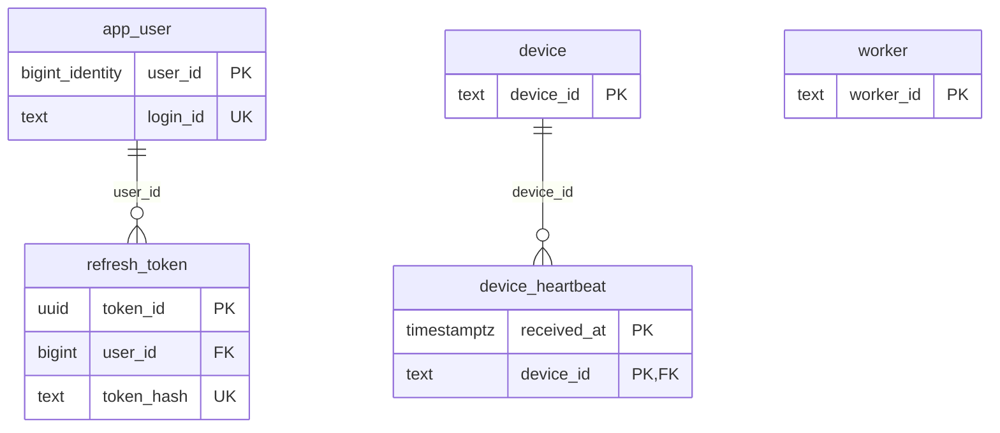

다른 묶음에서 이 묶음을 참조하는 테이블: `action_ticket`, `action_ticket_history`, `agentic_report`, `analysis_job`, `calibration_run`, `calibration_verification`, `calibration_version`, `clip_access_log`, `config_bundle`, `event_ack`, `event_close`, `event_escalation`, `job_lease`, `layout_plan`, `media_clip_retention`, `notification`, `operator_qa`, `push_subscription`, `report`, `scale_reference`, `scene_version`, `sim.evaluation_run`, `sim.placement_recommendation`, `sim.trajectory_plan`, `sim.what_if_scenario`, `static_object`, `test_push`, `upload_grant`, `vlm_assessment`, `watch_alert`, `watch_binding`, `watch_impact`, `watch_registrant`, `work_schedule`, `zone`.

## 3. B. 구성·기준 데이터

11.1. 수정하지 않고 새 버전을 추가한다(11.4-1).

| 테이블 | 단계 | 종류 |
|---|---|---|
| `site` | MVP | 일반 |
| `camera` | MVP | 일반 |
| `zone` | MVP | 버전 |
| `static_object` | MVP | 버전 |
| `rule_version` | MVP | 버전 |
| `config_bundle` | MVP | 버전 |
| `config_bundle_item` | MVP | 일반 |
| `config_ack` | MVP | 일반 |
| `tier0_endpoint` | MVP | 일반 |
| `layout_plan` | M3 | 일반 |
| `equipment_asset` | 확장 2 | 일반 |

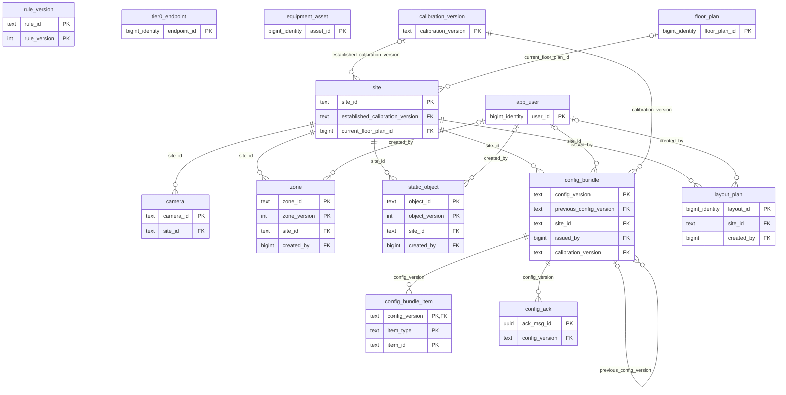

다른 묶음에서 이 묶음을 참조하는 테이블: `calibration_camera`, `calibration_run`, `calibration_version`, `coverage_guide`, `floor_plan`, `region_state`, `report`, `scale_reference`, `scene_version`, `sim.evaluation_run`, `sim.trajectory_plan`, `sim.what_if_scenario`, `work_schedule`.

## 4. C. 보정·설치

4장, 12.6 보정·실측 정물·설치 안내·BEV. 11장에 없어 추가.

| 테이블 | 단계 | 종류 |
|---|---|---|
| `calibration_version` | MVP | 버전 |
| `calibration_camera` | MVP | 일반 |
| `calibration_run` | M1 | 일반 |
| `calibration_verification` | M1 | 일반 |
| `scale_reference` | M1 | 일반 |
| `calibration_scale_check` | M1 | 일반 |
| `coverage_guide` | MVP | 일반 |
| `floor_plan` | MVP | 일반 |
| `scene_version` | MVP | 버전 |

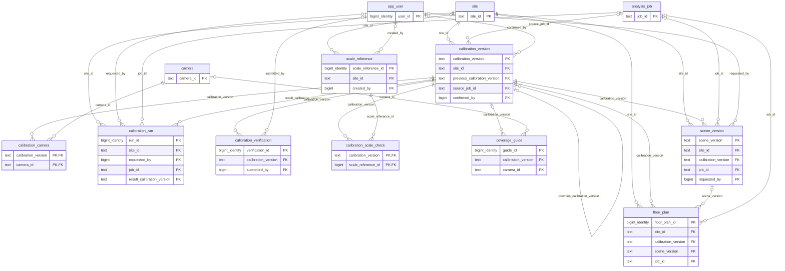

다른 묶음에서 이 묶음을 참조하는 테이블: `config_bundle`, `region_state`, `site`.

## 5. D. 시계열 관측

11.2. 볼륨이 큰 것은 TimescaleDB hypertable.

| 테이블 | 단계 | 종류 |
|---|---|---|
| `world_track_state` | MVP | hypertable |
| `skeleton_3d` | MVP | hypertable |
| `system_health` | MVP | hypertable |
| `system_metric` | MVP | hypertable |
| `observation_summary` | M1 | 일반 |

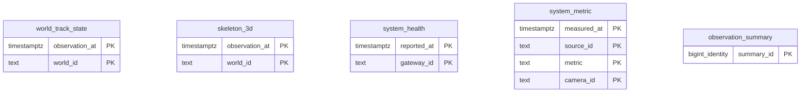

## 6. E. 이벤트·조치

11.3. LIVE 이벤트 정본은 Tier 0 저널이고 EC2 는 받아 저장만 한다(FR-95).

| 테이블 | 단계 | 종류 |
|---|---|---|
| `risk_event` | MVP | 일반 |
| `risk_event_update` | MVP | 일반 |
| `event_ack` | MVP | 일반 |
| `event_close` | MVP | 일반 |
| `event_escalation` | M3 | 일반 |
| `journal_cursor` | MVP | 일반 |
| `event_frame` | M3 | 일반 |
| `action_ticket` | M2 | 일반 |
| `action_ticket_history` | M2 | 일반 |
| `media_clip` | MVP | 일반 |
| `media_clip_retention` | MVP | 일반 |
| `clip_access_log` | MVP | 일반 |
| `upload_grant` | MVP | 일반 |

```mermaid
erDiagram
    risk_event {
        uuid event_id PK
        text source UK
        uuid related_event_id FK
    }
    risk_event_update {
        uuid event_id PK,FK
        int event_sequence PK
        uuid msg_id UK
        text gateway_id UK
        bigint journal_offset UK
        uuid ack_id FK
        uuid close_id FK
        uuid escalation_id FK
    }
    event_ack {
        uuid ack_id PK
        uuid event_id FK
        bigint actor_user_id FK
        text actor_device_id FK
    }
    event_close {
        uuid close_id PK
        text idempotency_key UK
        uuid event_id FK
        bigint actor_user_id FK
    }
    event_escalation {
        uuid escalation_id PK
        uuid event_id FK
        bigint assessment_id FK
        bigint actor_user_id FK
    }
    journal_cursor {
        text gateway_id PK
    }
    event_frame {
        bigint_identity frame_id PK
        uuid event_id FK
    }
    action_ticket {
        bigint_identity ticket_id PK
        uuid event_id FK
        bigint assignee_user_id FK
    }
    action_ticket_history {
        bigint_identity history_id PK
        bigint ticket_id FK
        bigint actor_user_id FK
    }
    media_clip {
        uuid clip_id PK
        uuid event_id FK,UK
        int resume_count UK
        text camera_id UK
    }
    media_clip_retention {
        bigint_identity retention_id PK
        uuid clip_id FK
        bigint actor_user_id FK
    }
    clip_access_log {
        bigint_identity access_id PK
        uuid clip_id FK
        bigint user_id FK
    }
    upload_grant {
        bigint_identity grant_id PK
        text object_key UK
        text requested_by_device FK
        bigint requested_by_user FK
    }
    app_user {
        bigint_identity user_id PK
    }
    device {
        text device_id PK
    }
    vlm_assessment {
        bigint_identity assessment_id PK
    }
    risk_event |o--o{ risk_event : "related_event_id"
    risk_event ||--o{ risk_event_update : "event_id"
    event_ack |o--o{ risk_event_update : "ack_id"
    event_close |o--o{ risk_event_update : "close_id"
    event_escalation |o--o{ risk_event_update : "escalation_id"
    risk_event ||--o{ event_ack : "event_id"
    app_user |o--o{ event_ack : "actor_user_id"
    device |o--o{ event_ack : "actor_device_id"
    risk_event ||--o{ event_close : "event_id"
    app_user ||--o{ event_close : "actor_user_id"
    risk_event ||--o{ event_escalation : "event_id"
    vlm_assessment ||--o{ event_escalation : "assessment_id"
    app_user ||--o{ event_escalation : "actor_user_id"
    risk_event ||--o{ event_frame : "event_id"
    risk_event ||--o{ action_ticket : "event_id"
    app_user |o--o{ action_ticket : "assignee_user_id"
    action_ticket ||--o{ action_ticket_history : "ticket_id"
    app_user |o--o{ action_ticket_history : "actor_user_id"
    risk_event ||--o{ media_clip : "event_id"
    media_clip ||--o{ media_clip_retention : "clip_id"
    app_user |o--o{ media_clip_retention : "actor_user_id"
    media_clip ||--o{ clip_access_log : "clip_id"
    app_user ||--o{ clip_access_log : "user_id"
    device |o--o{ upload_grant : "requested_by_device"
    app_user |o--o{ upload_grant : "requested_by_user"
```

다른 묶음에서 이 묶음을 참조하는 테이블: `agentic_report`, `analysis_job`, `notification`, `vlm_assessment`, `watch_impact`.

## 7. F. 알림

10장, 11.3 notification, 12.6 푸시.

| 테이블 | 단계 | 종류 |
|---|---|---|
| `notification` | M1 | 일반 |
| `push_subscription` | M1 | 일반 |
| `test_push` | M1 | 일반 |
| `push_receipt` | M1 | 일반 |

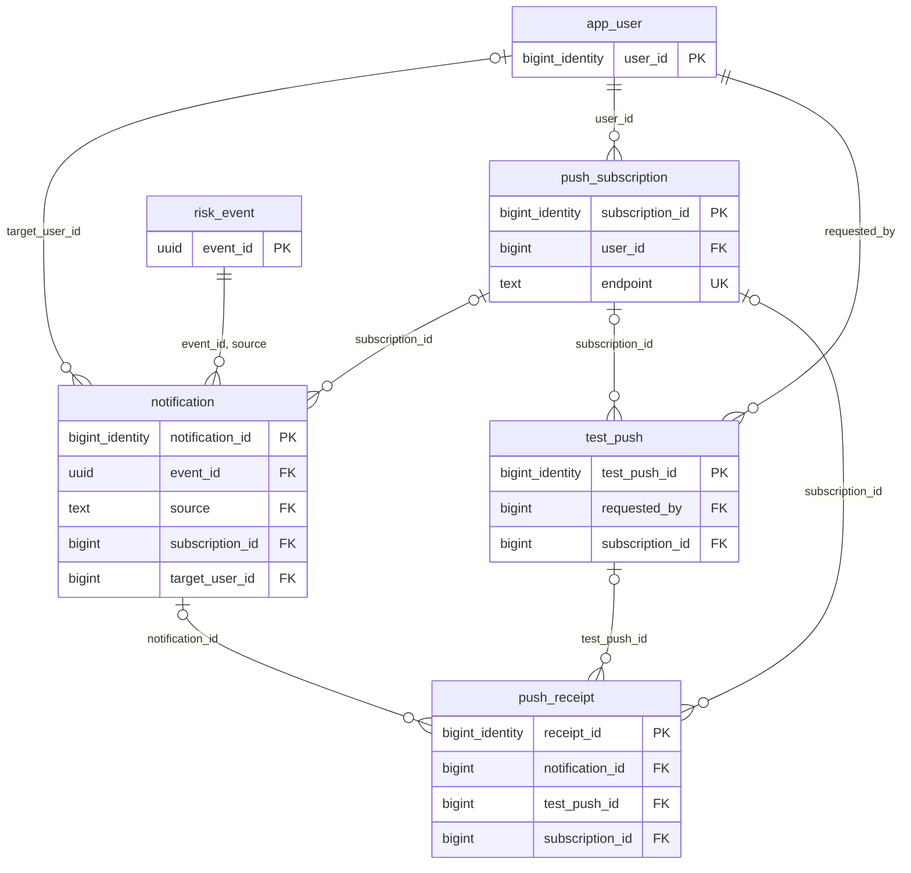

다른 묶음에서 이 묶음을 참조하는 테이블: `watch_alert`.

## 8. G. 분석 워커 작업

I5 작업 대여(12.5). 11장에 없어 추가.

| 테이블 | 단계 | 종류 |
|---|---|---|
| `analysis_job` | MVP | 일반 |
| `job_lease` | MVP | 일반 |

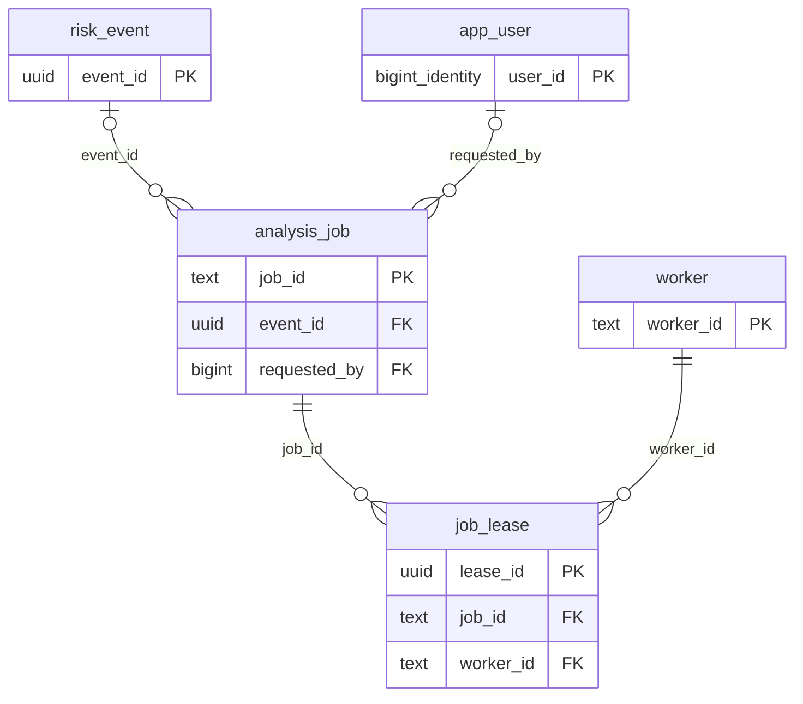

다른 묶음에서 이 묶음을 참조하는 테이블: `agentic_report`, `calibration_run`, `calibration_version`, `floor_plan`, `report`, `scene_version`, `vlm_assessment`.

## 9. H. AI 결과·보고서

11.3 vlm_assessment·report, 5.4 RAG.

| 테이블 | 단계 | 종류 |
|---|---|---|
| `vlm_assessment` | M3 | 일반 |
| `report` | M3 | 일반 |
| `rag_clause` | M3 | 일반 |

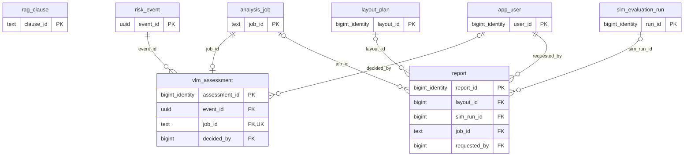

다른 묶음에서 이 묶음을 참조하는 테이블: `event_escalation`.

## 10. I. 계획·시뮬레이션 (sim 스키마)

11.3 "PLANNED·WHAT_IF 결과는 sim.*", 8.3, 부록 C.2·C.4.

| 테이블 | 단계 | 종류 |
|---|---|---|
| `sim.evaluation_run` | M3 | 일반 |
| `sim.risk_result` | M3 | 일반 |
| `sim.trajectory_plan` | 확장 2 | 일반 |
| `sim.what_if_scenario` | 확장 4 | 일반 |
| `sim.visibility_result` | 확장 4 | 일반 |
| `sim.placement_recommendation` | 확장 4 | 일반 |

```mermaid
erDiagram
    sim_evaluation_run {
        bigint_identity run_id PK
        bigint layout_id FK
        bigint trajectory_plan_id FK
        bigint scenario_id FK
        text config_version FK
        bigint requested_by FK
    }
    sim_risk_result {
        bigint_identity result_id PK
        bigint run_id FK
    }
    sim_trajectory_plan {
        bigint_identity plan_id PK
        text site_id FK
        bigint asset_id FK
        bigint created_by FK
    }
    sim_what_if_scenario {
        bigint_identity scenario_id PK
        text site_id FK
        bigint base_layout_id FK
        bigint created_by FK
    }
    sim_visibility_result {
        bigint run_id PK,FK
        int cell_id PK
    }
    sim_placement_recommendation {
        bigint_identity recommendation_id PK
        bigint run_id FK
        bigint decided_by FK
    }
    app_user {
        bigint_identity user_id PK
    }
    config_bundle {
        text config_version PK
    }
    equipment_asset {
        bigint_identity asset_id PK
    }
    layout_plan {
        bigint_identity layout_id PK
    }
    site {
        text site_id PK
    }
    layout_plan |o--o{ sim_evaluation_run : "layout_id"
    sim_trajectory_plan |o--o{ sim_evaluation_run : "trajectory_plan_id"
    sim_what_if_scenario |o--o{ sim_evaluation_run : "scenario_id"
    config_bundle |o--o{ sim_evaluation_run : "config_version"
    app_user |o--o{ sim_evaluation_run : "requested_by"
    sim_evaluation_run ||--o{ sim_risk_result : "run_id"
    site ||--o{ sim_trajectory_plan : "site_id"
    equipment_asset |o--o{ sim_trajectory_plan : "asset_id"
    app_user |o--o{ sim_trajectory_plan : "created_by"
    site ||--o{ sim_what_if_scenario : "site_id"
    layout_plan |o--o{ sim_what_if_scenario : "base_layout_id"
    app_user |o--o{ sim_what_if_scenario : "created_by"
    sim_evaluation_run ||--o{ sim_visibility_result : "run_id"
    sim_evaluation_run ||--o{ sim_placement_recommendation : "run_id"
    app_user |o--o{ sim_placement_recommendation : "decided_by"
```

다른 묶음에서 이 묶음을 참조하는 테이블: `agentic_report`, `report`.

## 11. J. 확장: 에이전틱·공정

부록 C.3·C.5.

| 테이블 | 단계 | 종류 |
|---|---|---|
| `agentic_report` | 확장 3 | 일반 |
| `operator_qa` | 확장 3 | 일반 |
| `work_schedule` | 확장 5 | 일반 |

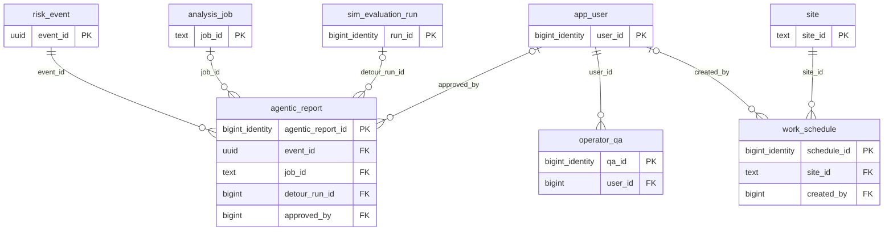

## 12. K. 확장: 워치

부록 C.6. 11.2·11.3 의 channel_state·watch_feature·watch_binding.

| 테이블 | 단계 | 종류 |
|---|---|---|
| `watch_registrant` | 확장 | 일반 |
| `watch_binding` | 확장 | 일반 |
| `channel_state` | 확장 | hypertable |
| `watch_feature` | 확장 | hypertable |
| `watch_alert` | 확장 | 일반 |
| `watch_impact` | 확장 | 일반 |

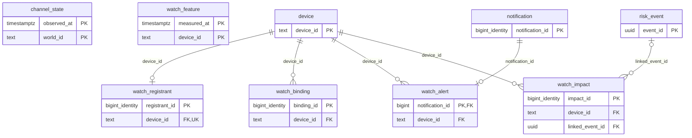

## 13. L. 확장: PPE·정적 공간 변화

부록 C.7·C.8. ppe_state·region_state.

| 테이블 | 단계 | 종류 |
|---|---|---|
| `ppe_state` | 확장 | hypertable |
| `region_state` | 확장 | 일반 |

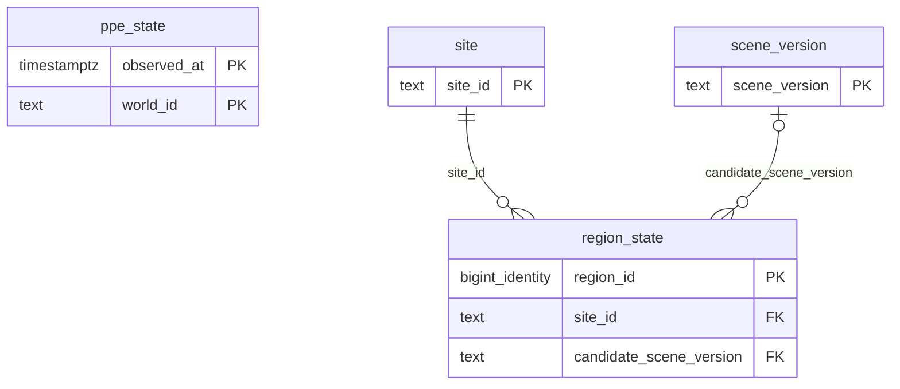

## 관계와 키에서 정한 것

| 항목 | 결정 | 근거 |
|---|---|---|
| 시각 컬럼 | `timestamptz`(UTC). 계약의 UTC int64 ms 는 EC2 수신 경계에서 변환하고 이름의 `_ms` 를 `_at` 으로 바꾼다. 길이(`*_ms`)는 `int` | hypertable 시간 컬럼, 11.4 |
| hypertable 참조 | FK 로 참조하지 않고 버전 ID·`world_id` 는 논리 참조만 둔다. hypertable 쪽에서 일반 테이블로 거는 FK 는 둔다 | 11장 첫머리 |
| 버전 테이블 | `zone`·`static_object`·`rule_version`·`calibration_version`·`scene_version` 은 수정하지 않고 새 버전을 추가하며 `valid_from`·`valid_to` 를 둔다. `zone` 은 (`zone_id`, `zone_version`) 복합 PK | 11.4-1, 리플레이 |
| LIVE 이벤트 | `risk_event.event_id`(UUIDv7) PK. 전이는 `risk_event_update` 에 (`event_id`, `event_sequence`) PK, 저널 위치 (`gateway_id`, `journal_offset`) 유일로 중복을 막는다 | FR-95, 3.2 |
| 알림은 LIVE 만 | `notification` 은 (`event_id`, `source`) 복합 FK 로 `risk_event` 의 (`event_id`, `source`) 유일 키를 참조하고 `source` 를 CHECK(LIVE) 로 묶는다 | 11.4-3 |
| 운영자 확인·종료·상향 | 명령·결과는 `event_ack`·`event_close`·`event_escalation` 에 두고, Tier 0 가 확정한 전이 행(`risk_event_update`)이 그 행을 FK 로 가리킨다. 등급은 EC2 가 직접 바꾸지 않는다 | 3.2, 16장(상향 의견 적용) |
| 클립 | `media_clip` 은 (`event_id`, `resume_count`, `camera_id`) 유일. 재개마다 새 구간 | 11.3, `media_clip`(I1) |
| 계획·시뮬레이션 | PLANNED·WHAT_IF 결과는 `sim` 스키마의 별도 테이블. `risk_event.source` 는 LIVE·REPLAY 만 | 11.3, 11.4 |
| 열거값 | PostgreSQL enum 대신 `text` + CHECK | Flyway 로 값 추가가 쉽다 |
| hypertable 보관·압축 | 좌표·골격·health 는 상시 삭제 없이 7일 뒤 압축, `system_metric`·`device_heartbeat` 는 30일. 디스크 70% 초과 시 `skeleton_3d` 30일 | 11.5, 16장, EC2 디스크 320 GB. 추정은 `db-verification.md` 6장 |
| 운영자 종료 멱등 키 | `event_close.idempotency_key`(유일)에 REST 요청 키, `close_id` 는 EC2 발급 PK | 12.6, 16장 |

## 검사한 것

- `db-tables.md` 를 만든 정의에서 자동으로 확인했다: FK 대상 테이블·컬럼이 모두 있다, hypertable 을 FK 로 참조하는 테이블이 없다, 묶음 유일 키(`UQ(이름)`)는 컬럼이 2개 이상이다, 복합 FK 는 대상에 같은 묶음 유일 키가 있다.
- 이 검사에서 `risk_event` 의 (`event_id`, `source`) 유일 키와 `media_clip` 의 (`event_id`, `resume_count`, `camera_id`) 유일 키에 `event_id` 가 빠진 것을 찾아 고쳤다.

## 남은 일

- 4단계 검증(API 행별 읽기·쓰기 매핑, 리플레이 질의, 보관·파기, 출처)은 [`db-verification.md`](db-verification.md) 에 있다. 거기서 나온 결정 사항(초기 데이터·관리 명령, 클립 삭제 방법 등)을 정하면 이 그림과 `db-tables.md` 를 고친다.
- 5단계(후속 이슈): 검토가 끝난 MVP·M1 테이블로 `V1__init.sql`.
- 기업·공사 계정 계층(부록 C.9)을 채택하면 11장 `site`(World 좌표계 정의)와 공사 개념의 이름을 나누고 이 그림을 고친다.
