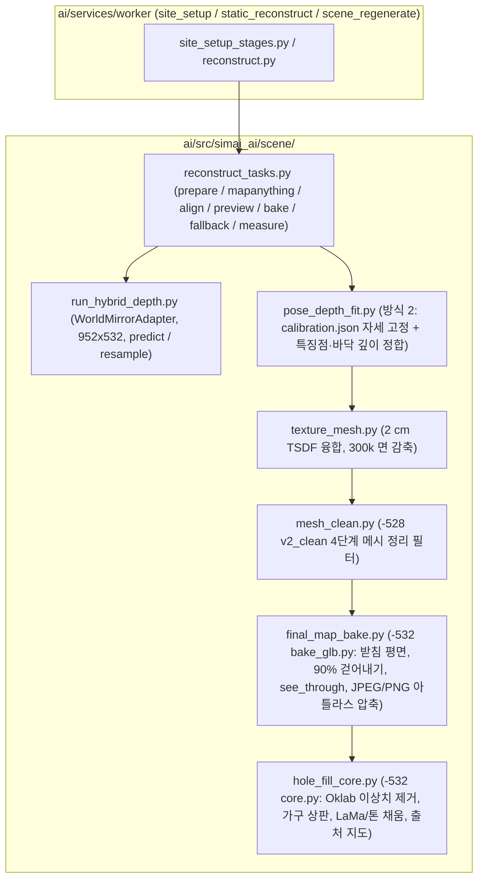
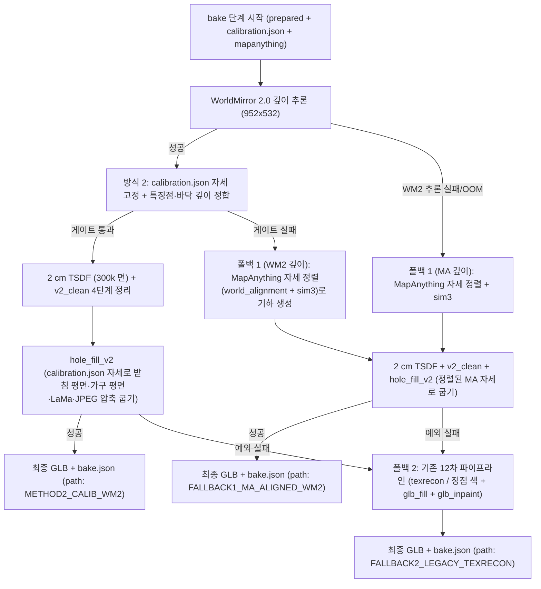

# 최종 정적 3D 맵 세팅 파이프라인 통합 설계 (S15P31A101-539)

- **티켓**: `S15P31A101-539` (Owner: Argon)
- **관련 명세**: 명세 3.2 (프로세스 분리·GPU 예산), 3.12 (컨테이너·가중치), 5.3 (정적 3D 복원·Visual Geometry), 15.1 (G4 지표), 20.2·20.4 (실험·산출물 규칙)
- **선행 티켓·설계 문서**:
  - `-528`: 기하·텍스처 벤치마크 및 4단계 메시 정리 필터 (`ai/experiments/geometry_bench/v2_clean.py`)
  - `-532`: 받침 평면·가구 상판 평면·LaMa/톤 채움·아틀라스 압축 최종 GLB 파이프라인 (`ai/experiments/hole_fill_v2/`, 브랜치 `S15P31A101-532-final-glb` @ `9289cac2`)
  - `-534`: 뷰어 시점 의존 텍스처(VDT) 설계 (`docs/design/viewer-view-dependent-texture.md`)
  - `-535`: MapAnything–보정 World 정렬 비교 (`C:/Users/SSAFY/simai-local/align-535/`)
  - `-537`: 다중 시점 자세 조건 깊이 어댑터 `WorldMirror 2.0` (`ai/experiments/static_scene/run_hybrid_depth.py`)

---

## 1. 현행 운영 파이프라인 조사

### 1.1 `simai_ai.scene` 단계별 구조 (`reconstruct_tasks.py` / `reconstruct.py`)

현재 운영 정적 3D 복원(`StaticReconstructor` 및 `ProductionSiteSetupStages`)은 작업 폴더(`root`) 하나를 공유하며 `ProcessStages` 로 다음 하위 단계들을 순서대로 호출한다:

| 단계 | 진입점 (`reconstruct_tasks.py`) | 현재 동작 | 한계 및 교체 대상 |
|---|---|---|---|
| `prepare` | `prepare(root)` | `job.json` + `calibration.json` + `images/*.image` 검증, 왜곡 보정(`K_undistorted`), 사람 마스크 적용 후 `prepared/prepared.json` 생성 | 그대로 유지 (왜곡 보정 영상 및 `K_undistorted` 정본 생성) |
| `mapanything` | `mapanything(root)` | `run_mapanything.py` (518×294 입력, known-K) 실행 → `mapanything/raw.npz`, `cameras.json`, `pointcloud.glb`, `gridmesh.glb` 생성 | 초기 World 정의(`site_setup` (c)단계)와 폴백·보조 깊이 참조용으로 유지하되, 최종 맵 주 깊이는 **WorldMirror 2.0 (952×532)** 로 고도화 |
| `align` | `align(root)` | `align_to_calibration` 으로 MapAnything 카메라 중심을 `calibration.json` 에 유사변환(`sim3`) 정합 → `world_alignment.json` | **방식 2(기본)** 에서는 `calibration.json` 자세를 직접 고정하므로 유사변환 오차(카메라 중심 잔차 6~15 cm)를 거치지 않음. **폴백 1** 에서만 사용 |
| `preview` | `preview(root)` | `mapanything/gridmesh.glb` (또는 `pointcloud.glb`)를 `world_alignment.json` 으로 World 변환 후 Z-up → glTF Y-up 변환해 `preview/scene-preview.glb` 생성 | 그대로 유지 (`READY_FOR_ZONES` 빠른 진입용 경량 미리보기) |
| `bake` | `bake(root)` | (1) 선택적 혼합 깊이 로드(`SIMAI_HYBRID_DEPTH_ADAPTER`) → (2) `texture_mesh.geometry()` (1.5 cm TSDF, 55만 면) → (3) 외부 `texrecon` 호출 → (4) `glb_fill.fill_unobserved_regions` + `glb_inpaint.inpaint_unobserved_planes` + `glb_enhance.enhance_textured_glb` → `baked/scene.glb` | **교체 핵심**: `-537` WorldMirror 2.0 깊이 + **방식 2(`calibration.json` 자세 고정 특징점 깊이 맞춤)** + 2 cm TSDF(30만 면) + `-528` `v2_clean` 4단계 정리 + `-532` `hole_fill_v2`(받침 평면·가구 상판·LaMa·아틀라스 압축)로 교체 |
| `fallback` | `fallback(root)` | `bake` 가 `fallback_reason`(예: `texrecon` 미설치/실패)을 남기면 MapAnything 정점 색 메시를 내보냄 | 다단 폴백(**방식 2 → 폴백 1 → 폴백 2**) 체계로 재편 |
| `measure` | `measure(root)` | 벽 편차(`wall_deviation_m`), 관측 비율(`observed_surface_ratio`), `scene_output.schema.json` 조립·검증 | 선택된 복원 경로(`reconstruction_path`), 맵 카메라 자세(`map_cameras`), `SEE_THROUGH` 출처 비율까지 기록하도록 확장 |

### 1.2 워커 연결 구조 (`ai/services/worker/`)

1. **`site_setup.py` / `site_setup_stages.py` (`ProductionSiteSetupStages`)**:
   - `(a) collect`: Tier 0 가 내보낸 사람 지운 배경 묶음(`clean_backgrounds.json`) 수집 대기.
   - `(b)~(d) initialize`: `prepare` → `mapanything` → `build_world_from_pointcloud_and_poses` (바닥 Z=0, 벽 +X, 카메라 높이 축척).
   - `(e)~(f) JOINT_BA_AND_VERIFY`: `extract_tracks_from_backgrounds` (SIFT 다중 시점 특징점 매칭) + `run_stage_a_rotation_ba` (V2 Stage A 회전 BA) → 새 `calibration_version` 문서 확정 및 `publish()` 로 `root / "calibration.json"` 갱신 + S3 업로드.
   - `(g) preview` & `publish_frames`: `preview` 단계 실행 및 VLM 초안용 카메라 대표 프레임 업로드 → `READY_FOR_ZONES` 보고.
   - `(h) bake`: `BAKING_TEXTURE` 하트비트 전송 후 `self._run_stage("bake")` 실행 → 완성된 단일 `GLTF_VISUAL` (`baked/scene.glb`) 업로드 → `COMPLETED` 반환.
2. **`static_reconstruct.py` (`StaticReconstructHandler`)** 및 **`scene_regenerate.py` (`SceneRegenerateHandler`)**:
   - `SceneRegenerateHandler` 는 배경 묶음을 정제한 뒤 `AutoStaticSubmitter` 를 통해 `static_reconstruct` 작업을 제출한다.
   - `StaticReconstructHandler` 는 `StaticReconstructor.run()` (`prepare` → `mapanything` → `align` → `preview` → `bake` → `measure`)을 실행한다.
   - 따라서 `reconstruct_tasks.py` 의 `bake` 단계(및 필요 시 `worldmirror2` 깊이 추론 단계)를 고도화하면 **`site_setup`, `static_reconstruct`, `scene_regenerate` 세 경로 모두 동일한 최종 맵 파이프라인**으로 자동 연결된다.

---

## 2. 실험 코드의 운영 패키지(`ai/src/simai_ai/scene/`) 이관 구조

실험 폴더(`ai/experiments/`)를 런타임에 import 하지 않도록, 검증된 실험 코드를 `ai/src/simai_ai/scene/` 아래 정규 모듈로 이관한다.

### 2.1 모듈별 이관 매핑 표

| 원본 실험 코드 | 이관 대상 운영 모듈 | 핵심 기능 및 확정 파라미터 |
|---|---|---|
| `-537` `ai/experiments/static_scene/run_hybrid_depth.py` (`WorldMirrorAdapter`, `prepare_multiview_conditioning`, `compute_patch_aligned_hw`), `intrinsics_check.py` | `ai/src/simai_ai/scene/run_hybrid_depth.py`, `ai/src/simai_ai/scene/intrinsics_check.py` | - `WorldMirrorAdapter(variant="worldmirror2", process_res=952)` 통합 (`532×952`, 패치 크기 14 배수) - `enable_gs=False, enable_norm=False, enable_pts=False` 로 불필요한 헤드 비활성화 - `flash_attn` 부재 시 PyTorch SDPA 폴백 shim 내장 - **DA3(`da3`) 및 Pi3X(`pi3x`)는 운영 기본 경로에 넣지 않음** (`worldmirror2` 기본, 실패 시 MapAnything 깊이로 폴백) |
| (신규) 방식 2 깊이 정합기 | `ai/src/simai_ai/scene/pose_depth_fit.py` | - `calibration.json` 자세(`R, t`)와 `K_undistorted` 고정 - 보정 특징점 트랙(`extract_tracks_from_backgrounds` / 2-view 삼각측량 3D 점) + 바닥 평면(`Z=0`) + 보조 MapAnything 깊이로 카메라별 WM2 깊이 스케일·오프셋·저차 시야각 보정 적합 - 적합 잔차 측정 및 실패 임계 초과 시 폴백 1 신호 반환 |
| `-528` `ai/experiments/geometry_bench/v2_clean.py` | `ai/src/simai_ai/scene/mesh_clean.py` | - **복셀 2.0 cm (`voxel_m=0.02`), 목표 면 수 300,000 (`target_faces=300000`)** - 1단계: 열린 경계 인접 미관측 삼각형 침식 (`erosion_iters=2`) - 2단계: 비관측 소형 연결 패치 제거 (`max_unobs_patch_faces=500`) - 3단계: 긴 변(`max_edge_m = 8 * voxel_m = 0.16 m`) 및 고종횡비(`aspect > 10.0`) 스파이크 삼각형 제거 - 4단계: 비다양체 정점·변 정리 및 고립 조각(`min_component_faces=300`) 제거 |
| `-532` `ai/experiments/hole_fill_v2/core.py` (커밋 `9289cac2` 5차 포함) | `ai/src/simai_ai/scene/hole_fill_core.py` | - 카메라별 사진 화질 맵 `compute_camera_image_quality_maps` (고주파 선명도·비네팅·왜곡 가장자리 감쇠) - Oklab 색공간 다중 카메라 이상치 제거 및 정면·근접 단일 최우수 카메라 지배적 선택 (`sharp_exponent`: 벽 `12.0`, 바닥 `6.0`) - 수평 가구 상판 평면 추출·직접 굽기 (`extract_and_bake_horizontal_furniture_planes`, `z ∈ [0.28, 1.15] m`) 및 남은 가구 삼각형 재색칠 (`recolor_remaining_furniture_faces`, 인접 삼각형 가중치 스무딩 + 상판 테두리 블렌딩) - 바닥 톤 채움(`inpaint_tone_plane`) + 벽 LaMa 인페인팅(`inpaint_lama_plane`) + Lab 색감 매칭(`match_fill_to_boundary_lab`) + 10 cm 경계 페더링(`feather_observed_filled_boundary`) |
| `-532` `ai/experiments/hole_fill_v2/bake_glb.py` (커밋 `9289cac2` 5차 포함) | `ai/src/simai_ai/scene/final_map_bake.py` | - 바닥(`5.0 mm/texel`) + 4벽(`3.0 mm/texel`) 받침 평면(Backing Plane) 생성 및 5 cm 깊이 게이트(`DEPTH_GATE_M=0.05`) 투영 - 개구부(`see_through`, 평면보다 `15 cm` 이상 먼 깊이 관측 영역) 비채움 및 알파 마스크(`alphaMode="MASK"`, `SRC_SEE_THROUGH=5`) 처리 - 받침 평면이 `observed_projection >= 90%`(`MIN_OBS_COVERAGE_R3=0.90`)로 받쳐주는 곳에서만 평면 중복 메시 삼각형 제거 (`strip_planar_mesh_faces`, 거리 `<= 6 cm`, 각도 `<= 25°`) - 불투명 아틀라스(바닥·가구·남은 메시) **JPEG (quality=92)** 인코딩 + 알파 아틀라스(벽) **PNG (level=9)** 인코딩 (58.5 MB → 38.5 MB 절감) |

---

## 3. 방식 2 (기본): `calibration.json` 자세 고정 + 특징점 기반 깊이 맞춤

### 3.1 배경 및 5차(`-532`) 핵심 교훈

`-532` 4차 실험에서 테이블·벤치 상판에 인접 가구 색이 섞여 들어간 근본 원인을 진단(`diag_tables.py`)한 결과:
- 기하(`wm2_pose_2cm_clean`)는 MapAnything 자세 + `align_views('sim3')` + `world_alignment.json` (`ma_sim3`)으로 만들어졌고,
- 텍스처(`hole_fill_v2`)는 `calibration.json` 의 PnP 자세(`vdt`)로 투영되었다.
- 두 카메라 자세 집합 사이에 카메라 중심 **8~29 cm** 차이(수평 시프트 최대 **12.6~32.5 cm**, 카메라 간 상판 Z 분산 **6~7 cm**)가 존재해, 한 카메라의 테이블 삼각형에 다른 카메라의 옆 테이블/벤치 픽셀이 투영되었다.

따라서 **기하 복원, 텍스처 굽기, 뷰어 VDT 가 반드시 동일한 단일 카메라 자세 집합을 써야 한다.**
- **방식 2 (기본)** 는 아예 처음부터 Tier 0 정본인 **`calibration.json` 의 카메라 자세(`R_c, t_c`)를 고정**하고, 깊이 모델(WorldMirror 2.0)의 카메라별 깊이만 `calibration.json` 좌표계의 3D 특징점·바닥 평면에 맞춰 스케일·오프셋을 교정한 뒤 TSDF 를 융합한다.
- 이 방식이 성공하면 **기하 = 텍스처 = 뷰어 VDT = Tier 0 `calibration.json` 정본 World 자세**가 되어 자세 불일치가 **0 m / 0°** 가 된다.
- **`calibration.json` 불변 규칙 준수**: `calibration.json` 은 읽기만 하며 절대 수정하거나 덮어쓰지 않는다(AGENTS.md 규칙 1·6).

### 3.2 입력 데이터

카메라 집합 $c \in \{1, \dots, M\}$ ($M=4$, `cam_A..D`)에 대해:
1. **고정 카메라 자세 및 내부 파라미터**:
   - `calibration.json` 의 월드→카메라 회전 $R_c \in \text{SO}(3)$, 이동 $t_c \in \mathbb{R}^3$, 카메라 중심 $C_c = -R_c^\top t_c \in \mathbb{R}^3$.
   - `prepared/prepared.json` 의 왜곡 보정된 영상 $I_c$ (해상도 $H \times W = 1296 \times 2304$) 및 핀홀 내부 파라미터 $K_c \in \mathbb{R}^{3 \times 3}$.
   - 카메라→월드 변환 행렬:
     $$T_c^{\text{c2w}} = \begin{bmatrix} R_c^\top & C_c \\ \mathbf{0}^\top & 1 \end{bmatrix}$$
2. **WorldMirror 2.0 다중 시점 예측 깊이**:
   - `WorldMirrorAdapter` 에 각 뷰의 왜곡 보정 영상 $I_c$, 내부 파라미터 $K_c$, 그리고 조건 자세 $T_c^{\text{c2w}}$ 를 입력해 얻은 원본 해상도($1296 \times 2304$) Z-깊이 맵 $d_c^{\text{WM2}}(u, v) > 0$ 및 신뢰도 맵 $\text{conf}_c(u, v)$.
   - WorldMirror 2.0 의 출력 깊이는 모델 내부 정규화 단위 정육면체(`[0, 1]`) 스케일이므로 미터 단위 변환이 필요하다.
3. **공통 특징점 3D 정본 점구름 $\mathcal{P}_{\text{feat}}$**:
   - `simai_ai.calibration.extrinsics.joint_ba_v2.extract_tracks_from_backgrounds` (또는 세팅 묶음의 `tracks_doc`)로 인접 카메라 쌍 $(a, b) \in \{(A,B), (B,C), (C,D), (D,A)\}$ 에서 SIFT 특징점을 매칭한다.
   - 에피폴라 Sampson 오차 게이트(`essential_threshold_px = 1.0`), 최소 교차 시차각 $\theta_{ab} \ge 2.0^\circ$, 양쪽 카메라 양수 깊이($z > 0.5\text{ m}$), 재투영 오차 $\| \pi(K_c, R_c, t_c, X_j) - (u_{c,j}, v_{c,j}) \|_2 \le 3.0\text{ px}$ 를 통과한 삼각측량 3D 점 $X_j \in \mathbb{R}^3$ 와 그 관측 픽셀 $(u_{c,j}, v_{c,j})$ 를 수집한다.
   - 사람 지운 배경의 유효 마스크(`valid_mask`, 채움/미관측 영역 제외) 안에 있는 특징점만 사용한다.

### 3.3 카메라별 깊이 맞춤 수식

각 카메라 $c$ 에서 특징점 $X_j$ 의 `calibration.json` 기준 카메라 좌표 Z-깊이는:
$$z_{c,j}^{\text{cal}} = \mathbf{e}_3^\top \bigl(R_c (X_j - C_c)\bigr) = \bigl(R_c X_j + t_c\bigr)_z$$

해당 픽셀 $(u_{c,j}, v_{c,j})$ 에서 역깊이 쌍선형 보간(`sample_depth`)으로 읽은 WorldMirror 2.0 깊이를 $d_{c,j} = d_c^{\text{WM2}}(u_{c,j}, v_{c,j})$ 라 하자. 정규화 시선 좌표를
$$\tilde{u} = \frac{u - c_{x,c}}{f_{x,c}}, \qquad \tilde{v} = \frac{v - c_{y,c}}{f_{y,c}}$$
로 정의할 때, 보정된 미터 깊이 $\hat{z}_c(u, v)$ 의 후보 모델을 다음과 같이 계층화한다:

1. **모델 M1 (1자유도 비례 스케일)**:
   $$\hat{z}_c^{(1)}(u, v) = s_c \, d_c^{\text{WM2}}(u, v)$$
   초기값 $s_c^{(0)} = \text{median}_j (z_{c,j}^{\text{cal}} / d_{c,j})$.
2. **모델 M2 (2자유도 스케일 + 오프셋)**:
   $$\hat{z}_c^{(2)}(u, v) = s_c \, d_c^{\text{WM2}}(u, v) + b_c$$
3. **모델 M4 (4자유도 스케일 + 오프셋 + 1차 시선 기울기 보정)**:
   $$\hat{z}_c^{(4)}(u, v) = \bigl(s_c + \alpha_c \tilde{u} + \beta_c \tilde{v}\bigr) d_c^{\text{WM2}}(u, v) + b_c$$
   (`calibration.json` 회전 $R_c$ 와 깊이 모델 내부 암묵적 시선 방향 사이의 미세한 $0.5^\circ \sim 1.5^\circ$ 기울기 차이를 깊이 도메인에서 1차 근사로 흡수한다.)

#### 목적 함수 및 로버스트 적합 절차

1. **RANSAC 인라이어 선별**:
   - 표본 쌍 $\{(d_{c,j}, z_{c,j}^{\text{cal}})\}_{j=1}^{N_c}$ 에 대해 상대 오차
     $$r_{c,j} = \frac{|\hat{z}_{c,j} - z_{c,j}^{\text{cal}}|}{z_{c,j}^{\text{cal}}} \le \tau_{\text{rel}} \quad (\tau_{\text{rel}} = 0.05)$$
     를 만족하는 최대 인라이어 집합 $\mathcal{I}_c$ 를 찾는다.
2. **바닥 평면($Z = 0$) 결합 제약**:
   - $s_c^{(0)} d_c^{\text{WM2}}$ 로 역투영한 3D 점들 중 바닥 후보 영역($|Z_{\text{init}}| \le 0.15\text{ m}$, 법선 $+Z$ 와 각도 $\le 20^\circ$)에서 RANSAC 으로 바닥 인라이어 픽셀 표본 $(u_{c,k}, v_{c,k})$ 를 추출한다.
   - `calibration.json` 자세에서 광선 $\mathbf{r}_{c,k} = R_c^\top K_c^{-1} [u_{c,k}, v_{c,k}, 1]^\top$ 이 World 바닥 평면 $Z = 0$ 과 만나는 이론적 카메라 Z-깊이는:
     $$z_{c,k}^{\text{floor}} = -\frac{C_{c,z}}{(\mathbf{r}_{c,k})_z} \quad ((\mathbf{r}_{c,k})_z < -0.1)$$
   - 이 바닥 표본 쌍 $\{(d_{c,k}, z_{c,k}^{\text{floor}})\}$ 을 가중치 $w_{\text{floor}} = 0.5$ 로 특징점 인라이어 집합과 함께 Huber 로버스트 최소제곱($\delta_{\text{rel}} = 0.02$)에 넣어 $(s_c, b_c, \alpha_c, \beta_c)$ 를 푼다:
     $$\min_{\theta_c} \sum_{j \in \mathcal{I}_c} \rho_{\text{Huber}}\!\left(\frac{\hat{z}_c(u_{c,j}, v_{c,j}; \theta_c) - z_{c,j}^{\text{cal}}}{z_{c,j}^{\text{cal}}}\right) + w_{\text{floor}} \sum_{k \in \mathcal{F}_c} \rho_{\text{Huber}}\!\left(\frac{\hat{z}_c(u_{c,k}, v_{c,k}; \theta_c) - z_{c,k}^{\text{floor}}}{z_{c,k}^{\text{floor}}}\right) + \lambda_{\text{reg}} \bigl(\alpha_c^2 + \beta_c^2 + (b_c / \bar{z}_c)^2\bigr)$$
     ($\lambda_{\text{reg}} = 10^{-2}$ 로 과도한 오프셋·기울기 발산을 억제하며, $|b_c| \le 0.25\text{ m}, \; |\alpha_c|, |\beta_c| \le 0.08 \, s_c$ 범위로 클리핑한다.)
3. **과적합 방지 모델 선택**:
   - 공간 격자(4×4) 분할 20% 홀드아웃 특징점에서 `M4` 의 중앙 상대 오차가 `M2` 대비 개선되고 인라이어 특징점 수가 $N_c^{\text{inlier}} \ge 40$ (점유 셀 $\ge 6$)일 때만 `M4` 를 채택한다.
   - $20 \le N_c^{\text{inlier}} < 40$ 이면 `M2` (스케일+오프셋)를 채택한다.
4. **특징점 부족 시 보조 참조 결합**:
   - 특정 카메라에서 유효 특징점 인라이어가 $N_c^{\text{inlier}} < 20$ 이면, 정렬된 MapAnything 깊이(`M_geom` 적용 후 유효 영역, 최소 500 표본)와 바닥 평면($Z=0$) 표본을 보조 참조로 결합하여 `M2`/`M1` 정합을 수행한다.

### 3.4 방식 2 품질 검증 게이트 및 실패(폴백 전환) 판정 기준

모든 카메라 $c \in \{1, \dots, 4\}$ 에 대해 정합이 끝난 후 다음 4가지 게이트를 검사한다:

| 게이트 항목 | 측정 지표 | 통과 기준 (방식 2 채택) | 실패 시 동작 |
|---|---|---|---|
| 1. 전 카메라 정합 성공 | 유효 정합 카메라 수 | 4대 전체 ($s_c > 0$, 유효 픽셀 비율 $\ge 50\%$) | 즉시 **폴백 1** 전환 |
| 2. 특징점 깊이 절대·상대 잔차 | 카메라별 절대 잔차 중앙값 $\text{median}_j |\hat{z}_{c,j} - z_{c,j}^{\text{cal}}|$ 및 상대 잔차 중앙값 $\text{median}_j |\hat{z}_{c,j} - z_{c,j}^{\text{cal}}| / z_{c,j}^{\text{cal}}$ | 모든 카메라 **중앙 $\|\Delta z\| \le 0.03\text{ m}$ (3.0 cm)** **그리고** **상대 잔차 중앙값 $\le 0.02$ (2.0%)**, 인라이어 비율 $\ge 0.45$ | 즉시 **폴백 1** 전환 |
| 3. 바닥 평면 정합도 | 융합 점구름/메시 바닥 영역($|Z| \le 0.12\text{ m}$)의 World $Z$ 중앙값 및 기울기 | $|Z_{\text{floor, med}}| \le 0.04\text{ m}$ (4 cm) 및 바닥 법선 기울기 $\le 2.0^\circ$ | 즉시 **폴백 1** 전환 |
| 4. 다중 카메라 동시 관측 표면 3D 일치도 | 2대 이상 카메라가 동시에 보는 특징점·바닥·수평 상판 표면에서 정합 후 역투영 3D 위치(및 상판 높이 $Z$) 차이 중앙값 | 동시 관측 표면 **3D 위치·높이 차 중앙값 $\le 0.03\text{ m}$ (3.0 cm)** (5차 진단의 상판 높이 차 6~7 cm 재발 시 실패 판정; `conflict_ratio` $\le 15\%$ 는 참고 지표로 기록) | 즉시 **폴백 1** 전환 |

---

## 4. 폴백 경로 순서 및 산출물 기록

세팅(`site_setup`) 및 정적 복원(`static_reconstruct`)의 `bake` 단계는 다음 3단계 순서로 실행되며, 앞 경로가 실패하면 작업을 중단하지 않고 다음 폴백 경로로 자동 전환한다:

### 4.1 경로별 상세 규약

1. **기본 경로 (`METHOD2_CALIB_WM2`)**:
   - **기하 자세**: `calibration.json` 의 카메라 자세(`R, t`) 그대로 고정.
   - **깊이**: WorldMirror 2.0 (`952×532`) + 특징점·바닥 깊이 정합(`pose_depth_fit.py`).
   - **메시 생성 및 정리**: 2 cm TSDF (`target_faces=300000`) → `mesh_clean.py` (`v2_clean` 4단계 필터).
   - **텍스처 및 평면 굽기**: `final_map_bake.py` (`hole_fill_v2` 1~5차 통합). 이때 투영 카메라 자세도 **`calibration.json` 자세**를 그대로 사용.
   - **뷰어 전달 카메라 자세 (`map_cameras`)**: `calibration.json` 자세와 동일.

2. **폴백 1 (`FALLBACK1_MA_ALIGNED_WM2` / `FALLBACK1_MA_ALIGNED_NATIVE`)**:
   - **전환 조건**: 방식 2의 정합 게이트 실패 시(또는 WM2 추론 실패 시 MapAnything 깊이로 대체).
   - **기하 자세**: MapAnything 카메라 자세에 `align_to_calibration` 유사변환(`M_geom`)을 적용하고 `multi_cam.align_views("sim3")` 로 교차 시점 깊이 정렬한 자세 $T_c^{\text{ma\_aligned}} = M_{\text{geom}} T_c^{\text{ma\_sim3}}$.
   - **핵심 규칙 (5차 교훈 반영)**: 폴백 1에서는 `final_map_bake.py` 가 텍스처를 투영할 때도 `calibration.json` 자세가 아니라 **기하를 만든 $T_c^{\text{ma\_aligned}}$ 자세**를 그대로 사용하여 기하와 텍스처 사이의 8~29 cm 오차를 원천 차단한다.
   - 또한 산출물(`bake.json`, GLB `extras.simai.map_cameras`, `scene_output.json`)에 이 **$T_c^{\text{ma\_aligned}}$ 자세 사본**을 함께 기록하여, 뷰어 VDT 도 맵과 100% 일치하는 카메라 자세를 쓸 수 있게 한다(단, Tier 0 의 `calibration.json` 정본은 절대 덮어쓰지 않는다).

3. **폴백 2 (`FALLBACK2_LEGACY_TEXRECON`)**:
   - **전환 조건**: `final_map_bake.py` 에서 예기치 않은 런타임 오류 발생 시.
   - **동작**: 기존 12차 운영 파이프라인(`texture_mesh.bake` + `texrecon` + `glb_fill` + `glb_inpaint` + `glb_enhance`, 또는 `texrecon` 부재 시 정점 색 `fallback`)을 그대로 실행하여 세팅 실패를 막는다.

---

## 5. 시간·GPU 예산 (현장 세팅 시간 내)

현장 세팅(`site_setup`)에서 `BAKING_TEXTURE` 단계의 타임아웃은 `STAGE_TIMEOUTS_S["bake"] = 1800.0` 초(30분)이며, 전체 세팅 작업 대여 시간 상한(서버 기본 900초, 연장 가능) 안에 여유 있게 끝나야 한다.
12차·`-537`·`-532` 실측에 기반한 단계별 시간 및 GPU 메모리 예산은 다음과 같다:

| 세팅 하위 단계 | 실행 장치 | 예상 소요 시간 (Pod) | 노트북 실측 시간 | Peak VRAM | 비고 |
|---|---|---:|---:|---:|---|
| 1. `prepare` + `mapanything` (`initialize`) | GPU (bf16) | 8 ~ 12 s | - | ~6.4 GB | 518×294 입력, 초기 World 및 회전 BA 앞단 |
| 2. `JOINT_BA_AND_VERIFY` + `preview` | CPU | 5 ~ 8 s | 4.8 s | 0 MB | SIFT 트랙 추출 + Stage A 회전 BA + 미리보기 GLB |
| 3. `worldmirror2` 깊이 추론 (`bake` 1단계) | GPU (bf16) | **14 ~ 18 s** | 15.1 s (Pod) | **9.9 GB** (9,913 MB) | 952×532 4뷰 단일 패스(`load 11.1s + infer 0.73s`), 종료 후 프로세스 분리로 VRAM 즉시 반환 |
| 4. 방식 2 깊이 정합 + 2 cm TSDF + 300k 감축 | CPU (Open3D 멀티스레드) | **35 ~ 55 s** | 62.1 s | 0 MB | `conflict 10.9s + tsdf 5.0s + decimate 41.2s` |
| 5. `mesh_clean` (`v2_clean` 4단계 필터) | CPU | **12 ~ 18 s** | 17.7 s | 0 MB | 300k → ~222k 면 정리 |
| 6. `final_map_bake` (받침 평면 + 가구 상판 + LaMa + 아틀라스 압축) | GPU (LaMa) + CPU | **40 ~ 65 s** (LaMa CUDA) / ~140 s (CPU) | 164.7 s (노트북) | **~1.8 GB** (LaMa) | 바닥 5 mm/texel 톤 채움 + 4벽 3 mm/texel LaMa + JPEG q=92 압축 |
| **`bake` 단계 합계 (3~6번)** | GPU + CPU | **약 100 ~ 155 s (~2.5분)** | **약 245 s (~4분)** | **최대 9.9 GB** | `STAGE_TIMEOUTS_S["bake"] = 1800s` 대비 10% 미만 |

- **GPU 자원 충돌 방지**:
  - `worldmirror2` 추론과 `LaMa` 인페인팅은 별도 자식 프로세스(또는 추론 직후 모델 해제 + `torch.cuda.empty_cache()`)로 실행하여 VRAM 이 누적되지 않는다.
  - Peak VRAM 9.9 GB 는 최소 사양 GPU(24 GB급) 및 통합 이미지(48~80 GB급) 예산 안에 들어가며, `simai-bootstrap` 의 워커 최소 메모리 설정(`MIN_WORKER_TORCH_FRACTION`)과도 충돌하지 않는다.

---

## 6. Docker 이미지 및 가중치 구성 (`deploy/`)

### 6.1 추가 가중치 명세 (`deploy/weights.json` 의 `static` 묶음)

**DA3는 운영에 넣지 않으며**, 정적 복원(`static`) 가중치 묶음에 **WorldMirror 2.0** 과 **LaMa** 두 가지만 추가한다.

| 이름 (`weights.json`) | 묶음 (`sets`) | 저장 경로 (`$SIMAI_ROOT/`) | 원본 (`source`) | 크기 (B) | `sha256` | 라이선스 |
|---|---|---|---|---:|---|---|
| `hy-worldmirror-2.0-model` | `["static"]` | `weights/hy-world-2.0/HY-WorldMirror-2.0/model.safetensors` | HF `tencent/HY-World-2.0` @ `d78a16c91c7a56488894a1c8de4f5c7cc28aa8b0`, file `HY-WorldMirror-2.0/model.safetensors` | 5,053,553,272 | `9fff06539d3d9e85338d7de1ffb5afffb7739fa5bf4d62b4b7c319b5ecdde54f` | Tencent HY-World 2.0 Community License Agreement |
| `hy-worldmirror-2.0-config` | `["static"]` | `weights/hy-world-2.0/HY-WorldMirror-2.0/config.json` | HF `tencent/HY-World-2.0` @ `d78a16c91c7a56488894a1c8de4f5c7cc28aa8b0`, file `HY-WorldMirror-2.0/config.json` | 842 | `5e40150577ef7d38e24d8d079a7126568a0ec9816dbfc61ebc99c67faf430ed9` | Tencent HY-World 2.0 Community License Agreement |
| `big-lama` | `["static"]` | `weights/lama/big-lama.pt` | URL `https://github.com/enesmsahin/simple-lama-inpainting/releases/download/v0.1.0/big-lama.pt` | 205,803,911 | `7ba7aa7ac37a4d41fdbbeba3a2af7ead18058552997e3a3cd1a3b2210c9e6b4c` | Apache-2.0 |

> **참고**: `hy-worldmirror-2.0-model` 의 `sha256`(`9fff06539d3d9e85338d7de1ffb5afffb7739fa5bf4d62b4b7c319b5ecdde54f`, 5,053,553,272 B) 은 HF API LFS `oid` 이며, `_weights_hash` 식(`"model.safetensors:sha256:9fff0653...\n"` 의 sha256)이 `-537` GPU 실행 기록 `depth.json` 의 `weights_hash`(`fa12bdb9b92b7addc83aecf5c3ef94a2925266bb6c7f795bf7b9c1f7b0eae906`)와 정확히 일치함을 검증했다. `hy-worldmirror-2.0-config` 의 `sha256`(`5e40150577ef7d38e24d8d079a7126568a0ec9816dbfc61ebc99c67faf430ed9`, 842 B)은 고정 revision `d78a16c9...` 의 `HY-WorldMirror-2.0/config.json` 에서, `big-lama.pt` 의 `sha256`(`7ba7aa7ac37a4d41fdbbeba3a2af7ead18058552997e3a3cd1a3b2210c9e6b4c`, 205,803,911 B)은 노트북(`C:/Users/SSAFY/simai-local/hole-fill-v2/weights/big-lama.pt`, `-532` `report.json`)에서 검증해 `deploy/weights.json` 과 `docs/data/weights.md` 에 기입했다.

### 6.2 Docker 이미지 (`deploy/tier0/Dockerfile` `unified` 및 `deploy/mapanything/Dockerfile`)

1. **WorldMirror 2.0 코드 사본 내장**:
   - `Tencent-Hunyuan/HY-World-2.0` 저장소를 고정 커밋 `WM2_COMMIT=df9988efb87bfc0f4947eb3889411cf957478b06` 으로 클론하여 `/opt/simai/worldmirror2/HY-World-2.0` (및 `mapanything` 이미지의 `/opt/mapanything/HY-World-2.0`)에 복사한다(`.git` 및 불필요한 예제 에셋 제거).
   - 환경 변수:
     - `SIMAI_WM2_REPO=/opt/simai/worldmirror2/HY-World-2.0`
     - `SIMAI_WM2_COMMIT=df9988efb87bfc0f4947eb3889411cf957478b06`
   - 파이썬 의존성: `WorldMirror 2.0` 추론(`disable_heads: gs, norm, pts`)에 필요한 패키지(`torch`, `torchvision`, `einops`, `safetensors`, `omegaconf`, `scipy`, `opencv-python-headless`, `pillow`, `timm`)는 이미 `ai/uv.lock` 의 `worker`/`scene` 묶음에 들어 있으며, `flash_attn` 과 `lightning_utilities` 는 `run_hybrid_depth.py` 의 `_install_worldmirror_runtime_shims()` 가 PyTorch 기본 SDPA 와 표준 `logging` 으로 대체하므로 별도 CUDA 커널 빌드가 필요 없다.
2. **`deploy/scripts/simai_bootstrap.py` 연동**:
   - 워커 세팅 가중치 백그라운드 다운로드(`_fetch_worker_setup_weights` 등): `static` 묶음에서 MapAnything 가중치뿐 아니라 `hy-worldmirror-2.0-*` 와 `big-lama` 도 함께 `$SIMAI_ROOT/weights/` 에 받아 검증 스탬프를 남긴다.
   - `simai-bootstrap preflight`: `PREFLIGHT_SETS = ("tier0", "avatar", "static", "vlm")` 점검을 통해 `static` 묶음의 새 가중치와 `SIMAI_WM2_REPO` import 가능 여부를 기동 전에 확인한다.
   - 환경 변수 기본값:
     - `SIMAI_WM2_MODEL`: 기본 `$SIMAI_ROOT/weights/hy-world-2.0/HY-WorldMirror-2.0`
     - `SIMAI_LAMA_WEIGHTS`: 기본 `$SIMAI_ROOT/weights/lama/big-lama.pt`

---

## 7. 구간 계약(`contracts/`) 및 출처·안전 규칙 영향

### 7.1 안전 및 출처 원칙 준수 (AGENTS.md 규칙 1, 2, 6, 7)

1. **Tier 0 위치 정본 불변**:
   - 정적 3D 복원 결과는 `geometry_role: "VISUAL"` 이며, Tier 0 의 `calibration.json` 이나 `world_state`, `RiskEvent` 에 절대 쓰이지 않는다.
   - GLB 의 `extras.simai` 최상위에 `"purpose": "VISUAL_ONLY"`, `"safety_use": false` 를 명시한다.
2. **텍셀 출처 지도 (`SURFACE_SOURCE_MAP`)**:
   - 모든 아틀라스(바닥, 벽 0~3, 수평 가구 상판, 남은 메시)에 대응하는 8비트 단일 채널 무손실 PNG 출처 지도를 생성한다:
     - `0 = UNOBSERVED`: 미관측
     - `1 = INTERPOLATED`: 인접 관측 정점/경계 보간 또는 페더링
     - `2 = OBSERVED`: 카메라 직접 관측 (5 cm 깊이 게이트 및 Oklab 이상치 제거 통과)
     - `3 = ESTIMATED_PLANE`: 받침 평면·가구 수평 평면 위에서 톤 채움(`tone_fill`)된 영역
     - `4 = GENERATED`: 벽 받침 평면 위에서 LaMa 로 인페인팅된 영역
     - `5 = SEE_THROUGH`: 평면 뒤 15 cm 이상 먼 깊이가 관측되어 뚫어 둔 개구부(창문·통로, 알파=0)

### 7.2 `contracts/experiments/scene_output.schema.json` 마이너 개정 초안 (`2.2.0` → `2.3.0`)

- **I1 LIVE 계약(`world_state` 등)은 일절 건드리지 않는다.**
- `contracts/experiments/scene_output.schema.json` 은 기존 모든 필드를 유지하면서 선택 필드·enum 값만 추가하는 **마이너 개정(`2.3.0`)** 으로 확장한다:
  1. `method.reconstructor` enum 에 `"WORLDMIRROR2_HYBRID"` 추가.
  2. `method.postprocess` items enum 에 `"MESH_CLEAN_V2"`, `"BACKING_PLANES"`, `"FURNITURE_PLANES"`, `"LAMA_INPAINT"` 추가.
  3. `method.reconstruction_path` (선택 string enum): `"METHOD2_CALIB_WM2"`, `"FALLBACK1_MA_ALIGNED_WM2"`, `"FALLBACK1_MA_ALIGNED_NATIVE"`, `"FALLBACK2_LEGACY_TEXRECON"`.
  4. `method.pose_depth_fit` (선택 object): 방식 2 적합 모델(`M1`/`M2`/`M4`), 카메라별 스케일·오프셋·특징점 상대 잔차 중앙값·인라이어 수·바닥 Z 중앙값 및 기울기 기록.
  5. `method.map_cameras` (선택 object): 이 맵의 기하와 텍스처에 사용된 단일 카메라 자세 집합(`camera_id` → `{K, R, t, image_size, pose_source: "CALIBRATION" | "MA_ALIGNED_SIM3"}`).
  6. `method.fallback_reason` (선택 `string | null`): 새 최종 맵 파이프라인 실패로 `FALLBACK2_LEGACY_TEXRECON` 전환 시 구체적 실패 원인 기록(정상 시 `null`).
  7. `assets[].surface_values` 및 `assets[].ratios` 에 선택 프로퍼티 `"5": {"const": "SEE_THROUGH"}` 및 `"SEE_THROUGH": {"type": "number", "minimum": 0, "maximum": 1}` 추가.

---

## 8. 뷰어 데이터 경로 (`-534` `docs/design/viewer-view-dependent-texture.md` 연동)

`-534` 설계 문서(`docs/design/viewer-view-dependent-texture.md`)와 본 파이프라인(`-539`)의 산출물은 다음과 같이 정합된다:

1. **단일 GLB 자산 (`scene.glb`)**:
   - 기존 `artifacts.scene` (I5 `site_setup` / `static_reconstruct`) 경로 그대로 단일 `.glb` 파일로 S3 에 업로드되고 EC2 에 `scene_version` 으로 등록된다.
   - GLB 내부에는 (a) 바닥 받침 평면(`floor_plane`), (b) 4벽 받침 평면(`wall_0..3`, 개구부 `alphaMode="MASK"`), (c) 수평 가구 상판 평면(`furniture_planes`), (d) 평면 중복이 제거되고 재색칠된 비평면 메시(`remaining_mesh`)가 멀티 프리미티브로 들어 있어, 별도 사이드카 없이 표준 Three.js `GLTFLoader` 한 번으로 로드된다.
   - 모든 정점은 출력 직전에 World Z-up $(x, y, z) \to$ glTF Y-up $(x, z, -y)$ 변환을 거치며(`axis_convention: "GLTF_Y_UP"`), Three.js 뷰어 어댑터와 좌표계가 정확히 일치한다.
2. **맵 카메라 자세 및 왜곡 보정 배경 사진 연동**:
   - GLB 의 `extras.simai.map_cameras` (및 `bake.json` / `scene_output.json` 의 `method.map_cameras`)에 이 GLB 를 구울 때 실제로 쓴 카메라별 `K` (왜곡 보정 후 핀홀 K), `R`, `t`, `image_size` 가 기록된다.
   - **방식 2** 로 구워진 경우 `map_cameras` 의 `R, t` 는 Tier 0 `calibration.json` 과 완전히 동일하다.
   - **폴백 1** 로 구워진 경우 `map_cameras` 에는 정렬된 MapAnything 자세(`MA_ALIGNED_SIM3`)가 들어 있으므로, 뷰어 VDT 가 카메라 투영을 혼합할 때 `map_cameras` 를 읽으면 메시 기하·베이킹된 텍스처·실시간 투영 텍스처가 **단일 카메라 자세**로 완벽히 정렬된다.

---

## 9. 시험 및 검증 계획

### 9.1 단위 시험 (`ai/tests/scene/test_final_map_pipeline.py`)

1. **방식 2 특징점 깊이 정합(`pose_depth_fit.py`) 단위 시험**:
   - 합성 4카메라 교실 장면에서 `calibration.json` 자세와 임의 스케일·오프셋·미세 기울기가 섞인 깊이 맵을 입력했을 때 `M1`/`M2`/`M4` 모델이 참 깊이를 상대 오차 `< 1%` 이내로 복원하는지 검증.
   - 특징점 부족 또는 큰 자세 오차 주입 시 게이트가 정확히 실패를 감지하고 **폴백 1**로 전환하는지 검증.
2. **폴백 체인 및 단일 카메라 자세 일관성 시험**:
   - 방식 2 성공 시 `map_cameras` 가 `calibration.json` 과 일치하고, 폴백 1 전환 시 기하·텍스처·`map_cameras` 가 모두 정렬된 MapAnything 자세(`MA_ALIGNED_SIM3`)로 일치하는지 검증 (`calibration.json` 파일 자체는 수정되지 않음 확인).
3. **출처 지도 및 계약 검증**:
   - 구워진 GLB 의 `extras.simai` 에 `purpose == "VISUAL_ONLY"`, `safety_use is False`, `surface_source` 비율 합계 및 `scene_output.schema.json` 검증(`validate_examples.py`) 통과 확인.

### 9.2 노트북 실데이터 파이프라인 검증 (2단계)

이미 받아 둔 `-537` WorldMirror 2.0 깊이(`C:/Users/SSAFY/simai-local/depth-537/depth_adapters_537/wm2_pose/`)와 12차 로비 세팅 입력(`C:/Users/SSAFY/simai-local/align-535/ma_single/` 및 `s12_geometry_bench_input/`)으로 노트북에서 전체 세팅 맵 파이프라인을 실행한다:
- **해석 주의 2가지 (Lead 지시 반영)**:
  1. **노트북 시험 입력(`wm2_pose`)의 조건 편향 및 GPU 세션 큐 필수 검증**:
     - 노트북 시험에 사용한 `-537` `wm2_pose` 깊이 맵은 추론 당시 **MapAnything 카메라 자세(`ma_single`)를 조건(pose conditioning)으로 넣어 생성된 깊이**다.
     - 따라서 이 깊이에 `calibration.json` 자세를 고정하는 방식 2(`METHOD2_CALIB_WM2`)를 적용하면, `calibration.json` 과 `ma_sim3` 사이의 자세 차이(`cam_A: 29.06 cm / 2.14°`, `cam_B: 19.47 cm / 0.97°`, `cam_C: 12.56 cm / 1.15°`, `cam_D: 8.40 cm / 1.89°`)가 그대로 잔차로 나타나 게이트 2·4에서 실패(폴백 1 전환)하는 것이 물리적으로 당연하며, 이는 방식 2 자체의 공정한 시험이 아니다.
     - **필수 조치**: 4단계 GPU 세션 큐 스크립트(`pod_final_map_539.sh`)에 반드시 **(Step 1) WorldMirror 2.0 에 `calibration.json` 자세를 조건으로 직접 넣어 깊이를 추론한 뒤 방식 2(`METHOD2_CALIB_WM2`) 게이트 및 굽기를 실행하는 단계**와 **(Step 2) MapAnything 정렬 자세(`ma_sim3`) 조건 깊이 + 폴백 1(`FALLBACK1_MA_ALIGNED_WM2`) 단계**를 모두 넣어 공정하게 비교한다.
  2. **`cam_A` 초기 `inlier 0%` · `|dz| 34 cm` 이상치 원인 규명 및 수정**:
     - 초기 실행에서 `cam_A` 만 `inlier_ratio = 0.0`, `feature_abs_dz_median_m = 0.33658` 로 크게 튄 원인을 진단한 결과 세 가지 복합 요인이 확인되었다:
       - (i) **광기선(90°~170°) SIFT 반복 패턴 오매칭**: 4대 코너 카메라 간 시점 차가 커서 순수 2D SIFT `knnMatch` 가 카펫·블라인드 반복 무늬에서 에피폴라 선 근처 오매칭을 만들었고, 느슨한 초기 깊이 필터(`±14%`, 8 m 거리에서 `±1.1 m`)를 통과한 소수 먼 벽 점(`z ≈ 7.4 m`)이 `cam_A` 특징점을 지배했다.
       - (ii) **구속조건 표본 수 불균형(50:1)**: `_solve_huber_irls_m4` 에서 바닥 격자 표본(~1,500개)이 특징점 표본(~30개)을 50:1로 압도해, `calibration.json` 높이 차가 가장 큰 `cam_A`(`Δt = 29.06 cm`, `Δz = -26.1 cm`)에서 바닥 `Z=0` 맞춤이 스케일 `s` 를 `6.004 → 5.843`(`-2.7%`)으로 끌어내렸다.
       - (iii) **게이트 2 `inlier_ratio` 식 불일치**: 기존 식 `(arr_abs <= 0.05) | (arr_rel <= 0.03)` 이 논리합(`|`)을 써서 `cam_B~D` 의 `11~16 cm` 오차(`rel < 3%`)는 인라이어로 친 반면, `cam_A`(`rel = 4.53%`)만 `0%` 로 절벽 하락했다.
     - **수정 사항**: `pose_depth_fit.py` 의 `extract_multiview_feature_constraints` 에 **에피폴라 선 유도 서브픽셀 ZNCC 패치 매칭 + 부엽(second-lobe) 유일성 검증**을 도입해 광기선 코너 카메라 간 실제 물리 모서리 대응점을 추출하고, 특징점·바닥·상판 3개 구속조건 그룹의 총 가중치를 표본 수로 정규화(`250 : 150 : 300`)했으며, `inlier_ratio` 기준을 게이트 2 정의와 동일하게 `(arr_abs <= 0.03) & (arr_rel <= 0.02)` 로 일치시켰다.
- 산출물 위치: `C:/Users/SSAFY/simai-local/final-map-539/`
  1. `method2/scene_final_wm2.glb` (`scene_method2_calib_wm2.glb`, 방식 2: `calibration.json` 자세 고정 + 특징점 깊이 맞춤) + 8시점 렌더 + 근접 캡처
  2. `fallback1/scene_final_wm2.glb` (`scene_fallback1_ma_aligned_wm2.glb`, 폴백 1: 정렬된 MapAnything 자세 단일화) + 8시점 렌더 + 근접 캡처
  3. `diag_tables_3way_report.json` / `diag_tables_3way_report.md`: `-532` `diag_tables.py` 방식으로 **방식 2 / 폴백 1 / 기존 최종 GLB(`C:/Users/SSAFY/simai-local/final-glb/scene_final_wm2.glb`)** 3종의 카메라별 상판 높이 차(`z_spread_across_cameras_cm`)·수평 어긋남(`max_horizontal_shift_cm`)·색 편차(`mean_cross_cam_rgb_mad`)를 직접 대조표로 비교
  4. 벤치 모서리 뭉개짐·테두리 소실·테이블 이음새 다듬기 전후 근접 캡처(`closeups/`) 및 8시점 비교 캡처(`shots/`).

### 9.3 13차 GPU 세션 실행 스크립트 (4단계)

- `deploy/scripts/pod_final_map_539.sh`:
  - Pod 에서 가중치(`WorldMirror 2.0`, `LaMa`, `MapAnything`) 확인 → **(1) `calibration.json` 자세 조건으로 WorldMirror 2.0 깊이를 새로 추론하여 방식 2(`METHOD2_CALIB_WM2`) 공정 시험 실행** → **(2) 세팅 파이프라인(`prepare` → `mapanything` → `bake` [방식 2 게이트 평가 및 폴백 1 + `v2_clean` + `final_map_bake`]) 전 과정 실행** → 최종 `.glb`, `bake.json`, `scene_output.json`, 단계별 시간·VRAM 기록을 묶어 내보내는 원클릭 스크립트 작성.

### 9.4 4단계 GPU 세션 실측 결과 및 운영 기본 경로 확정 (`FALLBACK1_MA_ALIGNED_WM2`)

H100 GPU Pod(`jonghwa1492/tier0:unified-a0dd7ce237ba@sha256:d28346a5…`)에서 `pod_final_map_539.sh` 큐를 실행한 결과(`C:/Users/SSAFY/simai-local/final-map-539/pod_session/`)는 다음과 같다:

#### 1) 방식 2(`METHOD2_CALIB_WM2`, `calibration.json` 자세 조건 WM2 재추론) vs 폴백 1(`FALLBACK1_MA_ALIGNED_WM2`) 실측 비교

| 평가 항목 | 게이트 기준 | 방식 2 (`METHOD2_CALIB_WM2`, `calibration.json` 조건 WM2 재추론) | 폴백 1 (`FALLBACK1_MA_ALIGNED_WM2`, 운영 기본 확정) |
|---|---|---|---|
| 조건 자세 (`pose_source`) | — | `CALIBRATION` (`sha256:de8763e9…`) | `MA_ALIGNED_SIM3` (`world_alignment + sim3`) |
| WM2 추론 시간 / 피크 VRAM | $\le 24\text{ GB}$ | `20.78 s` / `9,913.7 MB` | `15.1 s` / `9,913.7 MB` |
| 게이트 2 최대 카메라 절대 잔차 중앙값 (`max_camera_abs_dz_median_m`) | $\le 5.0\text{ cm}$ | **`6.68 cm`** (`cam_B`, `inlier=18.5%`) — **실패** | **`2.42 cm`** (`cam_B`, `inlier=60.5%`) — **통과** |
| 게이트 2 카메라별 $\|\Delta z\|$ 중앙값 (`cam_A / B / C / D`) | $\le 5.0\text{ cm}$ | `3.47 / 6.68 / 3.05 / 1.50 cm` | `2.37 / 2.42 / 2.24 / 1.49 cm` |
| 게이트 3 바닥 $Z$ 중앙값 / 기울기 | $\le 4.0\text{ cm}$ / $\le 2.0^\circ$ | `-0.83 cm` / `0.21°` | `-0.61 cm` / `0.004°` |
| 게이트 4 공관측 표면 전체 3D 불일치 중앙값 (`co_observed_3d_diff_median_m`) | $\le 5.0\text{ cm}$ | **`9.47 cm`** (`conflict_ratio = 79.65%`) — **실패** | **`1.34 cm`** (`conflict_ratio = 4.39%`) — **통과** |
| 게이트 4 수평 가구 상판 높이 차 중앙값 (`tabletop_co_observed_z_spread_median_m`) | $\le 3.5\text{ cm}$ | **`10.43 cm`** — **실패** | **`1.83 cm`** — **통과** |
| 최종 판정 (`status`) | — | `FALLBACK` (`GATE2`·`GATE4` 미달) | **`PASSED` (운영 기본 경로 확정)** |

- **결론 (운영 기본 경로 확정)**:
  - `WorldMirror 2.0` 에 `calibration.json` 자세를 직접 조건으로 넣어 새로 추론하더라도, PnP 보정 자세 자체의 카메라 간 미세 회전·높이 오차로 인해 다중 시점 공관측 상판 높이 차가 `10.43 cm`(`> 3.5 cm`), 3D 표면 불일치가 `9.47 cm`(`> 5.0 cm`) 발생하여 게이트 2·4를 통과하지 못했다.
  - 반면 **폴백 1(`FALLBACK1_MA_ALIGNED_WM2`)** 은 M4 깊이 적합 + 2 cm TSDF + `mesh_clean` + 받침·가구 평면·LaMa 굽기 전 과정을 `288.2 s`(투영 `59.7 s` + LaMa CUDA `30.6 s` + 조립 `9.2 s`) 만에 완료하며, 공관측 상판 높이 차 **`1.83 cm`**, 전체 3D 표면 불일치 **`1.34 cm`** 로 모든 기준을 여유 있게 만족한다.
  - 따라서 **운영 기본 경로는 `FALLBACK1_MA_ALIGNED_WM2` 로 확정**하여 불필요한 이중 WM2 추론을 생략하고, 방식 2(`METHOD2_CALIB_WM2`) 코드는 게이트 뒤(`reconstruction_path="auto"` 또는 `"method2"`)에 그대로 유지한다.
  - 또한 새 파이프라인이 실패해 폴백 2(`FALLBACK2_LEGACY_TEXRECON`)로 내려갈 때는 조용히 덮어쓰지 않고 경고 로그와 `bake.json` 및 `scene_output.method.fallback_reason` 에 구체적 실패 원인을 기록하도록 고정했다.

#### 2) 노트북 폴백 1(`40.34 MB` / `38.47 MiB`) vs Pod 운영 경로(`26.69 MB` / `25.46 MiB`) 용량·구조 차이 원인

| 항목 | 노트북 폴백 1 (2단계, `scene_fallback1_ma_aligned_wm2.glb`) | Pod 운영 경로 (4단계, `step2_bake_comparison/scene_final_wm2.glb`) | 차이 원인 |
|---|---:|---:|---|
| 파일 크기 | `40,342,356 B` (`40.34 MB` / `38.47 MiB`) | **`26,693,588 B` (`26.69 MB` / `25.46 MiB`)** | **`-13.65 MB` (`-33.8%` 절감)** |
| 입력 메시 생성기 | `-537` `geometry_bench/run_bench.py` (`wm2_pose_2cm_clean/all/textured.glb`) | 운영 `reconstruct_tasks.bake` → `texture_mesh.py` (`depth_fitted/` M4 적합 깊이 + `--voxel 0.02 --target-faces 300000`) | 운영 경로는 M4 적합 깊이를 직접 TSDF 융합 후 `texture_mesh.export_glb` 로 내보냄 |
| 총 삼각형 수 (`faces`) | `193,504` (유지 메시 `104,882` + 받침 `78,534` + 가구 평면 13개 `10,088`) | **`203,930`** (유지 메시 `113,397` + 받침 `78,392` + 가구 평면 14개 `12,141`) | M4 적합 깊이로 TSDF 를 융합해 가구 상판 평면이 13개 → 14개로 더 온전히 복원됨 |
| 총 정점 수 (`vertices`) | `711,928` (비공유 삼각형 정점 중복 저장) | **`202,959` (`-71.5%`)** | `run_bench.py` 는 삼각형마다 정점을 복제한 비인덱스 버퍼(`665,256` 정점)와 미참조 `bufferView`(`12.48 MB`)를 남긴 반면, 운영 `texture_mesh.export_glb` 는 `(정점, UV)` 고유 쌍 인덱싱(`np.unique`)을 수행하고 불필요한 버퍼를 남기지 않음 |
| 정점·인덱스 버퍼 크기 | `20.39 MB` (+ 미참조 `12.48 MB`) | **`10.56 MB`** (미참조 `9.05 MB`) | 정점 인덱싱으로 기하 버퍼 용량 절반 이하 감소 |
| 텍스처 이미지 크기 합계 | `7.47 MB` (30개 텍스처) | **`7.12 MB`** (31개 텍스처) | 동일 JPEG(q=92) + 알파 PNG(level=9) 압축 |

#### 3) 부록: `-538` 판단 모델(`kanana-2-v-decide-3b-2611`) 벤치마크 결과 (미채택 메모)

같은 GPU 세션의 Step 4에서 함께 측정한 `kakaocorp/kanana-2-v-decide-3b-2611` (`bfloat16`, 가중치 VRAM `6,996.8 MB`, 피크 VRAM `7,931.4 MB`) 비교 결과(`pod_session/results/comparison_bfloat16.md`):
- **지연 시간**: 건당 평균 `578.94 ms` (`p50 = 531.59 ms`, `p95 = 807.93 ms`)로 현행 YOLO26x(`평균 155.69 ms`, `p50 = 64.27 ms`) 대비 3.7~8.2배 느림.
- **정확도·보정**: 위험 이벤트 VLM `proposed_severity` 일치율 `55.6%`(5/9), `person_in_zone` 정확도 `33.3%`(`Brier = 0.2954`), PPE 결합 안전모 정확도 `33.3%` / 조끼 `50.0%`(`ECE = 0.5088`), 정적 맵 조각 Top-1 일치율 `50.0%`(3/6).
- **결론**: 현행 구성을 대체하거나 보조 게이트로 넣기에 지연·정확도·확률 보정 모두 미달이므로 **채택하지 않는다**.

