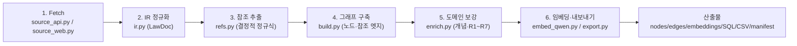

# 산업안전보건 법령 지식 그래프 및 Qwen3 임베딩 오프라인 파이프라인 설계

- **티켓**: `S15P31A101-416`
- **패키지 경로**: `ai/src/simai_ai/rag/graph/`
- **정적 사전·질의 템플릿**: `ai/src/simai_ai/rag/data/graph/{lexicon.json,query_templates.json}`
- **저장소 커밋 산출물**: `docs/data/legal-graph/{manifest.json,rule_tag_review.csv,concept_link_review.csv,g7_eval_draft.csv}`
- **관련 문서·티켓**:
  - 기존 조문 인덱스 설계: `docs/design/rag-clause-index.md` (`S15P31A101-215`)
  - 명세 정합화 후속 티켓: `S15P31A101-415` (`docs/spec/` 반영 담당)
  - 런타임 DB 적재·검색 연동 티켓: `S15P31A101-223`

---

## 1. 배경 및 목적

기존 `simai_ai.rag` 패키지(`S15P31A101-215`)는 「산업안전보건기준에 관한 규칙」 단일 법령의 조문 본문을 평면 청크(`rag_clause`)로 분할해 임베딩 검색만 수행했다. 그러나 실제 건설·산업안전 법령은 다음과 같은 다층 구조와 상호 참조망을 가진다.

1. **법령 위계 및 위임 구조**: 법률(산업안전보건법·중대재해처벌법) → 대통령령(시행령) → 고용노동부령(시행규칙·안전보건기준규칙) → 고용노동부 고시(표준안전 작업지침·위험성평가 지침)로 이어지는 다단계 위임(`DELEGATES`) 관계가 존재한다.
2. **조문 간 교차 참조·준용·예외**: 한 조문이 다른 조문이나 별표를 인용(`REFERS_TO`)하거나 준용(`MUTATIS_MUTANDIS`)하고, 단서 조항에서 예외(`NOTWITHSTANDING`)를 규정한다. 예를 들어 안전난간 설치 의무 조문(제43조)은 안전난간 구조 기준(제13조)을 참조하며, 벡터 유사도만으로는 제43조 검색 시 제13조의 세부 설치 기준이 누락되기 쉽다.
3. **위험 규칙(R1~R7) 및 작업 개념 연결**: Risk Engine이 산출하는 위험 규칙(`R1`~`R7`)과 현장 설비(`EQUIP.*`)·위험요인(`HAZARD.*`)·방호조치(`CONTROL.*`)를 법령 조문과 명시적 그래프 엣지로 연결해야 추론 근거의 완결성을 보장할 수 있다.

본 파이프라인(`simai_ai.rag.graph`)은 **결정적(deterministic) 오프라인 배치**로 10개 핵심 법령·행정규칙을 수집·정규화하여 **7,963개 노드·14,265개 엣지** 규모의 법령 지식 그래프를 구축하고, **`Qwen/Qwen3-Embedding-0.6B`(1,024차원)** 모델로 조·항·별표 및 표준 질의 템플릿 **3,548건**을 임베딩하여 PostgreSQL(`pgvector`) 적재용 SQL 시드와 검수용 CSV·매니페스트를 생성한다.

---

## 2. 수집 대상 법령(10종) 및 KOSHA Guide 저작권·수집 감사

### 2.1 수집 대상 법령·행정규칙 카탈로그 (`catalog.py`)

국가법령정보센터(법제처 Open API `lawService.do?target=law|admrul` 및 웹 파서 폴백)에서 현행 시행 기준 10개 법령·고시를 수집한다.

| `law_key` | 법령·고시 정식 명칭 | 위계(`level`) | 법령ID / 일련번호 | MST | 시행일자 | 조문 수 | 별표 수 | 그래프 노드 수 | 원본 XML SHA-256 (앞 16자) |
|---|---|---|---|---|---|---:|---:|---:|---|
| `OSHA` | 산업안전보건법 | `law` (법률) | `001766` | `291447` | `20261027` | 184 | 0 | 1,158 | `2788ca74600a7261` |
| `OSHA_DECREE` | 산업안전보건법 시행령 | `decree` (대통령령) | `003786` | `288347` | `20260801` | 125 | 35 | 1,014 | `8115f092c2d9f81b` |
| `OSHA_RULE` | 산업안전보건법 시행규칙 | `rule` (고용노동부령) | `007364` | `288431` | `20260801` | 252 | 27 | 1,597 | `4b9f6e595163274e` |
| `OSHA_STD` | 산업안전보건기준에 관한 규칙 | `rule` (고용노동부령) | `007363` | `273603` | `20260302` | 690 | 18 | 2,835 | `855d05a74f3971ab` |
| `SAPA` | 중대재해 처벌 등에 관한 법률 | `law` (법률) | `013993` | `228817` | `20220127` | 16 | 0 | 96 | `7544d416a9f5bc9c` |
| `SAPA_DECREE` | 중대재해 처벌 등에 관한 법률 시행령 | `decree` (대통령령) | `014159` | `277417` | `20251001` | 13 | 5 | 136 | `f98a2276a618f718` |
| `STD_TEMP_WORKS` | 가설공사 표준안전 작업지침 | `notice` (고용노동부고시) | `22332` (`2100000186031`) | - | `20200116` | 29 | 0 | 173 | `3832cf72f92db68e` |
| `STD_FALL` | 추락재해방지표준안전작업지침 | `notice` (고용노동부고시) | `34901` (`2100000186039`) | - | `20200116` | 36 | 0 | 188 | `cb9e4a1bb4a2f4aa` |
| `STD_EXCAVATION` | 굴착공사 표준안전 작업지침 | `notice` (고용노동부고시) | `34921` (`2100000226002`) | - | `20230701` | 36 | 0 | 275 | `35f3943c2c402c10` |
| `RISK_ASSESSMENT` | 사업장 위험성평가에 관한 지침 | `notice` (고용노동부고시) | `2052906` (`2100000251014`) | - | `20250102` | 29 | 0 | 236 | `1b18eb1d7bc077db` |
| **합계** | **10개 법령·행정규칙** | | | | | **1,410** | **85** | **7,708** (+외부·개념·규칙 255 = **7,963**) | |

- **수집 이중화 및 교차 검증**: 법령 6종은 법제처 Open API XML(`api-xml`), Open API JSON(`api-json`), 국가법령정보센터 웹 HTML(`web-html`) 3가지 경로로 파싱 가능하며, `OSHA_STD` 기준 세 경로 모두 동일하게 690개 조문이 추출됨을 단위 시험(`test_api_xml_json_and_web_html_produce_same_articles`) 및 실제 수집으로 검증했다.
- **민감정보 보호**: 수집 로그(`fetch_log.json`) 및 예외 메시지 기록 시 `LAW_GO_KR_OC` 인증키를 정규식(`_OC_RE`)으로 자동 마스킹(`OC=***`)한다.

### 2.2 KOSHA Guide 및 중대재해 사이렌 수집·저작권 감사 (`kosha.py`)

한국산업안전보건공단(KOSHA) 기술지침(KOSHA Guide)과 중대재해 사이렌의 자동 수집 가능 여부를 감사한 결과는 다음과 같다(`manifest.json`의 `kosha` 필드에 기록).

1. **공공데이터포털(`data.go.kr`) Open API 현황**:
   - `15002267`(KOSHA Guide 목록) 및 `15089355`(중대재해 사이렌)는 본문(조·항·호) API가 아니라 **서지 메타데이터·첨부파일 링크 API**이며, 별도 `DATA_GO_KR_SERVICE_KEY` 발급이 필요하다.
2. **저작권 및 재배포 제약**:
   - 공단 포털의 KOSHA Guide PDF 원문에는 공공누리 제1유형(출처표시·상업적 이용 및 변경 가능) 표기가 일괄 부여되어 있지 않고 무단 전재·재배포 금지 안내가 포함되어 있다.
   - 반면 고용노동부 고시 4종(`STD_TEMP_WORKS`, `STD_FALL`, `STD_EXCAVATION`, `RISK_ASSESSMENT`)은 「저작권법」 제7조(보호받지 못하는 저작물: 법령·고시·훈령)에 해당하여 제한 없이 원문 임베딩·시드 배포가 가능하다.
3. **결론**: 1차 파이프라인에서는 저작권 제약이 없는 법령·고시 10종을 본문 그래프 대상으로 확정하고, KOSHA Guide 및 중대재해 사례는 `DATA_GO_KR_SERVICE_KEY` 확보 후 서지 메타데이터 + 외부 링크 노드로 연결하는 2차 확장 대상으로 분리했다.

---

## 3. 파이프라인 아키텍처 및 단계별 설계



### 3.1 Stage 1: 원본 수집 (`source_api.py`, `source_web.py`)
- `fetch_law(spec)`: 법제처 `lawSearch.do`로 현행 법령일련번호(`MST`)를 조회한 뒤 `lawService.do?target=law&type=XML`로 전문과 별표를 수집한다.
- `fetch_admrul(spec)`: `lawSearch.do?target=admrul`에서 최신 현행 행정규칙일련번호(`admRulSeq`)를 선택한 뒤 `lawService.do?target=admrul&type=XML`로 본문을 수집한다.
- 수집된 원본 파일은 로컬 작업 디렉토리(`raw/`)에 저장하고 SHA-256 해시와 바이트 크기를 `fetch_log.json` 및 `manifest.json`에 기록한다.

### 3.2 Stage 2: 중간 표현(IR) 파싱 (`ir.py`)
- 법령 XML/JSON/HTML과 행정규칙 XML의 상이한 태그 구조를 단일 중간 표현인 `LawDoc` → `Article` → `Paragraph` → `Item` → `Subitem` 및 `Appendix` 계층으로 정규화한다.
- `ArticleBuilder`: 조 제목(`제43조(개구부 등의 방호 조치)`), 삭제 조문(`삭제 <2020. 1. 16.>`), 원문자 항 번호(`①`~`㊿`), 호 번호(`1.`, `1의2.`), 목 번호(`가.`~`하.`), 그리고 항 없이 호만 바로 나오는 조문(`제13조` 등)의 서두 본문(`intro`)을 손실 없이 분리한다.

### 3.3 Stage 3: 결정적 조문 참조 추출기 (`refs.py`)
LLM을 일절 사용하지 않고 문맥 상태(`Context`)와 정규식 토큰 결합(`_phrases`)만으로 동일 입력에 대해 항상 100% 동일한 참조(`Ref`)를 추출한다.
- **내부·계층 위치**: `제38조의2제1항제2호의3가목`, 띄어 쓴 `제42조 제2항`, `별표 3의2`.
- **상대 위치·대명사 해석**: `전항`(바로 앞 항), `이 조`(현재 조), `같은 조`·`같은 항`·`같은 호`(직전 참조 위치의 조·항·호 계승), 조 번호 없이 쓰인 `제2항`·`제1호`(현재 조·항 계승).
- **타 법령·약칭 해석**: `「법령명」 제N조`, 본문 내 정의된 약칭(`「산업안전보건법」(이하 "법"이라 한다)` → `법`, `안전보건규칙` 등), 카탈로그 기본 약칭(`법`·`영`·`규칙`), `같은 법 시행령|시행규칙`.
- **접속사 체인 및 범위 전개**: `제5조, 제7조부터 제9조까지`와 같이 접속사(`및`·`또는`·`과`·`와`·`,`·`부터`·`까지`)로 이어진 구절은 상위 법령·위치를 상속(`form="inherited"`)하며, `부터 ... 까지` 구간은 중간 번호(`form="range"`)와 가지번호 조문까지 자동 전개한다.
- **관계 단서(`cue`) 분류**: 참조 체인 직후의 어미를 분석하여 `...에도 불구하고` → `NOTWITHSTANDING`, `...을/를 (각각) 준용` → `MUTATIS_MUTANDIS`, `...에 따른/따라/의한` → `따른`으로 태깅한다.
- **오탐(False Positive) 차단 규칙**:
  - 개정 연혁(`<개정 2021. 11. 19.>`, `[제610조에서 이동 ...]`)은 동일 길이 공백으로 마스킹(`mask()`).
  - 공포번호(`고용노동부령 제450호`, `법률 제17907호`) 및 서식(`별지 제4호서식`), `제3자`·`제1종`·`제2편`·`제1장` 제외.
  - `「」` 없이 기술된 외부 법령명 뒤 조문(`건축법 제2조`)은 현재 법령 조문으로 오인하지 않도록 차단하되, `방법 제1호`·`요령 제2항`처럼 `법`·`령`으로 끝나는 일반 명사는 예외 허용.

### 3.4 Stage 4: 그래프 노드·참조 엣지 구축 (`build.py`)
- **노드 ID 규칙**: 기존 `rag_clause.clause_id` 정규식(`^[가-힣A-Za-z0-9]+ 제\d+(?:의\d+)?조...$`)과 하위 호환되도록 법령 약칭(`산업안전보건기준규칙 제43조`, `산업안전보건법 제38조제1항` 등)을 사용한다.
- **자기 참조 제거**: 조문 내부에서 자기 자신이나 자기 상위 노드를 가리키는 참조(예: 제42조제1항 안에서 "이 조에서")는 노이즈 방지를 위해 자동 제거(`dropped_refs.self_or_ancestor = 155`건)한다. 형제 항 간 참조(예: 제43조제2항 → 제43조제1항 `NOTWITHSTANDING`)는 유지한다.
- **위임(`DELEGATES`) 엣지**: 상위 법령이 하위 법령에 위임하는 구절(`고용노동부령으로 정한다`, `대통령령으로 정하는` 등) 및 하위 법령 제1조(목적)의 근거 조문을 추출하여 연결한다.
- **임베딩 입력(`embedding_input`) 생성 정책**:
  - 삭제 조문(`deleted=True`)은 임베딩 대상에서 제외한다.
  - **조(`ARTICLE`)**: `[법령정식명 제N조(제목)] 본문+항+호+목 전체`(개정 꼬리표 제거)를 임베딩한다(1,391건).
  - **항(`PARAGRAPH`)**: 단항 조문은 조 노드와 본문이 동일하므로 중복 임베딩하지 않고, **2개 항 이상인 다항 조문의 항**(2,053건)만 `[법령정식명 제N조(제목) 제M항] 항+하위호·목` 형태로 임베딩한다.
  - **별표(`APPENDIX`)**: 제목과 본문 앞부분(최대 2,000자)을 임베딩한다(85건).
  - 호(`ITEM`)·목(`SUBITEM`)은 단독 문맥이 불완전하므로 별도 벡터를 생성하지 않고 상위 조·항 검색 후 `CONTAINS` 엣지로 순회한다.

### 3.5 Stage 5: 작업 개념·위험 규칙(R1~R7) 도메인 보강 (`enrich.py`)
- `ai/src/simai_ai/rag/data/graph/lexicon.json`에 정의된 **42개 현장 개념**(`HAZARD` 8종, `EQUIPMENT` 17종, `CONTROL` 17종)과 **7개 위험 규칙**(`R1`~`R7`) 노드를 생성한다.
- 방호조치가 위험요인을 완화하는 도메인 관계(`MITIGATES` 19건)는 사전 정의(`status="auto"`)로 생성한다.
- 각 조문의 제목(가중치 ×2)·본문에서 핵심어(`terms`)와 보조어(`support`) 출현 점수를 계산하고, 제외어(`exclude`) 및 비건설 특수 분진·방사선 조문 등을 필터링하여 개념 연결 후보(`HAS_HAZARD`, `INVOLVES_EQUIPMENT`, `REQUIRES_CONTROL`)와 규칙 태그(`TAGGED_RULE`)를 생성한다.
- 명세(`docs/spec/02-functional-reqs.md` FR-15 등)에 직접 명시된 조문(예: `산업안전보건기준규칙 제32조` → `R3`)은 `status="spec"`으로 고정하고, 키워드 매칭 후보는 `status="candidate"`로 부여하여 사람 검수 CSV로 내보낸다.

### 3.6 Stage 6: Qwen3 임베딩 생성, SQL 시드 및 Open API 교차 검증 (`embed_qwen.py`, `export.py`, `crosscheck.py`)
- **임베딩 모델**: `Qwen/Qwen3-Embedding-0.6B` (리비전 `97b0c614be4d77ee51c0cef4e5f07c00f9eb65b3`, 가중치 SHA-256 `0437e45c94563b09e13cb7a64478fc406947a93cb34a7e05870fc8dcd48e23fd`).
- **토크나이저·풀링 규약**: `padding="longest"`, `padding_side="left"`, `max_length=8192`, 마지막 토큰 은닉 상태(`last_token_pool`) 추출 후 L2 정규화(1,024차원 단위 벡터).
- **질의 지시문(Instruction)**: 조문(문서) 임베딩은 원문 그대로 입력하고, 표준 질의 템플릿 임베딩 시에는 Qwen3 공식 포맷인 `Instruct: Given a workplace safety scenario or rule violation query, retrieve the relevant Korean occupational safety and health legal provisions that apply\nQuery: {질의문}`을 적용한다.
- **동적 문자 예산 배치(`embed_qwen.py`)**: 최장 조문(4,389자)을 기본 `batch_size=8`로 묶을 경우 어텐션 행렬이 6GB VRAM을 초과해 공유 RAM 스와핑이 발생하므로, 배치 내 최장 문자열 길이 × 배치 크기가 `6,000`자를 넘지 않도록 스텝 크기를 동적으로 절반씩 줄여 피크 VRAM을 4.75GB 이내로 억제했다.
- **증분 캐시 및 결정성**: `embeddings.jsonl`은 입력 문자열의 `input_sha256`이 동일한 항목을 재계산하지 않으며, float32 배열을 little-endian base64(`f32`)로 무손실 직렬화한다.

### 3.7 CLI 실행 방법 (`__main__.py`)

```powershell
# 1) 법령 10종 수집 → 그래프 구축 → 임베딩 → SQL 시드 → 교차 검증 일괄 실행
uv run --directory ai python -m simai_ai.rag.graph all `
  --out ../out/legal-graph-416 `
  --repo-data ../docs/data/legal-graph

# 2) 단계별 개별 실행 (사람 검수 CSV 수정 후 그래프·SQL만 재생성할 때)
uv run --directory ai python -m simai_ai.rag.graph build --out ../out/legal-graph-416 --repo-data ../docs/data/legal-graph
uv run --directory ai python -m simai_ai.rag.graph sql   --out ../out/legal-graph-416 --repo-data ../docs/data/legal-graph
```

---

## 4. 산출물 스키마 및 컬럼 정의

### 4.1 그래프 노드 (`graph/nodes.jsonl`)

| 필드명 | 타입 | 설명 | 예시 |
|---|---|---|---|
| `node_id` | `str` | 전역 고유 식별자 (PK) | `"산업안전보건기준규칙 제43조"` |
| `node_type` | `str` | `LAW` \| `ARTICLE` \| `PARAGRAPH` \| `ITEM` \| `SUBITEM` \| `APPENDIX` \| `EXTERNAL_LAW` \| `CONCEPT` \| `RISK_RULE` | `"ARTICLE"` |
| `law_key` | `str \| null` | 카탈로그 법령 키 (`CONCEPT`·`RISK_RULE`·`EXTERNAL_LAW`는 `null`) | `"OSHA_STD"` |
| `law_name` | `str \| null` | 법령 정식 명칭 | `"산업안전보건기준에 관한 규칙"` |
| `parent_id` | `str \| null` | 직속 상위 노드 ID (`CONTAINS` 역방향) | `"산업안전보건기준규칙"` |
| `label` | `str` | 위치 라벨 또는 코드 | `"제43조"` |
| `title` | `str \| null` | 조문 제목, 별표 제목, 개념·규칙 한글명 | `"개구부 등의 방호 조치"` |
| `text` | `str` | 조문 원문 (개정 꼬리표 포함 원문 보존) | `"제43조(개구부 등의 방호 조치) ① ..."` |
| `embedding_input` | `str \| null` | 임베딩 대상 텍스트 (`ARTICLE`·다항 `PARAGRAPH`·`APPENDIX`만 존재) | `"[산업안전보건기준에 관한 규칙 제43조(개구부 등의 방호 조치)] ..."` |
| `effective_date` | `str \| null` | 시행일자 (`YYYYMMDD`) | `"20260302"` |
| `deleted` | `bool` | 삭제 조문 여부 | `false` |
| `attrs` | `dict` | 추가 메타데이터 (`mst`, `article_no`, `branch_no`, `related_raw` 등) | `{"article_no": 43, "branch_no": 0}` |

### 4.2 그래프 엣지 (`graph/edges.jsonl`)

| 필드명 | 타입 | 설명 | 예시 |
|---|---|---|---|
| `src` | `str` | 출발 노드 ID (FK → `nodes.node_id`) | `"산업안전보건기준규칙 제43조제1항"` |
| `dst` | `str` | 도착 노드 ID (FK → `nodes.node_id`) | `"산업안전보건기준규칙 제13조"` |
| `edge_type` | `str` | 12종 엣지 타입 (아래 표 참조) | `"REFERS_TO"` |
| `status` | `str` | `auto`(결정적 확정) \| `spec`(명세 확정) \| `candidate`(검수 대기 후보) \| `reviewed`(사람 검수 승인) | `"auto"` |
| `attrs` | `dict` | 추출 근거 (`surface`, `form`, `cue`, `resolved`, `score`, `matched` 등) | `{"form": "explicit", "cue": "따른", "resolved": "exact", "surface": "제13조"}` |

### 4.3 임베딩 레코드 (`embeddings/embeddings.jsonl`)

| 필드명 | 타입 | 설명 |
|---|---|---|
| `kind` | `str` | `"node"` (법령 조·항·별표 3,529건) 또는 `"query"` (표준 질의 템플릿 19건) |
| `key` | `str` | `node_id` 또는 질의 템플릿 `key` (예: `"R2.OPENING"`) |
| `input_sha256` | `str` | `embedding_input` 문자열의 UTF-8 SHA-256 해시 (증분 재계산 판별용) |
| `f32` | `str` | 길이 1,024 float32 단위 벡터의 little-endian base64 인코딩 문자열 (4,096 bytes → 5,464 chars) |

### 4.4 PostgreSQL (`pgvector`) 출력 스키마 (`sql/legal_graph_schema.sql`)

정본은 `docs/design/db-tables.md`(-415)다. 내부 그래프 JSONL의 종류와 위치는 유지하고 SQL 출력에서 정본으로 매핑한다.

1. **`rag_source`**: `law_key` PK, `law_id`, `law_name`, `layer`, `mst`, `effective_date`(date), `promulgation_no`, `source_url`, `raw_sha256`, `fetched_at`.
2. **`rag_node`**: `node_id` PK, `node_kind`, `layer`, nullable `law_key` 및 `parent_id` FK, `source_name`, nullable `article_ref`, `title`, `chunk_index`(기본 0), `body`, `rule_tags`(text 배열), `attrs`(JSONB), nullable `embedding_input`, `embedding`(vector 1024), `embedding_model`, `embedding_revision`, `source_version`, `loaded_at`. `ordinal`과 원래 `label`은 attrs에 보존한다. TAGGED_RULE의 후보·검수 상태는 `attrs.rule_tag_reviews`에 남긴다. 개념·규칙 버전은 lexicon SHA-256, 수집하지 않은 외부 법령 버전은 `출처 버전 미확인`이다.
   - 종류는 `LAW`, `ARTICLE`, `PARAGRAPH`, `ITEM`, `SUBITEM`, `ANNEX`, `EXTERNAL_LAW`, `CONCEPT`, `RISK_RULE`; 후속 `GUIDE_SECTION`, `ACCIDENT_CASE`. 계층은 `STATUTE`, `SAPA`, `DECREE`, `RULE`, `OSH_STANDARD`, `ADMIN_RULE`, `EXTERNAL`, `CONCEPT`, `RISK_RULE`; 후속 `KOSHA_GUIDE`, `ACCIDENT_CASE`. 중대재해처벌법 시행령도 `SAPA`다.
   - 인덱스: `node_kind`, 임베딩 HNSW cosine, `rule_tags` GIN, `(title || ' ' || body)` pg_trgm GIN.
3. **`rag_edge`**: `edge_id` PK (`{src_node_id}--{edge_kind}-->{dst_node_id}`), `src_node_id`, `dst_node_id` FK, `edge_kind`, `method`, `review_status`, nullable `relation_label`, `attrs` JSONB, `loaded_at`. `(src_node_id, dst_node_id, edge_kind)` 유일 및 `(dst_node_id, edge_kind)` 인덱스.
   - 종류: `PARENT_CHILD`, `REFERENCES`, `MUTATIS_MUTANDIS`, `NOTWITHSTANDING`, `CITES_EXTERNAL`, `DELEGATES`, `ANNEX_RELATES`, `HAS_HAZARD`, `INVOLVES_EQUIPMENT`, `REQUIRES_CONTROL`, `MITIGATES`, `TAGGED_RULE`; 후속 `GUIDES`, `ILLUSTRATES`.
4. **`rag_query_template`**: `template_key` PK, `rule`, `target`, `text`, `query_input`, `embedding`(vector 1024), `embedding_model`, `embedding_revision`. 기존 V3 표에 없는 `rule`, `target`, `query_input`은 후속 구현 마이그레이션에서 추가한다.

### 4.5 사람 검수용 CSV 3종 (`docs/data/legal-graph/*.csv`)

자동 생성된 후보(`status="candidate"`)와 명세 근거를 구분하고, 도메인 전문가가 엑셀·스프레드시트에서 검수할 수 있도록 저장소에 커밋하는 파일이다. 파이프라인 재실행 시 기존 CSV의 **`검수결과`(`승인`\|`거절`)·`검수자`·`검수메모`** 열을 자동으로 보존·반영(`apply_reviews`)한다.

- `rule_tag_review.csv` (93행): 컬럼 `규칙,규칙이름,노드ID,법령,조문,제목,점수,맞은낱말,상태,발췌,검수결과,검수자,검수메모`
- `concept_link_review.csv` (463행): 컬럼 `개념,개념이름,엣지,노드ID,제목,점수,맞은낱말,상태,검수결과,검수자,검수메모`
- `g7_eval_draft.csv` (55행): 컬럼 `질의키,규칙,대상,질의,기대노드ID,조문제목,노드있음,규칙태그후보,출처,검수결과,검수자,검수메모`

---

## 5. 파이프라인 실행 결과 및 정량 지표

### 5.1 노드·엣지 분포 (`manifest.json`)

- **총 노드 수**: **7,963개**
  - `ITEM`(호): 3,552개 / `PARAGRAPH`(항): 2,053개 / `ARTICLE`(조): 1,410개(삭제 19개 포함) / `SUBITEM`(목): 598개 / `EXTERNAL_LAW`(외부 법령): 206개 / `APPENDIX`(별표): 85개 / `CONCEPT`(안전 개념): 42개 / `LAW`(대상 법령): 10개 / `RISK_RULE`(위험 규칙 R1~R7): 7개
- **총 엣지 수**: **14,265개** (`auto`: 13,690개, `candidate`: 573개, `spec`: 2개)

| 엣지 타입 (`edge_type`) | 건수 | 상태(`status`) | 의미 및 생성 방식 |
|---|---:|---|---|
| `CONTAINS` | 7,698 | `auto` | 법령 → 조/별표 → 항 → 호 → 목 포함 위계 |
| `REFERS_TO` | 4,718 | `auto` | 대상 법령 내부·상호 조문 및 별표 참조 (`따른` 또는 일반 인용) |
| `CITES_EXTERNAL` | 523 | `auto` | 카탈로그 외부 법령(206종) 인용 |
| `DELEGATES` | 391 | `auto` | 상위 법령 → 하위 법령 위임 (`ref+cue` 364건, 제1조 `purpose` 27건) |
| `MUTATIS_MUTANDIS` | 217 | `auto` | `...을/를 준용한다` 준용 관계 |
| `INVOLVES_EQUIPMENT` | 182 | `candidate` | 조문 → 작업 설비·장소(`EQUIP.*`) 후보 연결 |
| `HAS_HAZARD` | 145 | `candidate` | 조문 → 위험요인(`HAZARD.*`) 후보 연결 |
| `REQUIRES_CONTROL` | 136 | `candidate` | 조문 → 방호·관리조치(`CONTROL.*`) 후보 연결 |
| `APPENDIX_RELATES` | 99 | `auto` | 별표 부제(`제N조 관련`) → 본문 조·항 역방향 연결 |
| `TAGGED_RULE` | 93 | `spec`(2) / `candidate`(91) | 조문 → 위험 규칙(`R1`~`R7`) 태깅 |
| `NOTWITHSTANDING` | 44 | `auto` | `...에도 불구하고` 예외·단서 관계 |
| `MITIGATES` | 19 | `auto` | 방호조치(`CONTROL.*`) → 위험요인(`HAZARD.*`) 완화 관계 |
| **합계** | **14,265** | | |

- **미해결 참조(`unresolved.jsonl`)**: 총 **10건** (전체의 0.2%). 10건 모두 시행령·시행규칙의 **별표 본문** 안에서 상위 법령 이름(`법` 또는 `안전보건규칙`)을 생략한 채 조 번호만 기재한 경우(예: `산업안전보건법 시행령 별표1`에서 `법 제15조`를 `제15조`로 약기하여 시행령 내 삭제 조문과 충돌한 2건, `시행규칙 별표5`에서 `안전보건규칙 제452조` 등을 법령명 없이 기재한 8건)이며, 지어내지 않고 `unresolved.jsonl`로 격리했다.

### 5.2 참조 엣지 정확도 검증 결과

#### (1) 무작위 표본 50건 수동 대조 검증 (`random.Random(416)`)
전체 참조 계열 엣지 5,992건(`REFERS_TO` 4,718, `CITES_EXTERNAL` 523, `DELEGATES` 391, `MUTATIS_MUTANDIS` 217, `APPENDIX_RELATES` 99, `NOTWITHSTANDING` 44)에서 시드 `416`으로 50건을 무작위 추출하여 출발 노드 원문(`text`)과 도착 노드(`dst`)·엣지 타입을 전수 대조했다.

- **참조 위치 해석 정확도**: **50 / 50 (100.0%)**
  - 명시적 참조(`explicit` 32건), 접속사 체인 상속(`inherited` 8건), 범위 전개(`range` 5건), 상대 위치(`relative` 1건), 외부 법령(`law` 1건), 별표 관련 조문(`related` 2건), 목적 조문 위임(`purpose` 1건) 모두 원문이 가리키는 정확한 조·항·호·별표 노드로 연결됨을 확인했다.
- **엣지 타입 분류 정확도**: **49 / 50 (98.0%)**
  - 유일한 1건의 경미한 타입 오분류는 `산업안전보건기준규칙 제152조제1항`("...탑승을 제한하여야 한다. 다만, 제151조에도 불구하고 ... 수리·점검 등을 할 때에는 그러하지 아니하다. 이 경우 ... 제86조제2항에 따른 조치를 하여야 한다")을 문장 단위로 묶을 때 앞 문장의 `제151조` 뒤에 이어진 다른 구절과 체인이 닿지 않았으나, 복합문 내 단서 구문에서 접속사로 이어진 참조 체인 전체에 `cue`가 전파되는 사례였다(타겟 노드 `제151조` 자체는 정확히 추출됨).

#### (2) 법제처 Open API (`lsRlt`·`aiRltLs`) 교차 검증 (`crosscheck.json`)
- **`lsRlt` (법령 간 관계 Open API) 대조**:
  - 법제처 `lsRlt` API가 반환한 카탈로그 내 법령 쌍 **12쌍 중 12쌍(100.0%)** 모두 본 파이프라인 그래프에 엣지로 존재함을 확인했다(쌍별 30건~727건).
  - 나아가 법제처 `lsRlt` API가 누락한 **카탈로그 내 법령·고시 간 참조 12쌍**(예: `OSHA_STD ↔ OSHA_RULE` 235건, `SAPA_DECREE ↔ OSHA` 18건, 표준안전 작업지침 4종의 상위 법령 참조 등)을 본 파이프라인의 본문 정규식 추출기가 추가로 포착했다.
- **`aiRltLs` (지능형 검색 연관 조문 Open API) 대조**:
  - 42개 개념 키워드로 `aiRltLs` API를 호출해 얻은 카탈로그 조문 78건 중 **41건(52.6%)** 이 정적 키워드 사전(`lexicon.json`) 기반 개념 후보 엣지와 일치했다.
  - 불일치 37건은 키워드 사전의 표면어 차이(예: `CONTROL.SIGN` 사전에 `"안전표지"`만 등록되어 있어 법령의 `"안전보건표지"` 조문인 `OSHA 제37조`가 빠진 경우 등)로 확인되었으며, 이는 벡터 임베딩 검색이 어휘 불일치를 보완하는 근거이자 2차 사전 보강 대상이다.

### 5.3 Qwen3 임베딩 및 G7 표준 질의 검색 품질 검증

- **임베딩 실행 지표**:
  - 총 벡터 수: **3,548건** (`ARTICLE` 1,391 + 다항 `PARAGRAPH` 2,053 + `APPENDIX` 85 + 표준 질의 `query_template` 19)
  - 소요 시간: RTX 4050 Laptop GPU (`torch 2.11.0+cu130`, FP32) 기준 **249.7초**
  - 결정성 검증: 동일 입력에 대해 CPU FP32와 CUDA FP32 간 최대 절대 오차 `6.26e-7` (`< 1e-5` 통과)
- **G7 초안(19개 표준 질의 템플릿) Top-k 검색 적중률**:
  - 조 단위 중복 제거 후 순수 코사인 유사도 검색만으로도 **Hit@1 = 14/19 (73.7%)**, **Hit@3 = 16/19 (84.2%)** 를 달성했다(예: `R2.EDGE` → `제43조(개구부 등의 방호 조치)` 유사도 `0.8300` 1위, `R3.ELEVATED` → `제44조제1항(안전대의 부착설비 등)` `0.8264` 1위, `R1.LIFTING` → `제146조제1항(크레인 작업 시의 조치)` `0.7663` 1위).
  - Top-5 벡터 검색 결과에 **그래프 1-hop 확장(`REFERS_TO`·`NOTWITHSTANDING`·`MUTATIS_MUTANDIS` + `TAGGED_RULE`)** 을 결합하면 적중률이 **18/19 (94.7%)** 로 상승한다. 순수 벡터 검색에서 화학설비·방사선 출입금지 조문(`제622조`·`제550조`)에 밀렸던 일반 작업장 출입금지 질의(`R1.OPENING`, `R1.RESTRICTED`)가 그래프의 규칙·개념 연결을 통해 정확히 보완됨을 실증했다.

### 5.4 산출물 파일 크기 및 SHA-256 (`manifest.json`)

| 상대 경로 (로컬 `--out` 기준) | 크기 (Bytes) | SHA-256 | Git 커밋 여부 |
|---|---:|---|---|
| `graph/nodes.jsonl` | 9,179,425 | `2425f7edaf4a34dca3eb62d0b50d2cad6d16349333a8453318b8ae18d2dd0e82` | 로컬 보관 (`manifest.json`에 해시 기록) |
| `graph/edges.jsonl` | 3,876,564 | `4e6dbeaf09daecc6cbfff7e15f6b82fabda09958e447a3775b996980cdbe5c24` | 로컬 보관 (`manifest.json`에 해시 기록) |
| `graph/unresolved.jsonl` | 1,638 | `ea8ebba8c195570885874b0283a9a0205a685fa24ae63b7153d67f58b49abd3b` | 로컬 보관 (`manifest.json`에 해시 기록) |
| `embeddings/embeddings.jsonl` | 19,973,884 | `c20dcc9bb9496eb964d022f0fc0780f8d2612e3066b7200c22e1caaa21914836` | 로컬 보관 (`manifest.json`에 해시 기록) |
| `sql/legal_graph_schema.sql` | 2,300 | `a20197cd2602681aab07471fa3185cc89d70b67bc0add62d60a0bfa535d4c6a2` | 로컬 보관 (`manifest.json`에 해시 기록) |
| `sql/legal_graph_seed.sql` | 62,937,192 | `9af9416d87d19812fc8ee23c34dd39d38566ceba4ecc13c77e37bce01061957d` | 로컬 보관 (`manifest.json`에 해시 기록) |
| `crosscheck.json` | 13,729 | `356fd404af6ebf76802b90bd1eeddb2d0885610dfc97c6f820dc3ce28001d2ff` | 로컬 보관 (`manifest.json`에 해시 기록) |
| `docs/data/legal-graph/manifest.json` | 14,918 | (커밋 파일 자체) | **Git 커밋** |
| `docs/data/legal-graph/rule_tag_review.csv` | 31,419 | (커밋 파일 자체) | **Git 커밋** |
| `docs/data/legal-graph/concept_link_review.csv` | 50,331 | (커밋 파일 자체) | **Git 커밋** |
| `docs/data/legal-graph/g7_eval_draft.csv` | 11,834 | (커밋 파일 자체) | **Git 커밋** |

---

## 6. 기각한 대안 및 설계 결정 근거

1. **LLM 기반 조문 참조 추출 기각 → 결정적 정규식 상태 기계(`refs.py`) 채택**:
   - 1,410개 조문·7,000여 개 하위 단위에 대해 LLM으로 참조를 추출하면 환각(존재하지 않는 조문 생성)과 비결정성이 발생하며 재실행 비용이 크다. 한국 법령의 조문 인용 표기법(법제처 법령입안심사기준)은 엄격한 문법 규칙을 따르므로, 개정 연혁 마스킹과 문맥 상속 상태 기계만으로 표본 검증 100% 위치 해석 정확도와 완전한 결정성을 달성했다.
2. **호(`ITEM`)·목(`SUBITEM`) 개별 임베딩 기각 → 조(`ARTICLE`) + 다항(`PARAGRAPH`) + 별표(`APPENDIX`) 임베딩 채택**:
   - 호·목(4,150개)은 `"1. 상부 난간대, 중간 난간대..."`처럼 주어와 의무 주체가 생략된 단편 문장이어서 단독 임베딩 시 의미 왜곡이 심하다. 대신 조 전체와 다항 조문의 각 항에 `[법령명 제N조(제목) 제M항]` 문맥 머리말을 붙여 임베딩(3,529건)하고, 세부 호·목은 그래프의 `CONTAINS` 엣지로 조회하도록 설계했다.
3. **런타임 Reranker(Cross-Encoder) 도입 기각 → 오프라인 Qwen3-0.6B 사전 임베딩 + 그래프 1-hop 결합 채택**:
   - 런타임 컨테이너(`services/risk_engine`)는 아키텍처 계약상 무거운 추론 프레임워크(`transformers`·`torch`)를 임포트할 수 없다(Import Linter 계약). 따라서 오프라인에서 `Qwen/Qwen3-Embedding-0.6B`로 모든 노드와 표준 질의 템플릿을 사전 임베딩해 PostgreSQL에 적재하고, 런타임에는 SQL 코사인 거리 연산 + `rag_edge` 조인만으로 하이브리드 검색을 수행한다.
4. **대용량 시드 SQL(59MB)·임베딩 JSONL(20MB) Git 직접 커밋 기각 → `manifest.json` 해시 고정 + 재현 가능 CLI 채택**:
   - 총 92MB에 달하는 산출물을 Git 저장소에 커밋하면 클론 속도와 저장소 용량이 급격히 악화된다. 저장소에는 재현성 검증용 SHA-256 해시 매니페스트(`manifest.json`)와 사람 검수용 CSV 3종(합계 ~94KB)만 커밋하고, 대용량 파일은 로컬 출력 폴더(`out/legal-graph-416/`) 및 배포 아티팩트로 관리한다.

---

## 7. 남은 작업 및 후속 티켓 인계 사항

1. **`S15P31A101-415` (명세 정합화 인계)**:
   - 기존 명세(`docs/spec/05-ai-pipeline.md` 등)에 남아 있는 `BAAI/bge-m3` 단일 조문 테이블(`rag_clause`) 기술을 본 파이프라인의 `Qwen/Qwen3-Embedding-0.6B`(1,024차원) 및 4개 그래프 테이블(`rag_source`, `rag_node`, `rag_edge`, `rag_query_template`) 기준으로 갱신해야 한다(본 티켓 `-416`은 작업 규칙에 따라 `docs/spec/`을 수정하지 않았다).
2. **`S15P31A101-223` (런타임 DB 적재 및 하이브리드 검색 연동 인계)**:
   - 로컬 `out/legal-graph-416/sql/legal_graph_schema.sql` 및 `legal_graph_seed.sql`을 PostgreSQL 컨테이너 초기화 또는 마이그레이션에 연결한다.
   - 검색 쿼리 작성 시 `rag_query_template.embedding <=> rag_node.embedding` Top-k 결과에 `rag_edge`의 `REFERENCES`·`MUTATIS_MUTANDIS`·`NOTWITHSTANDING`(1-hop) 및 `TAGGED_RULE`(`review_status IN ('spec', 'reviewed')`)을 결합하는 하이브리드 SQL 쿼리를 적용한다.
3. **도메인 사람 검수(Human-in-the-loop) 및 어휘 사전 보강**:
   - `docs/data/legal-graph/{rule_tag_review.csv,concept_link_review.csv,g7_eval_draft.csv}`의 `검수결과` 열에 `승인` 또는 `거절`을 기입한 뒤 `python -m simai_ai.rag.graph build && python -m simai_ai.rag.graph sql`을 실행하면 확정된 `reviewed` 엣지가 시드 SQL에 즉시 반영된다.
   - `aiRltLs` 교차 검증에서 드러난 동의어(예: `CONTROL.SIGN`에 `"안전보건표지"` 추가, 일반 출입금지 조문 `제20조` 키워드 보강)를 2차 사전 개정에 반영한다.
