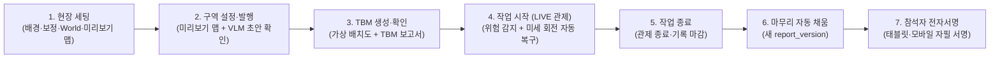
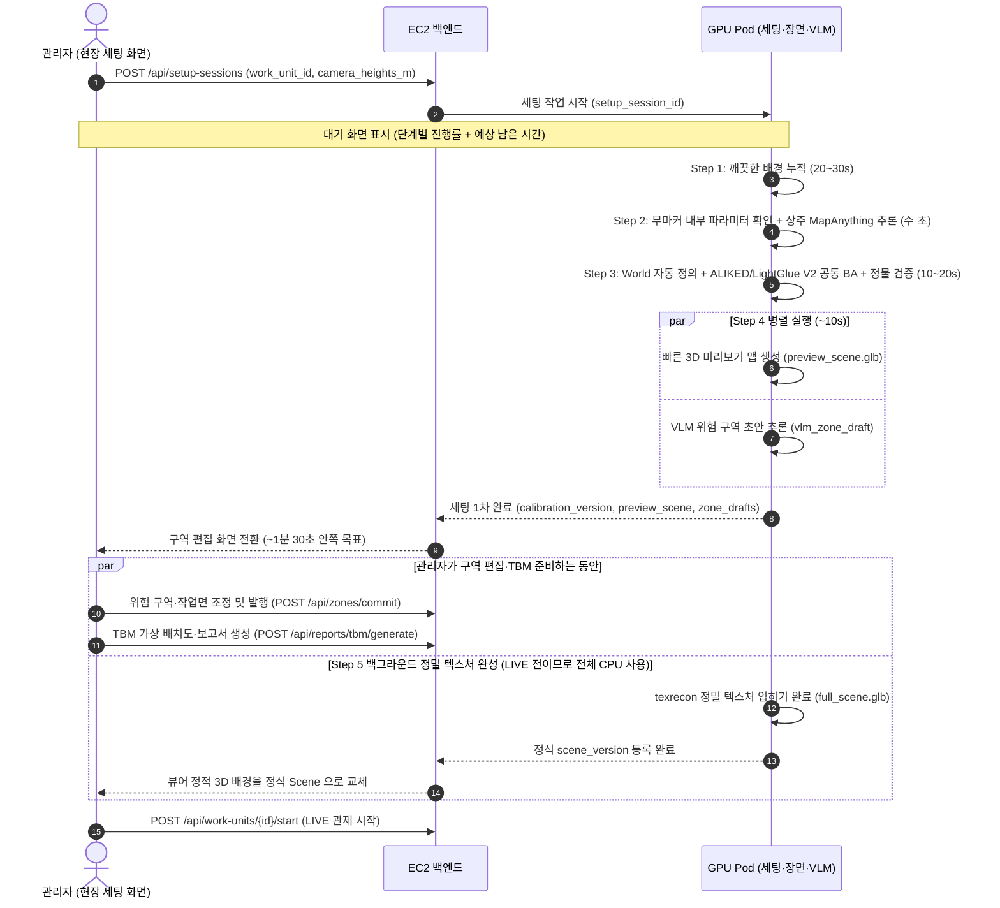
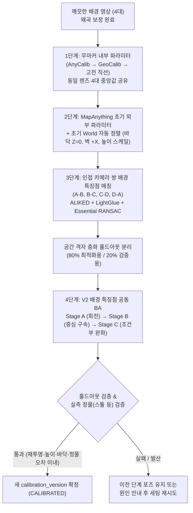
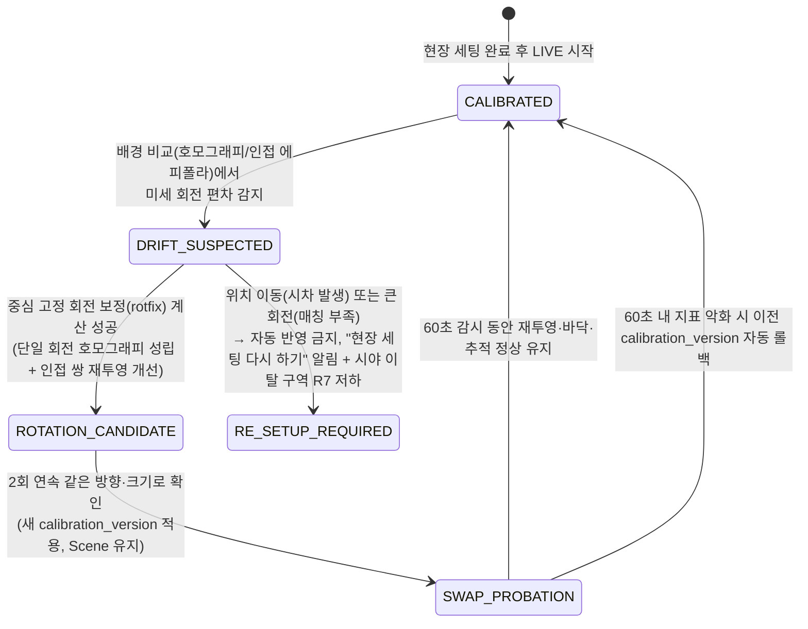

# 작업별 현장 세팅(캘리브레이션·World·정적 3D·초기 구역) 및 운영 중 회전 자동 복구 파이프라인 설계

- **관련 명세**: `docs/spec/03-system.md`(3.1, 3.2, 3.7, 3.8, 3.12), `docs/spec/04-coordinates.md`(4.1, 4.3, 4.4, 4.5), `docs/spec/05-processing.md`(5.1, 5.3, 5.4), `docs/spec/08-features.md`(8.1, 8.2, 8.3), `docs/spec/11-data.md`(11.1, 11.3, 11.7), `docs/spec/12-interfaces.md`(12.2, 12.5, 12.6), `docs/spec/13-viewer.md`(13.1, 13.2, 13.4), `docs/spec/15-gates.md`(15.1, 15.3), `docs/spec/16-decisions.md`, `docs/spec/17-risks.md`, `docs/spec/19-roadmap.md`, `docs/spec/appendix-e-demo.md`
- **관련 요구사항**: FR-3, FR-14, FR-18, FR-20, FR-22, FR-23, FR-24, FR-25, FR-26, FR-27, FR-90, FR-101, FR-102, FR-108, FR-135, NFR-6, NFR-7, NFR-19, NFR-22, NFR-31, NFR-35
- **연관 설계 문서**: `docs/design/work-session-flow.md`(단일 작업 생명주기), `docs/design/world-frame-from-mapanything.md`(MapAnything 점군 기반 바닥·벽 추출 수학 규약)
- **티켓**: `S15P31A101-438` (명세 v1.3 수정 54) → `S15P31A101-443` (명세 v1.3 수정 56: 세팅 1단계 카메라 각도 헬퍼 및 관제 중 사람 관절 보정 경로 제거)

---

## 1. 배경과 문제 정의

### 1.1 현장 운용 전제의 변화: 작업마다 달라지는 카메라와 작업 공간

기존 명세(v1.3 수정 52·53 이전)는 최초 설치 때 카메라 4대의 보정(`calibration_version`)과 World 좌표계, 정적 3D 배경(`scene_version`)을 한 번 확정하면 여러 작업 단위에 걸쳐 그대로 유지되고, 사람이 방 안을 걸어 다니는 동안 관절(23점) 궤적으로 외부 파라미터를 맞추는 **걷기 보정(HumanCalib 원리)**을 기본 절차로 삼았다. 또한 위험 구역 설정과 TBM 보고서·가상 배치도 생성을 작업 시작 전 언제든 미리 해 둘 수 있다고 가정했다.

그러나 실제 건설·산업 현장 및 교실 시연 운영을 검토한 결과 다음 전제가 확인되었다(사용자 결정, 2026-11-03):

1. **작업마다 카메라 위치·각도가 바뀐다**: 작업이 바뀔 때마다 카메라 삼각대 위치나 조준 각도가 달라질 수 있으므로 이전 작업의 보정값을 그대로 믿을 수 없다. 따라서 작업을 시작할 때 **현장 세팅 화면**에서 그 작업 전용 초기 세팅을 새로 수행해야 하며, 세팅이 끝나야 실시간 관제(LIVE)가 시작된다.
2. **위험 구역은 세팅된 공간 위에서 새로 그린다**: 카메라 배치와 현장 물건 배치가 작업마다 달라지므로, 현장 세팅 단계에서 새로 복원된 3D 공간(빠른 미리보기 맵)과 VLM 위험 구역 초안(`vlm_zone_draft`)을 바탕으로 관리자가 구역을 확인·조정·발행(`POST /api/zones/commit`)한다. TBM 가상 배치도와 TBM 보고서는 이 세팅·구역 발행이 끝난 뒤 생성한다.
3. **World 좌표계도 세팅마다 자동으로 잡는다**: 매번 사람이 바닥 점을 찍거나 수동으로 원점·축을 지정하는 절차는 현장에서 번거롭고 실수를 유발한다. 세팅 시 복원된 점군의 바닥 평면($Z=0$), 가장 긴 경계 벽 방향($+X$, 벽이 없으면 카메라 배치 기반 대안), 방 모서리 근처 바닥 원점, 카메라 실측 높이(`MEASURED_CAMERA_HEIGHT`, 이전 입력값 기본 채움)로 World 좌표계를 자동 정의한다. World 는 그 작업 안에서만 일관되면 충분하며, 과거 작업 기록은 당시 보정·Scene 버전 계보로 조회한다.
4. **걷기 보정을 폐기하고 배경 특징점 공동 최적화로 전환한다**: 사람이 방 안을 걸어 다니며 캘리브레이션하는 절차를 없앤다. 대신 사람이 없거나 사람을 지운 깨끗한 배경에서 MapAnything 초기 포즈를 구하고, 인접 카메라 쌍(`A–B`, `B–C`, `C–D`, `D–A`)의 배경 특징점(ALIKED + LightGlue) 공동 번들 조정(V2)으로 외부 파라미터를 정밀화한 뒤 실측 정물로 검증한다.
5. **세팅 대기 시간은 약 1분 30초 안쪽을 목표로 한다**: 관리자가 세팅 시작을 누른 뒤 구역을 그릴 수 있을 때까지 대기 화면에 진행 단계를 표시하되, 상주 MapAnything 모델·배경 특징점 BA·빠른 미리보기 맵 생성·VLM 구역 초안 병렬 호출로 **약 1분 30초 안쪽(목표, 확인 필요)**에 구역 편집 화면으로 넘긴다. 정밀 텍스처 입히기(`texrecon`)는 관리자가 구역을 그리고 TBM 을 준비하는 동안 뒤에서 끝낸다.
6. **관제 중 미세 회전은 자동으로 복구하고 이동·큰 회전은 재세팅을 안내한다**: 작업(관제) 중 카메라가 살짝 돌아간 경우, 깨끗한 배경 비교로 감지하여 **카메라 중심($C_i$)을 고정한 회전 보정(`rotfix`)**을 안전 게이트(2회 연속 확인·60초 감시·자동 롤백)를 거쳐 자동 반영한다. 카메라 중심이 바뀌지 않으므로 정적 3D 배경(Scene)을 다시 만들 필요가 없다. 반면 카메라 위치가 옮겨졌거나 매칭이 깨질 만큼 크게 돌아간 경우에는 자동 반영하지 않고 **"현장 세팅 다시 하기"** 경고를 띄우며, 시야에서 벗어난 구역은 R7 감시 저하(`CAUTION`)로 표시한다.

### 1.2 11차 GPU 세션(2026-11-03) 및 V0(`S15P31A101-437`) 실측 근거

이 설계는 11차 GPU 세션(2026-11-03) 현장 실험과 `S15P31A101-437`(V0 배경 특징점 진단) 실측 결과에 직접 근거한다.

#### (1) 10/30 보정 불일치의 실제 원인과 `rotfix` 검증 (11차 GPU 세션, 2026-11-03)
- **원인 규명**: 10/30 보정(`cal-fastrot-20261030-011907-266z`)과 11/03 보정(`cal-20261102-151925-a64m_rotfix`)을 비교했을 때 `B–C` 상대 회전이 **11.69°**, `C–D` 상대 회전이 **12.37°** 차이 났다. 이는 사람 관절 BA 의 수치적 사고 때문이 아니라, **10/30 촬영 이후 누군가 `cam_C`를 물리적으로 약 13.2° 돌려놓았기 때문**임이 확인되었다.
- **`rotfix` 실험 결과**: 10/29 깨끗한 배경(reference)과 11/02 사람 지운 중앙값 배경(median clean background) 사이에서 왜곡 보정 영상 위 SIFT 특징점과 순수 회전 호모그래피($H = K R_\delta K^{-1}$)로 카메라 중심을 고정한 채 회전만 보정(`rotfix`)한 결과, 다시점 클러스터가 **3-view 5,078개, 4-view 192개**로 즉시 복구되었다. 이는 관제 중 카메라가 돌아갔을 때 중심 고정 회전 복구만으로 기하 정합을 되살릴 수 있음을 실증한다.

#### (2) V0 다중 시점 배경 특징점 매칭 실측 (`S15P31A101-437`, 2026-11-03)
4대 코너 카메라(`cam_A`, `cam_B`, `cam_C`, `cam_D`)의 깨끗한 배경(`background.png`, 2304×1296)에서 ALIKED(최대 4,096점, 0.5배 스케일 추론 후 원본 좌표 복원) + LightGlue 와 OpenCV RANSAC 필수 행렬(`cv2.findEssentialMat`, threshold 2.0 px)로 모든 카메라 쌍(6쌍)을 진단한 결과는 다음과 같다(`C:/Users/SSAFY/simai-local/codex-tmp/437/out-orig/v0_results.json`, `out/v0_results.json`):

| 카메라 쌍 | 관계 | Inliers (`orig` / `rotfix`) | Inlier 비율 (`rotfix`) | Inlier 분포 spread (`rotfix`, 가로×세로) | 기존 보정 대비 상대 회전 차이 (`orig` → `rotfix`) | 기존 보정 대비 이동 방향 차이 (`orig` → `rotfix`) |
| --- | --- | --- | --- | --- | --- | --- |
| `A–B` | 인접 | 135 / 135 | 0.259 | 0.301 × 0.165 | 1.43° → **1.31°** | 3.74° → **1.66°** |
| `B–C` | 인접 | 120 / 120 | 0.241 | 0.237 × 0.241 | 11.69° → **1.58°** | 12.16° → **7.32°** |
| `A–D` | 인접 | 73 / 73 | 0.206 | 0.114 × 0.106 | 3.18° → **5.36°** | 2.66° → **5.86°** |
| `C–D` | 인접 | 19 / 19 | 0.088 | 0.148 × 0.247 | 12.37° → **1.32°** | 40.32° → **44.14°** |
| `A–C` | 대각(마주봄) | 12 / 12 | 0.056 | 0.248 × 0.239 | 172.41° → 172.18° | 86.26° → 85.46° |
| `B–D` | 대각(마주봄) | 7 / 7 | 0.044 | 0.273 × 0.105 | 169.25° → 165.62° | 76.43° → 62.58° |

카메라별 2-view 삼각측량 재투영 오차(중앙값 / p90, 단위 px) 및 다중 시점 트랙 연결 결과는 다음과 같다:

| 지표 | `cam_A` (`orig` → `rotfix`) | `cam_B` (`orig` → `rotfix`) | `cam_C` (`orig` → `rotfix`) | `cam_D` (`orig` → `rotfix`) | 비고 |
| --- | --- | --- | --- | --- | --- |
| 2-view 재투영 오차 중앙값 (px) | 14.39 → **2.19** | 15.66 → **6.19** | 28.52 → **6.64** | 10.18 → **1.80** | `rotfix` 적용 시 전 카메라 중앙값 1.8~6.6 px |
| 2-view 재투영 오차 p90 (px) | 24.65 → **9.26** | 49.24 → **8.85** | 108.02 → **7.44** | 125.49 → **4.10** | `cam_C` 회전 복구로 p90 100 px+ 오차 해소 |
| $\ge 3$-view 연결 트랙 수 | 전체 **5개**(inlier 필터 전) / **2개**(inlier 연결 그래프) | — | — | — | 재투영 오차 124~2,022 px (가짜 병합) |

#### (3) V0 실측에서 도출한 핵심 설계 결론
1. **대각 카메라 쌍(`A–C`, `B–D`)은 시점 차이가 약 170°에 달해 직접 특징점 매칭이 성립하지 않는다**(inlier 7~12개, 회전 오차 ~170°). 따라서 외부 파라미터 최적화는 **인접 카메라 고리(`A–B`, `B–C`, `C–D`, `D–A`)**의 2-view 대응점만을 사용해야 한다.
2. **3-view 이상 동시에 찍히는 배경 특징점 트랙은 사실상 없다**(inlier 기준 2개뿐이며 그마저도 반복 패턴에 의한 가짜 병합). 따라서 "나머지 3대 카메라로 3D 점을 삼각측량한 뒤 한 대 카메라를 PnP 로 재추정하는 Leave-One-Out PnP(V1)" 전략은 작동할 수 없으므로 **채택하지 않고 폐기**한다.
3. 대신 **2-view 인접 쌍들의 고리 제약(ring closure)을 한꺼번에 푸는 공동 번들 조정(V2 Joint BA)**으로 직행해야 한다. 특히 `A–D` 쌍은 특징점이 한쪽 영역에 몰려 있고(spread 0.114×0.106) `C–D` 쌍은 inlier 가 19개로 적어 회전과 카메라 중심 이동이 서로 엉키기 쉬우므로, **① 회전 먼저 고정 최적화 → ② 카메라 중심을 초기 위치 근처로 강하게 묶은 최적화 → ③ 검증 통과 시에만 완화**하는 단계적(staged) 최적화가 필수적이다.

---

## 2. 단일 작업 생명주기와 화면 흐름 통합

기존(수정 52)의 "구역 설정 → TBM 생성 → 작업 시작 → 작업 종료 → 마무리 → 서명" 흐름을 작업별 현장 세팅 전제에 맞춰 다음과 같이 **7단계 단일 흐름**으로 재정렬한다(상세 상태 전이와 API 는 `docs/design/work-session-flow.md` 참조):

1. **세팅 (Site Setup)**: 관리자가 작업 단위(`work_unit`)를 고르고 **현장 세팅 화면**에서 세팅을 시작한다. 카메라 4대 깨끗한 배경 누적 → 무마커 내부 파라미터 확인 → MapAnything 초기 포즈·점군 및 World 자동 정의 → 배경 특징점 공동 BA(V2) 및 실측 정물 검증 → 빠른 3D 미리보기 맵 생성과 VLM 위험 구역 초안(`vlm_zone_draft`) 생성이 자동으로 진행된다(목표 **약 1분 30초**, 확인 필요).
2. **구역 (Zone Setup & Commit)**: 세팅 화면이 완료되면 곧바로 빠른 3D 미리보기 맵 위에 VLM 초안 구역이 겹쳐 표시된다. 관리자가 위험 구역·작업면을 조정하고 발행(`POST /api/zones/commit`)한다. 이 동안 뒤에서는 정밀 텍스처 입히기(`texrecon`)가 완료되어 정적 3D 배경(`scene_version`)이 매끄럽게 교체된다.
3. **TBM (Virtual Layout & TBM Report)**: 구역 발행으로 해당 세팅의 World·보정·구역 묶음이 확정된 직후, 그 구역 배치를 반영한 **TBM 가상 배치도**와 **TBM 요약 보고서**(`POST /api/reports/tbm/generate`)를 생성하고 현장에서 TBM 을 진행한다.
4. **시작 / 관제 (Work Start & LIVE Monitoring)**: 관리자가 `POST /api/work-units/{id}/start` 를 눌러 LIVE 관제를 시작한다. Tier 0 가 실시간 3D 추적·위험 판정을 수행하고, 동시에 깨끗한 배경을 굴리며(rolling clean background) 카메라 미세 회전을 감시·자동 복구한다.
5. **종료 (Work End)**: 작업이 끝나면 `POST /api/work-units/{id}/end` 로 작업을 종료한다.
6. **마무리 (Wrap-up Auto-fill)**: 작업 중 발생한 위험 이벤트 요약을 반영해 마무리 섹션이 채워진 새 `report_version` 이 자동 생성된다.
7. **서명 (Electronic Signatures)**: 참석자들이 태블릿·모바일 화면에서 자필 전자서명(`POST /api/reports/tbm/{reportId}/signatures`)을 남긴다.

---

## 3. 현장 세팅 파이프라인 상세 설계

### 3.1 단계별 구성과 목표 시간 예산 (~1분 30초 목표)

관리자가 현장 세팅 화면에서 **"현장 세팅 시작"**을 누른 시점부터 **빠른 3D 미리보기 맵 위에서 위험 구역을 그릴 수 있게 되기까지 약 1분 30초 안쪽**(목표치, 실제 소요 시간은 현장 측정으로 확인 필요)에 도달하는 것을 목표로 한다.

| 단계 | 작업 내용 | 실행 주체 | 목표 소요 시간 (확인 필요) | 비고 |
| --- | --- | --- | --- | --- |
| **Step 0. 세팅 1단계 각도 헬퍼 & 입력 확인** | 카메라 4대 실시간 미리보기 + **카메라 각도 헬퍼(`coverage_guide` 1.0.0: 4대 시야 연결 `CONNECTED`·6쌍 등급·회전 방향 안내, 막지 않음·"그대로 진행" 가능)** 확인, 카메라별 실측 높이(`camera_heights_m`, 직전 세팅 값 자동 채움·처음이면 입력 필수) 확인 | 게이트웨이 별도 CPU 프로세스 → EC2 → 뷰어 | 세팅 1단계 화면이 열려 있는 동안 상시(비차단) | `gateway/relay` 로컬 미리보기 키프레임 소비(추가 RTSP 세션 0), 헬퍼 `CONNECTED` ≠ `CALIBRATED` |
| **Step 1. 깨끗한 배경 누적** | 4대 카메라에서 사람 영역(YOLO 세그멘테이션 마스크 + 팽창)을 뺀 깨끗한 배경(`background.png`) 누적 및 렌즈 왜곡 보정 | GPU Pod (`CleanBackgroundAccumulator`) | **20 ~ 30초** | 방이 비어 있으면 즉시 조기 수렴 가능, 사람이 지나다녀도 중앙값 누적으로 제거 |
| **Step 2. 무마커 내부 파라미터 & MapAnything 초기 복원** | (필요 시) AnyCalib 무마커 내부 파라미터 확인(동일 렌즈 4대 중앙값 공유) + **상주(warm) MapAnything 모델**로 초기 외부 파라미터·밀집 점군 추론 | GPU Pod (장면·세팅 워커) | **수 초 (5 ~ 10초)** | 모델 가중치를 미리 메모리에 올려 두어 로드 시간(기존 ~25초) 제거 |
| **Step 3. World 자동 정의 & 배경 특징점 공동 BA (V2)** | 점군 바닥 RANSAC($Z=0$)·경계 벽($+X$)·모서리 원점·카메라 높이 스케일로 초기 World 정의 → 인접 쌍(`A–B–C–D–A`) ALIKED+LightGlue 매칭 → V2 공동 BA + 실측 정물 검증 | GPU Pod | **10 ~ 20초** | 걷기 보정 없음. 공간 분할 홀드아웃(80/20) 검증 통과 시 새 `calibration_version` 확정 |
| **Step 4. 빠른 3D 미리보기 맵 & VLM 위험 구역 초안 (병렬)** | 확정된 포즈·점군으로 **빠른 미리보기 맵(저해상도 메시/점군 또는 투영 바닥면)** 생성 + VLM(`vlm_zone_draft`) 위험 구역 초안 병렬 추론 | GPU Pod (미리보기 맵 + VLM 워커 병렬) | **약 10초** | 이 단계가 끝나는 즉시(**누적 약 1분 ~ 1분 30초**) 관리자에게 구역 편집 화면 열림 |
| **Step 5. 정밀 텍스처 3D 배경 완성 (백그라운드)** | 관리자가 구역을 확인·조정하고 TBM 을 준비하는 동안 뒤에서 `texrecon` 텍스처 베이킹·GLB 패키징 완료 후 뷰어 Scene 무중단 교체 | GPU Pod (백그라운드) | 구역 편집 중 완료 (수십 초) | **아직 LIVE 관제 시작 전이므로 GPU Pod 의 CPU 코어를 전력으로 사용 가능** |

### 3.2 GPU·CPU 실행 자원 운용 (LIVE 전 세팅 단계의 이점)

기존에는 정적 3D 재구성이 LIVE 관제와 겹칠까 우려하여 `texrecon` 등 CPU 집약 후처리의 스레드 수를 제한하거나 별도 일회성 기동(`simai-bootstrap scene`)으로만 다루었다. 작업별 현장 세팅 흐름에서는 다음 원칙으로 자원을 운용한다:

1. **세팅 단계는 LIVE 관제 시작 전이다**: 관리자가 세팅을 시작할 때는 아직 `POST /api/work-units/{id}/start` 이전이므로 실시간 위험 판정(Tier 0 12 FPS 루프) 지연 예산을 침범할 우려가 없다. 따라서 Step 1~5 동안 GPU 와 **Pod 의 전체 CPU 코어**를 세팅·장면 복원(`texrecon` 등)에 전력으로 투입해 대기 시간을 단축한다.
2. **MapAnything 가중치 상주(Warm Model)**: 세팅할 때마다 프로세스를 새로 띄워 가중치를 디스크에서 읽는 시간(~25초)을 없애기 위해, 세팅 워커(또는 장면 서비스)가 MapAnything 가중치를 메모리에 올린 채 대기하다가 세팅 요청 즉시 추론하고, LIVE 관제가 시작될 때 VRAM 예산이 필요하면 가중치를 내리거나 유휴 상태로 전환한다(구체적인 VRAM 상주·언로드 전환 시간은 확인 필요).
3. **LIVE 전환 보장**: 관리자가 구역 발행과 TBM 을 마치고 **작업 시작(LIVE)**을 누를 때 아직 백그라운드 `texrecon` 이 끝나지 않았다면, Tier 0 실시간 관제 가용성이 최우선이므로 백그라운드 후처리 스레드를 즉시 줄이거나 중단하고 빠른 미리보기 맵(`preview_scene`)으로 먼저 관제를 시작할 수 있게 한다.

### 3.3 세팅 1단계 카메라 각도 헬퍼 (`coverage_guide`, `S15P31A101-443`·`-445`·`-446`·`-447`·`-448`)

관리자가 **"현장 세팅 시작"**(`POST /api/setup-sessions`)을 누르기 전인 **세팅 1단계 화면**에서, 지금 카메라 4대가 겹치는 시야를 통해 하나의 연결된 공간(`CONNECTED`)을 보고 있는지 즉시 확인하고 각도가 틀어진 카메라를 어느 쪽으로 돌릴지 안내하는 경량 헬퍼를 둔다.

1. **설계 원칙 (사용자 결정, 2026-11-03)**:
   - **지금 화면만 사용**: 이전 작업의 외부 파라미터 보정을 쓰지 않고 현재 들어오는 프레임만으로 판단한다. 내부 파라미터(`intrinsics_source`)는 카메라별 저장된 렌즈 고유 내부값(`"STORED"`, 렌즈 고유값이라 이전 세팅 자세가 아님)을 쓰고, 없으면 공칭 화각 기본값(`"DEFAULT"`, RANSAC 문턱 완화)을 쓴다.
   - **최소·비차단(Non-blocking)**: 목적은 오직 **"4대 카메라가 1개 연결 성분을 이루는지"** 확인하는 것이다. YOLO 사람 검출이나 VLM 은 호출하지 않으며, 세팅 1단계 화면이 열려 있는 동안에만 계산한다. 결과가 `DISCONNECTED` 이거나 `UNKNOWN` 이어도 관리자가 **"그대로 진행"**을 눌러 세팅을 시작하는 것을 막지 않는다.
   - **헬퍼 `"CONNECTED"` ≠ `CALIBRATED`**: 헬퍼의 `"CONNECTED"` 는 2D 특징점 매칭 그래프가 이어졌다는 안내일 뿐이며, 보정 성공(`CALIBRATED`) 판정은 여전히 Step 3~4의 홀드아웃·바닥·실측 정물 검증(명세 4.4)이 맡는다.
2. **실행 위치와 전송 경로 (추가 RTSP 세션 0)**:
   - Tapo C110 은 카메라당 동시 RTSP 2세션 한도(명세 3.3)가 있으므로 헬퍼가 카메라에 RTSP 로 직접 붙지 않는다. 또한 `gateway/relay` 프로세스 안에 `torch` 를 넣으면 크래시·메모리 문제 시 Tier 0 영상 중계가 멈추므로, 게이트웨이의 **별도 CPU 프로세스**가 `gateway/relay` 의 로컬 미리보기 WebSocket(`127.0.0.1:47032`, `simai-cctv-preview/1`)에서 카메라별 최신 키프레임만 받아 계산한다(추가 RTSP 세션 0).
   - 계산 결과(`contracts/messages/coverage_guide.schema.json` 1.0.0, 계약 v7.3.0)는 **게이트웨이 → EC2 `POST /api/devices/coverage-guides`(기기 토큰) → 브라우저 `GET /api/cameras/coverage-guides`(응답의 `latest`)** 로 전달한다. 영상·특징점 배열·사람 정보는 싣지 않는다(닫힌 값 객체 `additionalProperties: false`).
3. **판정 규칙과 회전 방향 안내**:
   - **입력 및 특징점**: 가로 `image_width_px = 1024` 리사이즈, 카메라당 ALIKED 최대 `max_keypoints = 1024`개 추출 후 6쌍(`4C2`) 모두에 LightGlue 매칭 + OpenCV Essential RANSAC(`ransac_threshold_px = 2.0`, `DEFAULT` 내부값일 때 완화) + `recoverPose` 양의 깊이를 통과한 인라이어 수(`inliers`)와 비율(`inlier_ratio = inliers / raw_matches`)을 계산한다.
   - **카메라 상태 (`cameras[].status`)**: `OK` | `NO_VIDEO` | `STALE`(영상이 2초 넘게 갱신되지 않음). `NO_VIDEO`·`STALE` 카메라가 낀 쌍은 `grade: "UNKNOWN"` 으로 두고 수치·무게중심을 모두 `null` 로 비운다.
   - **쌍 등급 (`pairs[].grade`)**: `ENOUGH`(`inliers >= 30` 그리고 `inlier_ratio >= 0.10`) | `WEAK`(`15 <= inliers < 30` 그리고 `inlier_ratio >= 0.10`) | `LACK`(그 밖) | `UNKNOWN`. `centroid_a`·`centroid_b` 는 인라이어 점들의 정규화 `[0, 1]` 무게중심이며 `inliers < 5` 또는 `UNKNOWN` 이면 `null` 이다.
   - **연결성 (`connectivity`)**: `ENOUGH`·`WEAK` 쌍을 간선으로 union-find 하여 연결 성분이 1개(4대 모두 연결)면 `"CONNECTED"`, 카메라 중 하나라도 `UNKNOWN` 이고 나머지로 판정할 수 없으면 `"UNKNOWN"`, 그 밖은 `"DISCONNECTED"` 로 판정한다.
   - **방향 안내 (`guides[]`)**: 약한·부족 쌍(`5 <= inliers < 30`)에서 한쪽 카메라의 인라이어 무게중심 `x > 0.65` → `RIGHT`, `x < 0.35` → `LEFT`, `y > 0.68` → `DOWN`, `y < 0.32` → `UP`(가로 우선)으로 돌릴 방향을 내고, 크기는 `WEAK` → `SMALL`, `LACK` → `MORE`, 사유는 `"WEAK_PAIR_EDGE_CLUSTER"`(이미 `CONNECTED` 면 선택 보강 `"OPTIONAL_IMPROVE"`)로 낸다. `inliers < 5` 면 `direction: "NONE"`, `magnitude: "NONE"`, `reason_code: "NO_OVERLAP_VISIBLE"` 을 낸다.
   - **흔들림 방지(히스테리시스)**: 쌍 등급과 `connectivity` 는 **2회 연속 같을 때만** 바꾼다(표시 화면이 아니라 헬퍼 프로세스가 적용).

---

## 4. 세팅별 World 좌표계 자동 정의

작업마다 현장 세팅을 새로 수행하므로 World 좌표계도 세팅마다 자동으로 정의한다. 수동 바닥 점 클릭 절차는 두지 않는다. 수학적 세부 규약은 `docs/design/world-frame-from-mapanything.md` 를 따르며, 벽이 안 잡히는 현장 조건과 원점 위치, 스케일 입력 UX 를 다음과 같이 확정한다.

### 4.1 바닥 평면 ($Z = 0$, $+Z$ 상방)
1. MapAnything 융합 점군에서 각 카메라 광선 아래쪽 표본으로 바닥 후보 점군을 추리고 RANSAC 평면 피팅(`floor_ransac_dist_m = 0.04 m`)으로 주 바닥 평면 $(\mathbf{n}_{\text{floor}}, d)$ 를 구한다.
2. 천장·들보가 바닥으로 오인되지 않도록 카메라 중심들의 평균이 법선 양의 방향($+Z$)에 놓이게 부호를 강제한다:
   $$\frac{1}{N}\sum_{i=1}^{N}\left(\mathbf{n}_{\text{floor}}\cdot \mathbf{C}_i + d\right) > 0$$
3. 이 바닥 평면이 World 의 $Z = 0$ 평면이 되며, 바닥에서 수직 위쪽이 $+Z$ 축이 된다.

### 4.2 수평 축 ($+X, +Y$)과 벽 부재 시 대안 (`axis_source`)
바닥 평면 위로 투영한 2D 점군에서 수평 축을 정하되, 현장 여건에 따라 2단계 대안을 둔다:

1. **기본 (`WALL_AND_FLOOR`) — 가장 긴 경계 벽 방향**:
   - 바닥 위 높이 $0.3\text{ m} \le z' \le 2.2\text{ m}$ 구간의 벽 후보 점들을 바닥 평면에 정사영하고, 2D 외곽 경계(convex hull / 경계 구간)에서 **가장 긴 직선 경계 벽 구간**을 1D 직선 RANSAC 으로 찾는다.
   - 그 벽을 따라가는 단위벡터를 $+X$ 로 두고, 방 안쪽(카메라 중심들의 평균 쪽)을 향하도록 $+Y = \mathbf{n}_{\text{floor}} \times (+X)$ 의 부호를 정한다.
2. **대안 (`CAMERA_LAYOUT`) — 경계 벽이 뚜렷하지 않을 때**:
   - 개방된 작업장이나 어수선한 적치물 때문에 경계 벽 RANSAC 인라이어가 최소 기준(`min_wall_inliers`)에 못 미치면 실패로 멈추지 않고 **카메라 배치 기반 축(`CAMERA_LAYOUT`)**으로 자동 전환한다.
   - 바닥 평면에 정사영한 첫 번째 기준 카메라(`cam_A`) 중심에서 인접 기준 카메라(`cam_B`, 없으면 카메라 중심들의 주성분 제1축)를 잇는 수평 방향 벡터를 $+X$ 로 삼고, 오른손 법칙($+Y = +Z \times +X$)과 카메라 중심 평균 방향 규약으로 $+Y$ 를 확정한다.

### 4.3 원점 ($(0, 0, 0)$) — 방 모서리 근처 바닥
- 바닥 평면($Z = 0$) 위에서 관측된 바닥·벽 인라이어 점들의 $(x, y)$ 분포 하위 분위수(예: 5% 분위수 모서리) 또는 주 경계 벽 두 개가 만나는 **방 모서리 근처 바닥 점**을 World 원점 $(0, 0, 0)$ 으로 잡는다.
- 이렇게 하면 방 안의 주요 작업 영역 좌표가 대부분 양수($X \ge 0, Y \ge 0$) 사분면에 놓여 관리자가 좌표를 직관적으로 읽을 수 있다.

### 4.4 절대 스케일 (`scale_source`) — 카메라 실측 높이 기본 및 이전 값 자동 채움
단안·다시점 기하 복원의 임의 스케일($s$)은 다음 우선순위로 확정한다:

1. **`MEASURED_CAMERA_HEIGHT` (기본 1순위)**:
   - 각 카메라 렌즈 중심에서 바닥($Z = 0$)까지의 실측 높이 $h_i^{\text{meas}}$(줄자 또는 레이저 거리계 측정값)와 재구성된 카메라 높이 $z'_i$ 의 비 $s_i = h_i^{\text{meas}} / z'_i$ 들의 중앙값으로 전체 스케일 $s$ 를 확정한다.
   - **입력 UX**: 현장 세팅 화면의 카메라 높이 입력 칸에는 **직전 세팅에서 입력했던 카메라별 높이 값이 기본으로 채워져(pre-filled) 표시**된다. 삼각대 높이를 바꾸지 않고 위치·각도만 조정한 경우에는 관리자가 숫자를 다시 칠 필요 없이 확인만 누르면 된다.
2. **`KNOWN_OBJECT_SIZE` (보조·검증)**:
   - 현장에 치수를 아는 정물(실측 스툴 `measure-stools`, 안전봉·라바콘 등, FR-135)이 있으면 2대 이상 삼각측량 치수로 스케일을 교차 검증하거나 카메라 높이 미입력 시 대안으로 사용한다.
3. **`MAPANYTHING_METRIC` (최후 대안, 과거 호환 스키마 값 `HUMAN_HEIGHT_PRIOR` 는 미사용)**:
   - 실측 높이와 정물이 모두 없을 때만 사용하며, 정확도 저하 경고를 표시한다.

### 4.5 작업 간 좌표계 독립성과 과거 기록 조회
- World 좌표계는 **해당 세팅(작업 단위) 안에서만 일관되면 된다**. 다음 작업에서 카메라를 옮겨 다시 세팅하면 새로운 `calibration_version` 과 `scene_version` 이 발급된다.
- 과거 작업의 이벤트·리플레이·TBM 가상 배치도를 열람할 때는 그 작업 세션에 연결된 당시 `calibration_version`·`scene_version`·구역 스냅샷 계보를 불러와 그대로 재현한다.

---

## 5. 외부 파라미터 정밀화: 배경 특징점 공동 BA (V2)

### 5.1 전체 파이프라인 요약 (걷기 보정 삭제)

- **무마커 내부 파라미터(1단계) 유지**: 체커보드 없이 AnyCalib(1순위) → GeoCalib(2순위) → 고전 직선/소실점(3순위) + 직선 왜곡 검증(`undistort_check`)으로 초점거리·왜곡 계수를 구하고, 같은 기종 카메라 4대의 중앙값을 공유하는 기존 무마커 파이프라인을 그대로 유지한다.
- **사람 관절(걷기·관제 보정) 완전 제거**: 사람이 방을 걸어 다니는 절차와 사람 2D 관절 보조 제약을 모두 없앤다(`YOLO26x-pose` 는 LIVE 사람 추적·위험 판정과 아바타 구동에만 사용). 현장 세팅은 100% 배경 특징점과 정적 기하 제약만으로 완결된다.

### 5.2 인접 쌍 특징점 추출·매칭 규약
1. **대상 카메라 쌍**: 코너 4대 배치에서 시야가 겹치는 **인접 4쌍(`A–B`, `B–C`, `C–D`, `D–A`)**만 사용한다. 대각 쌍(`A–C`, `B–D`)은 V0 실측에서 입증되었듯 시점 차이가 약 170°로 가짜 매칭만 유발하므로 제외한다.
2. **특징점 추출·매칭**: 왜곡 보정된 깨끗한 배경 영상(`2304×1296`)에서 ALIKED(또는 SuperPoint, 0.5배 스케일 추론 후 원본 해상도 좌표 복원) + LightGlue 로 쌍별 대응점을 뽑고, 필수 행렬(Essential Matrix) RANSAC 으로 기하학적 인라이어만 남긴다.
3. **공간 격자 층화 추출 (Spatial Grid Stratification & 80/20 Holdout)**:
   - 특정 구석(예: `A–B`의 135개)에 인라이어가 몰려 다른 쌍(`C–D`의 19개)이 무시되거나 국소 영역에 과적합되는 것을 막기 위해, 영상을 격자(예: $4 \times 4$ 또는 $6 \times 4$ 셀)로 나누어 셀당 가중치·표본 수를 균형 있게 조절한다.
   - 인라이어 대응점의 **80%는 최적화(train)에, 공간적으로 골고루 뽑은 20%는 검증(holdout validation)에 분리**한다.

### 5.3 V2 공동 번들 조정 (Staged Joint Bundle Adjustment) 수학적 구성

2-view 인접 쌍들의 대응점 집합 $\mathcal{M} = \{(i, j, \mathbf{u}_{ik}, \mathbf{u}_{jk})\}$ 와 삼각측량 3D 점 $\mathbf{X}_k \in \mathbb{R}^3$ 에 대하여, 게이지 고정(예: `cam_A` 위치·수평 회전 기준 고정 + 전체 스케일·바닥 평면 구속) 아래 다음 목적함수를 최소화한다:

$$\min_{\{R_i, \mathbf{C}_i\}, \{\mathbf{X}_k\}} \; E_{\text{reproj}} + \lambda_{\text{height}} E_{\text{height}} + \lambda_{\text{floor}} E_{\text{floor}} + \lambda_{\text{center}} E_{\text{center}} + \lambda_{\text{rot}} E_{\text{rot}}$$

- **재투영 오차 항 ($E_{\text{reproj}}$)**:
  $$E_{\text{reproj}} = \sum_{(i,j,k) \in \mathcal{M}_{\text{train}}} w_{ij} \left( \rho_{\text{Huber}}\!\left(\|\pi(K_i, R_i, \mathbf{C}_i, \mathbf{X}_k) - \mathbf{u}_{ik}\|^2\right) + \rho_{\text{Huber}}\!\left(\|\pi(K_j, R_j, \mathbf{C}_j, \mathbf{X}_k) - \mathbf{u}_{jk}\|^2\right) \right)$$
  여기서 $w_{ij}$ 는 인라이어 수가 적은 인접 쌍(`C–D` 등)이 완전히 묻히지 않도록 하는 쌍별 균형 가중치이고, $\rho_{\text{Huber}}$ 는 이상치에 강건한 손실 함수이다.
- **카메라 실측 높이 구속 항 ($E_{\text{height}}$)**:
  $$E_{\text{height}} = \sum_{i} \left( (\mathbf{C}_i)_Z - h_i^{\text{meas}} \right)^2$$
  카메라 중심의 World $Z$ 좌표가 줄자·레이저로 잰 실측 높이 $h_i^{\text{meas}}$(예: $\pm 5\text{ cm}$)에서 벗어나지 않도록 강하게 묶는다.
- **바닥 평면 일관성 항 ($E_{\text{floor}}$)**:
  바닥 영역에 속하는 3D 점 $\mathbf{X}_k \in \mathcal{F}$ 의 $Z$ 좌표가 $0$ 에 놓이도록($(\mathbf{X}_k)_Z^2$) 구속하여 4대 카메라가 보는 바닥 평면 차이(목표 $3\text{ cm}$ 이하)를 억제한다.
- **초기 카메라 중심·회전 사전 구속 항 ($E_{\text{center}}, E_{\text{rot}}$)**:
  $$E_{\text{center}} = \sum_{i} \|\mathbf{C}_i - \mathbf{C}_i^{(0)}\|^2, \qquad E_{\text{rot}} = \sum_{i} \|\log(R_i^{(0)\top} R_i)\|_2^2$$
  희소하거나 한쪽에 치우친 2-view 대응점 때문에 카메라 위치 $\mathbf{C}_i$ 가 회전을 보상하며 수십 cm 씩 미끄러지는(rotation-translation coupling) 현상을 방지한다.

#### 3단계(Staged) 최적화 절차
1. **Stage A — 회전 우선 정렬 (Rotation-first)**: 카메라 중심 $\mathbf{C}_i = \mathbf{C}_i^{(0)}$ 를 고정하고 회전 $R_i$ 와 3D 점 $\mathbf{X}_k$ 만 최적화하여 큰 각도 틀어짐(예: `cam_C`의 13° 회전)을 먼저 흡수한다.
2. **Stage B — 강하게 구속된 중심·회전 동시 최적화 (Constrained Center + Rotation)**: 큰 $\lambda_{\text{center}}$ 와 $\lambda_{\text{height}}, \lambda_{\text{floor}}$ 아래에서 $\mathbf{C}_i$ 의 미세 이동(예: 초기 위치 대비 수~십수 cm 이내)과 $R_i$ 를 함께 다듬는다.
3. **Stage C — 조건부 완화 및 홀드아웃 채택 판정 (Validated Relaxation)**:
   - 각 단계가 끝날 때마다 **20% 공간 홀드아웃 대응점의 재투영 오차(중앙값·p90)**와 **에피폴라 삼각합 일관성**, **카메라 높이 편차($\pm 5\text{ cm}$)**, **실측 정물(`measure-stools` 등) 치수 오차**를 계산한다.
   - 홀드아웃 오차가 직전 단계보다 나빠지거나 카메라 중심이 비정상적으로 이동하면 그 단계의 완화를 기각하고 직전 검증 통과 해를 채택한다.

---

## 6. 세팅 실패 시 대응과 사용자 재시도 UX

현장 세팅 도중 조명이 너무 어둡거나, 사람이 계속 카메라 앞을 가려 깨끗한 배경이 안 모이거나, 민무늬 벽면만 찍혀 인접 쌍 특징점 매칭이 부족할 때는 **잘못된 보정값을 억지로 발행하지 않고** 대기 화면에서 원인과 조치 방법을 명확히 안내한다.

| 실패 유형 | 감지 조건 (초기 기준, 확인 필요) | 관리자에게 표시하는 안내 문구 | 복구 동작 |
| --- | --- | --- | --- |
| **배경 누적 지연 (`BACKGROUND_INCOMPLETE`)** | 30초 경과 후에도 특정 카메라의 깨끗한 배경 픽셀 비율이 기준(예: 85%) 미달 | "`cam_X` 앞의 움직임이 많아 배경을 모으지 못했습니다. 작업자가 비켜선 뒤 **다시 시도**를 눌러 주세요." | 해당 카메라 배경만 추가 누적하거나 `POST /api/setup-sessions/{id}/retry` 실행 |
| **인접 쌍 특징점 부족 (`INSUFFICIENT_FEATURES`)** | 인접 4쌍 중 2쌍 이상에서 RANSAC 인라이어가 최소 기준(예: 12개) 미달(고리 끊김) | "`cam_X`–`cam_Y` 겹치는 영역에 눈에 띄는 물체(표지판·집기·스툴 등)가 부족해 위치를 맞출 수 없습니다. 경계 영역에 물체를 놓거나 카메라 각도를 조금 조정한 뒤 **다시 시도**해 주세요." | 현장 조치 후 세팅 재시도 |
| **바닥 평면 검출 실패 (`FLOOR_FIT_FAILED`)** | 바닥 RANSAC 인라이어 비율 미달 또는 카메라 높이 부호 불일치 | "바닥 면이 충분히 보이지 않습니다. 카메라가 바닥을 포함하도록 각도를 점검하고 카메라 높이 입력값을 확인해 주세요." | 카메라 높이 수정 / 각도 조정 후 재시도 |
| **홀드아웃 / 정물 검증 실패 (`VALIDATION_REJECTED`)** | V2 BA 후 홀드아웃 재투영 오차(p90)가 기준을 넘거나 실측 정물 치수 오차가 기준 초과 | "카메라 간 위치 정합 오차가 기준을 넘었습니다(`cam_X` 확인 필요). 카메라가 흔들렸는지 확인하고 **다시 시도**해 주세요." | Stage A 해(또는 MapAnything 초기해) 진단 표시 + 재시도 |

- 세팅이 실패(`FAILED`) 상태일 때는 구역 발행(`POST /api/zones/commit`)과 작업 시작(`POST /api/work-units/{id}/start`) 버튼이 비활성화되어 미보정 상태로 LIVE 관제가 켜지는 것을 원천 차단한다.

---

## 7. 작업(LIVE 관제) 중 자동 회전 복구 설계

### 7.1 설계 원리와 적용 범위
작업 중 누군가 삼각대를 스치거나 진동으로 카메라가 **살짝 회전(pan/tilt/roll)**하는 일은 현장에서 흔히 일어난다(11차 GPU 세션에서 확인된 `cam_C` 회전 사례). 이때 매번 작업을 멈추고 1분 30초짜리 전체 현장 세팅을 다시 하는 대신, **카메라 중심($\mathbf{C}_i$)은 그대로이고 회전($R_i$)만 바뀐 경우**에는 관제를 멈추지 않고 자동으로 회전만 복구(`rotfix`)한다.

- **자동 복구 가능 범위 (순수 미세 회전)**:
  - 카메라 중심 $\mathbf{C}_i$ 가 이동하지 않았으므로, 같은 카메라의 세팅 당시 기준 깨끗한 배경($I_i^{\text{ref}}$)과 관제 중 최근 누적된 깨끗한 배경($I_i^{\text{roll}}$) 사이의 특징점 이동이 **단일 순수 회전 호모그래피 $H_i = K_i \Delta R_i K_i^{-1}$** 로 설명된다.
  - 카메라 중심이 그대로이므로 **정적 3D 배경(`scene_version`)과 World 좌표계 원점·축·스케일은 전혀 바뀌지 않는다**. 따라서 Scene 을 다시 만들 필요 없이 새 `calibration_version` 만 발급해 투영 행렬을 갱신하면 된다.
- **자동 복구 불가 범위 (카메라 위치 이동 또는 큰 회전)**:
  - 삼각대 자체가 옮겨져 시차(parallax)가 생기면 단일 회전 호모그래피 $H_i = K_i \Delta R_i K_i^{-1}$ 의 인라이어 비율이 급락하고 잔차(residual)가 커진다.
  - 또는 카메라가 너무 크게 돌아가 기준 배경과의 겹침이나 인접 카메라와의 겹침이 깨지면 매칭 자체가 부족해진다.
  - 이 경우에는 **절대 자동으로 보정을 덮어쓰지 않고**, 관제 화면 상단에 **"카메라 위치/각도가 크게 변경되었습니다 — 현장 세팅 다시 하기"** 경고를 띄운다.

### 7.2 감지 → 중심 고정 회전 복구 → 안전 게이트 상태 전이

관제(LIVE) 중 Tier 0 와 분석 워커는 기존의 보정 안전 게이트(`CandidateConfirmation` 2회 연속 확인, `SwapProbation` 교체 후 60초 감시 및 악화 시 자동 롤백)를 그대로 재사용하여 다음과 같이 동작한다:

1. **상시 배경 비교 (Drift Watch)**:
   - 관제 중 `CleanBackgroundAccumulator` 가 사람을 지운 최근 깨끗한 배경($I_i^{\text{roll}}$)을 주기적으로 갱신한다.
   - 세팅 완료 시점의 기준 배경($I_i^{\text{ref}}$)과 $I_i^{\text{roll}}$ 사이에서 특징점(SIFT 또는 ALIKED+LightGlue)을 매칭하고, 인접 카메라 쌍의 배경 에피폴라 잔차만을 상시 감시한다(관제 중 사람 관절 기반 `drift_watch`·사람 LOO `monitor`·`live_candidate`·`live_calibration`·`LiveCandidateCalibrationRunner` 경로는 명세 v1.3 수정 56에서 제거).
2. **순수 회전 판별 및 중심 고정 회전 추정 (`rotfix`)**:
   - 특정 카메라 $i$ 에서 틀어짐이 감지되면 왜곡 보정 좌표계에서 순수 회전 $\Delta R_i = \arg\min_{R \in SO(3)} \sum_m \rho(\|\mathbf{x}'_m - \pi(K_i R K_i^{-1} \tilde{\mathbf{x}}_m)\|^2)$ 를 추정하고, 카메라 중심 $\mathbf{C}_i$ 를 고정한 채 인접 쌍(`(i-1, i)`, `(i, i+1)`) 배경 특징점으로 $R_i^{\text{new}} = \Delta R_i R_i^{\text{old}}$ 를 미세 조정한다.
   - **판별 게이트**(구체적 문턱값은 통제된 회전 시험 후 확정, **확인 필요**):
     - 순수 회전 호모그래피 인라이어 비율과 잔차가 기준 이내이고,
     - 회전 보정 후 인접 쌍 2-view 재투영 오차(중앙값·p90)가 보정 전보다 유의미하게 감소할 때만 `ROTATION_CANDIDATE` 로 인정한다.
3. **2회 연속 확인 및 60초 감시(`SwapProbation`)**:
   - 일시적인 가림이나 조명 변화를 걸러내기 위해 **연속 2회 주기(`CandidateConfirmation`)**에서 일관된 회전 후보가 나오면 새 `calibration_version` 으로 교체하고 60초 감시(`SwapProbation`)에 들어간다.
   - 60초 동안 배경 호모그래피·인접 쌍 배경 에피폴라 잔차가 교체 전보다 나빠지면 즉시 직전 `calibration_version` 으로 자동 롤백한다.
4. **시야 이탈 위험 구역의 감시 저하 표시 (R7 연계)**:
   - 회전 복구가 적용되었더라도 카메라가 돌아간 결과 기존에 발행된 위험 구역(`zone`)의 일부 또는 전부가 2대 이상 카메라 시야(FOV)에서 벗어났다면, 그 구역의 관측 가능 카메라 수를 즉시 재계산하여 **R7 감시 저하(`CAUTION`, 구역 빗금 표시)**를 발생시킨다.
   - 위치 이동이나 큰 회전으로 `RE_SETUP_REQUIRED`("현장 세팅 다시 하기")가 뜬 경우에도 해당 카메라를 신뢰할 수 없으므로 영향받는 구역을 즉시 R7 감시 저하로 표시한다.

---

## 8. 인터페이스 계약 (세팅 세션 REST API 및 내부 작업)

세팅 대기 화면 진행률 표시와 재시도 제어를 위해 EC2 REST API 에 세팅 세션(`setup_session`) 엔드포인트를 둔다(세부 스키마는 `docs/spec/12-interfaces.md` 12.6절 참조):

| 메서드 | 경로 | 권한 | 설명 |
| --- | --- | --- | --- |
| `POST` | `/api/devices/coverage-guides` | `DEVICE` | 세팅 1단계 화면이 열려 있는 동안 게이트웨이 별도 CPU 프로세스가 계산한 카메라 각도 헬퍼 결과(`contracts/messages/coverage_guide.schema.json` 1.0.0) 제출 |
| `GET` | `/api/cameras/coverage-guides` | `ADMIN` | 세팅 1단계 화면에서 최신 카메라 각도 헬퍼 결과(`latest: coverage_guide`) 조회 및 온디맨드 계산 활성화 |
| `GET` | `/api/setup-sessions/camera-height-defaults` | `ADMIN` | 활성 카메라별 직전 제출 높이 기본값(`camera_heights_m`, 한 번도 제출된 적 없는 카메라는 `null` 로 반환해 임의 기본값을 만들지 않음)과 허용 오차(`height_tolerance_cm: 5.0`), 전체 존재 여부(`all_present`) 조회 (`S15P31A101-452`) |
| `POST` | `/api/setup-sessions` | `ADMIN` | 선택한 `work_unit_id` 에 대해 새 현장 세팅 세션 시작(`202 Accepted`). 요청 본문에 카메라별 실측 높이 `camera_heights_m`(생략·일부 생략 시 `site.default_camera_heights_m` 폴백, 모두 채워지지 않으면 `400 CAMERA_HEIGHT_REQUIRED`) 전달. 제출된 유효 높이는 세션 생성·작업이 실패해도 다음 기본값으로 즉시 저장되며, 활성 `site_setup` 워커 부재 또는 동일 현장 진행 중 세션 존재 시 `409` 반환 (`S15P31A101-452`) |
| `POST` | `/api/setup-sessions` | `ADMIN` | 선택한 `work_unit_id` 에 대해 새 현장 세팅 세션 시작. 요청 본문에 카메라별 실측 높이 `camera_heights_m`(생략 시 직전 세팅 값 사용) 전달. 이전 세팅의 카메라 높이를 기본값으로 함께 반환 |
| `GET` | `/api/setup-sessions/{setupSessionId}` | `ADMIN`, `VIEWER` | 현재 세팅 단계(`COLLECTING_BACKGROUND` → `INITIAL_POSE_AND_WORLD` → `JOINT_BA_AND_VERIFY` → `PREVIEW_AND_VLM_DRAFT` → `READY_FOR_ZONES` / 백그라운드 `BAKING_TEXTURE` → `COMPLETED`, 실패 시 `FAILED`), 진행률(%), 카메라별 배경 수집률, 검증 요약, 생성된 `calibration_version`·`preview_scene_version`·`scene_version`·`zone_drafts`, 실패 사유(`failure_code`, `failure_message`) 조회 |
| `POST` | `/api/setup-sessions/{setupSessionId}/retry` | `ADMIN` | 실패했거나 관리자가 카메라/물체를 다시 조정한 뒤 현장 세팅을 다시 실행(깨끗한 배경이 이미 유효한 카메라는 재사용 선택 가능) |

- 내부 구간(EC2 ↔ GPU Pod I5/I1)에서는 I5 `site_setup` 1.0.0 계약(`contracts/messages/site_setup.schema.json`, `job_request` 3.7.0 · `job_heartbeat` 2.1.0 · `job_callback` 2.6.0, `S15P31A101-452`)으로 세팅 작업을 전달한다. 워커는 유효 대여 하트비트의 선택 `payload.site_setup` 에 단계·진행률·카메라별 배경 수집률·높이 검사(복원 높이 − 입력 높이 cm, 기본 허용치 ±5 cm 초과 시 `"카메라 camX 높이가 Y.Y cm 안 맞음 — 거치대 확인"` 안내)·삼각콘(`TRAFFIC_CONE`)/개구부 표지판(`OPENING_SIGN`) 교차 확인과 먼저 등록된 `calibration_version`·`preview_scene_version`·`scene_version`·선택 `config_version`·`zone_drafts_ref` 참조를 싣는다. 서버는 동일 대여 내 단계·진행률 단조 증가(재할당된 새 대여는 첫 스냅샷부터 재시작)와 버전의 현장·보정 계보를 검증하되, 보정·Scene·구성 묶음을 자동 활성화하지 않는다. `READY_FOR_ZONES` 진입 시점부터 `work_unit.active_setup_session_id` 와 `ready_at` 이 보장된다.

---

## 9. 기존 코드 재사용 매핑

현재 저장소에 이미 구현되어 있는 모듈을 최대한 재사용하고, 빠진 고리(인접 쌍 배경 특징점 추출기·V2 공동 BA·세팅 세션 오케스트레이션)만 추가한다.

| 구분 | 기존 코드 위치 | 재사용 여부 및 역할 |
| --- | --- | --- |
| **깨끗한 배경 누적** | `ai/gpu_tier0/clean_background.py` (`CleanBackgroundAccumulator`) | **그대로 재사용**. 사람 마스크 팽창 제거 + 픽셀별 온라인 중앙값 추정. 세팅 Step 1 및 관제 중 회전 감시용 롤링 배경 생성에 공통 사용 |
| **무마커 내부 파라미터** | `ai/scripts/calibration/calibrate_intrinsics.py`, `undistort_check.py` | **그대로 재사용**. 체커보드 없이 AnyCalib → GeoCalib → 고전 직선/소실점 순으로 추정하고 동일 렌즈 4대 중앙값 공유 |
| **MapAnything 초기 포즈·점군 & World 정렬** | `ai/scene/pipeline.py`, `ai/scene/world_frame.py` | **확장 재사용**. 바닥 RANSAC($Z=0$)·벽 직선 RANSAC($+X$)·카메라 높이 스케일 로직 완비. 상주(warm) 모델 호출, 벽 부재 시 `CAMERA_LAYOUT` 대안, 방 모서리 근처 원점, 빠른 미리보기 맵(`preview_scene`) 선출력만 보강 |
| **중심 고정 회전 복구 (`rotfix`)** | `ai/scripts/calibration/fix_rotations_from_bg.py` | **핵심 로직 재사용**. 기준 배경 vs 현재 배경 SIFT/특징점 매칭 + $H = K R_\delta K^{-1}$ 순수 회전 복구. 관제 중 자동 회전 복구 모듈로 정식 편입 |
| **실측 정물(스툴 등) 검증** | `ai/scripts/calibration/measure_stools_3d.py`, `ai/gpu_tier0/scale_reference.py` | **그대로 재사용**. 보정 완료 후 실측 정물 치수·삼각측량 일관성 자동 점검 |
| **교차 시점 에피폴라 진단** | `ai/gpu_tier0/cross_view_consistency.py` | **재사용**. 인접 카메라 쌍 에피폴라 거리 및 관제 중 틀어짐 감시 신호로 활용 |
| **보정 후보 확인·60초 감시·자동 롤백** | `ai/gpu_tier0/calibration_safety.py` (`CandidateConfirmation`, `SwapProbation`) | **그대로 재사용**. 관제 중 미세 회전 자동 복구(`rotfix`) 적용 시 2회 연속 확인 및 60초 감시 후 이상 시 자동 롤백 게이트로 사용 |
| **사람 관절 BA 및 관제 중 사람 관절 감시·후보 보정** | `ai/gpu_tier0/calibration_ba.py`, `drift_watch.py`, `live_candidate.py`, `live_calibration.py` | **명세에서 제거(v1.3 수정 54·56)**. 초기 세팅은 2-view 인접 쌍 배경 특징점 기반 **V2 공동 BA**로, 관제 중 보정 갱신은 배경 기반 **`rotfix` 단일 경로**로 일원화(코드 정리는 후속 티켓) |

---

## 10. 기각한 대안

| 기각한 대안 | 기각 사유 |
| --- | --- |
| **이전 작업의 보정(`calibration_version`)을 다음 작업에서 그대로 신뢰** | 작업마다 카메라 위치·각도가 바뀔 수 있으므로 이전 보정을 그대로 쓰면 3D 위치와 위험 구역 판정이 통째로 틀어진다(10/30 이후 `cam_C` 13.2° 회전 사례). |
| **걷기 보정(사람이 방 안을 걸어 다니며 관절로 외부 파라미터 추정)** | 세팅할 때마다 작업자가 방 안을 골고루 걸어 다녀야 하는 번거로움이 크고, 깨끗한 배경 특징점(ALIKED+LightGlue)과 MapAnything 초기값 + 높이/바닥 제약만으로 충분히 정밀한 보정이 가능하다. |
| **수동 바닥 점 클릭으로 World 원점·축 지정** | 매 작업 세팅마다 관리자가 4대 카메라 화면에서 같은 바닥 점을 찾아 찍는 것은 시간이 오래 걸리고 클릭 실수에 취약하다. 점군 바닥·벽 자동 추출로 대체한다. |
| **V1 Leave-One-Out PnP (나머지 3대 카메라 삼각측량 점으로 1대 카메라 PnP 재추정)** | `S15P31A101-437`(V0) 실측 결과, 4대 코너 배치에서는 3대 이상 카메라에 동시에 잡히는 배경 특징점 트랙이 사실상 0개(가짜 병합 2~5개뿐)이고 인접 2-view 매칭만 풍부하므로 원리적으로 성립하지 않는다. |
| **대각 카메라 쌍(`A–C`, `B–D`) 특징점 매칭을 BA 에 포함** | V0 실측에서 시점 차이가 약 170°에 달해 인라이어가 7~12개뿐이고 회전 오차가 ~170°인 가짜 대응점만 생성됨이 확인되었다. 인접 4쌍(`A–B–C–D–A`) 고리만 사용한다. |
| **세팅 전에 위험 구역과 TBM 보고서를 미리 작성** | 작업마다 카메라와 현장 물건 배치가 달라지므로 세팅(3D 복원·World 확정) 전에 그린 구역은 실제 작업 공간과 맞지 않는다. 반드시 **세팅 → 구역 → TBM → 시작** 순서를 따른다. |
| **관제 중 카메라 위치 이동이나 큰 회전까지 자동으로 보정 반영** | 위치가 바뀌면 카메라 중심이 달라져 정적 3D 배경(Scene)과 위험 구역의 정합이 깨지며, 큰 회전은 배경 겹침 부족으로 잘못된 해에 수렴할 위험이 크다. 중심 고정 미세 회전만 자동 복구하고 나머지는 "현장 세팅 다시 하기"로 안내한다. |
| **관제 중 사람 관절 보조 감시·후보 보정 유지 (`drift_watch`·사람 LOO·`live_candidate`)** | (1) 현장에서 한 사람이 3대 이상 카메라에 동시에 안정적으로 관측되는 구간이 드물어 사람 LOO 재투영·관절 BA 가 자주 성립하지 않고, (2) 11차 GPU 세션에서 사람 관절 기반 `DRIFTED` 오판이 발생해 관제 종료 뒤 자동 정적 3D 재구성(`static_reconstruct`)이 막혔으며, (3) Tier 0 실시간 프로세스의 자원 소모와 복잡도를 줄이기 위해 기각하고 배경 기반 `rotfix` 단일 경로로 일원화했다(명세 v1.3 수정 56). |
| **세팅 1단계 헬퍼의 RTSP 직접 연결 / `relay` 내부 `torch` 실행 / VLM·YOLO 호출 / 세팅 차단 / `"CONNECTED"` 를 `CALIBRATED` 로 간주** | Tapo C110 의 동시 RTSP 2세션 한도 때문에 RTSP 직접 연결은 불가하며(추가 RTSP 세션 0), `relay` 안에서 `torch` 를 돌리면 OOM·크래시 시 Tier 0 영상 중계가 멈춘다. 1단계 목적(4대 시야 연결 확인)에 VLM·YOLO 는 과하고 느리며, 헬퍼 결과로 진행을 막거나 `"CONNECTED"` 를 `CALIBRATED` 로 간주하면 현장 진행 방해와 4.4 독립 검증 우회 위험이 생긴다(명세 v1.3 수정 56). |

---

## 11. 잔여 위험과 미검증 항목 (확인 필요)

1. **현장 세팅 종단 소요 시간 (~1분 30초 목표, 확인 필요)**:
   - 배경 누적(20~30초) + 상주 MapAnything(수 초) + V2 배경 특징점 BA(10~20초) + 빠른 미리보기 맵 및 VLM 초안 병렬 생성(~10초)을 합친 실제 종단 소요 시간이 목표인 1분 30초 안에 안정적으로 들어오는지 통합 파이프라인 실측이 필요하다.
2. **특징점이 부족한 인접 쌍(`C–D`, `A–D`)에서의 V2 BA 안정성 (확인 필요)**:
   - V0 실측에서 `C–D` 인라이어는 19개, `A–D` 분포 spread 는 $0.114 \times 0.106$ 으로 좁았다. Stage A(회전) → Stage B(구속된 중심) → Stage C(홀드아웃 검증 완화)와 높이·바닥 구속을 결합한 V2 공동 BA 가 홀드아웃 재투영 오차와 실측 스툴 거리 오차를 목표 범위 안으로 줄이는지 후속 구현 티켓에서 정량 검증해야 한다.
3. **관제 중 자동 회전 복구 문턱값 (확인 필요)**:
   - 몇 도까지의 회전을 자동 복구(`rotfix`)로 받아들이고 몇 도/몇 cm 이상의 변화부터 "현장 세팅 다시 하기"로 보낼지(호모그래피 인라이어 비율·잔차 문턱, 최소 매칭 수, 재투영 개선율 등)는 실제 카메라를 조금씩 돌려가며 찍는 **통제된 회전 실험(Controlled Rotation Test)** 뒤에 수치를 확정한다.
4. **카메라 실측 높이 입력 오차의 영향**:
   - 관리자가 카메라 높이를 줄자로 재거나 이전 값을 그대로 쓸 때 실제 높이와 차이가 나면 전체 World 스케일에 비례 오차가 생긴다. 4대 카메라 높이 비율의 상호 일관성 검사와 실측 정물(`measure-stools` 등) 교차 검증으로 오입력 경고를 띄운다.
