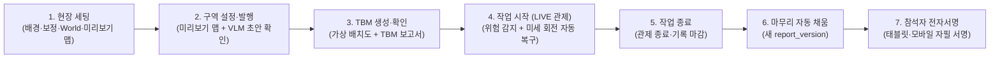
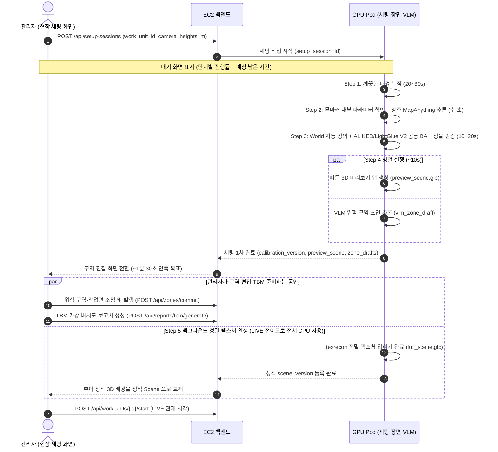
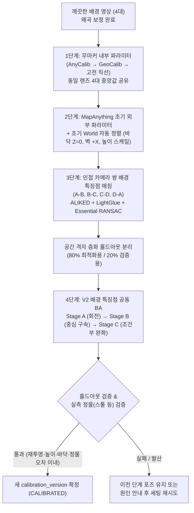
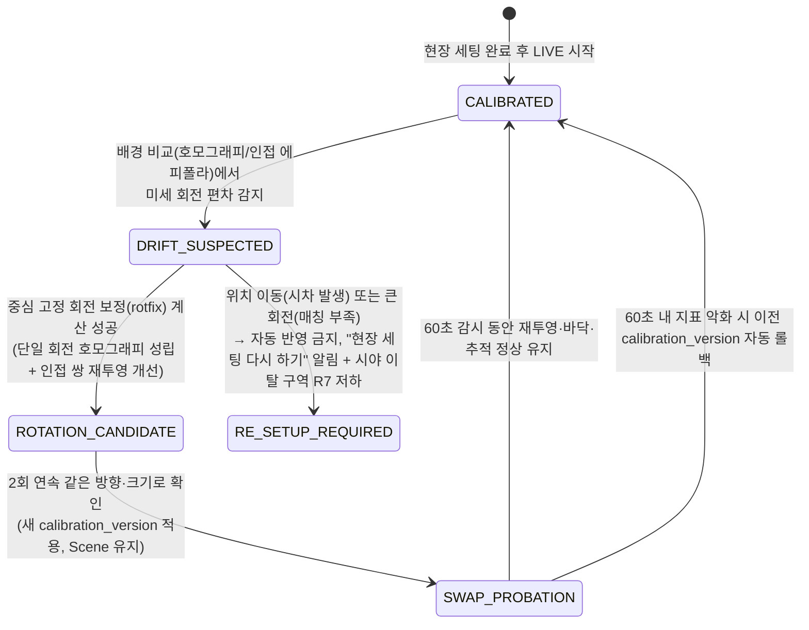

# 작업별 현장 세팅(캘리브레이션·World·정적 3D·초기 구역) 및 운영 중 회전 자동 복구 파이프라인 설계

- **관련 명세**: `docs/spec/03-system.md`(3.1, 3.2, 3.7, 3.8, 3.12), `docs/spec/04-coordinates.md`(4.1, 4.3, 4.4, 4.5), `docs/spec/05-processing.md`(5.1, 5.3, 5.4), `docs/spec/08-features.md`(8.1, 8.2, 8.3), `docs/spec/11-data.md`(11.1, 11.3, 11.7), `docs/spec/12-interfaces.md`(12.2, 12.5, 12.6), `docs/spec/13-viewer.md`(13.1, 13.2, 13.4), `docs/spec/15-gates.md`(15.1, 15.3), `docs/spec/16-decisions.md`, `docs/spec/17-risks.md`, `docs/spec/19-roadmap.md`, `docs/spec/appendix-e-demo.md`
- **관련 요구사항**: FR-3, FR-14, FR-18, FR-20, FR-22, FR-23, FR-24, FR-25, FR-26, FR-27, FR-90, FR-101, FR-102, FR-108, FR-135, NFR-6, NFR-7, NFR-19, NFR-22, NFR-31, NFR-35
- **연관 설계 문서**: `docs/design/work-session-flow.md`(단일 작업 생명주기), `docs/design/world-frame-from-mapanything.md`(MapAnything 점군 기반 바닥·벽 추출 수학 규약)
- **티켓**: `S15P31A101-438` (명세 v1.3 수정 54) → `S15P31A101-443` (명세 v1.3 수정 56: 세팅 1단계 카메라 각도 헬퍼 및 관제 중 사람 관절 보정 경로 제거)

---

## 1. 배경과 문제 정의

### 1.1 현장 운용 전제의 변화: 작업마다 달라지는 카메라와 작업 공간

기존 명세(v1.3 수정 52·53 이전)는 최초 설치 때 카메라 4대의 보정(`calibration_version`)과 World 좌표계, 정적 3D 배경(`scene_version`)을 한 번 확정하면 여러 작업 단위에 걸쳐 그대로 유지되고, 사람이 방 안을 걸어 다니는 동안 관절(23점) 궤적으로 외부 파라미터를 맞추는 **걷기 보정(HumanCalib 원리)**을 기본 절차로 삼았다. 또한 위험 구역 설정과 TBM 보고서·가상 배치도 생성을 작업 시작 전 언제든 미리 해 둘 수 있다고 가정했다.

그러나 실제 건설·산업 현장 및 교실 시연 운영을 검토한 결과 다음 전제가 확인되었다(사용자 결정, 2026-11-03):

1. **작업마다 카메라 위치·각도가 바뀐다**: 작업이 바뀔 때마다 카메라 삼각대 위치나 조준 각도가 달라질 수 있으므로 이전 작업의 보정값을 그대로 믿을 수 없다. 따라서 작업을 시작할 때 **현장 세팅 화면**에서 그 작업 전용 초기 세팅을 새로 수행해야 하며, 세팅이 끝나야 실시간 관제(LIVE)가 시작된다.
2. **위험 구역은 세팅된 공간 위에서 새로 그린다**: 카메라 배치와 현장 물건 배치가 작업마다 달라지므로, 현장 세팅 단계에서 새로 복원된 3D 공간(빠른 미리보기 맵)과 VLM 위험 구역 초안(`vlm_zone_draft`)을 바탕으로 관리자가 구역을 확인·조정·발행(`POST /api/zones/commit`)한다. TBM 가상 배치도와 TBM 보고서는 이 세팅·구역 발행이 끝난 뒤 생성한다.
3. **World 좌표계도 세팅마다 자동으로 잡는다**: 매번 사람이 바닥 점을 찍거나 수동으로 원점·축을 지정하는 절차는 현장에서 번거롭고 실수를 유발한다. 세팅 시 복원된 점군의 바닥 평면($Z=0$), 가장 긴 경계 벽 방향($+X$, 벽이 없으면 카메라 배치 기반 대안), 방 모서리 근처 바닥 원점, 카메라 실측 높이(`MEASURED_CAMERA_HEIGHT`, 이전 입력값 기본 채움)로 World 좌표계를 자동 정의한다. World 는 그 작업 안에서만 일관되면 충분하며, 과거 작업 기록은 당시 보정·Scene 버전 계보로 조회한다.
4. **걷기 보정을 폐기하고 배경 특징점 공동 최적화로 전환한다**: 사람이 방 안을 걸어 다니며 캘리브레이션하는 절차를 없앤다. 대신 사람이 없거나 사람을 지운 깨끗한 배경에서 MapAnything 초기 포즈를 구하고, 인접 카메라 쌍(`A–B`, `B–C`, `C–D`, `D–A`)의 배경 특징점(ALIKED + LightGlue) 공동 번들 조정(V2)으로 외부 파라미터를 정밀화한 뒤 실측 정물로 검증한다.
5. **세팅 대기 시간은 약 1분 30초 안쪽을 목표로 한다**: 관리자가 세팅 시작을 누른 뒤 구역을 그릴 수 있을 때까지 대기 화면에 진행 단계를 표시하되, 상주 MapAnything 모델·배경 특징점 BA·빠른 미리보기 맵 생성·VLM 구역 초안 병렬 호출로 **약 1분 30초 안쪽(목표, 확인 필요)**에 구역 편집 화면으로 넘긴다. 정밀 텍스처 입히기(`texrecon`)는 관리자가 구역을 그리고 TBM 을 준비하는 동안 뒤에서 끝낸다.
6. **관제 중 미세 회전은 자동으로 복구하고 이동·큰 회전은 재세팅을 안내한다**: 작업(관제) 중 카메라가 살짝 돌아간 경우, 깨끗한 배경 비교로 감지하여 **카메라 중심($C_i$)을 고정한 회전 보정(`rotfix`)**을 안전 게이트(2회 연속 확인·60초 감시·자동 롤백)를 거쳐 자동 반영한다. 카메라 중심이 바뀌지 않으므로 정적 3D 배경(Scene)을 다시 만들 필요가 없다. 반면 카메라 위치가 옮겨졌거나 매칭이 깨질 만큼 크게 돌아간 경우에는 자동 반영하지 않고 **"현장 세팅 다시 하기"** 경고를 띄우며, 시야에서 벗어난 구역은 R7 감시 저하(`CAUTION`)로 표시한다.

### 1.2 11차 GPU 세션(2026-11-03) 및 V0(`S15P31A101-437`) 실측 근거

이 설계는 11차 GPU 세션(2026-11-03) 현장 실험과 `S15P31A101-437`(V0 배경 특징점 진단) 실측 결과에 직접 근거한다.

#### (1) 10/30 보정 불일치의 실제 원인과 `rotfix` 검증 (11차 GPU 세션, 2026-11-03)
- **원인 규명**: 10/30 보정(`cal-fastrot-20261030-011907-266z`)과 11/03 보정(`cal-20261102-151925-a64m_rotfix`)을 비교했을 때 `B–C` 상대 회전이 **11.69°**, `C–D` 상대 회전이 **12.37°** 차이 났다. 이는 사람 관절 BA 의 수치적 사고 때문이 아니라, **10/30 촬영 이후 누군가 `cam_C`를 물리적으로 약 13.2° 돌려놓았기 때문**임이 확인되었다.
- **`rotfix` 실험 결과**: 10/29 깨끗한 배경(reference)과 11/02 사람 지운 중앙값 배경(median clean background) 사이에서 왜곡 보정 영상 위 SIFT 특징점과 순수 회전 호모그래피($H = K R_\delta K^{-1}$)로 카메라 중심을 고정한 채 회전만 보정(`rotfix`)한 결과, 다시점 클러스터가 **3-view 5,078개, 4-view 192개**로 즉시 복구되었다. 이는 관제 중 카메라가 돌아갔을 때 중심 고정 회전 복구만으로 기하 정합을 되살릴 수 있음을 실증한다.

#### (2) V0 다중 시점 배경 특징점 매칭 실측 (`S15P31A101-437`, 2026-11-03)
4대 코너 카메라(`cam_A`, `cam_B`, `cam_C`, `cam_D`)의 깨끗한 배경(`background.png`, 2304×1296)에서 ALIKED(최대 4,096점, 0.5배 스케일 추론 후 원본 좌표 복원) + LightGlue 와 OpenCV RANSAC 필수 행렬(`cv2.findEssentialMat`, threshold 2.0 px)로 모든 카메라 쌍(6쌍)을 진단한 결과는 다음과 같다(`C:/Users/SSAFY/simai-local/codex-tmp/437/out-orig/v0_results.json`, `out/v0_results.json`):

| 카메라 쌍 | 관계 | Inliers (`orig` / `rotfix`) | Inlier 비율 (`rotfix`) | Inlier 분포 spread (`rotfix`, 가로×세로) | 기존 보정 대비 상대 회전 차이 (`orig` → `rotfix`) | 기존 보정 대비 이동 방향 차이 (`orig` → `rotfix`) |
| --- | --- | --- | --- | --- | --- | --- |
| `A–B` | 인접 | 135 / 135 | 0.259 | 0.301 × 0.165 | 1.43° → **1.31°** | 3.74° → **1.66°** |
| `B–C` | 인접 | 120 / 120 | 0.241 | 0.237 × 0.241 | 11.69° → **1.58°** | 12.16° → **7.32°** |
| `A–D` | 인접 | 73 / 73 | 0.206 | 0.114 × 0.106 | 3.18° → **5.36°** | 2.66° → **5.86°** |
| `C–D` | 인접 | 19 / 19 | 0.088 | 0.148 × 0.247 | 12.37° → **1.32°** | 40.32° → **44.14°** |
| `A–C` | 대각(마주봄) | 12 / 12 | 0.056 | 0.248 × 0.239 | 172.41° → 172.18° | 86.26° → 85.46° |
| `B–D` | 대각(마주봄) | 7 / 7 | 0.044 | 0.273 × 0.105 | 169.25° → 165.62° | 76.43° → 62.58° |

카메라별 2-view 삼각측량 재투영 오차(중앙값 / p90, 단위 px) 및 다중 시점 트랙 연결 결과는 다음과 같다:

| 지표 | `cam_A` (`orig` → `rotfix`) | `cam_B` (`orig` → `rotfix`) | `cam_C` (`orig` → `rotfix`) | `cam_D` (`orig` → `rotfix`) | 비고 |
| --- | --- | --- | --- | --- | --- |
| 2-view 재투영 오차 중앙값 (px) | 14.39 → **2.19** | 15.66 → **6.19** | 28.52 → **6.64** | 10.18 → **1.80** | `rotfix` 적용 시 전 카메라 중앙값 1.8~6.6 px |
| 2-view 재투영 오차 p90 (px) | 24.65 → **9.26** | 49.24 → **8.85** | 108.02 → **7.44** | 125.49 → **4.10** | `cam_C` 회전 복구로 p90 100 px+ 오차 해소 |
| $\ge 3$-view 연결 트랙 수 | 전체 **5개**(inlier 필터 전) / **2개**(inlier 연결 그래프) | — | — | — | 재투영 오차 124~2,022 px (가짜 병합) |

#### (3) V0 실측에서 도출한 핵심 설계 결론
1. **대각 카메라 쌍(`A–C`, `B–D`)은 시점 차이가 약 170°에 달해 직접 특징점 매칭이 성립하지 않는다**(inlier 7~12개, 회전 오차 ~170°). 따라서 외부 파라미터 최적화는 **인접 카메라 고리(`A–B`, `B–C`, `C–D`, `D–A`)**의 2-view 대응점만을 사용해야 한다.
2. **3-view 이상 동시에 찍히는 배경 특징점 트랙은 사실상 없다**(inlier 기준 2개뿐이며 그마저도 반복 패턴에 의한 가짜 병합). 따라서 "나머지 3대 카메라로 3D 점을 삼각측량한 뒤 한 대 카메라를 PnP 로 재추정하는 Leave-One-Out PnP(V1)" 전략은 작동할 수 없으므로 **채택하지 않고 폐기**한다.
3. 대신 **2-view 인접 쌍들의 고리 제약(ring closure)을 한꺼번에 푸는 공동 번들 조정(V2 Joint BA)**으로 직행해야 한다. 특히 `A–D` 쌍은 특징점이 한쪽 영역에 몰려 있고(spread 0.114×0.106) `C–D` 쌍은 inlier 가 19개로 적어 회전과 카메라 중심 이동이 서로 엉키기 쉬우므로, **① 회전 먼저 고정 최적화 → ② 카메라 중심을 초기 위치 근처로 강하게 묶은 최적화 → ③ 검증 통과 시에만 완화**하는 단계적(staged) 최적화가 필수적이다.

---

## 2. 단일 작업 생명주기와 화면 흐름 통합

기존(수정 52)의 "구역 설정 → TBM 생성 → 작업 시작 → 작업 종료 → 마무리 → 서명" 흐름을 작업별 현장 세팅 전제에 맞춰 다음과 같이 **7단계 단일 흐름**으로 재정렬한다(상세 상태 전이와 API 는 `docs/design/work-session-flow.md` 참조):

1. **세팅 (Site Setup)**: 관리자가 작업 단위(`work_unit`)를 고르고 **현장 세팅 화면**에서 세팅을 시작한다. 카메라 4대 깨끗한 배경 누적 → 무마커 내부 파라미터 확인 → MapAnything 초기 포즈·점군 및 World 자동 정의 → 배경 특징점 공동 BA(V2) 및 실측 정물 검증 → 빠른 3D 미리보기 맵 생성과 VLM 위험 구역 초안(`vlm_zone_draft`) 생성이 자동으로 진행된다(목표 **약 1분 30초**, 확인 필요).
2. **구역 (Zone Setup & Commit)**: 세팅 화면이 완료되면 곧바로 빠른 3D 미리보기 맵 위에 VLM 초안 구역이 겹쳐 표시된다. 관리자가 위험 구역·작업면을 조정하고 발행(`POST /api/zones/commit`)한다. 이 동안 뒤에서는 정밀 텍스처 입히기(`texrecon`)가 완료되어 정적 3D 배경(`scene_version`)이 매끄럽게 교체된다.
3. **TBM (Virtual Layout & TBM Report)**: 구역 발행으로 해당 세팅의 World·보정·구역 묶음이 확정된 직후, 그 구역 배치를 반영한 **TBM 가상 배치도**와 **TBM 요약 보고서**(`POST /api/reports/tbm/generate`)를 생성하고 현장에서 TBM 을 진행한다.
4. **시작 / 관제 (Work Start & LIVE Monitoring)**: 관리자가 `POST /api/work-units/{id}/start` 를 눌러 LIVE 관제를 시작한다. Tier 0 가 실시간 3D 추적·위험 판정을 수행하고, 동시에 깨끗한 배경을 굴리며(rolling clean background) 카메라 미세 회전을 감시·자동 복구한다.
5. **종료 (Work End)**: 작업이 끝나면 `POST /api/work-units/{id}/end` 로 작업을 종료한다.
6. **마무리 (Wrap-up Auto-fill)**: 작업 중 발생한 위험 이벤트 요약을 반영해 마무리 섹션이 채워진 새 `report_version` 이 자동 생성된다.
7. **서명 (Electronic Signatures)**: 참석자들이 태블릿·모바일 화면에서 자필 전자서명(`POST /api/reports/tbm/{reportId}/signatures`)을 남긴다.

---

## 3. 현장 세팅 파이프라인 상세 설계

### 3.1 단계별 구성과 목표 시간 예산 (~1분 30초 목표)

관리자가 현장 세팅 화면에서 **"현장 세팅 시작"**을 누른 시점부터 **빠른 3D 미리보기 맵 위에서 위험 구역을 그릴 수 있게 되기까지 약 1분 30초 안쪽**(목표치, 실제 소요 시간은 현장 측정으로 확인 필요)에 도달하는 것을 목표로 한다.

| 단계 | 작업 내용 | 실행 주체 | 목표 소요 시간 (확인 필요) | 비고 |
| --- | --- | --- | --- | --- |
| **Step 0. 세팅 1단계 각도 헬퍼 & 입력 확인** | 카메라 4대 실시간 미리보기 + **카메라 각도 헬퍼(`coverage_guide` 1.0.0: 4대 시야 연결 `CONNECTED`·6쌍 등급·회전 방향 안내, 막지 않음·"그대로 진행" 가능)** 확인, 카메라별 실측 높이(`camera_heights_m`, 직전 세팅 값 자동 채움·처음이면 입력 필수) 확인 | 게이트웨이 별도 CPU 프로세스 → EC2 → 뷰어 | 세팅 1단계 화면이 열려 있는 동안 상시(비차단) | `gateway/relay` 로컬 미리보기 키프레임 소비(추가 RTSP 세션 0), 헬퍼 `CONNECTED` ≠ `CALIBRATED` |
| **Step 1. 깨끗한 배경 누적** | 4대 카메라에서 사람 영역(YOLO 세그멘테이션 마스크 + 팽창)을 뺀 깨끗한 배경(`background.png`) 누적 및 렌즈 왜곡 보정 | GPU Pod (`CleanBackgroundAccumulator`) | **20 ~ 30초** | 방이 비어 있으면 즉시 조기 수렴 가능, 사람이 지나다녀도 중앙값 누적으로 제거 |
| **Step 2. 무마커 내부 파라미터 & MapAnything 초기 복원** | (필요 시) AnyCalib 무마커 내부 파라미터 확인(동일 렌즈 4대 중앙값 공유) + **상주(warm) MapAnything 모델**로 초기 외부 파라미터·밀집 점군 추론 | GPU Pod (장면·세팅 워커) | **수 초 (5 ~ 10초)** | 모델 가중치를 미리 메모리에 올려 두어 로드 시간(기존 ~25초) 제거 |
| **Step 3. World 자동 정의 & 배경 특징점 공동 BA (V2)** | 점군 바닥 RANSAC($Z=0$)·경계 벽($+X$)·모서리 원점·카메라 높이 스케일로 초기 World 정의 → 인접 쌍(`A–B–C–D–A`) ALIKED+LightGlue 매칭 → V2 공동 BA + 실측 정물 검증 | GPU Pod | **10 ~ 20초** | 걷기 보정 없음. 공간 분할 홀드아웃(80/20) 검증 통과 시 새 `calibration_version` 확정 |
| **Step 4. 빠른 3D 미리보기 맵 & VLM 위험 구역 초안 (병렬)** | 확정된 포즈·점군으로 **빠른 미리보기 맵(저해상도 메시/점군 또는 투영 바닥면)** 생성 + VLM(`vlm_zone_draft`) 위험 구역 초안 병렬 추론 | GPU Pod (미리보기 맵 + VLM 워커 병렬) | **약 10초** | 이 단계가 끝나는 즉시(**누적 약 1분 ~ 1분 30초**) 관리자에게 구역 편집 화면 열림 |
| **Step 5. 정밀 텍스처 3D 배경 완성 (백그라운드)** | 관리자가 구역을 확인·조정하고 TBM 을 준비하는 동안 뒤에서 `texrecon` 텍스처 베이킹·GLB 패키징 완료 후 뷰어 Scene 무중단 교체 | GPU Pod (백그라운드) | 구역 편집 중 완료 (수십 초) | **아직 LIVE 관제 시작 전이므로 GPU Pod 의 CPU 코어를 전력으로 사용 가능** |

### 3.2 GPU·CPU 실행 자원 운용 (LIVE 전 세팅 단계의 이점)

기존에는 정적 3D 재구성이 LIVE 관제와 겹칠까 우려하여 `texrecon` 등 CPU 집약 후처리의 스레드 수를 제한하거나 별도 일회성 기동(`simai-bootstrap scene`)으로만 다루었다. 작업별 현장 세팅 흐름에서는 다음 원칙으로 자원을 운용한다:

1. **세팅 단계는 LIVE 관제 시작 전이다**: 관리자가 세팅을 시작할 때는 아직 `POST /api/work-units/{id}/start` 이전이므로 실시간 위험 판정(Tier 0 12 FPS 루프) 지연 예산을 침범할 우려가 없다. 따라서 Step 1~5 동안 GPU 와 **Pod 의 전체 CPU 코어**를 세팅·장면 복원(`texrecon` 등)에 전력으로 투입해 대기 시간을 단축한다.
2. **MapAnything 가중치 상주(Warm Model)**: 세팅할 때마다 프로세스를 새로 띄워 가중치를 디스크에서 읽는 시간(~25초)을 없애기 위해, 세팅 워커(또는 장면 서비스)가 MapAnything 가중치를 메모리에 올린 채 대기하다가 세팅 요청 즉시 추론하고, LIVE 관제가 시작될 때 VRAM 예산이 필요하면 가중치를 내리거나 유휴 상태로 전환한다(구체적인 VRAM 상주·언로드 전환 시간은 확인 필요).
3. **LIVE 전환 보장**: 관리자가 구역 발행과 TBM 을 마치고 **작업 시작(LIVE)**을 누를 때 아직 백그라운드 `texrecon` 이 끝나지 않았다면, Tier 0 실시간 관제 가용성이 최우선이므로 백그라운드 후처리 스레드를 즉시 줄이거나 중단하고 빠른 미리보기 맵(`preview_scene`)으로 먼저 관제를 시작할 수 있게 한다.

### 3.3 세팅 1단계 카메라 각도 헬퍼 (`coverage_guide`, `S15P31A101-443`·`-445`·`-446`·`-447`·`-448`)

관리자가 **"현장 세팅 시작"**(`POST /api/setup-sessions`)을 누르기 전인 **세팅 1단계 화면**에서, 지금 카메라 4대가 겹치는 시야를 통해 하나의 연결된 공간(`CONNECTED`)을 보고 있는지 즉시 확인하고 각도가 틀어진 카메라를 어느 쪽으로 돌릴지 안내하는 경량 헬퍼를 둔다.

1. **설계 원칙 (사용자 결정, 2026-11-03)**:
   - **지금 화면만 사용**: 이전 작업의 외부 파라미터 보정을 쓰지 않고 현재 들어오는 프레임만으로 판단한다. 내부 파라미터(`intrinsics_source`)는 카메라별 저장된 렌즈 고유 내부값(`"STORED"`, 렌즈 고유값이라 이전 세팅 자세가 아님)을 쓰고, 없으면 공칭 화각 기본값(`"DEFAULT"`, RANSAC 문턱 완화)을 쓴다.
   - **최소·비차단(Non-blocking)**: 목적은 오직 **"4대 카메라가 1개 연결 성분을 이루는지"** 확인하는 것이다. YOLO 사람 검출이나 VLM 은 호출하지 않으며, 세팅 1단계 화면이 열려 있는 동안에만 계산한다. 결과가 `DISCONNECTED` 이거나 `UNKNOWN` 이어도 관리자가 **"그대로 진행"**을 눌러 세팅을 시작하는 것을 막지 않는다.
   - **헬퍼 `"CONNECTED"` ≠ `CALIBRATED`**: 헬퍼의 `"CONNECTED"` 는 2D 특징점 매칭 그래프가 이어졌다는 안내일 뿐이며, 보정 성공(`CALIBRATED`) 판정은 여전히 Step 3~4의 홀드아웃·바닥·실측 정물 검증(명세 4.4)이 맡는다.
2. **실행 위치와 전송 경로 (추가 RTSP 세션 0)**:
   - Tapo C110 은 카메라당 동시 RTSP 2세션 한도(명세 3.3)가 있으므로 헬퍼가 카메라에 RTSP 로 직접 붙지 않는다. 또한 `gateway/relay` 프로세스 안에 `torch` 를 넣으면 크래시·메모리 문제 시 Tier 0 영상 중계가 멈추므로, 게이트웨이의 **별도 CPU 프로세스**가 `gateway/relay` 의 로컬 미리보기 WebSocket(`127.0.0.1:47032`, `simai-cctv-preview/1`)에서 카메라별 최신 키프레임만 받아 계산한다(추가 RTSP 세션 0).
   - 계산 결과(`contracts/messages/coverage_guide.schema.json` 1.0.0, 계약 v7.3.0)는 **게이트웨이 → EC2 `POST /api/devices/coverage-guides`(기기 토큰) → 브라우저 `GET /api/cameras/coverage-guides`(응답의 `latest`)** 로 전달한다. 영상·특징점 배열·사람 정보는 싣지 않는다(닫힌 값 객체 `additionalProperties: false`).
3. **판정 규칙과 회전 방향 안내**:
   - **입력 및 특징점**: 가로 `image_width_px = 1024` 리사이즈, 카메라당 ALIKED 최대 `max_keypoints = 1024`개 추출 후 6쌍(`4C2`) 모두에 LightGlue 매칭 + OpenCV Essential RANSAC(`ransac_threshold_px = 2.0`, `DEFAULT` 내부값일 때 완화) + `recoverPose` 양의 깊이를 통과한 인라이어 수(`inliers`)와 비율(`inlier_ratio = inliers / raw_matches`)을 계산한다.
   - **카메라 상태 (`cameras[].status`)**: `OK` | `NO_VIDEO` | `STALE`(영상이 2초 넘게 갱신되지 않음). `NO_VIDEO`·`STALE` 카메라가 낀 쌍은 `grade: "UNKNOWN"` 으로 두고 수치·무게중심을 모두 `null` 로 비운다.
   - **쌍 등급 (`pairs[].grade`)**: `ENOUGH`(`inliers >= 30` 그리고 `inlier_ratio >= 0.10`) | `WEAK`(`15 <= inliers < 30` 그리고 `inlier_ratio >= 0.10`) | `LACK`(그 밖) | `UNKNOWN`. `centroid_a`·`centroid_b` 는 인라이어 점들의 정규화 `[0, 1]` 무게중심이며 `inliers < 5` 또는 `UNKNOWN` 이면 `null` 이다.
   - **연결성 (`connectivity`)**: `ENOUGH`·`WEAK` 쌍을 간선으로 union-find 하여 연결 성분이 1개(4대 모두 연결)면 `"CONNECTED"`, 카메라 중 하나라도 `UNKNOWN` 이고 나머지로 판정할 수 없으면 `"UNKNOWN"`, 그 밖은 `"DISCONNECTED"` 로 판정한다.
   - **방향 안내 (`guides[]`)**: 약한·부족 쌍(`5 <= inliers < 30`)에서 한쪽 카메라의 인라이어 무게중심 `x > 0.65` → `RIGHT`, `x < 0.35` → `LEFT`, `y > 0.68` → `DOWN`, `y < 0.32` → `UP`(가로 우선)으로 돌릴 방향을 내고, 크기는 `WEAK` → `SMALL`, `LACK` → `MORE`, 사유는 `"WEAK_PAIR_EDGE_CLUSTER"`(이미 `CONNECTED` 면 선택 보강 `"OPTIONAL_IMPROVE"`)로 낸다. `inliers < 5` 면 `direction: "NONE"`, `magnitude: "NONE"`, `reason_code: "NO_OVERLAP_VISIBLE"` 을 낸다.
   - **흔들림 방지(히스테리시스)**: 쌍 등급과 `connectivity` 는 **2회 연속 같을 때만** 바꾼다(표시 화면이 아니라 헬퍼 프로세스가 적용).

---

## 4. 세팅별 World 좌표계 자동 정의

작업마다 현장 세팅을 새로 수행하므로 World 좌표계도 세팅마다 자동으로 정의한다. 수동 바닥 점 클릭 절차는 두지 않는다. 수학적 세부 규약은 `docs/design/world-frame-from-mapanything.md` 를 따르며, 벽이 안 잡히는 현장 조건과 원점 위치, 스케일 입력 UX 를 다음과 같이 확정한다.

### 4.1 바닥 평면 ($Z = 0$, $+Z$ 상방)
1. MapAnything 융합 점군에서 각 카메라 광선 아래쪽 표본으로 바닥 후보 점군을 추리고 RANSAC 평면 피팅(`floor_ransac_dist_m = 0.04 m`)으로 주 바닥 평면 $(\mathbf{n}_{\text{floor}}, d)$ 를 구한다.
2. 천장·들보가 바닥으로 오인되지 않도록 카메라 중심들의 평균이 법선 양의 방향($+Z$)에 놓이게 부호를 강제한다:
   $$\frac{1}{N}\sum_{i=1}^{N}\left(\mathbf{n}_{\text{floor}}\cdot \mathbf{C}_i + d\right) > 0$$
3. 이 바닥 평면이 World 의 $Z = 0$ 평면이 되며, 바닥에서 수직 위쪽이 $+Z$ 축이 된다.

### 4.2 수평 축 ($+X, +Y$)과 벽 부재 시 대안 (`axis_source`)
바닥 평면 위로 투영한 2D 점군에서 수평 축을 정하되, 현장 여건에 따라 2단계 대안을 둔다:

1. **기본 (`WALL_AND_FLOOR`) — 가장 긴 경계 벽 방향**:
   - 바닥 위 높이 $0.3\text{ m} \le z' \le 2.2\text{ m}$ 구간의 벽 후보 점들을 바닥 평면에 정사영하고, 2D 외곽 경계(convex hull / 경계 구간)에서 **가장 긴 직선 경계 벽 구간**을 1D 직선 RANSAC 으로 찾는다.
   - 그 벽을 따라가는 단위벡터를 $+X$ 로 두고, 방 안쪽(카메라 중심들의 평균 쪽)을 향하도록 $+Y = \mathbf{n}_{\text{floor}} \times (+X)$ 의 부호를 정한다.
2. **대안 (`CAMERA_LAYOUT`) — 경계 벽이 뚜렷하지 않을 때**:
   - 개방된 작업장이나 어수선한 적치물 때문에 경계 벽 RANSAC 인라이어가 최소 기준(`min_wall_inliers`)에 못 미치면 실패로 멈추지 않고 **카메라 배치 기반 축(`CAMERA_LAYOUT`)**으로 자동 전환한다.
   - 바닥 평면에 정사영한 첫 번째 기준 카메라(`cam_A`) 중심에서 인접 기준 카메라(`cam_B`, 없으면 카메라 중심들의 주성분 제1축)를 잇는 수평 방향 벡터를 $+X$ 로 삼고, 오른손 법칙($+Y = +Z \times +X$)과 카메라 중심 평균 방향 규약으로 $+Y$ 를 확정한다.

### 4.3 원점 ($(0, 0, 0)$) — 방 모서리 근처 바닥
- 바닥 평면($Z = 0$) 위에서 관측된 바닥·벽 인라이어 점들의 $(x, y)$ 분포 하위 분위수(예: 5% 분위수 모서리) 또는 주 경계 벽 두 개가 만나는 **방 모서리 근처 바닥 점**을 World 원점 $(0, 0, 0)$ 으로 잡는다.
- 이렇게 하면 방 안의 주요 작업 영역 좌표가 대부분 양수($X \ge 0, Y \ge 0$) 사분면에 놓여 관리자가 좌표를 직관적으로 읽을 수 있다.

### 4.4 절대 스케일 (`scale_source`) — 카메라 실측 높이 기본 및 이전 값 자동 채움
단안·다시점 기하 복원의 임의 스케일($s$)은 다음 우선순위로 확정한다:

1. **`MEASURED_CAMERA_HEIGHT` (기본 1순위)**:
   - 각 카메라 렌즈 중심에서 바닥($Z = 0$)까지의 실측 높이 $h_i^{\text{meas}}$(줄자 또는 레이저 거리계 측정값)와 재구성된 카메라 높이 $z'_i$ 의 비 $s_i = h_i^{\text{meas}} / z'_i$ 들의 중앙값으로 전체 스케일 $s$ 를 확정한다.
   - **입력 UX**: 현장 세팅 화면의 카메라 높이 입력 칸에는 **직전 세팅에서 입력했던 카메라별 높이 값이 기본으로 채워져(pre-filled) 표시**된다. 삼각대 높이를 바꾸지 않고 위치·각도만 조정한 경우에는 관리자가 숫자를 다시 칠 필요 없이 확인만 누르면 된다.
2. **`KNOWN_OBJECT_SIZE` (보조·검증)**:
   - 현장에 치수를 아는 정물(실측 스툴 `measure-stools`, 안전봉·라바콘 등, FR-135)이 있으면 2대 이상 삼각측량 치수로 스케일을 교차 검증하거나 카메라 높이 미입력 시 대안으로 사용한다.
3. **`MAPANYTHING_METRIC` (최후 대안, 과거 호환 스키마 값 `HUMAN_HEIGHT_PRIOR` 는 미사용)**:
   - 실측 높이와 정물이 모두 없을 때만 사용하며, 정확도 저하 경고를 표시한다.

### 4.5 작업 간 좌표계 독립성과 과거 기록 조회
- World 좌표계는 **해당 세팅(작업 단위) 안에서만 일관되면 된다**. 다음 작업에서 카메라를 옮겨 다시 세팅하면 새로운 `calibration_version` 과 `scene_version` 이 발급된다.
- 과거 작업의 이벤트·리플레이·TBM 가상 배치도를 열람할 때는 그 작업 세션에 연결된 당시 `calibration_version`·`scene_version`·구역 스냅샷 계보를 불러와 그대로 재현한다.

---

## 5. 외부 파라미터 정밀화: 배경 특징점 공동 BA (V2)

### 5.1 전체 파이프라인 요약 (걷기 보정 삭제)

- **무마커 내부 파라미터(1단계) 유지**: 체커보드 없이 AnyCalib(1순위) → GeoCalib(2순위) → 고전 직선/소실점(3순위) + 직선 왜곡 검증(`undistort_check`)으로 초점거리·왜곡 계수를 구하고, 같은 기종 카메라 4대의 중앙값을 공유하는 기존 무마커 파이프라인을 그대로 유지한다.
- **사람 관절(걷기·관제 보정) 완전 제거**: 사람이 방을 걸어 다니는 절차와 사람 2D 관절 보조 제약을 모두 없앤다(`YOLO26x-pose` 는 LIVE 사람 추적·위험 판정과 아바타 구동에만 사용). 현장 세팅은 100% 배경 특징점과 정적 기하 제약만으로 완결된다.

### 5.2 인접 쌍 특징점 추출·매칭 규약
1. **대상 카메라 쌍**: 코너 4대 배치에서 시야가 겹치는 **인접 4쌍(`A–B`, `B–C`, `C–D`, `D–A`)**만 사용한다. 대각 쌍(`A–C`, `B–D`)은 V0 실측에서 입증되었듯 시점 차이가 약 170°로 가짜 매칭만 유발하므로 제외한다.
2. **특징점 추출·매칭**: 왜곡 보정된 깨끗한 배경 영상(`2304×1296`)에서 ALIKED(또는 SuperPoint, 0.5배 스케일 추론 후 원본 해상도 좌표 복원) + LightGlue 로 쌍별 대응점을 뽑고, 필수 행렬(Essential Matrix) RANSAC 으로 기하학적 인라이어만 남긴다.
3. **공간 격자 층화 추출 (Spatial Grid Stratification & 80/20 Holdout)**:
   - 특정 구석(예: `A–B`의 135개)에 인라이어가 몰려 다른 쌍(`C–D`의 19개)이 무시되거나 국소 영역에 과적합되는 것을 막기 위해, 영상을 격자(예: $4 \times 4$ 또는 $6 \times 4$ 셀)로 나누어 셀당 가중치·표본 수를 균형 있게 조절한다.
   - 인라이어 대응점의 **80%는 최적화(train)에, 공간적으로 골고루 뽑은 20%는 검증(holdout validation)에 분리**한다.

### 5.3 V2 공동 번들 조정 (Staged Joint Bundle Adjustment) 수학적 구성

2-view 인접 쌍들의 대응점 집합 $\mathcal{M} = \{(i, j, \mathbf{u}_{ik}, \mathbf{u}_{jk})\}$ 와 삼각측량 3D 점 $\mathbf{X}_k \in \mathbb{R}^3$ 에 대하여, 게이지 고정(예: `cam_A` 위치·수평 회전 기준 고정 + 전체 스케일·바닥 평면 구속) 아래 다음 목적함수를 최소화한다:

$$\min_{\{R_i, \mathbf{C}_i\}, \{\mathbf{X}_k\}} \; E_{\text{reproj}} + \lambda_{\text{height}} E_{\text{height}} + \lambda_{\text{floor}} E_{\text{floor}} + \lambda_{\text{center}} E_{\text{center}} + \lambda_{\text{rot}} E_{\text{rot}}$$

- **재투영 오차 항 ($E_{\text{reproj}}$)**:
  $$E_{\text{reproj}} = \sum_{(i,j,k) \in \mathcal{M}_{\text{train}}} w_{ij} \left( \rho_{\text{Huber}}\!\left(\|\pi(K_i, R_i, \mathbf{C}_i, \mathbf{X}_k) - \mathbf{u}_{ik}\|^2\right) + \rho_{\text{Huber}}\!\left(\|\pi(K_j, R_j, \mathbf{C}_j, \mathbf{X}_k) - \mathbf{u}_{jk}\|^2\right) \right)$$
  여기서 $w_{ij}$ 는 인라이어 수가 적은 인접 쌍(`C–D` 등)이 완전히 묻히지 않도록 하는 쌍별 균형 가중치이고, $\rho_{\text{Huber}}$ 는 이상치에 강건한 손실 함수이다.
- **카메라 실측 높이 구속 항 ($E_{\text{height}}$)**:
  $$E_{\text{height}} = \sum_{i} \left( (\mathbf{C}_i)_Z - h_i^{\text{meas}} \right)^2$$
  카메라 중심의 World $Z$ 좌표가 줄자·레이저로 잰 실측 높이 $h_i^{\text{meas}}$(예: $\pm 5\text{ cm}$)에서 벗어나지 않도록 강하게 묶는다.
- **바닥 평면 일관성 항 ($E_{\text{floor}}$)**:
  바닥 영역에 속하는 3D 점 $\mathbf{X}_k \in \mathcal{F}$ 의 $Z$ 좌표가 $0$ 에 놓이도록($(\mathbf{X}_k)_Z^2$) 구속하여 4대 카메라가 보는 바닥 평면 차이(목표 $3\text{ cm}$ 이하)를 억제한다.
- **초기 카메라 중심·회전 사전 구속 항 ($E_{\text{center}}, E_{\text{rot}}$)**:
  $$E_{\text{center}} = \sum_{i} \|\mathbf{C}_i - \mathbf{C}_i^{(0)}\|^2, \qquad E_{\text{rot}} = \sum_{i} \|\log(R_i^{(0)\top} R_i)\|_2^2$$
  희소하거나 한쪽에 치우친 2-view 대응점 때문에 카메라 위치 $\mathbf{C}_i$ 가 회전을 보상하며 수십 cm 씩 미끄러지는(rotation-translation coupling) 현상을 방지한다.

#### 3단계(Staged) 최적화 절차
1. **Stage A — 회전 우선 정렬 (Rotation-first)**: 카메라 중심 $\mathbf{C}_i = \mathbf{C}_i^{(0)}$ 를 고정하고 회전 $R_i$ 와 3D 점 $\mathbf{X}_k$ 만 최적화하여 큰 각도 틀어짐(예: `cam_C`의 13° 회전)을 먼저 흡수한다.
2. **Stage B — 강하게 구속된 중심·회전 동시 최적화 (Constrained Center + Rotation)**: 큰 $\lambda_{\text{center}}$ 와 $\lambda_{\text{height}}, \lambda_{\text{floor}}$ 아래에서 $\mathbf{C}_i$ 의 미세 이동(예: 초기 위치 대비 수~십수 cm 이내)과 $R_i$ 를 함께 다듬는다.
3. **Stage C — 조건부 완화 및 홀드아웃 채택 판정 (Validated Relaxation)**:
   - 각 단계가 끝날 때마다 **20% 공간 홀드아웃 대응점의 재투영 오차(중앙값·p90)**와 **에피폴라 삼각합 일관성**, **카메라 높이 편차($\pm 5\text{ cm}$)**, **실측 정물(`measure-stools` 등) 치수 오차**를 계산한다.
   - 홀드아웃 오차가 직전 단계보다 나빠지거나 카메라 중심이 비정상적으로 이동하면 그 단계의 완화를 기각하고 직전 검증 통과 해를 채택한다.

---

## 6. 세팅 실패 시 대응과 사용자 재시도 UX

현장 세팅 도중 조명이 너무 어둡거나, 사람이 계속 카메라 앞을 가려 깨끗한 배경이 안 모이거나, 민무늬 벽면만 찍혀 인접 쌍 특징점 매칭이 부족할 때는 **잘못된 보정값을 억지로 발행하지 않고** 대기 화면에서 원인과 조치 방법을 명확히 안내한다.

| 실패 유형 | 감지 조건 (초기 기준, 확인 필요) | 관리자에게 표시하는 안내 문구 | 복구 동작 |
| --- | --- | --- | --- |
| **배경 누적 지연 (`BACKGROUND_INCOMPLETE`)** | 30초 경과 후에도 특정 카메라의 깨끗한 배경 픽셀 비율이 기준(예: 85%) 미달 | "`cam_X` 앞의 움직임이 많아 배경을 모으지 못했습니다. 작업자가 비켜선 뒤 **다시 시도**를 눌러 주세요." | 해당 카메라 배경만 추가 누적하거나 `POST /api/setup-sessions/{id}/retry` 실행 |
| **인접 쌍 특징점 부족 (`INSUFFICIENT_FEATURES`)** | 인접 4쌍 중 2쌍 이상에서 RANSAC 인라이어가 최소 기준(예: 12개) 미달(고리 끊김) | "`cam_X`–`cam_Y` 겹치는 영역에 눈에 띄는 물체(표지판·집기·스툴 등)가 부족해 위치를 맞출 수 없습니다. 경계 영역에 물체를 놓거나 카메라 각도를 조금 조정한 뒤 **다시 시도**해 주세요." | 현장 조치 후 세팅 재시도 |
| **바닥 평면 검출 실패 (`FLOOR_FIT_FAILED`)** | 바닥 RANSAC 인라이어 비율 미달 또는 카메라 높이 부호 불일치 | "바닥 면이 충분히 보이지 않습니다. 카메라가 바닥을 포함하도록 각도를 점검하고 카메라 높이 입력값을 확인해 주세요." | 카메라 높이 수정 / 각도 조정 후 재시도 |
| **홀드아웃 / 정물 검증 실패 (`VALIDATION_REJECTED`)** | V2 BA 후 홀드아웃 재투영 오차(p90)가 기준을 넘거나 실측 정물 치수 오차가 기준 초과 | "카메라 간 위치 정합 오차가 기준을 넘었습니다(`cam_X` 확인 필요). 카메라가 흔들렸는지 확인하고 **다시 시도**해 주세요." | Stage A 해(또는 MapAnything 초기해) 진단 표시 + 재시도 |

- 세팅이 실패(`FAILED`) 상태일 때는 구역 발행(`POST /api/zones/commit`)과 작업 시작(`POST /api/work-units/{id}/start`) 버튼이 비활성화되어 미보정 상태로 LIVE 관제가 켜지는 것을 원천 차단한다.

---

## 7. 작업(LIVE 관제) 중 자동 회전 복구 설계

### 7.1 설계 원리와 적용 범위
작업 중 누군가 삼각대를 스치거나 진동으로 카메라가 **살짝 회전(pan/tilt/roll)**하는 일은 현장에서 흔히 일어난다(11차 GPU 세션에서 확인된 `cam_C` 회전 사례). 이때 매번 작업을 멈추고 1분 30초짜리 전체 현장 세팅을 다시 하는 대신, **카메라 중심($\mathbf{C}_i$)은 그대로이고 회전($R_i$)만 바뀐 경우**에는 관제를 멈추지 않고 자동으로 회전만 복구(`rotfix`)한다.

- **자동 복구 가능 범위 (순수 미세 회전)**:
  - 카메라 중심 $\mathbf{C}_i$ 가 이동하지 않았으므로, 같은 카메라의 세팅 당시 기준 깨끗한 배경($I_i^{\text{ref}}$)과 관제 중 최근 누적된 깨끗한 배경($I_i^{\text{roll}}$) 사이의 특징점 이동이 **단일 순수 회전 호모그래피 $H_i = K_i \Delta R_i K_i^{-1}$** 로 설명된다.
  - 카메라 중심이 그대로이므로 **정적 3D 배경(`scene_version`)과 World 좌표계 원점·축·스케일은 전혀 바뀌지 않는다**. 따라서 Scene 을 다시 만들 필요 없이 새 `calibration_version` 만 발급해 투영 행렬을 갱신하면 된다.
- **자동 복구 불가 범위 (카메라 위치 이동 또는 큰 회전)**:
  - 삼각대 자체가 옮겨져 시차(parallax)가 생기면 단일 회전 호모그래피 $H_i = K_i \Delta R_i K_i^{-1}$ 의 인라이어 비율이 급락하고 잔차(residual)가 커진다.
  - 또는 카메라가 너무 크게 돌아가 기준 배경과의 겹침이나 인접 카메라와의 겹침이 깨지면 매칭 자체가 부족해진다.
  - 이 경우에는 **절대 자동으로 보정을 덮어쓰지 않고**, 관제 화면 상단에 **"카메라 위치/각도가 크게 변경되었습니다 — 현장 세팅 다시 하기"** 경고를 띄운다.

### 7.2 감지 → 중심 고정 회전 복구 → 안전 게이트 상태 전이

관제(LIVE) 중 Tier 0 와 분석 워커는 기존의 보정 안전 게이트(`CandidateConfirmation` 2회 연속 확인, `SwapProbation` 교체 후 60초 감시 및 악화 시 자동 롤백)를 그대로 재사용하여 다음과 같이 동작한다:

1. **상시 배경 비교 (Drift Watch)**:
   - 관제 중 `CleanBackgroundAccumulator` 가 사람을 지운 최근 깨끗한 배경($I_i^{\text{roll}}$)을 주기적으로 갱신한다.
   - 세팅 완료 시점의 기준 배경($I_i^{\text{ref}}$)과 $I_i^{\text{roll}}$ 사이에서 특징점(SIFT 또는 ALIKED+LightGlue)을 매칭하고, 인접 카메라 쌍의 배경 에피폴라 잔차만을 상시 감시한다(관제 중 사람 관절 기반 `drift_watch`·사람 LOO `monitor`·`live_candidate`·`live_calibration`·`LiveCandidateCalibrationRunner` 경로는 명세 v1.3 수정 56에서 제거).
2. **순수 회전 판별 및 중심 고정 회전 추정 (`rotfix`)**:
   - 특정 카메라 $i$ 에서 틀어짐이 감지되면 왜곡 보정 좌표계에서 순수 회전 $\Delta R_i = \arg\min_{R \in SO(3)} \sum_m \rho(\|\mathbf{x}'_m - \pi(K_i R K_i^{-1} \tilde{\mathbf{x}}_m)\|^2)$ 를 추정하고, 카메라 중심 $\mathbf{C}_i$ 를 고정한 채 인접 쌍(`(i-1, i)`, `(i, i+1)`) 배경 특징점으로 $R_i^{\text{new}} = \Delta R_i R_i^{\text{old}}$ 를 미세 조정한다.
   - **판별 게이트**(구체적 문턱값은 통제된 회전 시험 후 확정, **확인 필요**):
     - 순수 회전 호모그래피 인라이어 비율과 잔차가 기준 이내이고,
     - 회전 보정 후 인접 쌍 2-view 재투영 오차(중앙값·p90)가 보정 전보다 유의미하게 감소할 때만 `ROTATION_CANDIDATE` 로 인정한다.
3. **2회 연속 확인 및 60초 감시(`SwapProbation`)**:
   - 일시적인 가림이나 조명 변화를 걸러내기 위해 **연속 2회 주기(`CandidateConfirmation`)**에서 일관된 회전 후보가 나오면 새 `calibration_version` 으로 교체하고 60초 감시(`SwapProbation`)에 들어간다.
   - 60초 동안 배경 호모그래피·인접 쌍 배경 에피폴라 잔차가 교체 전보다 나빠지면 즉시 직전 `calibration_version` 으로 자동 롤백한다.
4. **시야 이탈 위험 구역의 감시 저하 표시 (R7 연계)**:
   - 회전 복구가 적용되었더라도 카메라가 돌아간 결과 기존에 발행된 위험 구역(`zone`)의 일부 또는 전부가 2대 이상 카메라 시야(FOV)에서 벗어났다면, 그 구역의 관측 가능 카메라 수를 즉시 재계산하여 **R7 감시 저하(`CAUTION`, 구역 빗금 표시)**를 발생시킨다.
   - 위치 이동이나 큰 회전으로 `RE_SETUP_REQUIRED`("현장 세팅 다시 하기")가 뜬 경우에도 해당 카메라를 신뢰할 수 없으므로 영향받는 구역을 즉시 R7 감시 저하로 표시한다.

---

## 8. 인터페이스 계약 (세팅 세션 REST API 및 내부 작업)

세팅 대기 화면 진행률 표시와 재시도 제어를 위해 EC2 REST API 에 세팅 세션(`setup_session`) 엔드포인트를 둔다(세부 스키마는 `docs/spec/12-interfaces.md` 12.6절 참조):

| 메서드 | 경로 | 권한 | 설명 |
| --- | --- | --- | --- |
| `POST` | `/api/devices/coverage-guides` | `DEVICE` | 세팅 1단계 화면이 열려 있는 동안 게이트웨이 별도 CPU 프로세스가 계산한 카메라 각도 헬퍼 결과(`contracts/messages/coverage_guide.schema.json` 1.0.0) 제출 |
| `GET` | `/api/cameras/coverage-guides` | `ADMIN` | 세팅 1단계 화면에서 최신 카메라 각도 헬퍼 결과(`latest: coverage_guide`) 조회 및 온디맨드 계산 활성화 |
| `GET` | `/api/setup-sessions/camera-height-defaults` | `ADMIN` | 활성 카메라별 직전 제출 높이 기본값(`camera_heights_m`, 한 번도 제출된 적 없는 카메라는 `null` 로 반환해 임의 기본값을 만들지 않음)과 허용 오차(`height_tolerance_cm: 5.0`), 전체 존재 여부(`all_present`) 조회 (`S15P31A101-452`) |
| `POST` | `/api/setup-sessions` | `ADMIN` | 선택한 `work_unit_id` 에 대해 새 현장 세팅 세션 시작(`202 Accepted`). 요청 본문에 카메라별 실측 높이 `camera_heights_m`(생략·일부 생략 시 `site.default_camera_heights_m` 폴백, 모두 채워지지 않으면 `400 CAMERA_HEIGHT_REQUIRED`) 전달. 제출된 유효 높이는 세션 생성·작업이 실패해도 다음 기본값으로 즉시 저장되며, 활성 `site_setup` 워커 부재 또는 동일 현장 진행 중 세션 존재 시 `409` 반환 (`S15P31A101-452`) |
| `POST` | `/api/setup-sessions` | `ADMIN` | 선택한 `work_unit_id` 에 대해 새 현장 세팅 세션 시작. 요청 본문에 카메라별 실측 높이 `camera_heights_m`(생략 시 직전 세팅 값 사용) 전달. 이전 세팅의 카메라 높이를 기본값으로 함께 반환 |
| `GET` | `/api/setup-sessions/{setupSessionId}` | `ADMIN`, `VIEWER` | 현재 세팅 단계(`COLLECTING_BACKGROUND` → `INITIAL_POSE_AND_WORLD` → `JOINT_BA_AND_VERIFY` → `PREVIEW_AND_VLM_DRAFT` → `READY_FOR_ZONES` / 백그라운드 `BAKING_TEXTURE` → `COMPLETED`, 실패 시 `FAILED`), 진행률(%), 카메라별 배경 수집률, 검증 요약, 생성된 `calibration_version`·`preview_scene_version`·`scene_version`·`zone_drafts`, 실패 사유(`failure_code`, `failure_message`) 조회 |
| `POST` | `/api/setup-sessions/{setupSessionId}/retry` | `ADMIN` | 실패했거나 관리자가 카메라/물체를 다시 조정한 뒤 현장 세팅을 다시 실행(깨끗한 배경이 이미 유효한 카메라는 재사용 선택 가능) |

- 내부 구간(EC2 ↔ GPU Pod I5/I1)에서는 I5 `site_setup` 1.0.0 계약(`contracts/messages/site_setup.schema.json`, `job_request` 3.7.0 · `job_heartbeat` 2.1.0 · `job_callback` 2.6.0, `S15P31A101-452`)으로 세팅 작업을 전달한다. 워커는 유효 대여 하트비트의 선택 `payload.site_setup` 에 단계·진행률·카메라별 배경 수집률·높이 검사(복원 높이 − 입력 높이 cm, 기본 허용치 ±5 cm 초과 시 `"카메라 camX 높이가 Y.Y cm 안 맞음 — 거치대 확인"` 안내)·삼각콘(`TRAFFIC_CONE`)/개구부 표지판(`OPENING_SIGN`) 교차 확인과 먼저 등록된 `calibration_version`·`preview_scene_version`·`scene_version`·선택 `config_version`·`zone_drafts_ref` 참조를 싣는다. 서버는 동일 대여 내 단계·진행률 단조 증가(재할당된 새 대여는 첫 스냅샷부터 재시작)와 버전의 현장·보정 계보를 검증하되, 보정·Scene·구성 묶음을 자동 활성화하지 않는다. site_setup 1.2.0(`S15P31A101-467`)부터는 선택 `artifacts`(새 보정 문서·미리보기/정식 GLB 객체 참조)로 EC2 가 그 버전을 이 세션 귀속으로 등록하고, 세팅 성공 시 새 보정을 실은 구성 묶음을 발행한다(13절). `READY_FOR_ZONES` 진입 시점부터 `work_unit.active_setup_session_id` 와 `ready_at` 이 보장된다.

---

## 9. 기존 코드 재사용 매핑

현재 저장소에 이미 구현되어 있는 모듈을 최대한 재사용하고, 빠진 고리(인접 쌍 배경 특징점 추출기·V2 공동 BA·세팅 세션 오케스트레이션)만 추가한다.

| 구분 | 기존 코드 위치 | 재사용 여부 및 역할 |
| --- | --- | --- |
| **깨끗한 배경 누적** | `ai/gpu_tier0/clean_background.py` (`CleanBackgroundAccumulator`) | **그대로 재사용**. 사람 마스크 팽창 제거 + 픽셀별 온라인 중앙값 추정. 세팅 Step 1 및 관제 중 회전 감시용 롤링 배경 생성에 공통 사용 |
| **무마커 내부 파라미터** | `ai/scripts/calibration/calibrate_intrinsics.py`, `undistort_check.py` | **그대로 재사용**. 체커보드 없이 AnyCalib → GeoCalib → 고전 직선/소실점 순으로 추정하고 동일 렌즈 4대 중앙값 공유 |
| **MapAnything 초기 포즈·점군 & World 정렬** | `ai/scene/pipeline.py`, `ai/scene/world_frame.py` | **확장 재사용**. 바닥 RANSAC($Z=0$)·벽 직선 RANSAC($+X$)·카메라 높이 스케일 로직 완비. 상주(warm) 모델 호출, 벽 부재 시 `CAMERA_LAYOUT` 대안, 방 모서리 근처 원점, 빠른 미리보기 맵(`preview_scene`) 선출력만 보강 |
| **중심 고정 회전 복구 (`rotfix`)** | `ai/scripts/calibration/fix_rotations_from_bg.py` | **핵심 로직 재사용**. 기준 배경 vs 현재 배경 SIFT/특징점 매칭 + $H = K R_\delta K^{-1}$ 순수 회전 복구. 관제 중 자동 회전 복구 모듈로 정식 편입 |
| **실측 정물(스툴 등) 검증** | `ai/scripts/calibration/measure_stools_3d.py`, `ai/gpu_tier0/scale_reference.py` | **그대로 재사용**. 보정 완료 후 실측 정물 치수·삼각측량 일관성 자동 점검 |
| **교차 시점 에피폴라 진단** | `ai/gpu_tier0/cross_view_consistency.py` | **재사용**. 인접 카메라 쌍 에피폴라 거리 및 관제 중 틀어짐 감시 신호로 활용 |
| **보정 후보 확인·60초 감시·자동 롤백** | `ai/gpu_tier0/calibration_safety.py` (`CandidateConfirmation`, `SwapProbation`) | **그대로 재사용**. 관제 중 미세 회전 자동 복구(`rotfix`) 적용 시 2회 연속 확인 및 60초 감시 후 이상 시 자동 롤백 게이트로 사용 |
| **사람 관절 BA 및 관제 중 사람 관절 감시·후보 보정** | `ai/gpu_tier0/calibration_ba.py`, `drift_watch.py`, `live_candidate.py`, `live_calibration.py` | **명세에서 제거(v1.3 수정 54·56)**. 초기 세팅은 2-view 인접 쌍 배경 특징점 기반 **V2 공동 BA**로, 관제 중 보정 갱신은 배경 기반 **`rotfix` 단일 경로**로 일원화(코드 정리는 후속 티켓) |

---

## 10. 기각한 대안

| 기각한 대안 | 기각 사유 |
| --- | --- |
| **이전 작업의 보정(`calibration_version`)을 다음 작업에서 그대로 신뢰** | 작업마다 카메라 위치·각도가 바뀔 수 있으므로 이전 보정을 그대로 쓰면 3D 위치와 위험 구역 판정이 통째로 틀어진다(10/30 이후 `cam_C` 13.2° 회전 사례). |
| **걷기 보정(사람이 방 안을 걸어 다니며 관절로 외부 파라미터 추정)** | 세팅할 때마다 작업자가 방 안을 골고루 걸어 다녀야 하는 번거로움이 크고, 깨끗한 배경 특징점(ALIKED+LightGlue)과 MapAnything 초기값 + 높이/바닥 제약만으로 충분히 정밀한 보정이 가능하다. |
| **수동 바닥 점 클릭으로 World 원점·축 지정** | 매 작업 세팅마다 관리자가 4대 카메라 화면에서 같은 바닥 점을 찾아 찍는 것은 시간이 오래 걸리고 클릭 실수에 취약하다. 점군 바닥·벽 자동 추출로 대체한다. |
| **V1 Leave-One-Out PnP (나머지 3대 카메라 삼각측량 점으로 1대 카메라 PnP 재추정)** | `S15P31A101-437`(V0) 실측 결과, 4대 코너 배치에서는 3대 이상 카메라에 동시에 잡히는 배경 특징점 트랙이 사실상 0개(가짜 병합 2~5개뿐)이고 인접 2-view 매칭만 풍부하므로 원리적으로 성립하지 않는다. |
| **대각 카메라 쌍(`A–C`, `B–D`) 특징점 매칭을 BA 에 포함** | V0 실측에서 시점 차이가 약 170°에 달해 인라이어가 7~12개뿐이고 회전 오차가 ~170°인 가짜 대응점만 생성됨이 확인되었다. 인접 4쌍(`A–B–C–D–A`) 고리만 사용한다. |
| **세팅 전에 위험 구역과 TBM 보고서를 미리 작성** | 작업마다 카메라와 현장 물건 배치가 달라지므로 세팅(3D 복원·World 확정) 전에 그린 구역은 실제 작업 공간과 맞지 않는다. 반드시 **세팅 → 구역 → TBM → 시작** 순서를 따른다. |
| **관제 중 카메라 위치 이동이나 큰 회전까지 자동으로 보정 반영** | 위치가 바뀌면 카메라 중심이 달라져 정적 3D 배경(Scene)과 위험 구역의 정합이 깨지며, 큰 회전은 배경 겹침 부족으로 잘못된 해에 수렴할 위험이 크다. 중심 고정 미세 회전만 자동 복구하고 나머지는 "현장 세팅 다시 하기"로 안내한다. |
| **관제 중 사람 관절 보조 감시·후보 보정 유지 (`drift_watch`·사람 LOO·`live_candidate`)** | (1) 현장에서 한 사람이 3대 이상 카메라에 동시에 안정적으로 관측되는 구간이 드물어 사람 LOO 재투영·관절 BA 가 자주 성립하지 않고, (2) 11차 GPU 세션에서 사람 관절 기반 `DRIFTED` 오판이 발생해 관제 종료 뒤 자동 정적 3D 재구성(`static_reconstruct`)이 막혔으며, (3) Tier 0 실시간 프로세스의 자원 소모와 복잡도를 줄이기 위해 기각하고 배경 기반 `rotfix` 단일 경로로 일원화했다(명세 v1.3 수정 56). |
| **세팅 1단계 헬퍼의 RTSP 직접 연결 / `relay` 내부 `torch` 실행 / VLM·YOLO 호출 / 세팅 차단 / `"CONNECTED"` 를 `CALIBRATED` 로 간주** | Tapo C110 의 동시 RTSP 2세션 한도 때문에 RTSP 직접 연결은 불가하며(추가 RTSP 세션 0), `relay` 안에서 `torch` 를 돌리면 OOM·크래시 시 Tier 0 영상 중계가 멈춘다. 1단계 목적(4대 시야 연결 확인)에 VLM·YOLO 는 과하고 느리며, 헬퍼 결과로 진행을 막거나 `"CONNECTED"` 를 `CALIBRATED` 로 간주하면 현장 진행 방해와 4.4 독립 검증 우회 위험이 생긴다(명세 v1.3 수정 56). |

---

## 11. 잔여 위험과 미검증 항목 (확인 필요)

1. **현장 세팅 종단 소요 시간 (~1분 30초 목표, 확인 필요)**:
   - 배경 누적(20~30초) + 상주 MapAnything(수 초) + V2 배경 특징점 BA(10~20초) + 빠른 미리보기 맵 및 VLM 초안 병렬 생성(~10초)을 합친 실제 종단 소요 시간이 목표인 1분 30초 안에 안정적으로 들어오는지 통합 파이프라인 실측이 필요하다.
2. **특징점이 부족한 인접 쌍(`C–D`, `A–D`)에서의 V2 BA 안정성 (확인 필요)**:
   - V0 실측에서 `C–D` 인라이어는 19개, `A–D` 분포 spread 는 $0.114 \times 0.106$ 으로 좁았다. Stage A(회전) → Stage B(구속된 중심) → Stage C(홀드아웃 검증 완화)와 높이·바닥 구속을 결합한 V2 공동 BA 가 홀드아웃 재투영 오차와 실측 스툴 거리 오차를 목표 범위 안으로 줄이는지 후속 구현 티켓에서 정량 검증해야 한다.
3. **관제 중 자동 회전 복구 문턱값 (확인 필요)**:
   - 몇 도까지의 회전을 자동 복구(`rotfix`)로 받아들이고 몇 도/몇 cm 이상의 변화부터 "현장 세팅 다시 하기"로 보낼지(호모그래피 인라이어 비율·잔차 문턱, 최소 매칭 수, 재투영 개선율 등)는 실제 카메라를 조금씩 돌려가며 찍는 **통제된 회전 실험(Controlled Rotation Test)** 뒤에 수치를 확정한다.
4. **카메라 실측 높이 입력 오차의 영향**:
   - 관리자가 카메라 높이를 줄자로 재거나 이전 값을 그대로 쓸 때 실제 높이와 차이가 나면 전체 World 스케일에 비례 오차가 생긴다. 4대 카메라 높이 비율의 상호 일관성 검사와 실측 정물(`measure-stools` 등) 교차 검증으로 오입력 경고를 띄운다.

---

## 12. 워커 처리기 구현 (`S15P31A101-465`, I5 `site_setup`)

관련 명세: `docs/spec/04-coordinates.md`(4.3 보정·축척), `05-processing.md` 5.3(현장 세팅), `18-operations.md` 18.1. 계약: `contracts/messages/site_setup.schema.json` 1.1.0(`metrics` 추가, README 판 v7.7.0), `job_heartbeat` 2.1.0, `job_callback` 2.7.0.

### 12.1 코드·시험 위치

| 구분 | 위치 | 역할 |
| --- | --- | --- |
| Stage A 이식 | `ai/src/simai_ai/calibration/extrinsics/joint_ba_v2.py` | `calib_v2_joint_ba` 의 projected 회전 BA 만 운영 모듈로 정리(실험 폴더 import 없음). `run_stage_a_rotation_ba`(회전만 갱신, 중심 이동량 0 이 아니면 거절), `extract_tracks_from_backgrounds`, `compute_height_checks`, `ObjectScaleCrossChecker`(-462 확장 지점) |
| 처리기 | `ai/services/worker/site_setup.py` | `SiteSetupHandler`(단계·하트비트·결과), `build_world_from_pointcloud_and_poses`(바닥 Z=0·경계 벽 +X·모서리 원점·카메라 높이 축척) |
| 운영 단계 어댑터 | `ai/services/worker/site_setup_stages.py` | Tier 0 배경 묶음 수집, MapAnything(`prepare`→`mapanything`), 새 보정 등록, `preview`·`bake`(`fallback`)를 기존 `reconstruct_tasks` 단계 도구로 실행. `__main__` 이 `site_setup` 으로 등록 |
| 하트비트 | `ai/services/worker/{handlers,runner,client}.py` | `JobContext.report_site_setup`(단계·진행률 단조 검사), 단계 전환 즉시 하트비트 전송, 하트비트 `payload.site_setup` |
| 시험 | `ai/tests/calibration/test_joint_ba_v2.py`, `ai/tests/services/worker/test_site_setup.py`, `…/test_site_setup_stages.py` | 합성 방·실제 val01 캐시 트랙·실패·재시도·단계 어댑터 |

### 12.2 단계별 입력·출력·시간 목표·실패 사유

진행률은 단계 전환 때 보내는 값이다(서버가 같은 대여에서 감소를 거절한다). 시간 목표는 3.1 표를 따른다. `stage_seconds` 는 결과 `metrics` 에 그대로 남는다.

| 단계(`status`, 진행률) | 입력 → 출력 | 목표 | 실패 사유(`error.code`, 재시도) |
| --- | --- | --- | --- |
| (a) `COLLECTING_BACKGROUND` 0~14 → 15 | Tier 0 가 내보낸 사람 지운 배경 묶음(`SIMAI_STATE_DIR/clean-background`, `status.json` complete + `COMPLETE`) → 카메라별 수집률·배경 이미지. 묶음이 덜 됐으면 `status.json` 표본 수로 수집률(최대 99)을 하트비트로 보내며 최대 `SIMAI_SETUP_BACKGROUND_WAIT_S`(기본 240 s) 기다린다(13.8). 활성 보정 버전과 다른 수집은 0 | 묶음이 이미 있으면 즉시, 새로 모으면 약 100 s(Tier 0 수집) | `BACKGROUND_INCOMPLETE`(대기 초과, 재시도 가능) |
| (b)(c)(d) `INITIAL_POSE_AND_WORLD` 40 | Tier 0 활성 보정의 K·왜곡 재사용 → `prepare`·`mapanything` → 점구름·카메라 자세 → World 자동 정의 → **카메라 실측 높이**로 축척 → `height_checks`(복원 높이 − 입력 높이 cm, ±`height_tolerance_cm` 초과는 `within_tolerance=false` 로 표시만, 세팅을 멈추지 않음) | 5~10 s(MapAnything 상주 시) | `INTRINSICS_UNAVAILABLE`(활성 보정 없음, 재시도 불가), `FLOOR_FIT_FAILED`(바닥·축 정의 실패, 재시도 불가), `STATIC_*_TIMEOUT`·`*_TOOL_FAILED`(재시도 가능) |
| (e)(f) `JOINT_BA_AND_VERIFY` 65 | 배경 특징점 트랙(사전 추출 또는 `extract_tracks_from_backgrounds`) + 초기 보정 → **Stage A 회전 BA**(projected 솔버, 카메라 중심 고정) → 쌍별 홀드아웃 재투영 지표 → **새 `calibration_version`**(`<이전>-jba2-<해시>`, 덮어쓰지 않음) 등록 | Stage A 10 s 이내(상한, 넘으면 거절) | `INSUFFICIENT_FEATURES`(인접 쌍 트랙 부족, 재시도 불가), `VALIDATION_REJECTED`(미수렴·홀드아웃 악화·중심 이동·시간 초과·스키마 위반, 재시도 불가), `SETUP_OBJECT_FAILED`(객체 저장소, 오류가 알려주는 대로) |
| (g) `PREVIEW_AND_VLM_DRAFT` 80 → `READY_FOR_ZONES` 85 | 새 보정으로 `preview` 단계(-451 미리보기 맵) → GLB 업로드 → `preview_scene_version` = `scene-preview-<job>-<lease>`. `zone_drafts_ref` 는 -455 가 채움(지금 없음) | ~10 s | `STATIC_PREVIEW_*`·`STATIC_OUTPUT_*` |
| (h) `BAKING_TEXTURE` 95 → `COMPLETED` 100 | `bake`(도구가 없으면 `fallback`) → GLB 업로드 → `scene_version` = `scene-<job>-<lease>` | 구역 편집 중 | `STATIC_BAKE_*`. Tier 0 표시 파일만으로는 미루지 않는다(13.8, `LIVE_EXP_BLOCKED` 는 "LIVE 작업 중" 신호 자리로만 남음) |

모든 단계에서 취소·대여 상실은 `CANCELLED`(재시도 가능), 실행 상한 초과는 `TIMEOUT`. 같은 입력(같은 묶음·같은 높이·같은 시드)이면 Stage A 결과가 같다(분할 시드 449 고정). 재시도는 새 대여라 첫 스냅샷부터 다시 시작한다.

### 12.3 명세에 없어 정한 수치와 근거

| 값 | 근거 |
| --- | --- |
| 카메라 높이 허용 ±5 cm(입력 `height_tolerance_cm`) | 서버가 입력에 넣는 값. 서버가 하트비트에서 차이(cm)·`within_tolerance` 를 다시 계산해 0.15 cm 넘게 다르면 거절하므로 반올림은 0.01 cm |
| 높이 축척 퍼짐 한도 0.5 (`camera_height_max_spread`) | 기본 0.03 이면 높이 하나가 틀린 카메라 때문에 세팅이 실패한다. 이 티켓은 틀린 카메라를 **표시**하는 것이 목표라 축척은 카메라 배율 중앙값으로 정하고 차이는 `height_checks` 로 드러낸다 |
| Stage A 시간 상한 10 s | 지시서·3.1 표(V2 10~20 s 중 Stage A 만). 실측 0.34~1.0 s(12.5) |
| 재투영 오차를 모르면 비움 | 초기 보정 문서에 지어낸 오차(3.5/9.0 px)를 넣지 않는다. Stage A 가 홀드아웃 값으로 채운다 |
| `INTRINSICS_UNAVAILABLE` 신설 | 활성 보정이 없을 때 K 를 지어내지 않는다. 무마커 추정(AnyCalib) 경로는 이 처리기에 아직 연결하지 않았다 |

### 12.4 버린 대안

- **카메라 중심 이동(Stage B/C)**: V2 실험(-449 `RESULTS.md`)에서 바닥·벽·높이 제약 없는 배경 특징점만으로는 카메라 Z 가 약 28 cm 흐르는 약한 모드가 남았다. Stage A 회전만 쓰고 중심은 MapAnything+바닥+높이로 정한 값을 그대로 둔다(5.3 의 Stage B/C 는 쓰지 않는다).
- **정물(스툴·라바콘·안내판) 축척 단계**: 지금은 높이만. `ObjectScaleCrossChecker`(`object_cross_checker` 주입)가 확장 지점이고 결과는 `object_cross_checks` 로 나간다(-462).
- **`static_reconstruct` 작업을 세팅 안에서 다시 등록**: 입력의 `s3://` 주소를 작업 입력에서만 서명해 주는 서버 규칙(`JobObjectSignService`) 때문에 세팅 작업이 새 보정 문서 주소를 읽을 수 없다. 같은 Pod 의 작업 폴더에서 `reconstruct_tasks` 단계 도구를 직접 돌린다(MapAnything 한 번 실행을 초기 복원·미리보기·굽기가 공유).

### 12.5 로컬 측정과 12차 GPU 세션 종단 측정 절차

로컬(2026-11-04, 노트북 CPU, GPU·MapAnything 없음): 실제 val01 녹화 캐시 트랙(`codex-tmp/449/val01-calib-v2-20261103T153758154194Z/tracks.json`, 318 트랙)과 11차 세션 초기 보정으로 Stage A 를 3회 돌렸다(결과 `simai-local/site-setup-465/stage_a_val01.json`).

| 항목 | 값 |
| --- | --- |
| Stage A 시간 | 0.34 s(첫 실행 포함 벽시계 1.0 s, 이후 0.37~0.38 s), 수렴 true |
| 홀드아웃 중앙 재투영(전 → 후, px) | A–B 1.47 → 0.33, B–C 7.37 → 0.20, **C–D 5.82 → 4.09**, D–A 1.92 → 0.24 |
| 최대 회전 변화 / 중심 이동 | 1.65° / 0 cm |
| 높이 검사(입력 − 복원) | −1.41 / 0 / +1.39 / −0.07 cm, 모두 ±5 cm 안 |

C–D 쌍은 여전히 4 px 이다(트랙이 적은 쌍, 11.2 와 같은 위험). 합성 방·실패·재시도는 `test_site_setup.py` 가 본다.

12차 GPU 세션 종단 측정 절차(세팅 시작 → 미리보기 맵·초안까지):

1. Pod 에서 `python -m services.worker`(대여 루프)와 Tier 0 를 띄우고, 방 전체가 보이는 4대로 Tier 0 사람 지운 배경 묶음을 완성한다(`clean-background/status.json` complete).
2. 관리자 화면(또는 `POST /api/setup-sessions`)에서 카메라 높이를 넣고 세팅을 시작한다. 시작 시각 `T0` 를 기록한다.
3. 하트비트로 서버에 쌓이는 단계 전환 시각(`GET /api/setup-sessions/{id}` 의 단계 변화)과 결과 `metrics.stage_seconds`(a~h 단계별 초)·`metrics.total_seconds` 를 읽는다. 목표: `READY_FOR_ZONES` 도달까지 `T0` 기준 약 90 s.
4. 합격 기준: `joint_ba.converged=true`, `stage_seconds.JOINT_BA_AND_VERIFY ≤ 10`, 쌍별 `pair_holdout_median_px` 가 전보다 줄었는지, `height_checks` 불일치 카메라가 실제 줄자 값과 맞는지.
5. 같은 입력으로 한 번 더(재시도) 실행해 `calibration_version` 의 해시 접미사가 같은지 확인한다(결정론).
6. 실패 사유 시험: 묶음 없이 시작(`BACKGROUND_INCOMPLETE`), 높이 하나를 일부러 10 cm 틀리게 입력(해당 카메라만 `within_tolerance=false`).
7. 끝나면 결과 묶음을 노트북으로 가져온 뒤 Pod 를 Stop 한다.

### 12.6 잔여 위험과 넘긴 일

1. ~~EC2 에 새 보정·미리보기 Scene 후보를 등록할 워커 경로가 없다.~~ → `S15P31A101-467` 에서 해결(13절). 워커가 하트비트·결과의 `artifacts`(site_setup 1.2.0)로 객체 참조를 알리고, EC2 가 그 참조로 문서·GLB 를 확인해 새 `calibration_version`·`scene_version` 을 등록한다. 남은 것은 Tier 0 가 새 보정을 받아들이는 경로(13.6 1번).
2. 무마커 내부 파라미터 추정 경로 미연결: 활성 보정이 없는 현장은 `INTRINSICS_UNAVAILABLE`.
3. MapAnything 상주(warm) 모델은 이 티켓에서 만들지 않았다. 현재는 `ProcessStages` 가 단계마다 프로세스를 띄워 로드 ~25 s 가 단계 시간에 들어간다(12차 세션에서 `INITIAL_POSE_AND_WORLD` 초를 확인).
4. C–D 같은 약한 쌍의 홀드아웃(4 px). 11.2 와 같은 위험이며 12차 세션에서 현장 배치로 재확인한다.
5. `zone_drafts_ref`(-455 `vlm_zone_draft`)와 정물 교차 확인(-462)은 넘겼다. 처리기는 두 값을 선택 필드로 이미 실을 수 있다.
6. `ai/tests/services/worker/test_runner.py::test_vlm_budget_ends_at_event_deadline_not_lease_plus_timeout` 는 파일 전체를 돌릴 때 `0.30000000000291 <= 0.3` 로 실패한다(단독 실행은 통과). 변경을 모두 되돌린 기준선(`git stash`)에서도 같은 실패라 이 티켓과 무관한 기존 부동소수 비교다.

---

## 13. 서버 등록 (`S15P31A101-467`, 세팅 결과 → 보정·Scene 버전·구성 묶음)

관련 명세: `docs/spec/04-coordinates.md` 4.5(보정 버전 덮어쓰지 않음), `05-processing.md` 5.3(미리보기 → 정식 Scene 교체), `11` 11.1·11.4(버전 추가만), `12-interfaces.md` 12.5(I5)·12.6(세팅 REST). 계약: `site_setup` 1.2.0, `job_heartbeat` 2.2.0, `job_callback` 2.9.0, `providers/calibration` 2.2.0(선택 `setup_session_id`·`previous_calibration_version`, content_hash 제외 키)(README v7.9.0). Flyway `V37__setup_session_artifact.sql`. Lead 결정(2026-11-04)으로 Tier 0 수용 경로까지 이 티켓에서 끝낸다(13.7).

### 13.1 흐름

| 시점 | 워커가 싣는 것 | EC2 가 하는 일 |
| --- | --- | --- |
| `JOINT_BA_AND_VERIFY` 하트비트 | `calibration_version` + `artifacts.calibration_document`{`uri`,`sha256`,`size_bytes`} | 키 확인 → 문서를 내려받아(4 MiB 상한) 크기·sha256 대조 → 문서의 버전·카메라 집합이 스냅샷·세션과 같은지 → `CalibrationService.registerFromSetup`(계약 `providers/calibration`·현장·content_hash 다시 재기·같은 버전 잠금) → 새 `calibration_version`(`previous` = Tier 0 가 알린 지금 활성 보정, `calibration_ref` = 그 s3 주소, `source_job_id` = 세팅 작업) + `calibration_document` 추가 → `setup_session_artifact` 에 세션 귀속 |
| `PREVIEW_AND_VLM_DRAFT`·`READY_FOR_ZONES` 하트비트 | `preview_scene_version` + `artifacts.preview_scene` | 키 확인 → HEAD 로 있는지·크기·저장소 체크섬 대조 → `scene_version` 후보(`CANDIDATE`, `quality.notes` 에 `scene_tier=PREVIEW; safety_use=false`) 추가 → 귀속. 같은 스냅샷에 보정·미리보기가 모두 있으니 기존 -455 `vlm_zone_draft` 자동 등록이 그대로 이어진다(입력 `calibration_ref` 가 이제 워커가 올린 s3 문서라 VLM 워커도 읽을 수 있다). **`READY_FOR_ZONES` 이후 하트비트이고 이 세션이 등록한 보정이면** 커밋 뒤 별도 트랜잭션에서 그 보정 문서를 실은 구성 묶음(`config_version`)을 발행해 연결된 Tier 0 에 보낸다(`ConfigBundleService.publishForSetupAfterCommit`, 묶음 생성 SQL 이 세션의 `config_version` 을 채운다) |
| 결과 `SUCCEEDED`(`COMPLETED`) | `scene_version` + `artifacts.scene` | 정식 GLB 를 같은 방식으로 후보 등록(`scene_tier=FULL; replaces_preview_scene=…`). 세션 `COMPLETED`. 그 보정의 묶음이 이미 있으면(READY 에서 발행) 다시 만들지 않는다 |
| 결과 `FAILED`·`TIMED_OUT`·`CANCELLED` | — | 세션 `FAILED`. 이미 등록한 보정·Scene 행은 추가만 한 기록으로 남지만(덮어쓰지 않음) 구성 묶음을 만들지 않아 Tier 0 는 이전 보정·묶음 그대로다 |

**세팅 Scene 자동 현재화**(Lead 결정 2026-11-04): 세팅 보정 채택 뒤 이전 World 의 Scene 은 정합 판정에서 숨으므로(MISMATCH), 세팅 화면·관제 뷰어가 빈 배경이 되지 않게 서버가 기존 활성화 경로(`SceneActivationService`, `scene_activation` 이력 추가·덮어쓰지 않음, actor `setup:<세션>`)로 현재 Scene 을 바꾼다.
- `READY_FOR_ZONES` 이후 하트비트(묶음 발행과 같은 시점, 커밋 뒤 별도 트랜잭션): 이 세션이 등록한 보정·미리보기면 미리보기를 현재 Scene 으로 올린다. 세션당 한 번이다(같은 actor 로 그 미리보기를 이미 올렸으면 다시 올리지 않아, 이어지는 하트비트가 관리자 선택을 되돌리지 않는다). 미리보기는 `quality.notes` 의 `scene_tier=PREVIEW; safety_use=false` 를 그대로 둔다(표시용, 위험 판정 미사용).
- 결과 `SUCCEEDED`: 정식 Scene 을 등록하고, 그때 현재 Scene 이 **이 세션의 미리보기**일 때만 정식으로 교체한다(`SceneActivationService.activateIfCurrent`). 관리자가 그 사이 다른 Scene 을 골랐으면 건드리지 않는다.
- 같은 현장에 `IN_PROGRESS` 작업이 있으면 자동 현재화도 하지 않는다. 실패해도 세팅은 되돌리지 않고 경고만 남긴다.
- 활성화 때 자산 확인: 세팅 GLB 는 업로드 허가(`upload_grant`)가 없으므로 `setup_session_artifact` 의 크기로 객체 HEAD 를 다시 본다.

보정은 Tier 0 가 묶음 적용 경계에서 채택한다(13.7). 구성 묶음 자체는 Tier 0 가 검증·적용한다.

### 13.2 검사 규칙

- **키 = 이 작업·이 대여 경로만**: `s3://<우리 버킷>/job-objects/site_setup/{job_id}/{lease_id}/{한 단계 이름}`(`JobObjectSignService` 의 PUT 키). 하트비트는 그 하트비트의 대여, 결과는 `SUBMITTED` 대여 기준이다. 다른 작업·다른 대여·다른 버킷 경로는 400.
- **해시**: 보정 문서는 EC2 가 바이트를 받아 SHA-256 을 다시 잰다. GLB 는 크게는 수십 MB 라 내려받지 않고 HEAD(`ChecksumMode.ENABLED`)로 크기와 저장소가 기록한 SHA-256(올릴 때 서명에 묶은 `x-amz-checksum-sha256`)을 대조한다. 저장소가 체크섬을 돌려주지 않으면(여러 조각 업로드 등) 크기만 대조하고 경고를 남긴다.
- **같은 세션의 반복 알림**: 이어지는 하트비트가 같은 `artifacts` 를 다시 실으면 귀속 기록의 sha256 이 같을 때 다시 읽지 않는다. 같은 버전에 다른 sha256 은 400.
- **버전 계보(`validateVersionLineage`)**: 버전은 같은 현장에 있어야 하고(기존), 보정은 `PROVISIONAL`·`CALIBRATED`(기존), Scene 은 그 보정을 참조해야 한다(기존). 추가로 **세팅 세션에 귀속된 버전이면 이 세션 귀속이어야 한다**. 귀속 기록이 없는 버전(관리자 업로드·Tier 0 알림·기존 시험 데이터)은 이전처럼 받는다. 다른 세션 귀속 버전을 `artifacts` 없이 참조하거나 다른 세션 경로 객체로 알리면 400.
- **재시도 세션**: 같은 입력이면 Stage A 가 같은 보정 버전·같은 문서를 낸다(12.2 결정론). 재시도 세션이 자기 작업 경로에 같은 바이트를 올려 알리면, 문서는 이미 있으니(같은 sha256) 그대로 두고 이 세션에도 귀속을 추가한다. 다른 바이트면 `CALIBRATION_VERSION_CONFLICT` → 400.
- 실패는 모두 `INVALID_SETUP_PROGRESS`(400)로 하트비트·제출 트랜잭션 전체를 되돌린다(세션 단계도 바뀌지 않음). 저장소에 닿지 못하면 `STORAGE_UNAVAILABLE`(503) 그대로.

### 13.3 코드·시험 위치

| 구분 | 위치 |
| --- | --- |
| 계약 | `contracts/messages/site_setup.schema.json`(`$defs.object_ref`·`$defs.artifacts`), 예시 `job_heartbeat.site_setup`·`job_callback.site_setup`, 반례 `invalid/job_heartbeat.site_setup_bad_artifact_sha`, `ai/src/simai_ai/contracts/models.py` 재생성 |
| 등록 | `server/.../domain/setup/SetupArtifactRegistrar.java`(신규), `SetupService`(등록 → 계보 검사, 성공 시 묶음 발행 연결) |
| 보정 | `CalibrationService.registerFromSetup`(관리자 업로드와 같은 검사, 호출자 트랜잭션) |
| 구성 묶음 | `ConfigBundleService.publishForSetupAfterCommit`(지정 보정 문서를 싣는 `build`, 커밋 뒤 REQUIRES_NEW) |
| 저장소 | `ObjectStorage.head`(크기+체크섬)·`read`(Range 로 상한까지만) |
| DB | `V37__setup_session_artifact.sql`(세션·종류·버전·작업·대여·주소·sha256·크기, 추가만, 세션 삭제 시 함께) |
| 워커 | `ai/services/worker/site_setup.py`(`ObjectRef`·`PublishedCalibration`·`BakedScene`, 스냅샷·결과 `artifacts`), `site_setup_stages.py`(올린 주소·sha256·크기 반환, 정식 GLB 하나만) |
| 시험 | `server/.../setup/SetupResultRegisterIntegrationTest`(하트비트 보정 등록 → 미리보기 등록 → 초안 enqueue → 성공 → 정식 Scene·config_version / 해시 불일치·다른 작업 경로·문서 버전 불일치 거부 / 실패 시 묶음 없음·활성 보정 유지·다른 세션 버전 거부·재시도 세션의 같은 문서 귀속), 기존 `SetupSessionIntegrationTest`·`SetupZoneDraftIntegrationTest`; `ai/tests/services/worker/test_site_setup.py`(artifacts 단계별 누적)·`test_site_setup_stages.py` |

### 13.4 명세에 없어 정한 수치와 근거

| 값 | 근거 |
| --- | --- |
| 보정 문서 상한 4 MiB | 카메라 4대 문서는 수 KB. 카메라 수십 대도 수십 KB 라 넉넉하고, EC2 가 하트비트 트랜잭션 안에서 받는 양을 묶는다 |
| 묶음 발행 조건 = `READY_FOR_ZONES` 이후 하트비트(또는 결과 성공), 이 세션이 `artifacts` 로 등록한 보정, 그 보정을 실은 묶음이 아직 없음, 같은 현장에 `IN_PROGRESS` 작업 없음 | 미리보기까지 끝나야 구역 편집이 시작되므로 그 시점에 새 보정을 Tier 0 에 걸어 굽기 도중 구역 발행이 같은 World 를 쓰게 한다. 이미 있던 보정을 참조만 한 세션은 묶음을 만들지 않는다. 관제 중에는 보정·World 를 바꾸지 않는다(세팅은 작업 시작 전 절차, 세팅 시작도 `409 SETUP_BLOCKED_BY_LIVE_WORK`) |
| 구역 발행의 보정 = 가장 최근 세팅 보정 묶음의 보정이 Tier 0 의 지금 보정에서 출발했고 Tier 0 가 아직 그 보정을 알리지 않았으면 그 세팅 보정, 아니면 기존대로 Tier 0 의 지금 보정 | 세팅 묶음 발행 뒤 Tier 0 채택 알림(calibration_update) 전에 관리자가 구역을 발행해도 새 World 구역과 새 보정이 한 묶음에 들어가게 한다 |
| 묶음 발행은 커밋 뒤 별도 트랜잭션 | 서버의 트랜잭션 관리자(JpaTransactionManager)가 저장점(NESTED)을 허용하지 않는다. 규칙 없음·서명 주소 미설정 등으로 묶음을 못 만들어도 세팅 완료가 되돌아가지 않게 한다 |
| Scene `quality.notes` 에 `scene_tier=PREVIEW` 또는 `FULL`, `safety_use=false` | `reconstruct.py` 가 쓰는 표기와 같게. 미리보기는 표시용이며 위험 판정에 쓰지 않는다(AGENTS 1) |

### 13.5 버린 대안

- **워커 토큰으로 `POST /api/calibrations`·`POST /api/scenes` 를 열기**: 워커가 임의 버전을 등록할 수 있게 되고, 세션·대여와 묶이지 않는다. 결과 경로 키·해시로 EC2 가 직접 확인하는 쪽이 세션 귀속을 보장한다.
- **`scene_version.job_id` 로 세션 귀속**: 부분 유일 색인(작업당 하나) 때문에 같은 작업의 미리보기·정식 둘을 못 넣는다. 별도 귀속 표를 둔다.
- **GLB 도 내려받아 SHA-256 재계산**: 정식 GLB 는 수십 MB 라 하트비트·제출 트랜잭션을 길게 잡는다. 서명에 묶은 저장소 체크섬 대조로 대신한다.
- **세팅 결과 처리 트랜잭션 안에서 묶음 생성(저장점)**: 위 13.4 의 이유로 쓸 수 없다.

### 13.6 잔여 위험과 넘긴 일

1. ~~Tier 0 가 새 보정을 받아들이는 경로가 없다.~~ → 13.7 로 해결.
2. ~~세팅 중 구역 발행의 보정~~ → 묶음 발행을 `READY_FOR_ZONES` 로 당기고 `latestCalibration` 이 채택 전 세팅 보정을 우선한다(13.4). 남은 틈: Tier 0 가 세팅 묶음을 거부(계보 어긋남 등)했는데 그 뒤 구역을 발행하면 그 묶음도 같은 세팅 보정을 실어 다시 거부된다. 이때는 세팅을 다시 해야 한다(Tier 0 는 이전 보정·묶음으로 판정을 계속하고 health `config_sync` 가 STALE 로 보인다).
3. 객체 읽기·HEAD 가 하트비트·제출 트랜잭션 안에서 일어난다(문서 수 KB·HEAD 1회라 짧지만, 저장소가 느리면 대여 갱신이 그만큼 늦다).
4. 저장소가 체크섬을 기록하지 않으면 GLB 해시는 대조하지 못하고 크기만 본다(경고 로그).
5. 12차 GPU 세션에서 실제 S3·Tier 0 로 종단 확인: 하트비트 → 보정 행·문서, 미리보기 후보, `vlm_zone_draft` 입력의 `calibration_ref` 서명 GET, READY 에서 `config_version` 발행 → Tier 0 `config_ack` APPLIED·`calibration_update`(RECALIBRATED, `world_frame_id` = 세팅 보정) → `GET /api/calibrations/current` 가 세팅 보정.
6. 세팅 보정 채택은 새 World 계보의 시작이라, 그 전 World 의 Scene 은 서버 Scene–보정 정합 판정에서 `MISMATCH`(숨김)가 된다(의도). 세팅 미리보기·정식 Scene 은 자동 현재화로 바로 보인다(13.1). 단, 미리보기 자동 현재화(READY 커밋 뒤)와 Tier 0 채택(다음 묶음 적용 경계) 사이 잠깐은 현재 Scene 이 새 World, Tier 0 보정이 이전 World 라 배경이 흐리게(DIMMED/MISMATCH) 보일 수 있다.

### 13.7 Tier 0 수용 규칙 (세팅 보정 채택)

| 단계 | 위치 | 규칙 |
| --- | --- | --- |
| 검증(I1 수신 스레드) | `simai_ai.config.verify.BundleVerifier._calibration`, 주입 `setup_calibration=RuntimeCalibrationStore.setup_candidate_problem` | 묶음의 보정 버전이 저장소에 있으면 지금처럼 통과. 없으면 (a) 묶음에 실린 보정 문서가 계약 `providers/calibration`·구조·**content_hash** 를 통과하고 (b) **세팅 출처**(`setup_session_id`)이며 (c) `previous_calibration_version` 이 **지금 활성 보정**이고 (d) 현장·카메라 집합이 지금 활성 보정과 같고 (e) 처음 보는 버전일 때만 받아 `ConfigBundle.setup_calibration=True` 로 표시한다. 하나라도 어긋나면 지금처럼 `REFERENCE_INVALID`(사유 문구에 어긋난 조건) 거부, 이전 묶음 유지. 구성 요소 해시가 틀리면 `HASH_MISMATCH`, 문서를 못 받으면 `DOWNLOAD_FAILED`(기존) |
| 적용(판정 경계, 판정 lock 안) | `ConfigSync(before_apply=Tier0Service._adopt_setup_calibration)` | 대기 묶음을 활성으로 바꾸기 직전에 같은 조건을 다시 본다(검증과 경계 사이에 운영 중 회전 복구가 활성 보정을 바꿨을 수 있다). 통과하면 `RuntimeCalibrationStore.prepare_setup`(문서·출처 기록 `*.report.json` `source=SITE_SETUP` 추가만) → `CameraRig` → `activate(new_world=True)`(이 버전이 새 World 계보 시작 `bootstrap`, 첫 시작 문서는 `initial` 로 남김) → 인지 rig 교체 → 묶음 적용(APPLIED). 실패하면 저장·전환 없이 그 묶음을 `REFERENCE_INVALID` 로 거부하고 이전 묶음·보정으로 판정을 계속한다 |
| 안전장치와의 관계 | `Tier0Service._adopt_setup_calibration` | 세팅 보정은 운영 중 후보(`propose_calibration` → `validate_candidate`, 같은 World 계승)가 아니다. 2회 연속 확인·교체 뒤 감시(`SwapProbation`)·되돌림 대상이 아니고 바로 기준이 된다: 대기 중 회전 후보·감시·드리프트 근거를 버리고 `live_calibration`·`rotation_recovery`·`clean_background` 를 새 문서로 다시 시작한다. `safety_reference` 는 지금 World 계보의 시작부터 본다(이전 World 의 CALIBRATED 문서를 기준으로 쓰지 않음) |
| 기록 | 저장소 전환 이력·health | `calibration_update`(reason `RECALIBRATED`, `previous_calibration_version` = 이전 활성, `world_frame_id` = 세팅 보정, `camera_poses`)를 기존 신뢰 대기열로 EC2 에 보낸다. `calibration_status.setup_adoption`{version, previous_version, setup_session_id, config_version, at_ms}, 로그 `세팅 보정 채택`, 이벤트 `calibration_switched:…` |

- 워커(`site_setup_stages.publish`)는 문서에 `schema_version` 2.2.0, `setup_session_id`, 읽은 Tier 0 활성 보정을 `previous_calibration_version` 으로 싣는다(활성 보정을 못 읽었으면 지어내지 않는다 → Tier 0 가 채택하지 않음). 두 키는 content_hash 에서 빠진다(ai `calibration/document.py`·EC2 `CalibrationContentHash` 같게).
- EC2 등록은 문서의 `setup_session_id` 가 이 세션이어야 받는다. 재시도 세션이 같은 보정 내용(같은 content_hash)에 출처만 다른 문서를 올리면 같은 보정으로 보고 원문은 처음 것을 둔다.
- 재시작: 채택 뒤에는 저장소가 그 버전을 알므로 보관소 복구가 그대로 된다. 채택 전에 꺼지면 대기 묶음은 적용되지 않았으므로 EC2 재연결 알림으로 다시 검증한다.
- 시험: `ai/tests/services/tier0/test_setup_calibration_adoption.py`(정상 채택·재시작 뒤 새 World 기준, content_hash 불일치·계보 불일치·세팅 출처 없음·문서 없음 거부, 검증 뒤 활성 보정이 바뀌면 경계에서 거부), 기존 `test_calibration_swap`·`test_live_calibration_safety`·`test_rotation_recovery`·`tests/config`.

### 13.8 워커 세팅 차단 결함 수정 (`S15P31A101-473`, 12차 GPU 세션 전)

12차 세션(시연 흐름 첫 종단 실행) 전 Lead 점검에서 나온, `simai-bootstrap lobby` 로 띄운 워커가 세팅을 끝내지 못하는 결함 다섯 가지다.

| 결함 | 원인 | 고친 것 | 위치 |
| --- | --- | --- | --- |
| 1. 상태 폴더 어긋남 | lobby 가 워커에 `SIMAI_TIER0_MARKER=<work>/state/tier0.live` 만 넘기고 `SIMAI_STATE_DIR` 를 안 넘겨 워커가 `$SIMAI_ROOT/state` 를 봤다(배경 묶음·활성 보정·scene_regenerate 요청이 Tier 0 의 `<work>/state` 와 다름) | lobby 환경에 `SIMAI_STATE_DIR=<work>/state`(after-live 와 같은 규칙). 워커 `AutoStaticSettings` 도 `SIMAI_STATE_DIR` 가 없으면 표시 파일의 폴더를 본다(`vlm_frames.LocalFrames` 와 같은 규칙, 감시 모드 등 다른 진입점 대비) | `deploy/scripts/simai_bootstrap.py` `prepare_lobby_work`, `ai/services/worker/auto_static.py` |
| 2. 배경을 한 번만 봄 | 묶음이 없으면 바로 `BACKGROUND_INCOMPLETE`. 묶음은 카메라마다 최소 20장 × 5 s ≈ 100 s 걸린다 | `SiteSetupHandler` 가 최대 `background_wait_s` 동안 `background_poll_s` 마다 다시 보고, 수집률이 바뀔 때마다 `COLLECTING_BACKGROUND` 하트비트(`progress_pct` 0~14 단조, `background_collection_pct` 는 `status.json` 의 카메라별 `sample_count/20`·`ready`/`exported` → 99, 완성 묶음 → 100). 취소·대여 상실은 신호 대기에서 바로 깨어 `CANCELLED`, 실행 상한은 `TIMEOUT` | `site_setup.py` `_wait_for_backgrounds`, `site_setup_stages.py` `_partial_collection_pct` |
| 3. 굽기 게이트 → 재시도 → 서버 400 | 워커 굽기 게이트가 Tier 0 표시 파일만 있으면 LIVE 로 보고 `LIVE_EXP_BLOCKED`(재시도 가능) → 시도 소모 → 재시도가 처음부터 다시 돌며 `created_at`(지금 시각)이 달라 같은 버전·다른 sha256 → `INVALID_SETUP_PROGRESS`(400) → FAILED | (a) 운영 조립은 표시 파일을 `live_notice`(로그 "Tier 0 가 떠 있지만 세팅 굽기를 진행")로만 쓰고 굽는다. 세팅은 서버가 같은 현장에 `IN_PROGRESS` 작업이 없을 때만 시작시킨다(-467 409). `live_gate`(차단)는 서버가 "LIVE 작업 중"을 알려 줄 때 쓸 자리로 남겼다 — 지금 그런 신호는 없다(대여 하트비트 응답은 ACTIVE·REJECTED 뿐이고, 서버 취소 `JOB_CANCELLED` 는 이미 존중). (b) 보정 `created_at` = 배경 묶음의 마지막 관측 시각(`clean_backgrounds.json` 카메라별 `time_range_ms` 끝의 최댓값, 없으면 `COMPLETE` 수정 시각). 초기·Stage A 문서 모두 같은 값. (c) Stage A 새 버전 해시에 문서 `content_hash` 를 넣어 **같은 버전이면 같은 내용**이 되게 했다(GPU 비결정성으로 중심·지표가 조금 달라지면 다른 버전으로 새로 등록, 400 이 아님) | `site_setup.py` `_created_at_ms`, `__main__.py`, `joint_ba_v2.py` `_derive_new_calibration_version` |
| 4. MapAnything 가중치 없음 | `reconstruct_tasks.mapanything` 은 `SIMAI_MAPANYTHING_MODEL` 또는 `$SIMAI_ROOT/weights/map-anything` 을 기대하는데 lobby 는 tier0·vlm·avatar 묶음만 받았다(static 은 scene·preflight 에서만) | 감시 프로세스가 run 단계(워커 가중치 다음)에 들어서면 뒤 스레드로 `static` 묶음 중 그 모델 폴더 항목만 받는다(이미 있으면 건너뜀, apache 사본은 안 받음). 워커 시작을 막지 않고, 실패하면 경고 "STATIC_MODEL_MISSING … preflight 로 확인"과 기록(`runs/bootstrap`, stage `setup-weights`). `SIMAI_WORKER_SETUP_WEIGHTS=0` 으로 끔. 경고만 내는 안을 버린 이유: 볼륨이 없어 Pod 마다 새로 받아야 하고, 경고를 놓치면 세팅이 재시도 불가로 끝난다 | `simai_bootstrap.py` `Supervisor._prepare_setup_weights` |
| 5. 실패 로그 소실 | 단계 로그(`<단계>.log`)가 임시 작업 폴더째 지워졌다 | 단계 실패 시 로그 끝 20줄을 워커 로그에, 끝 3줄(240자)을 실패 메시지(계약 500자)에 붙이고, 폴더를 지우기 전에 `*.log`·`*.error.json`(8 MiB 이하)을 `SIMAI_STATE_DIR/worker/site-setup-failed/<작업>-<대여>/` 에 복사한다 | `site_setup_stages.py` `_with_log_tail`·`keep_failure_logs` |

명세에 없어 정한 수치:

| 값 | 근거 |
| --- | --- |
| 배경 대기 240 s, 주기 2 s | Tier 0 묶음 최소 100 s(20장 × 5 s)의 두 배 남짓 + 묶음 조립·사람이 오래 가린 카메라 여유. 서버 실행 상한 900 s 안에서 복원·굽기 시간을 남긴다. 2 s 는 Tier 0 `status.json` 갱신(표본 5 s 마다)보다 촘촘하고, 하트비트는 값이 바뀔 때만 보낸다 |
| 수집률 = `sample_count / 20`, 완성 전 최대 99 | 20 은 Tier 0 기본 `min_samples_per_camera`(설정을 바꾸면 표시만 어긋나고 완성 판정은 Tier 0 `ready`·묶음 `COMPLETE` 가 한다). 100 은 처리기가 "쓸 수 있음"으로 보는 값이라 묶음이 생기기 전에는 쓰지 않는다 |
| 대기 중 `progress_pct` = 14 × 평균 수집률(지금까지 최댓값) | 서버가 같은 대여의 감소를 거절한다. 활성 보정이 바뀌어 수집이 새로 시작되면 카메라별 값은 내려가도 진행률은 유지한다 |

잔여 위험:

1. 첫 시도가 `READY_FOR_ZONES` 를 지나 Tier 0 가 세팅 보정을 채택한 뒤 굽기(`STATIC_BAKE_TIMEOUT` 등)로 재시도되면, 재시도는 새 활성 보정 기준으로 배경을 다시 모아(약 100 s) 처음부터 돈다 → 또 하나의 새 보정·World. 서버 400 은 아니지만 느리다. 굽기 실패만 굽기부터 다시 하는 단계 재개는 넘긴다.
2. 굽는 동안 관리자가 작업을 시작(IN_PROGRESS)해도 워커는 알 길이 없어 굽기를 계속한다(GPU 상한·Tier 0 우선 접수 문은 그대로). 서버가 하트비트 응답 등으로 "LIVE 작업 중"을 알려 주면 `live_gate` 에 잇는다(계약 변경 필요, 이 티켓 범위 밖).
3. MapAnything 가중치는 run 단계 뒤에 받으므로 Pod 를 띄우자마자 세팅을 시작하면 받기가 끝나기 전에 `mapanything` 단계에 닿을 수 있다(배경 대기 ~100 s 가 대개 가린다). 감시 로그의 "현장 세팅 MapAnything 가중치 준비" 줄을 본 뒤 세팅을 시작한다.
4. 활성 보정이 없으면(`INTRINSICS_UNAVAILABLE`) 배경 대기를 다 채운 뒤에야 실패한다. lobby 는 번들 `calibration.json` 으로 늘 활성 보정을 갖고 시작하므로 운영 경로에서는 생기지 않는다.

12차 세션 절차 반영: lobby 명령은 그대로(`simai-bootstrap lobby --bundle-dir … --work …`). 워커 환경의 `SIMAI_STATE_DIR` 가 `<work>/state` 인지 워커 시작 로그("현장 세팅 상태 폴더 …")로 확인하고, 감시 로그의 MapAnything 가중치 준비 줄을 본 뒤 세팅을 시작한다. 세팅 시작부터 `COLLECTING_BACKGROUND` 수집률이 오르는지(약 100 s 안에 100) 보고, 실패하면 `<work>/state/worker/site-setup-failed/` 의 로그를 가져온다. 대기를 바꾸려면 `SIMAI_SETUP_BACKGROUND_WAIT_S`(lobby 를 띄우는 셸 환경, 감시 프로세스가 워커에 그대로 넘긴다).

시험: `ai/tests/services/worker/test_site_setup.py`(대기 중 수집률 하트비트·단조 진행률·완성 뒤 진행, 대기 초과·취소, Tier 0 떠 있어도 굽기, 같은 묶음 재시도 → 같은 문서, 내용이 다르면 다른 버전), `test_site_setup_stages.py`(status.json 부분 수집률·다른 보정 0, 관측 시각, 운영 처리기 대기, 환경 설정, 실패 로그 끝·복사), `test_auto_static.py`(표시 파일 폴더 기본값), `ai/tests/deploy/test_simai_supervisor.py`(lobby 모든 프로세스의 `SIMAI_STATE_DIR`, 세팅 가중치를 VLM 다음에 모델 폴더 항목만·실패 경고·끄기·워커 없으면 안 받음).

### 13.9 AI 구역 초안에 카메라 프레임 전달 (`S15P31A101-479`)

-474 로 초안 입력에 미리보기 맵 주소는 실리지만 카메라 프레임이 없어 VLM 크롭 없이 기하 후보 + "AI 의견 없음"만 나왔다. 시연의 "AI 가 위험구역 이름·등급·이유를 제안"이 실제로 나오도록, 세팅 워커가 이미 가진 사람 지운 배경에서 카메라별 대표 프레임 1장을 올려 EC2 가 초안 입력 `frames` 에 싣는다.

관련 명세: `docs/spec/05-processing.md` 5.3·5.4(VLM 입력 프레임·얼굴 정책), 15.1(얼굴), `12-interfaces.md` 12.5(I5). AGENTS 규칙 4(AI 는 제안만)·8(얼굴). 계약: `site_setup` 1.3.0, `job_heartbeat` 2.3.0, `job_callback` 2.10.0(README v7.10.0). `vlm_zone_draft` 1.0.0 은 바꾸지 않는다(`frames[]` 가 이미 있다). Flyway `V38__setup_session_artifact_camera_frame.sql`.

흐름:

1. 워커(g) 단계: `ProductionSiteSetupStages.publish_frames` 가 카메라마다 배경 묶음의 대표 배경(`clean_backgrounds.json` 의 `image`)을 디코드해 긴 변 1280 px 이하(`INTER_AREA`)·JPEG 품질 90 으로 줄여 `job-objects/site_setup/{job}/{lease}/frame-{camera_id}.jpg` 로 올린다(서명 PUT, 기존 산출물 경로). `SiteSetupHandler` 는 이를 미리보기 스냅샷(`PREVIEW_AND_VLM_DRAFT`)의 `artifacts.camera_frames[] = {camera_id, uri, sha256, size_bytes, face_policy}` 로 싣고 이후 스냅샷·결과에 이어 싣는다. 서버가 `calibration_version`·`preview_scene_version` 이 처음 함께 보이는 그 스냅샷에서 초안 작업을 한 번만 만들기 때문에(`UNIQUE (session, preview)`) 프레임은 반드시 그 스냅샷에 있어야 한다.
2. 서버 `SetupArtifactRegistrar.registerFrames`: 키가 이 작업·이 대여 경로인지, 카메라가 세션 카메라인지(스냅샷 안 중복 불가, 최대 8), `face_policy` 가 BLURRED·EXCLUDED 인지 보고, 객체를 내려받아(상한 8 MiB) 크기·sha256·JPEG 시그니처(`FF D8 FF`)를 확인한 뒤 `setup_session_artifact`(kind `CAMERA_FRAME`, `version = <camera_id>@<sha256 앞 12자>`, `camera_id`·`face_policy` 열)에 이 세션 귀속으로 남긴다. 같은 내용을 다시 알리면(이어지는 하트비트) 다시 읽지 않고, 같은 버전에 다른 해시는 거부한다. 어긋나면 `INVALID_SETUP_PROGRESS`(400)로 그 하트비트 전체를 되돌린다.
3. 서버 `SetupService.enqueueZoneDraftIfReady`: 미리보기를 등록한 그 시도(대여)의 프레임을 카메라당 하나, 최대 8개 `input.frames[] = {camera_id, frame_uri, face_policy}` 로 싣는다(재시도가 다른 배경 묶음을 썼을 수 있어 최근 등록분이 아니라 같은 대여 기준; 미리보기 행이 없으면 가장 최근 등록분). 프레임이 없으면 `frames` 를 싣지 않는다(기존 동작, "AI 의견 없음"). 워커 GET 서명은 input 에 적힌 주소만 허용하므로(`JobObjectSignService`) 다른 변경은 필요 없다.
4. 초안 워커: `gate_input_frames` 로 얼굴 흐림 관문을 거친 `VlmFrame` 에서 후보별 크롭을 만들어 VLM 에 넣는다. 사람 지운 배경이라 얼굴이 원칙상 없어도 `face_policy` 대로 관문을 거치게 해 정책을 하나로 둔다.

초안 워커 점검에서 찾아 고친 결함(이 티켓 범위: 워커 `vlm_zone_draft.py`):

| 결함 | 원인 | 고친 것 |
| --- | --- | --- |
| 프레임이 항상 버려짐 | 운영 조립(`__main__.build_handlers`)이 `VlmZoneDraftHandler` 에 `decode` 를 넘기지 않아 `decode=None` 으로 관문에 들어가 모든 프레임이 `decode` 실패로 빠졌고, 그 결과 `NO_FACE_SAFE_FRAMES` 를 경고만 남기고 삼켜 늘 "AI 의견 없음"이었다(가짜 디코더를 주입한 기존 시험은 못 잡았다) | `decode` 가 없으면 `vlm_frames.decode_image`(OpenCV)를 쓴다(`vlm_rationale` 과 같은 기본값). 실패 로그에 사유를 붙였다 |
| 줄인 프레임에서 크롭이 어긋남 | 보정 문서의 `K` 는 원본 해상도(`image_size`, 예 2304×1296) 기준인데 프레임은 긴 변 1280 으로 줄어 후보 투영 좌표가 프레임 밖/엉뚱한 곳이 된다 | `_fit_cameras_to_frames`: 프레임 크기가 `image_size` 와 다르면 그 카메라의 `K` 를 가로·세로 비율로 비례 축소한 사본을 쓴다(원본 보정은 건드리지 않음) |

명세에 없어 정한 수치:

| 값 | 근거 |
| --- | --- |
| 긴 변 1280 px, JPEG 품질 90 | 후보 크롭(후보 영역 + 25% 여백, 최소 64 px)을 VLM 에 넣기에 충분하고 1장 약 0.2~0.5 MB 라 카메라 4대를 하트비트 도중 올려도 부담이 작다. 계약 `vlm_zone_draft` 의 프레임 수 상한(8)을 그대로 따라 `camera_frames` 도 최대 8 |
| 프레임 객체 상한 8 MiB(서버) | 1280 px JPEG 의 수십 배 여유. 큰 파일로 서버 메모리를 쓰게 하는 것을 막는다 |
| 프레임 업로드 실패는 세팅을 실패시키지 않음 | 프레임은 AI 의견용 보조 산출물이다. 올리지 못하면 경고만 남기고 프레임 없이 이어가(초안은 기하 후보 + "AI 의견 없음"), 취소·시간 초과만 그대로 낸다. 서버가 거부(400)하는 잘못된 프레임은 워커가 만들지 않으므로 정상 경로에는 없다 |
| `face_policy` 는 늘 `BLURRED` | 사람 지운 배경에서 온 프레임이라 원본 얼굴 픽셀은 원칙상 없지만, `OBSERVED` 는 계약상 금지이고 VLM 워커가 어차피 얼굴 흐림 관문을 거치게 한다 |

버린 대안:

1. **서버가 Tier 0 의 배경 묶음 주소를 직접 보관**: 배경 묶음은 Pod 로컬 파일이고 EC2 는 알 방법이 없다. 워커가 올리는 기존 산출물 경로를 재사용하는 편이 서명·해시·대여 검사를 그대로 쓴다.
2. **원본 해상도 그대로 올리기**: 카메라당 수 MB 가 하트비트 도중 올라가고 VLM 입력에도 과하다. 대신 `K` 를 비례 축소한다.
3. **프레임을 `vlm_zone_draft` 작업 입력에 base64 로 넣기**: 계약이 data URI·Base64 본문을 받지 않는다(`object_uri` 정의).
4. **`version` 을 `camera_id` 로만 두기**: 재시도가 다른 배경 묶음을 쓰면 같은 키에 다른 해시가 되어 `INVALID_SETUP_PROGRESS` 로 세팅이 죽는다. 내용 해시 앞자리를 붙여 시도별로 다른 행이 되게 했다.

잔여 위험과 넘긴 일:

1. 후보 투영은 핀홀(왜곡 계수 미사용, 기존 동작)이다. 실제 카메라는 왜곡이 커서(예: k1≈-0.29) 화면 가장자리 후보의 크롭이 조금 어긋날 수 있다. 25% 여백이 일부 흡수한다. 왜곡 보정 투영은 넘긴다(후보가 가장자리에 걸리는지는 12차 GPU 세션에서 본다).
2. 초안 워커가 프레임을 쓰려면 같은 Pod 에 pose 가중치(`SIMAI_TIER0_WEIGHTS`, 얼굴 처리용)와 VLM 서버가 있어야 한다. 없으면 `provider is None` 이라 프레임을 무시하고 "AI 의견 없음"이다(기존 동작). 실제 Cosmos 응답 품질·후보당 지연은 12차 GPU 세션에서 `vlm-zone-draft.md` 5절 절차로 잰다.
3. 프레임은 사람 지운 배경 1장이라 사람·가림이 없는 정적 장면만 본다. 그래서 VLM 의견은 "무엇이 있는 구역인가"(작업대·개구부 등)에 한정되고 위험 판정에는 쓰이지 않는다(`safety_use: false`, 규칙 4).
4. 프레임 객체의 보존 기간은 저장소 수명 규칙을 따른다(스틸 카메라당 1장).

시험: `ai/tests/services/worker/test_site_setup.py`(프레임이 미리보기 스냅샷부터 `camera_frames` 로 실림·계약 적합, 못 올려도 세팅 유지·취소는 전파, 세션 밖 카메라·중복 제거), `test_site_setup_stages.py`(카메라별 JPEG·긴 변 1280·sha256·같은 배경 → 같은 바이트, 못 쓰는 배경 건너뜀, 저장소 실패 매핑), `test_vlm_zone_draft.py`(워커가 올린 프레임 → 입력 `frames` → 기본 디코더로 후보별 크롭이 VLM 에 들어감, 줄인 프레임에 맞춘 `K` 축소), 서버 `SetupResultRegisterIntegrationTest`(프레임 등록·`frames` 입력·같은 대여 프레임 선택·멱등, 프레임 없으면 `frames` 없음, 해시·JPEG·경로·카메라 집합·중복 거부). 계약 `job_heartbeat.site_setup_preview_frames`·`job_callback.site_setup`, 반례 `job_heartbeat.site_setup_bad_frame_policy`.

### 13.10 카메라 실측 높이와 현장 정물(라바콘·개구부 안내판) 공동 축척·바닥 오프셋 추정 (`S15P31A101-462`)

현장 세팅 화면 단계는 추가하지 않고, 기본 축척 근거는 **카메라 실측 높이(`MEASURED_CAMERA_HEIGHT`)**로 유지하되 현장에 놓인 안전 비품(라바콘 `TRAFFIC_CONE` 높이 `67.5 cm`·밑판 `37.0 cm`·상단 `4.5 cm`, 개구부 안내판 `OPENING_SIGN` `30.0 × 38.5 cm`)이 **2대 이상 카메라**에서 검출·삼각측량되면 Stage A(`JOINT_BA_AND_VERIFY`)에서 카메라 높이와 단일 최소제곱 문제로 공동 축척(`scale_source: "JOINT"`) 및 바닥 오프셋($\delta z_{\text{floor}}$)을 추정한다.

- **계약 확장 (v7.19.0)**:
  - `contracts/providers/calibration.schema.json` `2.3.0`: `quality.scale_source` (`HEIGHT_ONLY` | `JOINT` | `PROP_ONLY` | `MODEL_ESTIMATE`) 및 `quality.scale_estimation` (`height_only_scale`, `prop_only_scale`, `joint_scale`, `applied_scale`, `floor_offset_m`, `disagreement_pct`, `disagreement_threshold_pct`, `camera_height_residuals_cm`, `prop_residuals`, `outliers`, `warning_message`) 선택 필드 추가.
  - `contracts/messages/site_setup.schema.json` `1.5.0` (`job_heartbeat` `2.5.0`, `job_callback` `2.12.0`): 스냅샷과 결과 `metrics.joint_ba` 에 `scale_source` 및 `scale_estimation` 보고 필드 추가.
- **공동 추정 및 5% 불일치 보호 규칙**:
  1. 정물이 없거나 1대 카메라에서만 보이면 기존과 동일하게 `scale_source = "HEIGHT_ONLY"` 로 동작한다.
  2. 2대 이상 카메라에서 삼각측량된 정물이 있고 카메라 높이 단독 축척(`height_only_scale`)과 정물 단독 축척(`prop_only_scale`)의 차이가 **`5.0%` 이하**이면, 공동 최소제곱 해(`joint_scale`, `floor_offset_m`)를 채택(`scale_source = "JOINT"`)하여 카메라 중심 좌표계를 $\mathbf{C}_i \leftarrow s_{\text{joint}}\mathbf{C}_i - [0, 0, \delta z_{\text{floor}}]^\top$ 로 갱신한다.
  3. 두 근거의 차이가 **`5.0%` 초과**이면 억지로 평균내지 않고, 어느 카메라 높이나 어느 정물이 이상치(`outliers`)인지 경고(`warning_message`)로 표시하며 **적용 축척은 보수적으로 `HEIGHT_ONLY` 를 유지**하고 공동 추정값(`joint_scale`)은 참고용으로만 기록한다.
- **12차 GPU 세션 실데이터 검증 (`cal-lobby-init-f0ab1c6b-jba2-2f6cc097`)**:
  - 4대 카메라 깨끗한 배경에서 라바콘 꼭대기(4-view, 재투영 오차 $\le 1.15\text{ px}$)와 밑판 모서리 3점(`SW, NE, NW`)을 자동 검출·삼각측량하여 높이 **`67.39 cm`**(실측 `67.50 cm` 대비 **`-0.11 cm` / `-0.16%`**)를 복원했다.
  - `(a) height_only_scale = 0.999417`, `(b) prop_only_scale = 1.002137` (`+0.27%`), `(c) joint_scale = 1.003054` (`+0.36%`, $\delta z_{\text{floor}} = +0.97\text{ cm}$)로 세 방법 모두 **0.36% 이내**에서 일치했다.
  - 12차 세션에서 4대 카메라 높이 경고가 일제히 `5.8~8.1 cm` 로 뜬 원인은 전역 축척 오차가 아니라 바닥 RANSAC 평면의 $X$축 방향 약 $-1.057^\circ$ 미세 기울기($X \approx 0\text{ m}$ 벽 `cam_C, cam_D` 에서 $+6.73\text{ cm}$, $X \approx 7.4\text{ m}$ 벽 `cam_A, cam_B` 에서 $-6.94\text{ cm}$) 때문임이 확인되었다(`ai/experiments/scale_props/REPORT.md`).

