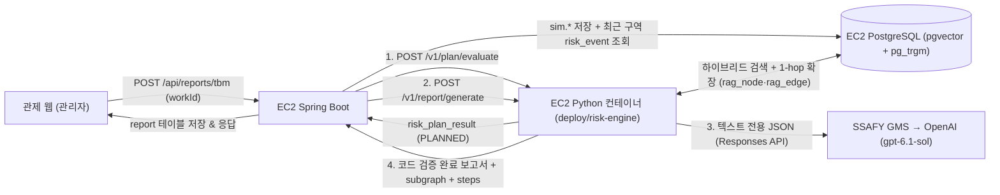
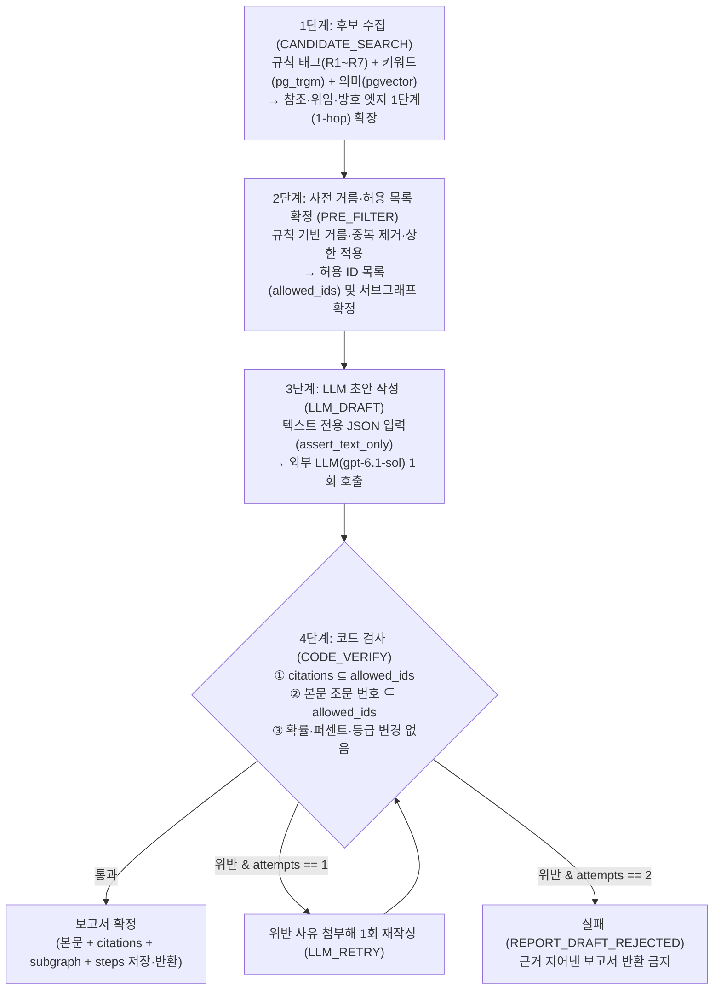

# TBM 법령 지식 그래프·하이브리드 RAG·EC2 컨테이너 보고서 생성 설계 (S15P31A101-415)

TBM 위험성 평가 보고서(F-02)와 일일 안전 일지의 실행 위치를 RunPod 분석 워커(I5 `tbm_report`)에서 **EC2 Python 컨테이너**(`deploy/risk-engine`)로 옮기고, 단순 조항 청크(`rag_clause`) 검색을 **건설안전 법령 지식 그래프(`rag_node`·`rag_edge`) + 하이브리드 검색(`pg_trgm` + `pgvector` + 규칙 태그) + 참조 엣지 1단계 확장 + 코드 4단계 생성·검증 파이프라인**으로 개편한다. 아울러 VLM 근거 생성(5.4)의 입력 이미지 시각 오버레이 규칙과 시연(부록 E) 교실 테스트베드 안내 원칙을 함께 정한다.

이 문서는 명세·계약·DB 설계 정본(S15P31A101-415)이며, AI 파이프라인·시드·컨테이너 엔드포인트·서버·프론트엔드 코드는 후속 티켓(S15P31A101-416 등)에서 구현한다.

## 관련 명세

| 절 | 내용 | 이 문서에서 |
|---|---|---|
| 3.1, 3.2, 3.8 | 모델 요약표, EC2 Python 컨테이너 역할, 외부 LLM 호출 위치, 임베딩 모델(`Qwen/Qwen3-Embedding-0.6B`), PostgreSQL 법령 그래프 저장소 | EC2 컨테이너 실행, API 키 EC2 `.env`, 모델·차원·저장소 정리 |
| 5.4 | VLM 입력 이미지 오버레이·프롬프트 경계, 외부 LLM 텍스트 전용 호출, RAG 임베딩·법령 지식 그래프·하이브리드 검색·코드 4단계 생성·검증 | VLM 오버레이 순서, 4단계 파이프라인과 1회 재작성 규칙 |
| 8.3 (F-02) | 사전 위험 시뮬레이션·TBM 보고서 생성 흐름, 구역 최근 `risk_event` 이력 연동, 응답·DB 의 `subgraph`·`steps` | EC2 내부 호출 흐름, 관제 웹 그래프 패널·단계 표시 데이터 |
| 11장, 11.3 | PostgreSQL `pgvector`·`pg_trgm`, `rag_node`·`rag_edge`·`rag_query_template`, 기존 `rag_clause` 와의 관계, `report` 테이블 `subgraph`·`steps` | 그래프 테이블 스키마·관계, 마이그레이션 방침 |
| 12.2, 12.5, 12.6 | EC2 내부 Python 컨테이너 구간, I5 `tbm_report` 폐기 예정, `/api/reports/tbm`·`daily` 응답 | 내부 HTTP 경로·입출력, 계약 폐기 예정 표시 |
| 14장, 15.1 (G7) | EC2 `.env` 비밀 값, 외부 LLM 텍스트 전용, G7 인용 존재 100%·적절성 80% 표본 준비 | 보안 경계, G7 인용 평가 표본 구성 |
| 16장, 17장, 19.1, 부록 A·B·E | 기술 결정·기각 대안, 위험·대응, 미결 정리, 용어, 모델·참고 프로젝트 라이선스, 시연 Scene 6·교실 테스트베드 대본 | 결정 근거, 참고 구현(`graphify-legal-wiki`, `LegalGraphRAG`) |

## 결정 요약 (2026-11-02)

1. **실행 위치 이전 (RunPod I5 → EC2 Python 컨테이너)**
   - TBM 보고서·일일 일지 생성은 RunPod 분석 워커(I5 `tbm_report`)에서 빼고 **EC2 의 Python 컨테이너**(현재 PLANNED 판정을 수행하는 `deploy/risk-engine`)에서 실행한다.
   - GPU·Pod 를 켜지 않아도 관제 웹에서 언제든 TBM 보고서와 일일 일지를 생성할 수 있다.
   - 외부 LLM(`gpt-6.1-sol`, SSAFY GMS 경유 OpenAI Responses API, 텍스트만) 호출과 4단계 코드 인용 검증도 이 컨테이너에서 수행한다.
   - 외부 LLM API 키(`SIMAI_LLM_API_KEY` 등 `SIMAI_LLM_*`)는 Pod 가 아니라 **EC2 비밀 값(`.env`)** 에 둔다.
2. **코퍼스 = 건설안전 법령 지식 그래프 (PostgreSQL 노드·엣지 테이블)**
   - 별도 Graph DB(Neo4j 등)를 두지 않고 같은 EC2 PostgreSQL 안에 노드 테이블(`rag_node`)과 엣지 테이블(`rag_edge`)로 구축한다.
   - **노드 종류(`node_kind`):** 법률·시행령·시행규칙·산업안전보건기준에 관한 규칙(조·항·호·별표), 중대재해처벌법(및 시행령), KOSHA GUIDE 항목, 재해사례 요약, 개념 엔티티(위험요인·설비·방호조치).
   - **노드 속성:** 층(`layer`), 출처(`source_name`, `source_ref`), 버전(`source_version`: 법령 시행일·공포번호·MST 등), 위험 규칙 태그(`rule_tags`: `R1`~`R7`·`TBM`), 제목(`title`), 본문(`body`), 임베딩(`embedding vector(1024)`), 임베딩 모델·리비전(`embedding_model`, `embedding_revision`).
   - **엣지 종류(`edge_kind`):** 상하위(`PARENT_CHILD`: 조→항→호·별표), 참조·준용(`REFERENCES`: "제N조에 따른" 등 결정적 추출), 위임(`DELEGATES`: 법→시행령·시행규칙·안전보건기준규칙), 지침 연결(`GUIDES`: 조문↔KOSHA GUIDE), 사례 연결(`ILLUSTRATES`: 조문·위험요인↔재해사례 요약), 방호조치 연결(`MITIGATES`: 위험요인·규칙↔방호조치·설비 개념).
   - **단계 도입:** 국가법령정보 Open API 로 받는 법령 전체가 먼저 들어가고, KOSHA GUIDE 와 재해사례 요약은 이용 조건(저작권·공공누리 유형)을 확인한 뒤 넣는다. 시연에는 그때까지 적재된 코퍼스를 쓴다.
3. **임베딩 모델 전환 (`Qwen/Qwen3-Embedding-0.6B`)**
   - `BAAI/bge-m3` 에서 **`Qwen/Qwen3-Embedding-0.6B`**(Apache-2.0)로 바꾼다.
   - 출력 차원은 **1024차원**(`vector(1024)`, float32, L2 정규화, cosine)으로 유지해 pgvector 컬럼 차원을 바꾸지 않는다. 문서·질의에 같은 모델·고정 revision·설정을 쓰는 원칙도 그대로 유지한다.
   - 문서 임베딩 입력 형식은 `"[법령명 조문(제목)] 본문"`(개정 꼬리표 제거)으로 통일한다.
   - 질의는 규칙·구역 조합별 표준 질의를 사전 임베딩(`rag_query_template`)해 두고, 실시간 질의 임베딩이 필요할 때는 EC2 Python 컨테이너 CPU 에서 수행한다.
4. **하이브리드 검색 + 참조 엣지 1단계 확장**
   - 위험 규칙 태그 필터(`R1`~`R7`) + 키워드 검색(`pg_trgm`) + 의미 검색(`pgvector` cosine)을 결합해 1차 시드 노드를 찾고 → `rag_edge` 를 따라 참조·위임·상하위·지침·방호조치 엣지를 **1단계(1-hop) 확장** → 중복 제거 및 상한 적용.
5. **생성·검증 (코드 4단계, LLM 호출은 작성 1회·위반 시 재작성 1회만)**
   - 여러 LLM 호출로 쪼갠 다중 에이전트로 만들지 않는다(LangGraph 도입 여부는 구현 선택 사항이며 명세는 아래 4단계만 규정).
   - **1단계(후보 수집):** 하이브리드 검색 + 참조 엣지 1단계 확장으로 후보 노드·엣지 수집.
   - **2단계(사전 거름·허용 목록 확정):** 규칙 기반 사전 거름으로 문맥에 맞는 노드·엣지 서브그래프와 **허용 인용 ID 목록(`allowed_ids`)** 확정.
   - **3단계(LLM 초안 작성):** 외부 LLM 1회 호출로 JSON 초안(`sections`, 문단별 `citations`) 작성(텍스트만 전송).
   - **4단계(코드 검사·재작성):** 결정적 코드로 ① `citations` 가 허용 목록 안인지 ② 본문 텍스트에 적힌 조문 번호가 허용 목록 밖이지 않은지 ③ 임의 확률·퍼센트 수치나 등급 변경이 없는지 검사 → 위반 시 위반 사유를 덧붙여 **1회 재작성**(최대 2회 호출) → 재작성본도 위반이면 실패(`REPORT_DRAFT_REJECTED`, 근거 지어냄 절대 금지).
6. **응답·저장 (`subgraph`·`steps`)**
   - 보고서 응답(`/api/reports/tbm`, `/api/reports/daily`, 조회 API)과 DB `report` 테이블에 **사용한 서브그래프(`subgraph`: 노드·엣지)** 와 **단계별 실행 기록(`steps`: 단계명, 건수, 결과, 소요 ms)** 을 함께 담아 관제 웹이 법령 그래프 패널과 단계 표시를 그릴 수 있게 한다(부록 E Scene 6).
7. **관제 이력 연동**
   - 해당 구역의 최근 `risk_event` 요약만 연동한다(반장 PWA·조치 티켓은 S15P31A101-411 에서 취소되었으므로 조치 티켓 상태는 쓰지 않는다).
8. **VLM 근거 생성 시각 오버레이와 교실 테스트베드 명시 (5.4, 부록 E)**
   - VLM 입력 이미지에는 **얼굴 비식별(`face_policy` 적용·실패 시 프레임 제외 fail-closed) 뒤에** 보정으로 투영한 위험 구역과 대상 사람 표시를 그려서 넘긴다.
   - 교실 사물(책상·단상·테이프)을 건설 현장 사물(비계·개구부)로 바꿔 부르라는 프롬프트 지시는 하지 않는다. 시연에서는 발표 대본으로 **"교실 테스트베드(`rule_version 1001`)"** 임을 먼저 밝힌다.
9. **G7 평가 표본 준비 (15.1)**
   - 인용 존재 100%(코드 4단계 자동 검사), 인용 적절성 사람 평가 80% 이상을 검증하기 위한 보고서·인용 행 표본 준비 절차를 명세화한다.
10. **보고서 단위 = TBM 작업(`work_unit`) 하나에 보고서 1개 (작업 ↔ 레이아웃 연결·버전 이력)**
   - TBM 작업(`work_unit`, V21, S15P31A101-396)에 그 작업이 쓰는 가상 레이아웃(`layout_plan`, V23, S15P31A101-30)을 연결한다(`work_unit.layout_id`).
   - `POST /api/reports/tbm` 은 작업 ID(`workId`)로 요청하고, 서버가 그 작업에 연결된 레이아웃(`layout_id` 의 현재 `revision`)으로 PLANNED 판정 → 구역 최근 `risk_event` 요약 → 법령 지식 그래프 검색 → 외부 LLM 초안 작성·코드 검증 → 보고서(`report` 테이블) 저장을 수행한다.
   - 같은 작업의 보고서를 다시 만들 때는 덮어쓰지 않고 `report_version` 을 올린 새 행을 추가하며, 조회는 작업별 최신 보고서와 버전 이력을 돌려준다.
11. **LLM 입력 개인정보 규칙 유지와 공종(`work_type`) 입력 허용**
   - 작업명(`work_unit.name`), 참석 인원(`planned_people`), 반장·담당 조 이름(`lead_team`) 등은 사람 이름이나 식별 정보가 섞일 수 있으므로 외부 LLM 에 보내지 않고(기존 invalid 예시 `job_request.tbm_report_person_name.json` 취지 유지) 서버가 보고서·A4 회의록 머리말에만 붙인다.
   - 반면 개인정보가 아닌 **공종(`work_type`: 작업 유형 코드·이름, 예: `HIGH_PLACE` 고소·비계 작업, `OPENING_WORK` 개구부 주변 작업, `MATERIAL_HANDLING` 자재 반입·운반 등)** 은 법령 지식 그래프 검색과 LLM 대책 문장 작성의 정확도를 높이기 위해 입력에 넣을 수 있게 정의한다(공종 코드 초안은 5.4절).
12. **관제 앱 `/tbm` 화면 연결 정의 (`tbmDemo.ts` 목 대체)**
   - 현재 관제 웹 `/tbm` 화면은 서버를 부르지 않고 `tbmDemo.ts` 목 데이터로만 그린다. 후속 구현에서 작업 등록·수정은 `/api/work-units`(`layout_id`·`work_type` 포함), 보고서 생성·조회는 `/api/reports/tbm` 으로 연결한다.
   - 화면 매핑: 왼쪽 패널의 **위험성 평가 표** ← PLANNED 판정 결과(`risk_items`), **대책·법령 근거(새 칸)** ← 보고서 문단(`sections`)·인용(`citations`), **법령 그래프 패널·단계 표시** ← `subgraph`·`steps`, 오른쪽 패널의 **A4 회의록** ← 위 값들로 자동 채움(고정 체크리스트 문구는 유지하고 사람이 편집 모달에서 수정 가능). `tbmDemo.ts` 목 데이터는 API 실패 시 대체 화면으로만 쓴다.

---

## 1. 아키텍처와 실행 위치 (EC2 Python 컨테이너)



- **컨테이너 통합:** EC2 에서 이미 PLANNED 위험 판정을 맡고 있는 Python 컨테이너(`deploy/risk-engine`)에 보고서 생성 엔드포인트(`POST /v1/report/generate`)를 함께 둔다(또는 같은 코드베이스의 내부 서비스로 기동).
- **네트워크·보안 경계:**
  - 기존 `risk-engine` 컨테이너는 내부망 전용(`internal: true`)이었으나, 보고서 생성 시에는 ① compose 내부망으로 EC2 PostgreSQL(`rag_node`·`rag_edge`·`rag_query_template` 읽기 전용 조회)에 붙고 ② 외부로는 SSAFY GMS(`SIMAI_LLM_BASE_URL`, HTTPS 443)로만 아웃바운드 요청을 보낸다(호스트 공개 인바운드 포트는 여전히 열지 않는다).
  - Risk Engine 의 순수 기하·규칙 판정 모듈(`simai_ai.risk`)은 여전히 DB·네트워크·무거운 딥러닝 패키지를 import 하지 않는다(`lint-imports` 규칙 유지). 보고서·법령 검색 모듈(`simai_ai.rag`, `simai_ai.report`)만 컨테이너 서비스 계층에서 연결한다.
  - 외부 LLM 설정(`SIMAI_LLM_BASE_URL`, `SIMAI_LLM_MODEL`, `SIMAI_LLM_API_KEY`, `SIMAI_LLM_TIMEOUT_S` 등)은 **EC2 `.env`** 에만 두고 컨테이너 환경변수로 주입한다.

---

## 2. 건설안전 법령 지식 그래프 설계 (`rag_node` · `rag_edge`)

### 2.1 참고 프로젝트·논문

| 구분 | 이름 | 라이선스 / 출처 | 채택한 아이디어 |
|---|---|---|---|
| 참고 코드 | `graphify-legal-wiki` (`collect-and-construct-legal-graph`) | MIT | 국가법령정보 Open API 수집 → 조·항·호 계층 분해 → 정규식 기반 법령 간/조문 간 참조("제N조에 따른", "별표 N") 결정적 엣지 구축(LLM 인덱싱 없이 100% 재현 가능) |
| 참고 논문 | `LegalGraphRAG` | arXiv:2605.28120 | 법령 계층(Hierarchy) + 인용/참조(Citation) 이종 그래프 위에서 의미 검색 시드 노드로부터 1-hop 이웃 조문을 확장해 문맥 누락(예: 정의·위임·예외 조항 빠짐)을 막는 기법 |

### 2.2 노드·엣지·출처 테이블 (`rag_node` · `rag_edge` · `rag_source`)

칸 정의의 정본은 `docs/design/db-tables.md` 의 `rag_source`·`rag_node`·`rag_edge` 다(S15P31A101-416 파이프라인이 실제로 내보내는 형식과 같다). 여기에는 종류 값만 둔다.

- `rag_node.node_kind`: `LAW`(법령 묶음)·`ARTICLE`(조)·`PARAGRAPH`(항)·`ITEM`(호)·`SUBITEM`(목)·`ANNEX`(별표)·`EXTERNAL_LAW`(카탈로그 밖 인용 법령)·`CONCEPT`(개념 엔티티: 위험요인·설비·방호조치)·`RISK_RULE`(R1~R7). 후속: `GUIDE_SECTION`(KOSHA GUIDE)·`ACCIDENT_CASE`(재해사례)
- `rag_node.layer`: `STATUTE`(법률)·`SAPA`(중대재해처벌법·시행령)·`DECREE`(시행령)·`RULE`(시행규칙)·`OSH_STANDARD`(산업안전보건기준에 관한 규칙)·`ADMIN_RULE`(고시·행정규칙)·`EXTERNAL`·`CONCEPT`·`RISK_RULE`. 후속: `KOSHA_GUIDE`·`ACCIDENT_CASE`
- `rag_edge.edge_kind`: `PARENT_CHILD`(상하위)·`REFERENCES`(참조 "제N조에 따른")·`MUTATIS_MUTANDIS`(준용)·`NOTWITHSTANDING`("제N조에도 불구하고")·`CITES_EXTERNAL`(카탈로그 밖 법령 인용)·`DELEGATES`(위임)·`ANNEX_RELATES`(별표 연결)·`HAS_HAZARD`·`INVOLVES_EQUIPMENT`·`REQUIRES_CONTROL`·`MITIGATES`(개념 연결)·`TAGGED_RULE`(위험 규칙 태그). 후속: `GUIDES`(지침 연결)·`ILLUSTRATES`(사례 연결)
- `rag_edge.review_status`: `auto`(구조·정규식 결정적 추출)·`candidate`(사전 기반 후보, 사람 검수 전)·`spec`(명세가 정한 연결), 검수 반영 뒤 `reviewed`·`rejected`.
- 노드 ID 는 기존 `rag_clause.clause_id` 형식(`산업안전보건기준규칙 제43조`)을 그대로 써서 `rule_version.legal_basis` 와 호환한다.
- **유일성·인덱스:** `(src_node_id, dst_node_id, edge_kind)` UNIQUE, `(dst_node_id, edge_kind)` 인덱스(양방향 1-hop 확장용), `rag_node` 는 HNSW·GIN `rule_tags`·GIN trigram.


### 2.4 기존 `rag_clause` · `rag_query_template` 와의 관계 및 이관

- **기존 자산(`S15P31A101-27`):** `V3__rag_clause.sql` 과 `R__rag_clauses.sql` 이 만든 `rag_clause`(산업안전보건기준에 관한 규칙 31개 조·38개 청크)와 `rag_query_template`(9개 표준 질의).
- **하위 호환 ID 유지:** `rag_clause.clause_id`(`산업안전보건기준규칙 제N조[#k]`)는 `rag_node.node_id` 에 그대로 유지한다(`layer = 'OSH_STANDARD'`, `node_kind = 'ARTICLE'`). 따라서 `rule_version.legal_basis` 가 가리키는 조 단위 ID(`산업안전보건기준규칙 제32조; 산업안전보건기준규칙 제44조` 등)와 기존 계약·시험의 조항 ID 체계가 깨지지 않는다.
- **마이그레이션 방침(번호는 후속 구현에서 부여):**
  - 후속 구현 마이그레이션에서 `CREATE EXTENSION IF NOT EXISTS pg_trgm;` 와 `rag_node`·`rag_edge` 테이블 및 인덱스(`HNSW vector_cosine_ops`, `GIN rule_tags`, `GIN body/title gin_trgm_ops`)를 생성한다.
  - `rag_query_template` 은 테이블 구조를 유지하되(`template_key`, `rule`, `target`, `text`, `query_input`(임베딩에 넣은 문자열, 후속 마이그레이션에서 `rule`·`target`·`query_input` 칸 추가), `embedding vector(1024)`, `embedding_model`, `embedding_revision`, `loaded_at`), 시드 반복 마이그레이션(`R__rag_clauses.sql` 또는 후속 시드 SQL)이 `Qwen/Qwen3-Embedding-0.6B` 임베딩으로 교체하고 `rag_node`·`rag_edge` 를 함께 적재한다.
  - 기존 `rag_clause` 는 후속 구현에서 `rag_node` 로 조회가 완전히 넘어간 뒤 호환 뷰로 두거나 정리한다.

### 2.5 코퍼스 단계 도입

1. **1단계(즉시, Open API 법령):** 국가법령정보 Open API(`SIMAI_LAW_API_OC`)로 수집 가능한 법령(저작권법 제7조 제1호 비보호 공공저작물) — 산업안전보건기준에 관한 규칙 전체 관련 장(추락·개구부·비계·통로·보호구·낙하·장비 등), 산업안전보건법(제38조 안전조치 등), 산업안전보건법 시행령·시행규칙 관련 조문, 중대재해처벌법(제4조 등)·시행령, 그리고 규칙(`R1`~`R7`)과 연결되는 개념 엔티티(위험요인·설비·방호조치).
2. **2단계(이용 조건 확인 뒤):** KOSHA GUIDE 항목과 재해사례 요약은 한국산업안전보건공단 저작권·공공데이터포털/공공누리 이용 조건(출처 표시·상업적/재배포 조건·원문 커밋 가능 여부)을 확인한 뒤 적재한다.
3. **시연 원칙:** 시연에는 그때까지 적재·검증된 코퍼스를 사용하며, 법령만 적재된 상태에서도 상하위·참조·위임·방호조치 엣지로 그래프 탐색과 서브그래프 시각화가 완전하게 동작한다.

---

## 3. 임베딩 (`Qwen/Qwen3-Embedding-0.6B`)

- **모델:** `Qwen/Qwen3-Embedding-0.6B` (Apache-2.0, HuggingFace 고정 revision 해시 사용).
- **차원·정규화:** **1024차원**(`float32`, L2 정규화, cosine 거리 `vector_cosine_ops`). `pgvector` 컬럼 `vector(1024)` 를 그대로 쓴다.
- **문서 임베딩 입력 형식:**
  ```text
  [{source_name} {article_ref}({title})] {body_without_amendment_tags}
  ```
  예: `[산업안전보건기준에 관한 규칙 제43조(개구부 등의 방호 조치)] ① 사업주는 작업발판 및 통로의 끝이나 개구부로서...`
  - 조문 제목과 법령명을 대괄호 머리말로 명시해 본문만으로는 구분이 흐려지는 조문(예: 보호구 다수를 나열하는 제32조)도 제목·법령 문맥이 벡터에 반영되게 한다.
- **질의 임베딩:**
  - 기본 경로는 규칙·구역 유형 조합별 표준 질의를 사전 임베딩해 둔 `rag_query_template` 을 사용한다(응답 지연 0 ms).
  - 레이아웃의 구역 이름·설명이나 추가 조건으로 실시간 질의 임베딩이 필요할 때는 **EC2 Python 컨테이너 CPU** 에서 같은 `Qwen/Qwen3-Embedding-0.6B`(동일 revision·fp32·L2 정규화)로 임베딩한다.

---

## 4. 하이브리드 검색과 코드 4단계 생성·검증 파이프라인

보고서 생성은 여러 번 LLM 을 부르는 다중 에이전트가 아니라, **결정적 코드 3단계(1·2·4단계) + 외부 LLM 작성 1단계(3단계, 위반 시 1회 재작성)** 로 이루어진 **코드 4단계 파이프라인**이다.



### 4.1 1단계: 후보 수집 (`CANDIDATE_SEARCH`)

1. **입력 분석:**
   - TBM 보고서: 작업(`work_unit`)의 공종(`work_type` 코드·이름), 연결된 레이아웃(`layout_id`)의 PLANNED 판정 결과(`plan.items`: 발생한 `rule_id` 목록, `zone_id` 및 구역 유형, 수평 거리·높이 차 `metrics`), 규칙의 고정 근거 조항(`rule_version.legal_basis`), 그리고 **해당 구역들의 최근 LIVE `risk_event` 이력 요약**(최근 발생 건수, 규칙, 최고 등급, 해소 여부).
   - 일일 일지(DAILY): 해당 날짜의 LIVE `risk_event` 요약 목록(`events[]`).
2. **하이브리드 시드 검색 (PostgreSQL 단일 쿼리 또는 결합):**
   - **규칙 태그 필터:** `rag_node.rule_tags && ARRAY[...]` (발생한 `R1`~`R7` 및 `'TBM'`).
   - **키워드 점수(`pg_trgm`):** 구역 유형·위험 키워드(예: `개구부`, `작업발판`, `안전난간`, `안전대`, `추락`, `보호구`)에 대한 `title || ' ' || body` trigram 유사도(`word_similarity`).
   - **의미 점수(`pgvector`):** `rag_query_template` 사전 임베딩 벡터(또는 EC2 컨테이너 CPU 가 계산한 질의 벡터)와 `rag_node.embedding` 의 cosine 유사도(`1 - (embedding <=> query_vec)`).
   - **고정 법적 근거 합산:** 발생한 규칙의 `rule_version.legal_basis` 에 적힌 조문 노드는 점수와 무관하게 시드에 항상 포함한다.
   - 시드 상위 $K_0$개(기본 8~12개)를 선정한다.
3. **참조 엣지 1단계(1-hop) 확장:**
   - 시드 노드 집합 $S_0$ 에 연결된 `rag_edge`(`review_status` 가 `auto`·`spec`·`reviewed` 인 `REFERENCES`·`MUTATIS_MUTANDIS`·`NOTWITHSTANDING`·`DELEGATES`·`PARENT_CHILD`·`ANNEX_RELATES`·`MITIGATES`·`REQUIRES_CONTROL`, 후속 `GUIDES`·`ILLUSTRATES`)를 1단계만 따라가 이웃 노드 $N(S_0)$ 와 그 사이 엣지들을 수집한다.
   - 예: `제43조(개구부 등의 방호 조치)`가 시드로 뽑히면, 그 조문이 참조하는 `제13조(안전난간의 구조 및 설치요건)`와 상위 위임 조문인 `산업안전보건법 제38조`가 1-hop 확장을 통해 후보 그래프에 들어온다.

### 4.2 2단계: 규칙 기반 사전 거름·허용 목록 확정 (`PRE_FILTER`)

1. **사전 거름:**
   - 입력에 없는 규칙 전용 조문이나 현재 작업면·구역 조건과 무관한 가지 조문을 규칙 기반으로 걸러낸다.
   - 시드 점수와 엣지 가중치(직접 시드 > `legal_basis` > `REFERENCES`/`MITIGATES` 1-hop > `DELEGATES`/`PARENT_CHILD` 1-hop) 순으로 정렬해 중복을 제거하고 상한(예: 인용 가능 조문·지침 노드 최대 20개, 전체 서브그래프 노드 최대 30개)으로 자른다.
2. **허용 인용 ID 목록(`allowed_ids`) 확정:**
   - 거름을 통과한 법령·지침 노드의 `node_id`(및 그 노드의 조 단위 표기 `article_ref`) 집합을 **허용 인용 목록(`allowed_ids`)** 으로 잠근다.
   - 확정된 노드·엣지 묶음을 `subgraph`(`nodes[]`, `edges[]`)로 기록한다.

### 4.3 3단계: 외부 LLM 초안 작성 (`LLM_DRAFT`)

1. **텍스트 전용 검사(`assert_text_only`):**
   - LLM 에 보내는 메시지는 `system` 과 `user`(JSON 문자열) 두 개뿐이다.
   - 보내기 직전 모든 메시지에 이미지 객체이나 `s3://`, `http://`, `https://`, `data:`, `file://` 주소가 없는지, 사람 실명·얼굴·World ID 및 작업명(`work_unit.name`)·인원(`planned_people`)·반장 이름(`lead_team`)이 없는지 검사한다(어기면 호출하지 않고 즉시 실패, 머리말은 서버가 부착).
2. **입력 구성:**
   - 보고서 종류(`TBM` / `DAILY`), 날짜, 비개인정보 공종(`work_type`: 코드·이름, 5.4절), PLANNED 위험 항목(`plan.items`)과 계획 작업 위치(`plan.positions`), **해당 구역의 최근 `risk_event` 이력 요약**(`zone_history`: 구역별 최근 N일/N건 발생 횟수·규칙·최고 등급, 반장 조치 티켓은 취소되어 제외), 그리고 2단계에서 확정한 허용 조항 목록(`clauses`: `node_id`·`source_name`·`article_ref`·`title`·`text`·연결 관계 요약).
3. **호출:**
   - SSAFY GMS 프록시 경유 OpenAI Responses API(`POST .../v1/responses`, 모델 `gpt-6.1-sol`, `store: false`, `text.format.type = "json_object"`, `temperature` 미전송)를 1회 호출한다.

### 4.4 4단계: 코드 검사 및 최대 1회 재작성 (`CODE_VERIFY`)

결정적 Python 코드가 LLM 응답 JSON 을 검사한다:

1. **JSON 형식 및 섹션 구조:** 정해진 키(`sections[]`: `kind`, `title`, `paragraphs[].text`, `paragraphs[].citations`, 선택 `item_index`)만 있는지, `severity` 등 등급 변경 키가 없는지, 글자 수 상한(`max_chars`) 안인지 확인한다.
2. **인용 ID 허용 목록 검사 (`citations ⊆ allowed_ids`):**
   - 문단별 `citations[]` 의 모든 ID 가 2단계에서 확정한 `allowed_ids` 안에 있는지 확인한다(같은 문단 내 중복 인용 금지).
3. **본문 조문 번호 교차 검사:**
   - 문단 본문(`text`)에 등장하는 모든 법령 조문 표기(`제N조`, `제N조의M`, `제N조#k`)를 정규식으로 추출해, 해당 조문이 `allowed_ids` 안에 있는지 확인한다. LLM 이 학습 기억으로 허용 목록 밖의 조문 번호를 본문에 적으면 즉시 거부한다.
4. **확률·퍼센트 수치 금지 검사:**
   - 본문에 임의의 위험 확률·퍼센트 표현(예: `85%`, `확률`, `가능성 N%`)이 있으면 거부한다(위험은 오직 등급 + 거리·높이 차 등 물리 수치 근거로만 표현).
5. **재작성 및 실패 규칙:**
   - 위 검사 중 하나라도 위반하면, 위반 사유 목록을 `user` 메시지로 덧붙여 **딱 1회만 재작성(`LLM_RETRY`)** 을 요청한다(`generator.attempts = 2`).
   - 2회째 응답도 검사를 통과하지 못하면 `REPORT_DRAFT_REJECTED` 오류로 실패 처리한다. **어떤 경우에도 허용 목록 밖의 인용이나 지어낸 근거가 든 보고서를 저장하거나 반환하지 않는다.**
   - 결과의 `risk_items` 표는 LLM 출력에서 가져오지 않고 입력 `plan.items` 의 등급·규칙·구역·위치를 코드가 그대로 복사해 넣는다.

---

## 5. 보고서 응답·저장 구조 (`subgraph` · `steps` · 구역 이력)

관제 웹(시연 Scene 6)이 TBM 보고서 옆에 **사용한 법령 지식 그래프 패널**과 **4단계 생성·검증 실행 단계 표시**를 그릴 수 있도록, Python 컨테이너 응답과 EC2 `/api/reports/tbm`·`/api/reports/tbm/{reportId}`·`/api/reports/daily` 응답 및 DB `report` 테이블에 `subgraph` 와 `steps` 를 함께 담는다.

### 5.1 `subgraph` JSON 구조

```json
{
  "nodes": [
    {
      "node_id": "산업안전보건기준규칙 제43조",
      "node_kind": "ARTICLE",
      "layer": "OSH_STANDARD",
      "source_name": "산업안전보건기준에 관한 규칙",
      "article_ref": "제43조",
      "title": "개구부 등의 방호 조치",
      "rule_tags": ["R1", "R2"],
      "hop": 0,
      "cited": true
    },
    {
      "node_id": "산업안전보건기준규칙 제13조",
      "node_kind": "ARTICLE",
      "layer": "OSH_STANDARD",
      "source_name": "산업안전보건기준에 관한 규칙",
      "article_ref": "제13조",
      "title": "안전난간의 구조 및 설치요건",
      "rule_tags": ["R2", "R3"],
      "hop": 1,
      "cited": true
    }
  ],
  "edges": [
    {
      "edge_id": "산업안전보건기준규칙 제43조--REFERENCES-->산업안전보건기준규칙 제13조",
      "src_node_id": "산업안전보건기준규칙 제43조",
      "dst_node_id": "산업안전보건기준규칙 제13조",
      "edge_kind": "REFERENCES",
      "relation_label": "안전난간 설치 기준 참조"
    }
  ]
}
```

- `hop`: `0` 은 1차 하이브리드 검색·`legal_basis` 시드 노드, `1` 은 참조·위임·방호조치 엣지 1단계 확장 노드.
- `cited`: 최종 보고서 `citations` 에 실제로 인용된 노드이면 `true`, 후보(허용 목록)였으나 인용되지 않았으면 `false` (뷰어에서 인용 노드 강조 표시용).

### 5.2 `steps` JSON 구조

```json
[
  {
    "step": "CANDIDATE_SEARCH",
    "label": "하이브리드 검색 및 1단계 그래프 확장",
    "status": "SUCCEEDED",
    "input_count": 3,
    "output_count": 14,
    "duration_ms": 18,
    "detail": "규칙 태그(R1,R2,R3) + pg_trgm + pgvector 시드 6건 → 1-hop 확장 14건(엣지 11건)"
  },
  {
    "step": "PRE_FILTER",
    "label": "규칙 기반 사전 거름 및 허용 조항 확정",
    "status": "SUCCEEDED",
    "input_count": 14,
    "output_count": 8,
    "duration_ms": 2,
    "detail": "허용 인용 ID 8건 확정"
  },
  {
    "step": "LLM_DRAFT",
    "label": "외부 LLM 보고서 초안 작성",
    "status": "SUCCEEDED",
    "input_count": 8,
    "output_count": 3,
    "duration_ms": 19400,
    "detail": "gpt-6.1-sol 호출 1회(섹션 3개)"
  },
  {
    "step": "CODE_VERIFY",
    "label": "인용·조문 번호·확률 표현 코드 검증",
    "status": "SUCCEEDED",
    "input_count": 4,
    "output_count": 4,
    "duration_ms": 1,
    "detail": "인용 4건 모두 허용 목록 일치, 본문 미등록 조문 0건, 확률 표현 0건"
  }
]
```

- 4단계 검사에서 첫 초안이 거부되어 1회 재작성(`LLM_RETRY`)이 일어났다면 `steps` 에 첫 `CODE_VERIFY`(`status: "REJECTED"`, 거부 사유)와 `LLM_RETRY`, 두 번째 `CODE_VERIFY`(`status: "SUCCEEDED"`)를 순서대로 기록해 검증·교정 과정이 투명하게 보이게 한다.

### 5.3 관제 이력 연동 (`zone_history`)

- TBM 생성 시 EC2 는 레이아웃의 구역(`zone_id`)별로 최근 관제 이력(`risk_event` 테이블에서 LIVE 출처의 최근 기간 이벤트 건수, 발생 규칙 목록, 최고 심각도, 마지막 발생 시각)을 집계해 Python 컨테이너 입력 `zone_history` 로 넘긴다.
- 반장 PWA 와 조치 티켓은 취소(S15P31A101-411)되었으므로 조치 티켓 상태(`action_status`)는 조회하거나 넣지 않는다.

### 5.4 보고서 단위(`work_unit` ↔ `layout_plan`), LLM 입력 개인정보 경계, 공종(`work_type`) 초안

1. **보고서 단위와 작업–레이아웃 연결 (`work_unit` ↔ `layout_plan`):**
   - TBM 보고서는 가상 레이아웃 단독이 아니라 **TBM 작업(`work_unit`, V21) 하나당 보고서 1개(최신 버전 + 버전 이력)** 를 단위로 한다.
   - `work_unit` 테이블(후속 마이그레이션)에 `layout_id`(`FK > layout_plan.layout_id`)와 `work_type`(`text`) 컬럼을 두어 작업 등록·수정(`/api/work-units`) 때 그 작업이 쓰는 가상 레이아웃과 공종을 연결한다.
   - 관리자가 `POST /api/reports/tbm`(`{ "workId": "12" }`, 하위 호환으로 `layoutId` 단독 지정도 가능)을 호출하면, 서버가 `work_unit` 의 `layout_id`(현재 `revision`)와 `zone_id`·작업 시간대(`starts_at`~`ends_at`)를 읽어:
     1. EC2 Python 컨테이너에 PLANNED 판정을 요청(`sim.evaluation_run`, `sim.risk_result` 저장)하고,
     2. 해당 구역의 최근 LIVE `risk_event` 요약(`zone_history`)을 조회한 뒤,
     3. 같은 컨테이너에 법령 지식 그래프 검색 + 외부 LLM 초안 생성·4단계 코드 검증을 요청해,
     4. `report` 테이블에 `work_id`, `layout_id`, `layout_revision`, `report_version`(기존 최대 버전 + 1, 덮어쓰기 없음), `work_type`, `body`(`sections`), `citations`, `subgraph`, `steps` 를 저장한다.
   - 조회 API(`GET /api/reports/tbm/{reportId}`, `GET /api/reports/tbm?workId={workId}`)는 작업별 최신 보고서와 과거 버전 이력을 돌려준다.

2. **LLM 입력 개인정보 규칙 유지 vs 공종(`work_type`) 입력 허용:**
   - **LLM 에 보내지 않는 필드 (개인정보·식별자 차단):**
     - `work_unit.name`(자유 텍스트 작업명에 작업자·반장 실명이 적힐 위험), `planned_people`(인원수), `lead_team`(반장·조 이름), 작업자 실명(`worker_name`, 계약 반례 `job_request.tbm_report_person_name.json` 과 동일 원칙)은 외부 LLM 입력 JSON 에 넣지 않는다.
     - 이 값들은 EC2 서버와 관제 웹이 보고서·A4 회의록 머리말(일시, 작업명, 인원, 담당 조, 장소)을 채울 때만 사용한다.
   - **LLM 및 법령 그래프 검색에 넣는 공종(`work_type`) 코드·이름 초안:**
     - 개인정보가 아닌 표준화된 공종 코드는 검색 키워드(`pg_trgm`)·질의 템플릿 선택·LLM 안전대책 문장 생성에 직접 도움이 되므로 입력에 허용한다.

| `work_type` 코드 | 공종 이름 (`work_type_label`) | 기본 연관 규칙 태그 | 주요 검색 키워드 예시 |
|---|---|---|---|
| `SCAFFOLD_INSTALL` | 비계 조립·해체 및 고소 작업발판 | `R2`, `R3` | 비계, 작업발판, 안전난간, 안전대 부착설비 |
| `OPENING_WORK` | 개구부 주변·단부 작업 | `R1`, `R2` | 개구부, 덮개, 안전난간, 울타리, 추락방망 |
| `HIGH_PLACE` | 고소 작업(단상·사다리·작업면 상부) | `R2`, `R3`, `R4` | 추락, 안전모, 안전대, 작업면 높이 |
| `MATERIAL_HANDLING` | 자재 반입·운반·정리 | `R1`, `R5` | 자재 반입, 통로 확보, 유도자, 낙하·전도 |
| `EQUIPMENT_OP` | 중장비·지게차·양중기 운행 | `R1`, `R5` | 차량계 하역운반기계, 지게차, 작업계획서, 유도자, 출입통제 |
| `FLOOR_FINISHING` | 바닥·내장 마감 및 일반 통행 | `R1`, `R4` | 통로, 조명, 넘어짐, 전도, 정리정돈 |
| `GENERAL` | 일반 작업(기타) | `R1`~`R7` | 안전점검회의, 보호구, 기본 안전수칙 |

### 5.5 관제 웹 `/tbm` 화면 연결 흐름 (`tbmDemo.ts` 대체)

현재 `front/apps/admin/src/features/tbm/`(`TbmPage.tsx`, `TbmLeftPanel.tsx`, `TbmAssessment.tsx`, `TbmDocument.tsx`, `tbmForm.ts`)은 서버 API 를 호출하지 않고 `tbmDemo.ts` 의 정적 목 데이터로만 동작한다. 후속 구현에서 아래와 같이 서버 API 와 연결한다:

| 화면 영역 (컴포넌트) | 데이터 출처 · API 연결 | 동작 규칙 |
|---|---|---|
| **작업 목록·등록·수정** (`TaskList`, `TaskAddDialog`, `TbmPlan`) | `GET·POST·PUT·DELETE /api/work-units` + `GET·POST·PUT /api/layouts` | 작업(`work_unit`)마다 공종(`work_type`)과 가상 레이아웃(`layout_id`)을 연결해 저장 |
| **보고서 생성·조회** (`TbmPage`) | `POST /api/reports/tbm`(`workId`), `GET /api/reports/tbm?workId={workId}`, `GET /api/reports/tbm/{reportId}` | 작업 선택 시 최신 보고서(및 버전 이력)를 조회하고, "보고서 생성/재생성" 버튼으로 새 버전 생성 |
| **왼쪽 패널: 위험성 평가 표** (`TbmAssessment` — `EvalTable`) | 보고서의 PLANNED 판정 결과(`risk_items`: 항목·규칙 `R1`~`R7`·등급·물리 수치 근거) + 동시 작업 간섭 | 기존 목 `task.evals` 대신 서버가 계산한 PLANNED 위험 항목을 표시 |
| **왼쪽 패널: 대책·법령 근거 칸 (신규)** (`TbmAssessment` 확장) | 보고서 본문 문단(`sections`)과 문단별 인용 조문(`citations`: 법령명·조문 번호·제목·원문 요약) | 각 위험 항목별 안전대책 문장과 법적 근거 조문을 함께 표시 |
| **왼쪽 패널: 법령 지식 그래프 패널·단계 표시 (신규)** | 보고서 응답의 `subgraph`(`nodes`·`edges`, 인용 노드 `cited: true` 강조)와 `steps`(4단계 건수·상태·소요 ms) | 시연 Scene 6 에서 하이브리드 검색·1-hop 확장 서브그래프와 4단계 코드 검증 결과를 시각화 |
| **오른쪽 패널: A4 TBM 회의록** (`TbmMinutesPanel`, `TbmDocument`, `tbmForm.ts`) | 머리말 ← `work_unit`(일시·작업명·장소·인원·담당 조), 잠재위험요인·중점위험 ← 판정 결과, 안전대책·중점대책·법령 근거 ← 보고서 문단·인용 | 위 값들로 A4 양식을 자동 채움. 양식의 고정 체크리스트 문구는 그대로 유지하고, 관리자가 편집 모달(`TbmEditDialog`)에서 문구를 수정할 수 있음 |
| **오프라인·장애 폴백** (`tbmDemo.ts`) | API 요청 실패(서버 미기동·네트워크 오류) 시에만 `tbmDemo.ts` 목 데이터 사용 | 정상 연결 시에는 서버 정본만 표시하고, 폴백 시 화면에 데모/오프라인 상태를 알림 |

---

## 6. VLM 근거 생성 입력 오버레이와 프롬프트 경계 (5.4 · 부록 E)

1. **시각 오버레이 순서 (얼굴 비식별 우선 · fail-closed 유지):**
   - 분석 워커가 VLM(`vlm_rationale` 빠른 경로 및 `incident_summary`)에 넘길 이벤트 프레임을 준비할 때, **반드시 먼저 `face_policy`(BLURRED 모자이크 또는 EXCLUDED 단색, 처리 실패 시 해당 프레임 제외 fail-closed)를 적용한다.**
   - 얼굴 처리가 끝난 이미지 위에 활성 보정(`calibration`)으로 투영한 **위험 구역 바닥/부피 경계선(폴리곤)** 과 **대상 작업자 표시(바운딩 박스 또는 접지점 마커)** 를 그려 넣어 VLM 이 "어느 구역 경계와 어느 사람을 설명해야 하는지"를 시각적으로 혼동하지 않게 한다.
   - 오버레이는 VLM 에 넘기는 메모리 내 사본에만 그리고, 객체 저장소에 보관하는 원본 이벤트 프레임·클립은 덮어쓰지 않는다(규칙 6).
2. **프롬프트 경계 (교실 사물 이름 바꾸기 금지):**
   - VLM 프롬프트에 교실 사물(책상, 40cm 단상, 바닥 테이프)을 건설 현장 사물(비계, 개구부, 작업발판)로 바꿔 부르라고 지시하지 않는다. 그런 지시는 영상에 없는 사물·상황을 지어내게(환각) 만들어 G7 근거-상태 일치율을 떨어뜨리고 관측·추정 구분 원칙(AGENTS 규칙 7)을 해친다.
   - 대신 VLM 은 구조화 상태(`rule_id`, `zone_id`, 거리·높이 차 수치)와 영상에서 실제로 관측된 위치·자세 관계만 사실대로 기술한다.
3. **시연 발표 대본 명시 (부록 E):**
   - 시연 시작과 이벤트·보고서 시연 때 발표 대본에서 **"물리 공간은 교실 테스트베드(`rule_version 1001`, 40cm 단상·테이프 구역)이고, 그 위에 건설 현장 안전 규칙(R1~R7)과 법령 지식 그래프를 투영해 검증한다"** 고 먼저 밝힌다.

---

## 7. G7 평가 표본 준비 (15.1)

| 평가 항목 | 합격 기준 | 검증 방법·표본 준비 |
|---|---|---|
| 보고서 인용 존재 | **100%** | 코드 4단계(`CODE_VERIFY`) 자동 검사: 결과의 모든 `citations` 와 본문 내 `제N조` 표기가 2단계 허용 목록(`allowed_ids`) 안에 있는지 전수 검사(위반 시 재작성 1회 후 실패 처리하므로 통과한 보고서는 항상 100%) |
| 보고서 인용 적절성 | **사람 평가 80% 이상** | 교실 레이아웃 PLANNED 판정 시나리오(개구부 R1, 단상 가장자리 R2, 고소 작업면 R3, 복합 위험 등)와 일일 이벤트 요약 조합으로 생성한 보고서 표본(보고서 20건 이상, 문단-인용 조항 쌍 100건 이상 권장, `docs/design/g7-eval.md`)에서 구현자가 아닌 평가자가 `(위험 항목·문단 본문, 인용된 법령/지침 조문 원문)`을 블라인드로 보고 해당 위험 항목의 법적·기술적 근거로 적절한지 Y/N 채점(`g7_score.py cite-sheet` / `cite-aggregate`) |

---

## 8. 명세에 없어 정한 수치와 근거

| 항목 | 정한 값 | 근거 |
|---|---|---|
| 임베딩 출력 차원 | 1024 (`Qwen/Qwen3-Embedding-0.6B`) | 기존 `pgvector` `vector(1024)` 컬럼·인덱스와 호환되어 차원 변경이 필요 없고, 0.6B 모델의 기본 출력 차원과 일치 |
| 문서 임베딩 입력 문자열 | `"[{source_name} {article_ref}({title})] {body}"` | 조문 본문에 제목 단어가 생략된 경우(예: 제32조 보호구 나열)에도 법령명·조문 번호·제목이 벡터에 함께 인코딩되게 함 |
| 그래프 확장 깊이 | 1단계 (1-hop) | 법령의 직접 준용·참조("제13조에 따른 안전난간")와 상위 위임(법 제38조 ↔ 기준규칙)은 모두 1-hop 에 있으며, 2-hop 이상은 벌칙·행정절차 등 무관한 조문이 급증함(`LegalGraphRAG` 결과와 일치) |
| 2단계 허용 조항 상한 | 인용 가능 노드 최대 20개 (서브그래프 노드 최대 30개) | LLM 입력 토큰을 약 2,500~3,500 토큰 안으로 묶어 GMS `gpt-6.1-sol` 응답 시간을 20초 안팎으로 유지하고, 뷰어 그래프 패널이 한눈에 읽히도록 함 |
| LLM 호출 횟수 상한 | 초안 1회 + 검증 위반 시 재작성 1회 (`MAX_ATTEMPTS = 2`) | 코드 사전 거름·검증을 거치면 1회로 통과하며, 형식·인용 실수도 사유 피드백 1회면 교정됨. 2회 실패는 코퍼스/질의 문제이므로 무한 재호출로 API 비용·지연을 늘리지 않음 |

---

## 9. 버린 대안과 기각 이유

| 버린 대안 | 기각 이유 |
|---|---|
| **MS GraphRAG / LightRAG** | 인덱싱 단계에서 코퍼스 전체에 대량 LLM 호출을 수행해 비용·시간이 크고, LLM 이 만든 비결정적 커뮤니티 요약이 법령 조문 번호·원문의 엄밀성을 흐린다. 한국 법령은 조·항·호 계층과 `"제N조에 따른"` 참조가 명시적이므로 결정적 파서(`graphify-legal-wiki` 방식)로 그래프를 구축하는 것이 정확하고 100% 재현 가능하다 |
| **Neo4j 등 별도 Graph DB 도입** | EC2 단일 인스턴스에서 별도 Graph DB 컨테이너를 띄우면 메모리·운영·백업·마이그레이션 부담이 커진다. 필요한 연산이 규칙 태그 필터 + `pg_trgm` + `pgvector` 결합 후 1-hop 참조 확장이므로 PostgreSQL 안의 `rag_node`·`rag_edge` 조인 한 번(수 ms)으로 충분하다 |
| **LlamaIndex 등 범용 RAG 프레임워크** | 추상화 계층이 두꺼워 2단계 허용 ID 목록 잠금과 4단계 정규식 조문 번호 교차 검사를 엄격히 통제하기 어렵고 컨테이너 의존성이 불필요하게 커진다 |
| **여러 LLM 호출로 나눈 다중 에이전트** | 검색·계획·작성·검증을 각각 별도 LLM 호출로 나누면 GMS 왕복 지연(호출당 약 20 s)이 60~80 s 로 늘고 중간 LLM 이 조항 ID 를 변형할 위험이 커진다. 후보 수집·사전 거름·사후 검증은 결정적 코드가 맡고 LLM 은 작성 1회(위반 시 1회 재작성)만 부르는 코드 4단계 파이프라인이 빠르고 결정적이다 |
| **`BAAI/bge-m3` 유지** | `Qwen/Qwen3-Embedding-0.6B`(Apache-2.0)가 한국어·법령 문맥 표현력과 지시문/문서 비대칭 검색 성능이 더 우수하며, 같은 1024차원이라 DB 벡터 타입을 바꾸지 않고 교체할 수 있다 |
| **RunPod 분석 워커(I5 `tbm_report`) 유지** | GPU Pod 는 검증·시연 때만 켜므로 평소에 관제 웹에서 TBM 보고서를 생성할 수 없고, 외부 텍스트 LLM 호출에는 GPU 가 필요 없다 |
| **교실 사물을 건설 현장 사물로 바꿔 부르라는 VLM 프롬프트** | 영상에 없는 비계·개구부·안전모를 VLM 이 지어내게 유도해 G7 근거-상태 일치율을 떨어뜨리고 관측·추정 구분 원칙(AGENTS 규칙 7)을 위반한다 |

---

## 10. 잔여 위험과 후속 티켓 넘긴 일

- **후속 구현 티켓(S15P31A101-416 등):**
  1. `ai/src/simai_ai/rag/`: 국가법령정보 Open API 다중 법령 수집기, 조·항·호·참조 정규식 파서(`rag_node`·`rag_edge` 시드 생성), `Qwen/Qwen3-Embedding-0.6B` 임베딩 생성기, 하이브리드 검색 + 1-hop 확장 + 코드 4단계 파이프라인(`subgraph`·`steps` 반환) 구현.
  2. `deploy/risk-engine` & `ai/services/`: EC2 Python 컨테이너에 보고서 생성 엔드포인트 추가 및 PostgreSQL·GMS 연결 설정.
  3. `server/`: 후속 Flyway 마이그레이션(`pg_trgm`, `rag_node`, `rag_edge`, `report` 테이블의 `subgraph`·`steps` 컬럼), `/api/reports/tbm`·`/api/reports/daily` 가 I5 작업 대여 대신 EC2 Python 컨테이너를 호출하고 `subgraph`·`steps`·최근 구역 `risk_event` 요약을 연동하도록 전환.
  4. `front/`: 보고서 화면(시연 Scene 6)에 법령 서브그래프 패널과 4단계 실행 기록(`steps`) 표시 추가.
  5. `ai/src/simai_ai/vlm/`: 얼굴 비식별 뒤 위험 구역·대상 작업자 시각 오버레이 그리기 추가.
- **잔여 위험:**
  - KOSHA GUIDE 와 재해사례 요약은 이용 조건(저작권·재배포 허용 범위) 확인 전까지 저장소에 원문을 커밋하지 않으며, 확인 전에는 Open API 법령(법률·시행령·시행규칙·안전보건기준규칙·중대재해처벌법)과 자체 정의 개념 엔티티만으로 그래프를 구성한다.
  - EC2 CPU 에서 실시간 질의 임베딩을 돌릴 경우 `Qwen3-Embedding-0.6B` 메모리(fp32 약 2.4 GB, bf16/fp16 약 1.2 GB)를 쓰므로, 기본 경로는 사전 임베딩된 `rag_query_template` + `pg_trgm` 키워드 매칭을 우선 쓰고 자유 질의 임베딩은 요청 시에만 돌린다.
