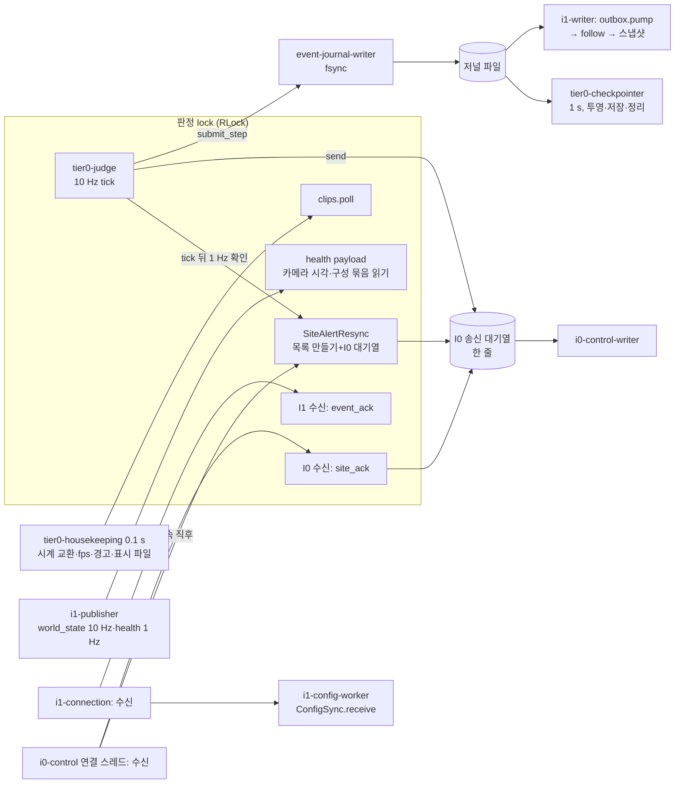

# Tier 0 서비스 조립: 스레드·lock·순서 불변식

S15P31A101-171. 기획서 §3.2(이벤트 소유권·저널 계약·재시작 복구·구성 묶음·재동기화), §3.9(시계 차이), §3.10(현장 경보·재동기화),
§3.12(엔드포인트 등록), §5.1·5.2(인지·ID 교정), §6.1·6.2·6.4·6.5, §7장, §12.2·12.3, §18.2 기준이다.
코드는 `ai/services/tier0/` 의 `__main__`(진입점), `service`(기동·스레드·종료), `judge`(판정 tick), `perception`(입력·인지),
`restore_link`(재시작 복원 Track 후보·이전 이벤트 연결, -178), `health`(health payload), `i0_control`(노트북 제어 채널 서버),
`settings`(설정), `config_fetch`, `yolo_detector`, `live_input`(LIVE 입력 조립, -182) 이다.
판정·추정 로직은 기능 패키지에 있고 여기서는 순서·스레드·설정만 정한다(ai/CONVENTION.md).

## 흐름

```
SIM 2D keypoint ─┐                      (LIVE: I0 영상 → 디코딩 → 최신성 대기열 → YOLO 엔진 → Local Tracker, live_input)
                 ▼
 observation_2d → LocalTrackletBuffer → CrossViewAssociator → WorldTrackManager → ContactEstimator → world_state payload
                                                                     │ revisions(ID 교정)
                                                                     ▼
            ConfigSync.begin_tick ─► ActiveConfig.evaluate(R1·R2·R3·R5·R6·R7, 작업면, 감시 상태) ─► LifecycleTracker
                                                                     │ LifecycleStep
                 ┌───────────────────────────────┬───────────────────┴─────────────┬──────────────────────┐
                 ▼                               ▼                                 ▼                      ▼
     JournalWriter.submit_step        I0 local_alert·alarm_stop          EventClipService           Checkpointer
     (쓰기 스레드가 fsync)              (fsync 를 기다리지 않음)            .on_transitions          .update_inputs
                 │
                 ▼
     Outbox(acked_offset 이후) ─► I1 risk_event_transition ─► (재전송 끝) event_state_snapshot
     world_state(10 Hz)·health(1 Hz) ─► I1 최신 칸        health(1 Hz + 접속 직후) ─► I0 노트북
```

## 스레드와 lock



| 스레드 | 하는 일 | 잡는 lock |
|---|---|---|
| `tier0-judge` | `JudgmentLoop.tick` (10 Hz), 그 뒤 `SiteAlertResync.tick`(1 Hz health). 재시작 뒤 연결 함수(`RestoreLink.related`)도 tick 안에서 만든다 | tick 과 목록 만들기·health 대기열 넣기에서 판정 lock. 초과 주기 뒤 양보는 lock 밖 |
| `event-journal-writer` | `EventJournal.append_step` + fsync (단일 작성자) | 저널 내부 lock |
| `tier0-checkpointer` | 투영 따라잡기 → 체크포인트 저장 → `SnapshotOutbox.compact` | Checkpointer 내부 lock |
| `i1-connection`·`i1-writer`·`i1-send-watchdog`·`i1-publisher`·`i1-config-worker` | I1 연결·송신(outbox pump, 스냅샷)·주기 송신·구성 묶음 검증 | health 를 만들 때만 판정 lock(짧게), event_ack 처리 때 판정 lock. 스냅샷(스냅샷 lock 안)의 콜백 current_state·risk_observed_at 은 판정 lock 을 잡지 않고 판정 상태 사본을 읽는다 |
| `i0-control-listen`·연결 스레드·`i0-control-writer` | 노트북 연결 수락·수신·송신(한 줄 대기열), 접속 직후 health | site_ack·접속 직후 목록·health 처리 때 판정 lock. 송신 스레드는 판정 lock 을 잡지 않는다 |
| `tier0-housekeeping` | 시계 교환 요청, 지연 표본(`health.evaluate`), fps, 경고, 표시 파일 | health 평가·clips.poll 때 판정 lock. 표시 파일의 `restore_link` 는 lock 없이 불변 사본을 읽는다 |

공유 시계는 lock 으로 감싼다: `SharedDecisionClock`(판정 시각, 앞으로만) → `SharedTier0Clock`(단조 기준 UTC) 순서로만 잡는다.
`Tier0ClockSync` 는 `LockedClockSync` 하나의 lock 으로 감싼다(요청은 정리 주기, 응답은 I0 수신, 추정은 판정·health).
lock 순서는 **판정 lock → (스냅샷 lock, 시계 lock, 각 모듈 내부 lock)** 한 방향뿐이다. 반대 방향을 없앤 방법:

- 스냅샷 콜백(current_state·risk_observed_at)은 스냅샷 lock 안에서 불린다. 판정 lock 을 잡으면 tick(판정 lock → 스냅샷)과
  순서가 뒤집혀 교착한다(리뷰 F1). 판정 루프는 tick·확인 끝마다 활성 이벤트·위험 관측 시각의 불변 사본(MappingProxyType)을
  바꿔 끼우고, 콜백은 lock 없이 그 사본을 읽는다(raised_at 은 이벤트 동안 바뀌지 않고, 위험 관측 시각은 sequence 로 걸러져 한
  tick 늦어도 틀리지 않는다).
- 판정 tick 은 스냅샷 lock 도 기다리지 않는다: `EventStateSnapshot.broken` 은 lock 없이 읽는다(참조 읽기는 원자적). 스냅샷이
  자기 lock 안에서 저널을 읽는 동안(디스크가 느려도) 판정은 진행한다. reseed 만 스냅샷 lock 을 잡는다(broken 일 때만, 드묾).

판정 lock 을 잡은 채 기다리는 일은 없다: 저널은 대기열에 넣기만 하고(가득 차면 JournalError), I0 송신도 대기열에 넣기만 한다.

## 순서 불변식

| 불변식 | 지키는 곳 | 시험 |
|---|---|---|
| 같은 tick 의 ID 교정은 판정보다 먼저: `correct_identity(rev.to_correction())` → `apply` | `JudgmentLoop._judge` 3) → 4) | `test_tier0_judge::test_identity_correction_is_applied_before_judgment_in_the_same_tick`, 음성 대조 `test_negative_control_reversed_order_duplicates_event` |
| 복원 Track 은 첫 World Track update 전에 후보로만 넘긴다(`manager.restore(result.tracks, result.tracks_t)`, 판정 스레드 시작 전). 위치 정본이 아니라 world_state·체크포인트 Track 에 나가지 않는다 | `Tier0Service._assemble_and_run`(인지 직후 `RestoreLink`) | `test_tier0_restore_link::test_restart_links_new_event_to_restored_event_without_moving_or_resolving_it`, E2E `test_tier0_restore_e2e`(재시작 뒤 world_state 에 이전 세션 World ID 없음) |
| 이전 이벤트 연결은 같은 tick 의 교정 뒤·판정 lock 안에서 만들어 `apply(..., related=linker.for_frame(frame, manager.restore_status))` 로 넘긴다. 입력 정지 tick 은 마지막 실제 World 의 frame. 연결은 정보뿐(복원 이벤트를 옮기거나 해소하지 않음), 실패는 연결 없음 | `JudgmentLoop._judge`·`_judge_frozen`·`_related`, `RestoreLink.related` | `test_judge_builds_related_after_identity_correction_inside_lock_and_on_frozen_ticks`, `test_related_failure_degrades_to_no_link_and_keeps_alert`, E2E(다른 사람이 같은 자리 → 이전 경보 유지) |
| 복원 Track 처리 결과는 정해지는 tick 에 로그(DISCARDED 면 이유 WARNING), 표시 파일 `status.restore_link` | `RestoreLink._note` | `test_checkpoint_older_than_30s_discards_tracks_logs_reason_and_links_by_zone_only` |
| 첫 인지 tick 전 체크포인트 재료는 복구 결과(config_version·Track·Track 시각)로 채운다(재시작 두 번 연속에도 30 s 규칙이 원래 Track 시각으로 선다) | `Tier0Service._assemble_and_run`(`checkpointer.update_inputs`) | `test_two_restarts_in_a_row_keep_checkpoint_tracks_for_the_third`, E2E 재시작 두 번 연속 |
| 구성 묶음 전환은 tick 시작(`begin_tick`)에서만. 한 tick 의 작업면(인지)·규칙·구역·config_version(world_state·전이)은 한 묶음 | `JudgmentLoop.tick` 1) | `test_config_bundle_switch_only_at_tick_boundary`, 음성 대조 `test_negative_control_switch_after_perception_mixes_bundles` |
| 판정 전이의 evidence_ref = 그 tick world_state 봉투 msg_id | `_judge` 2)·6) (`offer_world_state(msg_id=)`) | `test_evidence_ref_is_the_world_state_msg_id_of_the_same_tick` |
| 저널 넣기 → 현장 경보(fsync 를 기다리지 않음). 저널이 실패해도 현장 경보는 나간다 | `JudgmentLoop._record` | `test_site_alert_still_sent_when_journal_rejects` |
| 주기 I0 health 는 판정 tick 의 local_alert·alarm_stop 뒤 같은 스레드에서 확인한다. 목록 생성·대기열 넣기는 같은 판정 RLock 안, 1 Hz 판단은 SiteAlertResync 에만 있다. health 실패는 다음 tick 의 판정을 막지 않는다 | `Tier0Service._run_judge`, `SiteAlertResync` | `test_slow_ticks_keep_laptop_health_and_housekeeping_running`(실제 인지·판정·I0, 첫 resync 예외 뒤 계속 송신) |
| tick 이 주기를 넘기면 lock 밖에서 10 ms 양보해 정리 주기의 health.evaluate·표시 파일 갱신을 굶기지 않는다 | `Tier0Service._run_judge`, `JUDGE_OVERRUN_YIELD_S` | 같은 느린 입력 시험(송신 간격 < 3 s, 양수 대기, 정리 평가·실제 표시 파일 갱신) |
| 복원 → 쓰기 스레드·체크포인트·I0·I1 시작(단일 작성자, 복원 전 현장 경보 목록 금지) | `Tier0Service.start` 3)·6), `SiteAlertResync(ready=)`, `_site_fields` | `test_tier0_service::test_startup_recovers_before_any_link_and_no_alert_fields_before_restore`, E2E 재시작 첫 health |
| 재전송 → 스냅샷: 새 연결에서 health → acked_offset 이후 전이(오름차순, 같은 msg_id, resent) → event_state_snapshot | `build_i1_link`(첫 메시지 관문·outbox.reset) + `EventStateSnapshot.attach` | `test_tier0_e2e` 4) |
| 저널 정리는 `SnapshotOutbox.compact` 로만(스냅샷이 접지 않은 기록을 지우지 않음) | `Checkpointer(compact=self.outbox.compact)` | (기존 -81 시험) |
| 스냅샷 broken 회복(reseed)은 판정 lock 안에서 저널 쓰기 대기열이 빈 것을 확인한 뒤 | `JudgmentLoop._maybe_reseed` | `test_reseed_waits_for_empty_journal_queue_then_restarts_snapshot` |
| lock 순서는 판정 → 스냅샷 한 방향(콜백은 사본, broken 은 lock 없이) | `JudgmentLoop.current_state·risk_observed_at·_publish_views`, `EventStateSnapshot.broken` | `test_snapshot_callback_paused_inside_snapshot_lock_does_not_block_tick`(리뷰 부록 A), `test_snapshot_payload_and_ticks_repeat_concurrently` |
| 입력 정지(새 프레임 없음) tick 도 마지막 실제 World·원래 촬영 시각으로 판정한다. world_state 는 다시 보내지 않는다 | `JudgmentLoop._judge_frozen` | `test_full_input_stop_raises_pending_alert_as_unverifiable`, `test_short_stop_does_not_count_same_observation_twice_and_resumes`, `test_clock_estimate_expiry_during_input_stop_makes_event_unverifiable` |
| 확인은 ack_id 로 한 번만(대기 중 기록 포함) | `JudgmentLoop.acknowledge` (`journal.has_ack_id`) | `test_ack_is_recorded_once_per_ack_id_and_alarm_stop_carries_it`, E2E 저널 ack_id 1건 |
| 종료: 판정 → I0·I1 → 저널 비우기 → 마지막 체크포인트 → 저널 닫기, 공통 deadline 하나 | `Tier0Service.stop`·`_shutdown` | `test_stop_flushes_slow_journal_and_ends_threads`, `test_stop_returns_within_deadline_when_disk_is_stuck_and_keeps_marker`(리뷰 부록 C), `test_disk_released_before_deadline_stops_cleanly`, `test_abort_start_does_not_hang_on_stuck_disk` |

## 기동 순서 (`Tier0Service.start`)

1. 상태 디렉터리(`state_dir`, Network Volume). `state/tier0.live` 가 남아 있으면 이전 실행이 정상 종료하지 않은 것으로 로그에 남긴다.
   이어서 표시 파일을 `gpu_priority.phase=starting` 으로 쓰고 GPU 메모리를 선확보한다(-60, `docs/design/tier0-gpu-priority.md`).
   기동이 실패하면 이 표시 파일을 지운다(이전 실행이 남긴 것이었으면 `start_failed` 로 남긴다).
2. 보정 문서 → `CameraRig`. 시계: `Tier0Clock`(단조 기준) → `DecisionClock`(판정 시각은 앞으로만, -160).
3. 노트북 쪽 객체(제어 채널 서버·`Tier0ClockSync`·`GatewayLinkMonitor`)를 만든다(아직 듣지 않음). 판정 해소 확인은
   `ClockAwareVerification(offset_source=시계 교환, generation_source=시계 세대)` 다(-160). 노트북이 없는 조립(오프라인 SIM)은
   촬영 시각이 판정 시계와 같아 `ObservedTracksPolicy` 를 쓴다.
4. 저널을 쓰기 모드로 열고 `recover`. 거부(`RecoveryError` 등)면 종료 코드 3 으로 시작하지 않는다(운영 절차는 tier0-recovery.md).
5. 구성 묶음: 체크포인트 config_version 을 `BundleArchive.restore` 로 같은 검증기로 다시 만든다. 결과를 `config_check` 에
   남긴다(MATCHED·MISSING_IN_ARCHIVE·ARCHIVE_REJECTED). 체크포인트가 없으면(저널 전체 복구·첫 시작) 보관소의 가장 최근 묶음,
   그것도 없으면 설정의 시작 묶음(bootstrap, 보관소에도 저장). 그것도 없으면 구성 묶음 없이 시작하고 위험 판정을 하지 않는다
   (health NO_ACTIVE_CONFIG = UNSAFE_UNKNOWN). 어떤 경우든 EC2 확인 전이라 config_sync 는 UNVERIFIED 다.
6. 인지·스냅샷(seed = 복원한 활성 이벤트, start_offset = 저널 끝)·health·현장 경보 목록·I1(outbox = `snap.bind(Outbox(...))`,
   `snapshot_payload` 는 주지 않고 `snap.attach`)·체크포인트·판정 루프를 만든다. 인지를 만든 직후 `RestoreLink` 가
   `manager.restore(result.tracks, result.tracks_t)` 를 부르고(첫 update 전) `RestoredEventLinker(result.restored)` 를 만든다.
   체크포인트 Track 을 restore 가 거부하면(중복·같은 세션 ID) 쓰지 않고 빈 후보로 다시 부른다(연결은 같은 규칙·같은 구역만).
   Checkpointer 재료는 첫 인지 tick 전까지 복구 결과로 둔다.
7. 시작: 저널 쓰기 스레드 → Checkpointer → I1 → I0 제어 채널 → I0 영상 수신(LIVE) → 정리 주기 → 판정 루프 → 표시 파일.

LIVE 입력(-182)은 6 에서 만들고 7 에서 연다. 만드는 순서와 종료 코드: 검출기(TensorRT 엔진 `SIMAI_TIER0_ENGINE` → 없으면
`.pt` 가중치 `SIMAI_TIER0_WEIGHTS` 를 경고와 함께 → 둘 다 없거나 ultralytics 가 없으면 4) → 디코더(`input.decoder`: `cpu` 기본,
`nvdec` 선택(-236, 근거 `tier0-nvdec-throughput.md`). nvdec 을 골랐는데 NVDEC 을 열지 못하면 CPU 로 바꾸지 않고 4) → 영상 포트 설정(`SIMAI_TIER0_VIDEO_PORTS` 등이 모자라거나 카메라 목록과
다르면 2). 클립 링 버퍼를 브리지에 붙인 뒤 영상 포트를 연다(열지 못하면 4). 수신 스레드는 카메라별(`VideoIngestServer`)이고,
디코딩은 그 스레드에서 카메라별 lock 으로(`CameraIngest`), 검출·추적은 판정 tick 에서(`DetectorFeed.poll` → `I0Ingest.next_batch`)
한다. 판정 lock 은 수신·디코딩 경로에서 잡지 않는다. LIVE 인데 I0 제어 채널이 없으면 노트북 시계 차이를 모르는 것으로
조립한다(`ClockAwareVerification(offset_source=None 반환)`, health capture_clock 모름 → UNSAFE_UNKNOWN·해소 확인 금지).
SAME_CLOCK(`ObservedTracksPolicy`)은 노트북 없는 SIM 에만 쓴다. 종료 때 영상 수신(accept·연결) 스레드는 공통 deadline 안에서
join 하고, 남으면 실패로 남긴다. 영상 포트 일부만 열고 실패하면 연 포트를 닫는다.

## 종료 (`Tier0Service.stop`, SIGTERM·SIGINT·Windows CTRL_BREAK)

판정 루프·정리 주기 멈춤 → I0 닫기(영상 수신 → 제어 채널) → I1 닫기(outbox 가 더는 저널을 읽지 않음) → `JournalWriter.stop`(넣은 단계를 모두 fsync)
→ Checkpointer 멈춤 → 마지막 체크포인트(저널 끝까지) → 저널 닫기 → 표시 파일 삭제.

모든 단계는 공통 deadline(`stop(timeout_s)`, 기본 drain_s) 하나를 나눠 쓰고, 각 단계는 별도 스레드에서 돌려 남은 시간만 기다린다
(리뷰 F3). 디스크가 멈춰 저널 쓰기가 시간 안에 끝나지 않거나 Checkpointer 가 멈추면 마지막 체크포인트와 저널 닫기를 동기로
다시 기다리지 않는다(둘 다 저널 쓰기 lock 을 기다리게 된다). 그때는 표시 파일에 `shutdown_failed`(끝나지 않은 단계 이름)를 남기고
실패(종료 코드 1)로 끝난다. 다음 시작이 체크포인트 + 저널로 복구한다. 기동 실패 정리(`_abort_start`)도 같은 함수를 쓴다(마지막
체크포인트 없음). 강제 종료(kill)면 fsync 전 단계는 잃고(그 전이는 EC2 로도
나간 적이 없다, D-G3-18) 다음 시작이 체크포인트 + 저널로 복구한다.

## health 와 노트북 연결

- System Health 는 `evaluate_health`(카메라 시각은 이번 프로세스에서 처리한 프레임으로 새로 만든다) 위에 `RecoveryHealthGate.apply`
  를 같은 capture_clock 으로 덧씌운다. ec2_link_ok = `I1Client.connected`, gateway_link = 노트북 제어 채널 + 하트비트 3회 누락 판정
  (`tracking.gateway_link`, -91), laptop_clock_offset = 시계 교환 추정(끊기면 null), config_version·config_sync = `ConfigSync.health_fields`,
  ec2_world_state_drops = `with_world_state_drops`(I1·I0 health 둘 다), active_site_alerts·as_of = `SiteAlertResync.fields`(복원 뒤에만).
- 노트북이 (재)접속하면 이전 연결의 시계 표본을 버리고 바로 시계 교환을 요청하고, 1 Hz 를 기다리지 않고 health(현장 경보 목록)를
  보낸다(-161). 이 health 는 하트비트를 아직 받지 못해 gateway_link DISCONNECTED·UNSAFE_UNKNOWN 이다(모르면 정상으로 보지 않는다).
- 주기 I0 health 는 `tier0-judge` 가 `judge.tick()` 직후 `resync.tick()` 으로 확인한다(-375). 정리 주기에서는 호출하지 않는다.
  local_alert·alarm_stop 과 같은 스레드에서 뒤이어 보내되, 목록 만들기부터 I0 FIFO 대기열 넣기까지 판정 RLock 으로 감싼다.
  접속 훅·site_ack 가 사이에 들어와도 같은 lock 으로 직렬화하고, `active_site_alerts_as_of` 경합 방어는 유지한다.
  active_states·health.evaluate 의 재진입에는 같은 RLock 을 쓰므로 일반 Lock 의 자기 교착이 없다. 스냅샷 콜백의 불변 사본
  읽기와 판정 → 스냅샷 lock 순서는 그대로다(`judge.py` 모듈 설명 8).
- 판정 주기 초과 시 `Event.wait(0.01)` 로 lock 밖에서 양보한다. 10 ms 는 명세 수치가 아니라 9차 Pod 사본에서 제어 채널
  끊김이 14분간 0회였던 초기값이다(9차 조사, S15P31A101-375). 즉시 재획득으로 정리 스레드가 굶는 것을
  줄이며 종료 신호에는 바로 깨어난다. lock 공정성이나 3초 상한을 보장하지는 않는다. 단일 tick 의 3초 초과·송신 경로 정체는
  별도 위험이고, 최대 속도 REPLAY 는 기존처럼 실제 시간 대기를 생략한다.
- health 계약에 필드가 없는 운영 경고(Checkpointer 정체·오류, 저널 쓰기 정체·실패, outbox blocked, 스냅샷 broken)는 로그(바뀔 때)와
  표시 파일 `state/tier0.live` 의 status 에 싣는다(5초마다 갱신).

## 미뤄 둔 연결 목록

| 출처 | 연결 | 상태 / 시험 |
|---|---|---|
| -79 저널·outbox | 판정 전이 evidence_ref = world_state msg_id | 배선 / `test_evidence_ref_is_the_world_state_msg_id_of_the_same_tick` |
| -79 | Outbox.blocked 보고 | 로그·표시 파일(health 계약 필드 없음) / 시험 없음(경고 경로) |
| -160 시계 | DecisionClock·ClockAwareVerification·generation_source | 배선 / `test_unknown_clock_offset_keeps_health_unsafe_and_blocks_resolution` |
| -117·-346 보정 감시 | 클러스터 공급·DRIFTED 영속·기준선 저장/복원 | 배선(-346, 아래): 기본 보조 스레드 감시, `test_drift_watch.py`. -345 재수집 실행기 연결과 카메라별 관제 표시는 후속 |
| -40 ID 교정 | revisions → correct_identity, apply 전 | 배선 / 위 순서 시험 |
| -45·-170 I1 | health payload, ec2_link_ok, with_world_state_drops, ack_seen, I1 경로 설정 | 배선 / E2E, `test_i1_path_is_configurable_and_gateway_id_is_shared` |
| -84·-48·-170 | world_state config_version | 배선 / E2E, 경계 시험 |
| -51 복구 | recover → Checkpointer.start, update_inputs, RecoveryHealthGate.apply, 복원 전 목록 금지, 경고, config_version 비교 | 배선 / `test_recovery_health_is_unsafe_until_reobserved_and_restored_alerts_listed`, 기동 순서 시험, E2E |
| -54 복원 Track·연결 | manager.restore(첫 update 전), RestoredEventLinker → apply(related=), DISCARDED 이유 로그 | 배선(-178) / `test_tier0_restore_link.py`, `test_tier0_restore_e2e.py` |
| -81 스냅샷 | bind·attach·compact·risk_observed_at·status·reseed | 배선 / E2E(재전송 → 스냅샷), `test_reseed_waits_for_empty_journal_queue_then_restarts_snapshot`, lock 순서 시험 |
| -91 노트북 하트비트 | 3회 누락 → gateway_link 끊김 | 배선(`tracking.gateway_link`) / `test_gateway_link.py` |
| -93 Risk | ActiveConfig.evaluate(작업면), 등록부 전체 | 배선 / E2E 묶음(R1·R2·R3·R5·R7 교실 프로파일) |
| -57 클립 | on_transitions·poll | 배선(업로더 없음: 서명 API 미정) / 시험 없음(SIM 은 영상이 없다) |
| -159 엔드포인트 | (재)연결마다 tier0_endpoint | 배선 / E2E(계약 검증) |
| -161 현장 경보 재동기화 | 접속 직후·1 Hz, 같은 lock·한 줄 대기열 | 배선 / E2E |
| -32 이미지 | SIMAI_TIER0_ENGINE, state/tier0.live | 배선 / `test_live_without_engine_exits_4_without_judging`, `test_live_start_errors_have_clear_exit_codes` |
| -83·-80·-21·-57 LIVE 입력 | I0 영상 수신 → 링 버퍼 + PyAV 디코딩(CPU 기본·NVDEC 선택) → latest-frame-wins → 검출 → Local Tracker, health cameras[].frames·WAITING_KEYFRAME | 배선(-182) / `test_tier0_live_e2e.py`(실제 H.264, 검출·추적 대역), `test_live_input.py`, `tests/io/test_pyav_decoder.py`. Pod 의 CPU 디코딩·TensorRT 실경로는 -183 큐 c |

## 남은 일

- LIVE 입력(-182 뒤): Pod 실경로(CPU 디코딩·TensorRT·10명 처리 시간)는 -183 큐. observation_2d 원본 Network Volume 보관(11.2)은
  아직 잇지 않았다.
- health 계약은 2.0.0 에서 정했다(-179): 시계 차이를 모르면 `pipeline_lag_ms` null + 하한 `pipeline_lag_lower_bound_ms`, 운영 경고
  `tier0_warnings`(정리 주기에 Checkpointer·저널·outbox·스냅샷 상태를 읽어 기억), 카메라 `sync_valid`(근거 없으면 null). 송신 봉투(i1_client·i0_control)는
  `HEALTH_SCHEMA_VERSION` 을 쓴다. 남은 일: 카메라 sync_offset_ms·동기화 무효 판정 모듈.
- 보정 감시(-117·-346): -344의 영속 저장소와 Cross-view 입력을 연결했다(아래). -345 재수집 실행기 연결과
  카메라별 관제 표시는 후속이다.
- 정책 해석을 기능 패키지 API 로 옮기기(리뷰 권장): 공통 시각 선택(`Perception.choose_t`), health 카메라 상태 계산
  (`HealthReporter.payload`), 위험 관측 시각 판단(`JudgmentLoop._note_risk`). 지금은 services 에 있다.
- 클립 트리거(-57) 회귀 시험(영상·업로더가 생긴 뒤), Network Volume 강제 종료 영속성 실측(-92).
- ID 교정 기록(`IdentityRevision.to_payload`)은 저널에 넣지 않는다: outbox 가 저널의 모든 기록을 I1 risk_event_transition 으로 보내므로
  다른 종류의 기록을 넣으면 보낼 수 없다. 교정은 IDENTITY_CORRECTED 전이로 남는다.
- 구성 묶음 내려받기 주소 형식(서버 확정 전, `config_fetch` 는 https 만), 체크포인트에 묶음 applied_at 이 없어 복원 시각을 기동 시각으로 둔다.

## S15P31A101-344 — 실행 중 검증된 보정 버전으로 전환

관련 명세는 §4.1(World 고정), §4.4(내부 파라미터 변경 시 별도 절차), §4.5(검증·개선 뒤 원자적 전환),
§12.6(관리자 확정)이다. `contracts/`와 I1 LIVE 계약은 변경하지 않는다. 후보 계산(-345), 틀어짐 감시 입력(-346),
서버·프런트·연관 임계값 변경은 이 작업의 범위 밖이다.

### 진입점과 검증

같은 프로세스의 백그라운드 실행기가 `Tier0Service.propose_calibration(document, report) -> bool`을 부른다.
document는 CalibrationProvider 문서, report는 -343의 `calibration/extrinsics/session.py`가 만든 session 보고서다.
True는 다음 tick을 기다리는 후보 수락이며 활성화 완료가 아니다. 실행 전·종료 중·다른 후보 대기 중이면 거부한다.
입력은 엄격한 JSON 사본으로 보관해 호출자가 나중에 수정해도 바뀌지 않는다.

`calibration/runtime.py::validate_candidate`에서 계약 스키마·기하·상태·`document.content_hash`를 검증한다.
현재와 같은 비어 있지 않은 site_id, 동일 카메라 집합, 카메라별 image_size·K·distortion의 정확한 동등성을 요구한다.
보고서의 previous_version은 활성 버전이어야 하고 calibration.version/content_hash/state는 문서와 일치해야 한다.
보고서 계산 실패·스키마 오류·미상 값·NaN/무한대는 수락하지 않는다. 자동 후보는 PROVISIONAL만 받으며 CALIBRATED로
자동 승격하거나 기존 문서의 상태를 덮어쓰지 않는다. 관리자 확정 경로는 기존 §12.6의 별도 절차다.

| 검사 | 채택 기준 | 근거 |
|---|---|---|
| fit 데이터 | 공통 tick 30, 활성 tick 25, 다중 카메라 사람 관측 40, 3대 이상 관측 25, 카메라별 3대 이상 관측 15 이상 | -343 `DEFAULT_DATA_CRITERIA` 재사용 |
| holdout 데이터 | 공통 tick 15, 활성 tick 10 이상, fit과 중첩 0 | 같은 기본값, session split 보고 |
| holdout 재투영 | 후보 모든 설치 카메라 median ≤ 8px, p95 ≤ 25px. 두 보정의 공통 관측 ≥200개인 카메라만 그 관측의 median 악화 ≤1px | **명세 없음, 2026-10-30 Lead 2·3차 임시 결정**. 아래 -347 절의 공유 기준 사용 |
| 의미 있는 개선 | 같은 holdout의 4대/3대 이상 융합률·최저 카메라 쌍 통과율 등을 -345와 같은 함수로 비교. 카메라별 공통 관측 부족은 비교 불가로 기록 | **명세 없음, Lead 2·3차 임시 결정**. 기존 최악 median 10% 개선 기준을 대체 |
| World 정렬 | usable=true, 설치 카메라 중 서로 다른 기준 2대 이상. 기준 중심 잔차 각각 ≤ 15cm, 회전 잔차 각각 ≤ 1.5° | 기준 2대·1.5°는 session의 기준 카메라 선택 기본값, 15cm는 §4.4의 위치 불일치 수치. 채택 잔차 상한은 **명세 없음, 임시 결정** |

session.py에는 holdout 개선율·World 잔차의 최종 채택 상한이 없다. 위 표의 임시 결정은 그 공백을 채운 것이며
보고서의 usable 플래그만으로 통과시키지 않는다. -347 2차에서 자동 전환과 CALIBRATED 확정 기준을 분리했으며,
상세 근거는 아래에 기록한다. 이 수치들은 실제 교실 측정으로 검증한 제품 성능이 아니다.

### tick 경계와 위치 결과

후보 수락·활성화는 서비스 판정 RLock으로 직렬화한다. 후보 문서·보고서를 먼저 로컬 불변 파일로 저장하고 rig도
미리 만든다. `JudgmentLoop.tick` 시작에서 `_begin_calibration_tick`을 부른 뒤 구성 묶음의 begin_tick과 인지를 수행한다.
활성 head·전환 기록을 fsync 후 원자적으로 저장한 다음 서비스 rig, Perception rig, CrossViewAssociator rig,
WorldTrackManager의 input_provenance를 같은 lock 안에서 바꾼다. Cross-view의 essential matrix 캐시는 비우고
연결 이력·World Track·World ID·접지 추정기·입력 버퍼는 유지한다. 삼각측량은 매번 manager.update에 새 rig를 넘긴다.
아바타 공유도 Perception의 같은 rig를 읽는다. 구역 가시성 캐시 키에는 기존부터 보정 버전이 포함되어 있다.
클립은 보정 rig를 보관하지 않는다.

전환 tick의 첫 새 위치 계산부터 frame·world_state·input_provenance·아바타 보정에 새 버전이 붙는다. 전환 시각은
주입된 판정 시계의 UTC ms로 기록한다. 입력 정지 tick은 새 world_state를 만들거나 옛 좌표에 새 버전을 붙이지 않는다.
그동안의 판정은 직전 실제 World와 원래 버전·상태를 사용하며, 같은 버전의 DRIFTED 등 운영 상태 변화는 계속 반영한다.
이전 버전의 drift_watch 저장소 상태를 새 rig의 상태로 쓰지 않는다. health payload도 판정 lock 전체에서 만들어
전환 중 버전과 상태를 서로 다른 시점에서 읽지 않는다.

활성 head 저장이 실패하면 모든 메모리 참조를 유지하고 기존 보정으로 판정한다. 후보는 다음 tick에서 재시도하고
실패 사유를 기록한다. 디스크가 멈추면 이 경계의 fsync도 지연될 수 있다(잔여 위험).

### 로컬 영속과 I1

`RuntimeCalibrationStore`는 완성된 보정 문서를 받는 Provider와 버전 보관소다. 기존 `CalibrationVersionStore.propose`
는 근거에서 문서를 다시 만들고 버전 ID도 다시 발급하며 CALIBRATED를 동결하므로, -343이 만든 문서·해시·버전을
그대로 수락하는 데 재사용하지 않았다. 기존 클래스의 판정·상태 전이 정책은 바꾸지 않는다.

- 문서: `state_dir/calibrations/<sha256(version_id)>.json`, 보고서: 같은 이름의 `.report.json`. 같은 경로에 다른 내용을
  덮어쓰지 않는다. 버전 ID가 파일 경로로 해석되지 않게 ID를 해시한다.
- `active.json`: bootstrap 버전, 알려진 버전 목록, 활성 버전, 문서별 보관 해시, 추가만 하는 전환 이력. 임시 파일
  flush/fsync 뒤 os.replace로 한 번에 바꾸고 성공한 뒤 메모리 head를 갱신한다. head가 가리키지 않는 대기 문서는
  재시작 때 활성화하거나 알려진 버전으로 인정하지 않는다.
- 재시작은 저장된 활성 head가 시작 calibration_file보다 우선한다. 시작 파일이 없어도 복원한다. 보관 파일 손상·누락·
  문서 ID/해시 불일치·활성 버전 누락은 종료 코드 2로 기동 거부하며 옛 시작 파일로 돌아가지 않는다.
- 기존 SIM 등 시작 문서에는 다른 content_hash 계산 규칙이 있어 시작 파일 원문과 기존 해시는 유지한다. 저장소의 별도
  문서 해시로 그 후 무결성을 확인한다. 새 후보에는 content_hash 검사를 예외 없이 적용한다. 이 호환 정책도
  **명세 없음, 임시 결정**이다.
- 전환 이력에 `calibration_update` payload와 msg_id를 함께 저장한다. I1Publisher source가 신뢰 대기열로 보내며 포화 때
  기존 publisher의 carry에 보관한다. reason=RECALIBRATED, previous_calibration_version=직전 버전,
  effective_at=전환 tick 시각, state=PROVISIONAL, calibration_hash=문서 content_hash다.
- `calibration_ref`는 위 로컬 문서의 절대 file URI다. 공통 저장 위치 규칙이 아직 없어 **명세 없음, 임시 결정**으로
  최소 형태를 쓴다. 원격 EC2/worker에서 파일을 가져오는 경로는 -345 또는 후속 전달 경로에서 해결해야 한다.
- 프로세스 재시작마다 전환 이력을 같은 msg_id로 다시 내보낸다. 대기열에 넣은 뒤 종료돼도 유실되지 않게 하는
  **명세 없음, 임시 결정**이다. 수신 측의 중복 처리가 필요하고 장기 실행의 이력 정리는 후속이다.

### 구성 묶음과 health

BundleVerifier의 calibration_known은 현재 rig 하나 대신 영속 저장소의 커밋된 모든 버전을 조회한다.
전환 뒤 옛 보정의 묶음을 받아도 구역·규칙·작업면은 정상적으로 적용하고 활성 보정은 유지한다.
§4.1은 World가 고정되어 구역 등이 보정 변경의 영향을 받지 않는다고 정하지만, 이때의 config_sync 표현은 정하지
않는다. 따라서 **명세 없음, 임시 결정**으로 원래 묶음을 수정하지 않고 health에 config_sync=STALE을 덧씌운다.
활성 보정을 가리키는 새 묶음이 적용되면 원래 ConfigSync 상태로 돌아간다. 묶음에 없는 보정은 계속 거부한다.

후보 거부 또는 활성화 저장 실패는 로그와 `status.calibration.last_rejection`(시각·사유)에 남긴다. 기존 health 계약에는
보정 후보 거부용 warning code·사유 필드가 없다. 계약을 확장하지 않고 health.system_health의 NOMINAL을 DEGRADED로
올리며 구체 사유는 로컬 상태 표시 파일에 둔다(**명세 없음, 임시 결정**). UNSAFE_UNKNOWN은 내리지 않는다.
성공적으로 전환하면 거부 표시를 해제한다. 구성 버전 불일치는 `status.calibration.config_mismatch`에도 기록한다.

### 시험과 잔여 위험

`tests/services/tier0/test_calibration_swap.py`는 실제 서비스 조립·SIM 관측·인지·판정을 사용한다.
전환 전후 버전, 같은 tick 중 다른 스레드의 후보 진입, 기하 캐시·출처·아바타 일관성, Track 연속성,
내부 파라미터/검증/보고서/해시/현장/데이터 부족 거부, I1 계약 및 포화 대기열, 옛 구성 묶음 수용,
재시작 활성 버전 복원, 저장 실패 시 유지·재시도, 저장소 손상 기동 거부를 확인한다. SIM 결과는 상한이다.
최종 전환·판정·health 시험은 65개 통과(새 시험 27개 포함), import 검사는 6 kept/0 broken이다.
지시서의 넓은 관련 영역 시험은 번들 조정 최적화가 오래 걸려 중단했다. 기존 프로세스 E2E의 초기 R1 수신 대기는
현재 코드와 HEAD 서비스 원본 대조에서 모두 실패했다(`test_tier0_e2e.py:112`). 이를 이 변경의 통과 시험으로 세지 않는다.
정확한 명령과 로그는 `.agy/notes.md`에 남겼다.

버린 대안은 수신 스레드에서 즉시 rig 교체(같은 tick 혼합), 보정 변경 때 Track 초기화(World ID 단절),
옛 보정의 구성 묶음 전체 거부(같은 World의 구역/규칙 갱신도 차단), 시작 파일을 항상 우선(재시작 시 보정 후퇴),
거부 사유 때문에 I1 계약 확장(승인 없는 계약 변경), 전환 알림을 메모리 대기열에만 보관(재시작 유실)이다.

후보 검증과 로컬 파일 fsync는 판정 lock을 잠깐 잡으므로 실제 디스크 지연이 Tier 0 지연에 미치는 영향은 실측해야 한다.
전원 차단 시 디렉터리 rename의 저장장치 내구성은 운영 환경에서 확인해야 한다. 여러 프로세스가 같은 state_dir를
동시에 쓰는 것은 지원하지 않는다. World 정렬 보고서는 같은 프로세스 실행기의 신뢰 경계이며 이 진입점에서 관측을
다시 계산하지 않는다. 실제 GPU·교실 영상 측정, -345 실행기 연결, EC2의 로컬 보정 문서 접근은
후속 작업이다. 관리자 확정 및 Scene 재생성은 기존 인터페이스 책임으로 남긴다.

## S15P31A101-346 운영 중 틀어짐 감시 연결

관련 명세는 §4.4의 감시 근거 없음·기준선·귀속·재보정 시작 조건, §4.5의 보정 버전이다.
계약 및 Tier 0 연관 판정 규칙은 바꾸지 않는다. 서버·프런트는 읽기만 했다.

### 입력과 스레드

`Perception.step`의 Cross-view 결과를 `observe_association` 연결점으로 넘긴다. 기본 서비스는
`BackgroundDriftWatch.offer`에 해당 tick의 보정 문서·연관 결과·실제 검출 입력 해상도를 넣는다.
설정 파일의 `drift_watch_enabled`는 bool이고 기본 true, false이면 공급과 감시 스레드를 만들지 않는다.
기존 `drift_watch_factory`는 명시적으로 주입하는 대역 연결점으로 보존한다(끄기 설정은 대역에도 적용).

판정 경로는 최신 1칸의 참조만 바꾸고 기다리지 않는다. 기본 표본 간격은 공통 촬영 시각 기준 1초이고,
스트림 정보가 바뀌거나 버전이 바뀌면 간격을 기다리지 않는다. `tier0-drift-watch` 한 스레드에서
확실히 연결된 3대 이상 클러스터를 `PersonObservation`으로 복사하고 기존 `ReprojectionMonitor`에 준다.
카메라별 원본 해상도 픽셀·신뢰도·null을 보존한다. World XYZ나 추정 관절은 입력하지 않는다.
연관 불확실 클러스터는 제외하고 한 표본에서 최대 8명까지 쓴다. 최신 대기 표본이 밀리면 과거 대기 표본을 버린다.
이미 시작한 계산 하나는 끝내되 결과의 버전을 확인해 새 rig에 이전 근거가 들어가지 않게 한다.

표본 1초는 기존 `CalibrationDriftWatch.min_update_interval_ms` 기본값을 재사용했다.
최신 1칸·최대 8명·불확실 연결 제외는 **명세 없음, 임시 결정**이다. 판정 경로의 기하 중복 계산과
밀린 표본 재생을 피하고 잘못된 사람 연결로 틀어짐을 확정하지 않기 위해 정했다. 3대는 leave-one-out의
최소 관측 수다. 귀속 가능 여부와 지속 조건·절대 상한 8px는 기존 감시기의 판정을 그대로 쓴다.

### 상태·알림·재수집

감시 결과 반영은 판정 lock으로 버전 전환과 직렬화한다. `RuntimeCalibrationStore.report_drift`는
보정 문서를 덮어쓰거나 새 버전을 만들지 않고 같은 버전의 운영 상태 전이를 추가한다. active.json에
기존 방식으로 fsync/원자 저장한 뒤 메모리 운영 상태를 DRIFTED로 바꾼다. 원문·content_hash는 유지한다.
감시기에서 확정 근거가 한 번만 나오므로 저장 실패 시 서비스가 근거를 보관해 다음 표본 때 재시도한다.
DATASET_GT·SIM·MODEL_ESTIMATE 보정은 DRIFTED로 표시하지 않는다.

전이 기록에 같은 버전·해시·msg_id의 `calibration_update`를 보관한다. reason은 재투영 틀어짐이면
DRIFT_DETECTED, 해상도·화각 변경이면 STREAM_CHANGED다. 이미 DRIFTED여도 새 스트림 변경은 알린다.
기존 I1 신뢰 대기열 source가 보내고 재시작 때 같은 msg_id로 다시 보낸다. 운영 상태도 전이에서 복원한다.
기존 health/판정의 보정 상태 조회가 이 운영 상태를 읽는다. DRIFTED는 기존 매핑으로 DEGRADED이며
시계·연결 등으로 UNSAFE_UNKNOWN인 상태는 낮추지 않는다.

특정 카메라의 MonitorStatus가 DRIFTED이고 어느 카메라에도 스트림 변경이 없으면
`Tier0Service(..., on_camera_drifted=callback)`을 버전·카메라마다 한 번 부른다. 이 자리에 -345의
관절 버퍼 `reset_camera`를 연결한다. 콜백은 감시 스레드의 판정 lock 밖에서 실행하며 예외는 로그에 남긴다.
귀속 불확실(AMBIGUOUS)은 DRIFTED와 calibration_update만 알리고 콜백을 부르지 않는다.
사람 관측이 비면 기존 상태를 유지하며 보고의 evidence는 NONE이다. 감시 보고는 관측 시각을 함께 남긴다.

기존 `CalibrationDriftWatch`의 자체 후보 수집·재정렬 트리거까지 돌리는 대안은 사용하지 않았다.
-345가 후보 수집/계산을 맡으므로 동일한 수집기를 이중으로 실행하지 않고 감시기와 재수집 신호만 조립한다.

### 기준선과 버전 전환

`state/calibration_baselines.json`의 버전별 BaselineRecord를 그대로 복원한다. 검증 여부와 출처를
보존하고 현재 버전의 기록만 적용한다. 없으면 미확정 기준선을 배우며 시간이 지나도 검증으로 승격하지 않는다.
절대 상한은 학습 중에도 적용한다. 기준선은 정리 주기와 종료 시 저장한다.
-344의 tick 경계 전환은 새 문서로 감시 입력을 바꾸고 서비스 보고·저장 재시도 근거를 비운다.
보조 스레드는 첫 새 버전 표본에서 ReprojectionMonitor를 새로 만든다. 이전 창·지속·DRIFTED 표시를
이어 쓰지 않고 새 버전 기준선만 찾는다. 이전 버전의 기준선은 저장 기록으로 보존한다.
검증된 새 기준선은 해당 보정을 만든 관측으로 별도 계산해 버전별 기록으로 제공해야 하며,
holdout 요약 오차를 검증 기준선으로 복사하지 않는다.

### 관제 전달 확인과 잔여 위험

`health.calibration_state`와 EC2의 보정 알림 저장소(`CalibrationUpdateIngestor`)·보정 조회는
전체 보정 상태를 전달한다. 관제 `viewer3d/data/contractAdapter.ts`도 전체 calibrationState를 읽는다.
현재 health.cameras에는 보정 상태가 없고 world_state.cameras는 관측 카메라 ID 목록이다.
calibration_update.cameras 역시 재투영 오차만 담고 귀속 상태는 담지 않는다. 따라서 카메라별 DRIFTED와
귀속 불확실/감시 근거는 EC2·관제로 전달되지 않는다. 현재 로컬 status.calibration.drift_watch에
카메라별 감시 상태·기준선 검증 여부와 관측 시각을 남겼다. 계약 확장·EC2·관제 연결은 후속이다.

실제 해상도는 검출 입력 프레임에서 얻는다. 줌/렌즈 변경의 명시적 화각 통지 수신은 아직 없고 후속이다.
틀어짐이 커서 기존 연관이 카메라를 분리하거나 불확실로 만들면 그 관측은 감시에 못 쓰므로 감지하지 못할 수 있다.
3대 관측만으로는 불일치를 알아도 원인을 특정할 수 없다. 군중에서 최대 8명 이외의 표본이 늦어질 수 있다.
별도 CPU 스레드도 CPU/BLAS 자원을 공유한다. 실제 GPU·교실 영상의 2분 내 감지/오경보·지연은 미측정이다.
전이 fsync는 계산과 달리 판정 lock 안이므로 느린 디스크가 판정을 지연시킬 수 있다(-344와 같은 제한).
콜백은 메모리 신호이며 프로세스 종료를 넘는 전달 보장/실패 재시도는 -345에서 다뤄야 한다.

검증 위치는 `tests/services/tier0/test_drift_watch.py`, 기존 서비스 및
`tests/calibration/test_monitor*.py`, `test_watch*.py`다. 지정 영역은 557 passed / 1 skipped(가중치 없음),
마지막 변경 뒤 서비스·전환·새 연결은 45 passed, import 규칙은 6 kept / 0 broken이다.
감시 계산을 멈춘 동안에도 판정 12 tick이 274.922ms에 진행됐고 표본 제출 1,000회 p95는 0.004500ms였다.
CPU 합성 시험으로 스레드 격리/제출 비용만 확인했으며 실제 현장 지연/제품 성능을 뜻하지 않는다.
최종 명령·결과와 측정 조건은 `.agy/notes.md`에 기록한다.

## S15P31A101-347 — 운영 관절에서 백그라운드 후보와 실행 중 전환까지 연결

관련 명세는 §4.3(이미 추출한 관절 재사용·World 유지), §4.4(보정 상태·동결·재수집 조건),
§4.5(검증 후 원자적 버전 전환)다. 2차 Lead 결정으로 -344의 자동 PROVISIONAL 전환 기준을 분리했다.
Tier 0 연관 판정·I1 계약은 유지한다.

### 운영 흐름과 책임

서비스는 저장된 직전 활성 보정으로 바로 판정을 시작한다. `Perception.ingest`는 카메라별
`Observation2DFrame`을 `LiveJointBuffer.append_frame`에 공급한다. 촬영 시각·신뢰도·로컬 ID·null을
그대로 보존하며 판정 스레드에는 표본 추가만 둔다. 훅 실패는 로그에 남기고 판정을 계속한다.

`BackgroundLiveCalibration`의 단일 보조 스레드는 첫 주기까지 수집한 뒤 기존 -345 실행기를 호출한다.
스냅샷·공통 시각 보간은 보조 스레드, 후보 계산은 기존 spawn 프로세스(낮은 OS 우선순위·BLAS 1스레드)다.
호출이 끝난 뒤 다음 주기를 확인하므로 계산을 겹쳐 띄우지 않는다. 프로세스 사망·시간 초과·예외는
로컬 `status.calibration.live_candidate`와 로그에 남긴다. 실패해도 활성 rig와 판정 루프는 유지한다.
서비스 종료 신호를 후보 프로세스 대기에도 전달하고, terminate/join 및 필요 시 kill로 정리한다.
후보 실행 이력은 최근 16회까지만 보관한다.

후보 실행기는 같은 holdout에서 의미 있는 개선을 확인하고 서비스의 `propose_calibration`에 넘긴다.
전환 검증기는 실행기와 같은 개선 판정 함수와 카메라별 안전 상한을 쓰며(아래 2차 결정),
World 정렬, 문서 해시와 기준 버전을 계속 검사한다.
-345 요약에서 빠졌던 원시 재투영 지표와 `calibration` 문서 결속 정보를 보고서에 보존하며,
빠른 회전 경로는 실제로 고정한 기준 카메라의 회전 잔차 0을 기록한다. 근거 없는 오차를 채우지 않는다.
전체 회차 경로는 활성 공유 렌즈의 정확한 값을 계승한다. 녹화 도구의 반올림한 고정 렌즈를 대입하면
같은 렌즈라도 -344 내부 파라미터 불변 검사에서 거부되기 때문이다. 공유 렌즈가 아니면 명시적으로 거부한다.

수락은 대기만 뜻한다. 다음 tick에서 영속 활성화가 성공한 뒤 서비스·인지·후보 실행기의 활성 문서와
입력 출처를 같은 새 버전으로 바꾼다. 실행기의 직전 World 정렬 기준도 이 문서이며 World 좌표계와
World Track 관리자는 유지한다. 저장 실패나 거부 시 실행기는 이전 활성 버전을 기준으로 계속한다.
CALIBRATED에서는 후보 계산을 보류하고 감시만 한다. 자동 후보는 PROVISIONAL이며 독립 검산을 대신하지 않는다.

확정 DRIFTED 신호는 해당 카메라의 관절 버퍼만 비우고 새 관절을 모은다. 수집 세대를 바꿔 reset 이전에
계산 중이거나 tick을 기다리던 자동 후보를 버린다. 원인 귀속이 불확실하면 버퍼를 비우지 않고 자동 후보를
보류한다. 해상도·화각 변경도 내부 파라미터 재추정이 필요하므로 새 활성 보정이 올 때까지 후보를 보류한다.
원인 카메라 콜백에 대한 기존 외부 주입도 계속 호출한다.

### 설정과 초기값

Tier 0 JSON의 `live_calibration`은 다음 값을 받는다. `.env`를 추가하거나 읽지 않는다.

| 필드 | 기본값 | 의미·근거 |
|---|---|---|
| `enabled` | `true` | 관절 수집과 후보 스레드를 함께 켜고 끈다 |
| `interval_ms` | `60000` | 첫 시도·후속 확인 주기. -345 녹화 모의 실행 권장값 |
| `timeout_s` | `180.0` | 자식 프로세스 계산 상한. -345 기본값 |
| `buffer_duration_ms` | `300000` | 최근 5분. -345 관측 수렴 권장값 |
| `measured_camera_heights` | `{}` | 카메라 ID → 실측 렌즈 중심 높이(m). 문서의 추정 위치를 실측으로 채우지 않는다 |

기타 버퍼 상한은 기존 -345 기본값(카메라당 3600프레임, 전체 20000표본, 추정 32MiB)을 쓴다.
설정의 bool·양수·유한성·시간 하한을 검사한다. 실측 높이 없이 전체 조정의 축척 검산이 안 되면
후보가 거부될 수 있다. 빠른 회전은 스케일을 바꾸지 않고 이전 스케일 근거를 계승한다.

### 시험과 남은 위험

코드 위치는 `services/tier0/live_calibration.py`·`service.py`·`perception.py`·`settings.py`,
보고서/프로세스 처리는 `src/simai_ai/calibration/live_candidate.py`다.
`tests/services/tier0/test_live_calibration.py`가 합성 4대 + 1° 회전 틀어짐에서 관절 공급 → 실제 후보 계산
→ 검증 수락 → 전환 → 새 결과 버전, 실제 자식 프로세스 사망·시간 초과·종료 취소,
DRIFTED 재수집·귀속 불확실·스트림 변경 보류·낡은 후보 거부·공급 지연을 검증한다.
명령·측정값·실제 녹화 재생 결과는 `.agy/notes.md`와 git이 무시하는
`ai/experiments/runs/live-calib-wiring/`에 기록한다. 리뷰는 사용자 지시로 생략한다.

별도 프로세스도 CPU·메모리 대역폭을 공유한다. 스냅샷/보간은 보조 스레드지만 버퍼 잠금과 Python GIL,
후보 저장·전환 fsync는 지연을 만들 수 있다. 합성 CPU p95는 현장 GPU 지연 보장이 아니다.
후보 카메라의 holdout 오차가 없으면 계속 거부한다. 현재 보정에서만 관측이 없는 카메라의 회복은
2차 결정대로 허용하지만 독립 World 정확도가 입증되는 것은 아니다. 카메라마다 다른 내부 파라미터의
전체 회차 조정과 스트림 변경 후 내부 파라미터 재추정은 후속이다. 후보 상태는 로컬 status/로그만 쓰며
추가 관제 UI/health 계약은 만들지 않는다. 프로세스 종료를 넘는 수집 버퍼는 보존하지 않는다.

### 10/29 녹화 keypoint 재생 확인 (1차, 전환 기준 변경 전)

지정 녹화의 저장 keypoint와 직전 보정 `cal-walkshm-20261029-033008z`를 읽고, 파일 재생 시계와
실제 Local Tracker·Perception·후보 실행기·`propose_calibration`으로 150초를 재생했다.
주기 호출과 시계 전진은 동기 시험 경로이며 후보 계산은 저우선순위 자식 프로세스다.
REPLAY 출처, I0 제어/I1 없음, 활성 구성 묶음 없음(위치 인지는 수행, 위험 판단·실제 알림 없음)이다.
틀어짐 감시는 합성 시험으로 검증하고 이 재생에서는 껐다. 실측 높이는 기존 설계 문서의
A/B/C/D = 2.21/2.195/2.23/2.24m를 명시했다.

60초 주기는 데이터 부족(계산 31.441초), 120초 주기는 PROPOSED(계산 100.137초)였다.
후보 holdout 4대 융합률은 0 → 29.17%였지만 카메라별 재투영 중앙값 2.989~3.803px,
p95 12.780~15.208px로 기존 2px/5px 전환 검증에 미달하여 전환 0회였다.
이전 보정으로 150초 재생을 계속했고 정상 종료했다. 따라서 이 녹화의 전환 뒤 실제 4대 융합 증가는
확인하지 못했다. 후보 지표 개선과 제품의 실제 전환을 구분한다. 계산 시간은 녹화 시간과 별개다.

1201프레임의 표본 공급 p95 0.0527ms, 인지/판정 tick p95 36.9183ms, 전체 wall 153.773초였다.
CPU·저장 keypoint·동기 재생 경로의 값이며 GPU LIVE 성능을 주장하지 않는다.
`summary.json`, `candidate-1.json`, `candidate-2.json`, 스키마 검증한 `run_record.json`을
`ai/experiments/runs/live-calib-wiring/`에 보관한다(git 무시).

### 2차 Lead 임시 결정 — 자동 PROVISIONAL 전환 기준

명세 §4.4의 2px/5px는 CALIBRATED 확정 기준이다. §4.5의 ‘의미 있게 좋아졌고 검증을 통과’에
자동 전환의 수치 기준이 없으므로, 2026-10-30 Lead 지시(`.agy/inst.md` 2차)를 다음과 같이 적용한다.
독립 검산·관리자 확정(§12.6)의 2px/5px 기준은 변경하지 않으며 자동 전환 상태는 항상 PROVISIONAL이다.

- 같은 holdout의 현재 활성 보정과 후보를 비교한다. 실행기와 `runtime.validate_candidate`는
  `live_candidate.evaluate_improvement`와 `DEFAULT_IMPROVEMENT_CRITERIA`를 공유한다.
  4대 융합 +3%p와 최저 카메라 쌍 평균 통과율 +3%p 동시 개선, 또는 해당 쌍 통과율 +5%p,
  또는 3대 이상 융합 +5%p가 의미 있는 개선이다. 기존 -345의 재투영 중앙값 감소 +0.25px 경로와
  융합/최저 카메라 쌍 통과율의 최대 2%p 하락 제한도 공유한다.
- 후보 카메라별 holdout 중앙값 ≤8px, p95 ≤25px를 모두 만족해야 한다. 8px은 §4.4 감시 절대 상한
  초기값과 같다. 이전 실행기의 전체 오차 6px/20px·전체 p95 증가 3.5px 제한은 이 카메라별 검사로 대체한다.
- 현재와 비교 가능한 카메라는 후보 중앙값이 현재보다 1.0px 넘게 악화되면 거부한다.
  현재 카메라의 오차가 null이면 ‘비교 불가: 현재 관측 없음’으로 남기고 악화 검사만 건너뛴다.
  후보의 관측 없음·비정상 수치는 계속 거부하며, 현재의 빈 값을 0으로 채우지 않는다.
- 계약·해시·site·카메라 집합·내부 파라미터 동일·World 정렬 잔차 검사를 유지한다.
  실행기 요약의 중복 필드 대신 원시 카메라별 재투영/쌍 통과율에서 전환 지표를 다시 만든다.
- `status.calibration.last_decision`과 로그에 수락/거부 사유, before/after, delta,
  카메라별 비교 가능 여부와 상한을 기록한다. 수락 보고서에도 `runtime_validation`을 추가 보관한다.
  실행기 단계에서 걸러진 후보도 `live_candidate.last_comparison`과 로그에 남긴다. I1 계약은 그대로다.

시험 위치는 `tests/services/tier0/test_calibration_swap.py`의 실제 서비스 전환/거부 시험,
기존 `test_live_candidate.py`, `test_live_calibration.py`, CALIBRATED 경계 회귀 `test_criteria.py`다.
실제 녹화의 2차 결과는 다음 절과 `.agy/notes.md`에 기록한다.

### 10/29 녹화 keypoint 재생 확인 (2차)

1차와 동일한 150초·1201프레임을 새 상태 디렉터리에서 재생했다. 60초 시도는 데이터 부족(38.644초),
120초 시도는 후보 계산 뒤 NO_MEANINGFUL_IMPROVEMENT(109.661초)였다. 같은 holdout에서
4대 융합률 0→29.17%, 3대 이상 12.70→77.50%, 최저 카메라 쌍 평균 통과율 13.74→40.24%로 개선됐다.
카메라별 후보 median 2.989~3.803px, p95 12.780~15.208px는 절대 상한을 통과했다.
하지만 cam_B median이 2.591→3.629px(+1.038px)로 악화되어 공유 함수의 1.0px 악화 금지에서 거부됐다.
따라서 이번에는 전환 시도 전에 실행기가 거른 것이며, 1차의 2px/5px 거부와 원인이 다르다.

실제 전환 0회, 전환 시각 없음. 발행된 world_state 471개 모두 기존 버전
`cal-walkshm-20261029-033008z`를 유지했다. 전체 재생 world_state의 트랙 1346개 중
4대 관측은 0개(0%), 3대 이상은 81개(6.018%)였다. 전환 후 표본은 0개이므로 후 지표는 null이다.
위의 후보 holdout 개선율을 실제 전환 후 융합률로 보고하지 않는다. 새 버전 채택과 다음 world_state
버전 변경은 합성 서비스 시험에서 확인했다.

표본 공급 p95 0.0601ms, tick p95 42.2387ms, wall 173.907초, 정상 종료 및 run_record 스키마 검증 PASS.
시험과 재생을 일부 병행한 CPU 측정이며 현장 LIVE 성능 근거가 아니다. 결과는
`ai/experiments/runs/live-calib-wiring/second/{summary.json,candidate-1.json,candidate-2.json,config.json,run_record.json,state/}`에
보존한다(git 무시). 명령·최종 시험 결과는 `.agy/notes.md`의 2차 절에 기록한다.

남은 위험은 1px 악화 금지 때문에 전체 융합이 크게 좋아져도 자동 회복이 보류될 수 있다는 점이다.
이번 녹화에서 실제 전환 후 성능은 확인하지 못했으며, 독립 World 정확도와 현장 GPU 지연은 추가 확인이 필요하다.


### 3차 Lead 수정 결정 — 같은 관측에서만 악화 검사

2차의 cam_B +1.038px 거부는 두 보정의 연관 통과 관측 집합이 달라 생긴 선택 편향이었다.
2026-10-30 `.agy/inst.md` 3차에 따라 위 2차의 전체 중앙값 악화 검사를 다음 규칙으로 대체한다.
명세 §4.5에는 이 수치가 없어 Lead 임시 결정과 구현 선택으로 기록한다.

- `session_tracks.reprojection_metrics`에서 기존 연관·삼각측량 경로의 유한한 관절별 재투영 오차를
  선택적으로 수집한다. 키는 `(holdout 시각, 카메라, 로컬 트랙 ID, 관절 인덱스)`다.
  보정마다 달라질 수 있는 association ID는 대응 키로 쓰지 않는다. 신뢰도 0.3 미만·null 관절,
  단일 카메라·identity_uncertain 클러스터·비유한 투영은 기존처럼 제외한다. 연관 규칙은 바꾸지 않는다.
- `live_candidate.common_reprojection_metrics`가 두 보정에서 모두 유효한 키의 교집합을 구한다.
  각 보정에서 그 공통 관측의 카메라별 중앙값을 다시 계산한다. 후보가 추가로 묶은 어려운 관측은
  상대 악화 검사에 섞이지 않는다. 후보 전체의 오차는 그대로 절대 상한 검사에 사용한다.
  공통 관측을 직접 만들 수 있어 대체 투영 방법은 쓰지 않았다.
- 공통 관측 최소 수는 카메라별 관절 **200개**다. COCO17 약 12개 사람·시각 분량으로,
  몇 관절의 중앙값 변동만으로 채택을 막지 않기 위한 초기값이다. 관절끼리 독립이라는 가정이나
  통계적 신뢰수준을 뜻하지 않는다. 현장 자료로 조정할 수 있는 값이며 명세 수치가 아니다.
  `CandidateImprovementCriteria.min_common_reproj_observations` 한 곳에 정의한다.
- 200개 이상이면 공통 관측 중앙값 증가 **1.0px 초과** 시 거부한다. 미만이면 카메라별
  ‘비교 불가: 공통 관측 부족 또는 없음’으로 기록하고 그 악화 검사만 건너뛴다.
  전체 공통 보고서 누락·형식 오류·카메라 누락·잘못된 표본 수나 통계는 전환 검증에서 거부한다.
- 빠른 회전 경로와 전체 session 경로 모두 같은 공통 통계를 보고서의
  `holdout.common_reprojection`에 넣고 공유 `evaluate_improvement`로 검사한다.
  전환 검증기도 같은 통계와 기본 기준을 사용한다. 원시 관절별 오차는 자식 프로세스 안에만 두고,
  보고서·status·로그에는 표본 수, 공통 중앙값, 전체 중앙값, 비교 가능 여부와 거부/채택 사유를 남긴다.
- 2차의 상대 개선 게이트, 후보 절대 상한 **8px/25px**, 계약·해시·site·내부 파라미터 동일·World 정렬,
  자동 PROVISIONAL 및 CALIBRATED 확정 **2px/5px**는 유지한다. 판정 스레드에 추가 연산은 없다.

시험은 `test_calibration_swap.py`에서 다른 집합의 전체 중앙값이 올라도 공통 관측이 같으면 채택,
전체는 개선돼도 공통 관측이 1px 넘게 악화되면 거부, 카메라별 0/199/200개 경계,
공통 보고서 오류를 검증한다. `test_live_calibration.py`는 실제 기하로 관절별 오차를 만들고
시각·로컬 트랙·관절이 다른 표본을 교집합에서 제외하는지 검증한다.
새 시험과 이를 가져오는 서비스 시험은 최상단 `pytest.importorskip`으로 cv2·scipy 부재 시 건너뛴다.

공통 관측이 적은 카메라에서는 악화 검사를 생략하므로 후보 절대 상한과 상대 개선만 남는다.
공통 관측이 서로 다른 카메라 묶음으로 삼각측량될 수 있고 표본은 시간·관절 간 상관이 있으므로,
독립 World 정확도나 CALIBRATED를 입증하지 않는다. 비교 계산은 기존 시간 상한 안에서
자식 프로세스만 수행하며 현장 GPU 동시 부하의 지연은 추가 확인이 필요하다.


### 10/29 녹화 keypoint 재생 확인 (3차)

동일한 150초·1201프레임을 새 `third/state/`에서 재생했다. 저장 keypoint를 실제 Local Tracker,
Perception, 후보 자식 프로세스, propose_calibration, tick 전환에 공급했다. REPLAY이며 I1·실제 알림은 없다.
시계와 후보 호출만 동기식이고 drift watch는 이전 회차와 같이 끈 상태다.

- 재생 60초에는 데이터 부족, **120초**에는 후보를 제안했고 **120.1초** tick에서 전환했다.
  활성 시각은 UTC **1793239039583ms**, wall 시작 기준 전환은 **182.120초**였다.
  이후 실제 발행 `world_state` 102개의 버전은 모두 **cal-session-20261029-015719-483z**이며,
  전환 전 369개는 **cal-walkshm-20261029-033008z**였다.
- 공통 관측에서 cam_A 813개, median 2.427→3.331px(+0.904), cam_B 514개,
  2.825→3.784px(**+0.959**), cam_C 617개, 3.619→4.003px(+0.384)로 악화 상한을 통과했다.
  cam_D는 159개로 200개 미만이라 비교 불가다. 후보 전체 median 2.989~3.803px,
  p95 12.780~15.208px로 모든 카메라의 절대 상한을 통과했다.
- 아래는 같은 재생의 인접한 **전후 각 30초 창**, 실제 world_state의 전체 트랙을 분모로 한 결과다.
  holdout의 다중 카메라 클러스터 비율과 분모가 다르므로 구분한다.

| 창 (재생 초, 시작 포함·끝 제외) | world_state | 전체 트랙 | 3대 이상 | 4대 |
|---|---:|---:|---:|---:|
| 전 90.1~120.1 | 73 | 163 | 1/163 = **0.6135%** | 0/163 = **0%** |
| 후 120.1~150.1 | 102 | 203 | 78/203 = **38.4236%** | 39/203 = **19.2118%** |

후보의 같은 holdout 융합률은 이전 회차처럼 3대 이상 12.70→77.50%, 4대 0→29.17%였다.
실제 전환 후 비율은 위 표를 사용한다. 120초 후보 계산 119.598초, 재생 wall 185.603초,
공급 p95 0.0564ms, tick p95 43.8359ms였다. 일부 시험과 병행한 CPU 동기 재생 수치이며
현장 LIVE 지연이나 제품 성능을 뜻하지 않는다. 정상 종료·run_record 스키마 검증을 통과했다.
산출물은 `ai/experiments/runs/live-calib-wiring/third/`의 config, 후보 보고서, summary,
world-state-counts, run_record, state에 보존한다(git 무시). 1·2차 결과는 보존했다.

전후 창의 사람·가림·트랙 구성은 같지 않으므로 개선의 인과 효과를 분리한 실험은 아니다.
cam_B는 1px 경계에 가깝고 cam_D는 공통 표본이 부족하다. 200개 기준의 현장 적합성,
독립 World 정확도, GPU 동시 부하에서 지연과 메모리는 후속 검증이 필요하다.
