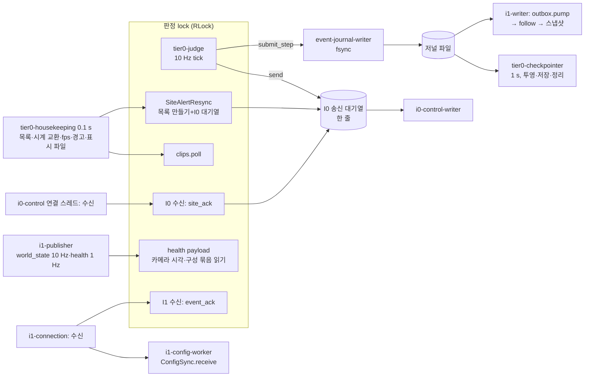

# Tier 0 서비스 조립: 스레드·lock·순서 불변식

S15P31A101-171. 기획서 §3.2(이벤트 소유권·저널 계약·재시작 복구·구성 묶음·재동기화), §3.9(시계 차이), §3.10(현장 경보·재동기화),
§3.12(엔드포인트 등록), §5.1·5.2(인지·ID 교정), §6.1·6.2·6.4·6.5, §7장, §12.2·12.3, §18.2 기준이다.
코드는 `ai/services/tier0/` 의 `__main__`(진입점), `service`(기동·스레드·종료), `judge`(판정 tick), `perception`(입력·인지),
`restore_link`(재시작 복원 Track 후보·이전 이벤트 연결, -178), `health`(health payload), `i0_control`(노트북 제어 채널 서버),
`settings`(설정), `config_fetch`, `yolo_detector`, `live_input`(LIVE 입력 조립, -182) 이다.
판정·추정 로직은 기능 패키지에 있고 여기서는 순서·스레드·설정만 정한다(ai/CONVENTION.md).

## 흐름

```
SIM 2D keypoint ─┐                      (LIVE: I0 영상 → 디코딩 → 최신성 대기열 → YOLO 엔진 → Local Tracker, live_input)
                 ▼
 observation_2d → LocalTrackletBuffer → CrossViewAssociator → WorldTrackManager → ContactEstimator → world_state payload
                                                                     │ revisions(ID 교정)
                                                                     ▼
            ConfigSync.begin_tick ─► ActiveConfig.evaluate(R1·R2·R3·R5·R6·R7, 작업면, 감시 상태) ─► LifecycleTracker
                                                                     │ LifecycleStep
                 ┌───────────────────────────────┬───────────────────┴─────────────┬──────────────────────┐
                 ▼                               ▼                                 ▼                      ▼
     JournalWriter.submit_step        I0 local_alert·alarm_stop          EventClipService           Checkpointer
     (쓰기 스레드가 fsync)              (fsync 를 기다리지 않음)            .on_transitions          .update_inputs
                 │
                 ▼
     Outbox(acked_offset 이후) ─► I1 risk_event_transition ─► (재전송 끝) event_state_snapshot
     world_state(10 Hz)·health(1 Hz) ─► I1 최신 칸        health(1 Hz + 접속 직후) ─► I0 노트북
```

## 스레드와 lock



| 스레드 | 하는 일 | 잡는 lock |
|---|---|---|
| `tier0-judge` | `JudgmentLoop.tick` (10 Hz). 재시작 뒤 연결 함수(`RestoreLink.related`)도 이 안에서 만든다 | 판정 lock 전체 |
| `event-journal-writer` | `EventJournal.append_step` + fsync (단일 작성자) | 저널 내부 lock |
| `tier0-checkpointer` | 투영 따라잡기 → 체크포인트 저장 → `SnapshotOutbox.compact` | Checkpointer 내부 lock |
| `i1-connection`·`i1-writer`·`i1-send-watchdog`·`i1-publisher`·`i1-config-worker` | I1 연결·송신(outbox pump, 스냅샷)·주기 송신·구성 묶음 검증 | health 를 만들 때만 판정 lock(짧게), event_ack 처리 때 판정 lock. 스냅샷(스냅샷 lock 안)의 콜백 current_state·risk_observed_at 은 판정 lock 을 잡지 않고 판정 상태 사본을 읽는다 |
| `i0-control-listen`·연결 스레드·`i0-control-writer` | 노트북 연결 수락·수신·송신(한 줄 대기열) | site_ack 처리 때 판정 lock. 송신 스레드는 판정 lock 을 잡지 않는다 |
| `tier0-housekeeping` | 현장 경보 목록 1 Hz, 시계 교환 요청, fps, 경고, 표시 파일 | 목록·clips.poll 때 판정 lock. 표시 파일의 `restore_link` 는 lock 없이 불변 사본을 읽는다 |

공유 시계는 lock 으로 감싼다: `SharedDecisionClock`(판정 시각, 앞으로만) → `SharedTier0Clock`(단조 기준 UTC) 순서로만 잡는다.
`Tier0ClockSync` 는 `LockedClockSync` 하나의 lock 으로 감싼다(요청은 정리 주기, 응답은 I0 수신, 추정은 판정·health).
lock 순서는 **판정 lock → (스냅샷 lock, 시계 lock, 각 모듈 내부 lock)** 한 방향뿐이다. 반대 방향을 없앤 방법:

- 스냅샷 콜백(current_state·risk_observed_at)은 스냅샷 lock 안에서 불린다. 판정 lock 을 잡으면 tick(판정 lock → 스냅샷)과
  순서가 뒤집혀 교착한다(리뷰 F1). 판정 루프는 tick·확인 끝마다 활성 이벤트·위험 관측 시각의 불변 사본(MappingProxyType)을
  바꿔 끼우고, 콜백은 lock 없이 그 사본을 읽는다(raised_at 은 이벤트 동안 바뀌지 않고, 위험 관측 시각은 sequence 로 걸러져 한
  tick 늦어도 틀리지 않는다).
- 판정 tick 은 스냅샷 lock 도 기다리지 않는다: `EventStateSnapshot.broken` 은 lock 없이 읽는다(참조 읽기는 원자적). 스냅샷이
  자기 lock 안에서 저널을 읽는 동안(디스크가 느려도) 판정은 진행한다. reseed 만 스냅샷 lock 을 잡는다(broken 일 때만, 드묾).

판정 lock 을 잡은 채 기다리는 일은 없다: 저널은 대기열에 넣기만 하고(가득 차면 JournalError), I0 송신도 대기열에 넣기만 한다.

## 순서 불변식

| 불변식 | 지키는 곳 | 시험 |
|---|---|---|
| 같은 tick 의 ID 교정은 판정보다 먼저: `correct_identity(rev.to_correction())` → `apply` | `JudgmentLoop._judge` 3) → 4) | `test_tier0_judge::test_identity_correction_is_applied_before_judgment_in_the_same_tick`, 음성 대조 `test_negative_control_reversed_order_duplicates_event` |
| 복원 Track 은 첫 World Track update 전에 후보로만 넘긴다(`manager.restore(result.tracks, result.tracks_t)`, 판정 스레드 시작 전). 위치 정본이 아니라 world_state·체크포인트 Track 에 나가지 않는다 | `Tier0Service._assemble_and_run`(인지 직후 `RestoreLink`) | `test_tier0_restore_link::test_restart_links_new_event_to_restored_event_without_moving_or_resolving_it`, E2E `test_tier0_restore_e2e`(재시작 뒤 world_state 에 이전 세션 World ID 없음) |
| 이전 이벤트 연결은 같은 tick 의 교정 뒤·판정 lock 안에서 만들어 `apply(..., related=linker.for_frame(frame, manager.restore_status))` 로 넘긴다. 입력 정지 tick 은 마지막 실제 World 의 frame. 연결은 정보뿐(복원 이벤트를 옮기거나 해소하지 않음), 실패는 연결 없음 | `JudgmentLoop._judge`·`_judge_frozen`·`_related`, `RestoreLink.related` | `test_judge_builds_related_after_identity_correction_inside_lock_and_on_frozen_ticks`, `test_related_failure_degrades_to_no_link_and_keeps_alert`, E2E(다른 사람이 같은 자리 → 이전 경보 유지) |
| 복원 Track 처리 결과는 정해지는 tick 에 로그(DISCARDED 면 이유 WARNING), 표시 파일 `status.restore_link` | `RestoreLink._note` | `test_checkpoint_older_than_30s_discards_tracks_logs_reason_and_links_by_zone_only` |
| 첫 인지 tick 전 체크포인트 재료는 복구 결과(config_version·Track·Track 시각)로 채운다(재시작 두 번 연속에도 30 s 규칙이 원래 Track 시각으로 선다) | `Tier0Service._assemble_and_run`(`checkpointer.update_inputs`) | `test_two_restarts_in_a_row_keep_checkpoint_tracks_for_the_third`, E2E 재시작 두 번 연속 |
| 구성 묶음 전환은 tick 시작(`begin_tick`)에서만. 한 tick 의 작업면(인지)·규칙·구역·config_version(world_state·전이)은 한 묶음 | `JudgmentLoop.tick` 1) | `test_config_bundle_switch_only_at_tick_boundary`, 음성 대조 `test_negative_control_switch_after_perception_mixes_bundles` |
| 판정 전이의 evidence_ref = 그 tick world_state 봉투 msg_id | `_judge` 2)·6) (`offer_world_state(msg_id=)`) | `test_evidence_ref_is_the_world_state_msg_id_of_the_same_tick` |
| 저널 넣기 → 현장 경보(fsync 를 기다리지 않음). 저널이 실패해도 현장 경보는 나간다 | `JudgmentLoop._record` | `test_site_alert_still_sent_when_journal_rejects` |
| 복원 → 쓰기 스레드·체크포인트·I0·I1 시작(단일 작성자, 복원 전 현장 경보 목록 금지) | `Tier0Service.start` 3)·6), `SiteAlertResync(ready=)`, `_site_fields` | `test_tier0_service::test_startup_recovers_before_any_link_and_no_alert_fields_before_restore`, E2E 재시작 첫 health |
| 재전송 → 스냅샷: 새 연결에서 health → acked_offset 이후 전이(오름차순, 같은 msg_id, resent) → event_state_snapshot | `build_i1_link`(첫 메시지 관문·outbox.reset) + `EventStateSnapshot.attach` | `test_tier0_e2e` 4) |
| 저널 정리는 `SnapshotOutbox.compact` 로만(스냅샷이 접지 않은 기록을 지우지 않음) | `Checkpointer(compact=self.outbox.compact)` | (기존 -81 시험) |
| 스냅샷 broken 회복(reseed)은 판정 lock 안에서 저널 쓰기 대기열이 빈 것을 확인한 뒤 | `JudgmentLoop._maybe_reseed` | `test_reseed_waits_for_empty_journal_queue_then_restarts_snapshot` |
| lock 순서는 판정 → 스냅샷 한 방향(콜백은 사본, broken 은 lock 없이) | `JudgmentLoop.current_state·risk_observed_at·_publish_views`, `EventStateSnapshot.broken` | `test_snapshot_callback_paused_inside_snapshot_lock_does_not_block_tick`(리뷰 부록 A), `test_snapshot_payload_and_ticks_repeat_concurrently` |
| 입력 정지(새 프레임 없음) tick 도 마지막 실제 World·원래 촬영 시각으로 판정한다. world_state 는 다시 보내지 않는다 | `JudgmentLoop._judge_frozen` | `test_full_input_stop_raises_pending_alert_as_unverifiable`, `test_short_stop_does_not_count_same_observation_twice_and_resumes`, `test_clock_estimate_expiry_during_input_stop_makes_event_unverifiable` |
| 확인은 ack_id 로 한 번만(대기 중 기록 포함) | `JudgmentLoop.acknowledge` (`journal.has_ack_id`) | `test_ack_is_recorded_once_per_ack_id_and_alarm_stop_carries_it`, E2E 저널 ack_id 1건 |
| 종료: 판정 → I0·I1 → 저널 비우기 → 마지막 체크포인트 → 저널 닫기, 공통 deadline 하나 | `Tier0Service.stop`·`_shutdown` | `test_stop_flushes_slow_journal_and_ends_threads`, `test_stop_returns_within_deadline_when_disk_is_stuck_and_keeps_marker`(리뷰 부록 C), `test_disk_released_before_deadline_stops_cleanly`, `test_abort_start_does_not_hang_on_stuck_disk` |

## 기동 순서 (`Tier0Service.start`)

1. 상태 디렉터리(`state_dir`, Network Volume). `state/tier0.live` 가 남아 있으면 이전 실행이 정상 종료하지 않은 것으로 로그에 남긴다.
   이어서 표시 파일을 `gpu_priority.phase=starting` 으로 쓰고 GPU 메모리를 선확보한다(-60, `docs/design/tier0-gpu-priority.md`).
   기동이 실패하면 이 표시 파일을 지운다(이전 실행이 남긴 것이었으면 `start_failed` 로 남긴다).
2. 보정 문서 → `CameraRig`. 시계: `Tier0Clock`(단조 기준) → `DecisionClock`(판정 시각은 앞으로만, -160).
3. 노트북 쪽 객체(제어 채널 서버·`Tier0ClockSync`·`GatewayLinkMonitor`)를 만든다(아직 듣지 않음). 판정 해소 확인은
   `ClockAwareVerification(offset_source=시계 교환, generation_source=시계 세대)` 다(-160). 노트북이 없는 조립(오프라인 SIM)은
   촬영 시각이 판정 시계와 같아 `ObservedTracksPolicy` 를 쓴다.
4. 저널을 쓰기 모드로 열고 `recover`. 거부(`RecoveryError` 등)면 종료 코드 3 으로 시작하지 않는다(운영 절차는 tier0-recovery.md).
5. 구성 묶음: 체크포인트 config_version 을 `BundleArchive.restore` 로 같은 검증기로 다시 만든다. 결과를 `config_check` 에
   남긴다(MATCHED·MISSING_IN_ARCHIVE·ARCHIVE_REJECTED). 체크포인트가 없으면(저널 전체 복구·첫 시작) 보관소의 가장 최근 묶음,
   그것도 없으면 설정의 시작 묶음(bootstrap, 보관소에도 저장). 그것도 없으면 구성 묶음 없이 시작하고 위험 판정을 하지 않는다
   (health NO_ACTIVE_CONFIG = UNSAFE_UNKNOWN). 어떤 경우든 EC2 확인 전이라 config_sync 는 UNVERIFIED 다.
6. 인지·스냅샷(seed = 복원한 활성 이벤트, start_offset = 저널 끝)·health·현장 경보 목록·I1(outbox = `snap.bind(Outbox(...))`,
   `snapshot_payload` 는 주지 않고 `snap.attach`)·체크포인트·판정 루프를 만든다. 인지를 만든 직후 `RestoreLink` 가
   `manager.restore(result.tracks, result.tracks_t)` 를 부르고(첫 update 전) `RestoredEventLinker(result.restored)` 를 만든다.
   체크포인트 Track 을 restore 가 거부하면(중복·같은 세션 ID) 쓰지 않고 빈 후보로 다시 부른다(연결은 같은 규칙·같은 구역만).
   Checkpointer 재료는 첫 인지 tick 전까지 복구 결과로 둔다.
7. 시작: 저널 쓰기 스레드 → Checkpointer → I1 → I0 제어 채널 → I0 영상 수신(LIVE) → 정리 주기 → 판정 루프 → 표시 파일.

LIVE 입력(-182)은 6 에서 만들고 7 에서 연다. 만드는 순서와 종료 코드: 검출기(TensorRT 엔진 `SIMAI_TIER0_ENGINE` → 없으면
`.pt` 가중치 `SIMAI_TIER0_WEIGHTS` 를 경고와 함께 → 둘 다 없거나 ultralytics 가 없으면 4) → 디코더(`input.decoder`: `nvdec` 기본,
`cpu` 노트북. NVDEC 을 열지 못하면 CPU 로 바꾸지 않고 4) → 영상 포트 설정(`SIMAI_TIER0_VIDEO_PORTS` 등이 모자라거나 카메라 목록과
다르면 2). 클립 링 버퍼를 브리지에 붙인 뒤 영상 포트를 연다(열지 못하면 4). 수신 스레드는 카메라별(`VideoIngestServer`)이고,
디코딩은 그 스레드에서 카메라별 lock 으로(`CameraIngest`), 검출·추적은 판정 tick 에서(`DetectorFeed.poll` → `I0Ingest.next_batch`)
한다. 판정 lock 은 수신·디코딩 경로에서 잡지 않는다. LIVE 인데 I0 제어 채널이 없으면 노트북 시계 차이를 모르는 것으로
조립한다(`ClockAwareVerification(offset_source=None 반환)`, health capture_clock 모름 → UNSAFE_UNKNOWN·해소 확인 금지).
SAME_CLOCK(`ObservedTracksPolicy`)은 노트북 없는 SIM 에만 쓴다. 종료 때 영상 수신(accept·연결) 스레드는 공통 deadline 안에서
join 하고, 남으면 실패로 남긴다. 영상 포트 일부만 열고 실패하면 연 포트를 닫는다.

## 종료 (`Tier0Service.stop`, SIGTERM·SIGINT·Windows CTRL_BREAK)

판정 루프·정리 주기 멈춤 → I0 닫기(영상 수신 → 제어 채널) → I1 닫기(outbox 가 더는 저널을 읽지 않음) → `JournalWriter.stop`(넣은 단계를 모두 fsync)
→ Checkpointer 멈춤 → 마지막 체크포인트(저널 끝까지) → 저널 닫기 → 표시 파일 삭제.

모든 단계는 공통 deadline(`stop(timeout_s)`, 기본 drain_s) 하나를 나눠 쓰고, 각 단계는 별도 스레드에서 돌려 남은 시간만 기다린다
(리뷰 F3). 디스크가 멈춰 저널 쓰기가 시간 안에 끝나지 않거나 Checkpointer 가 멈추면 마지막 체크포인트와 저널 닫기를 동기로
다시 기다리지 않는다(둘 다 저널 쓰기 lock 을 기다리게 된다). 그때는 표시 파일에 `shutdown_failed`(끝나지 않은 단계 이름)를 남기고
실패(종료 코드 1)로 끝난다. 다음 시작이 체크포인트 + 저널로 복구한다. 기동 실패 정리(`_abort_start`)도 같은 함수를 쓴다(마지막
체크포인트 없음). 강제 종료(kill)면 fsync 전 단계는 잃고(그 전이는 EC2 로도
나간 적이 없다, D-G3-18) 다음 시작이 체크포인트 + 저널로 복구한다.

## health 와 노트북 연결

- System Health 는 `evaluate_health`(카메라 시각은 이번 프로세스에서 처리한 프레임으로 새로 만든다) 위에 `RecoveryHealthGate.apply`
  를 같은 capture_clock 으로 덧씌운다. ec2_link_ok = `I1Client.connected`, gateway_link = 노트북 제어 채널 + 하트비트 3회 누락 판정
  (`tracking.gateway_link`, -91), laptop_clock_offset = 시계 교환 추정(끊기면 null), config_version·config_sync = `ConfigSync.health_fields`,
  ec2_world_state_drops = `with_world_state_drops`(I1·I0 health 둘 다), active_site_alerts·as_of = `SiteAlertResync.fields`(복원 뒤에만).
- 노트북이 (재)접속하면 이전 연결의 시계 표본을 버리고 바로 시계 교환을 요청하고, 1 Hz 를 기다리지 않고 health(현장 경보 목록)를
  보낸다(-161). 이 health 는 하트비트를 아직 받지 못해 gateway_link DISCONNECTED·UNSAFE_UNKNOWN 이다(모르면 정상으로 보지 않는다).
- health 계약에 필드가 없는 운영 경고(Checkpointer 정체·오류, 저널 쓰기 정체·실패, outbox blocked, 스냅샷 broken)는 로그(바뀔 때)와
  표시 파일 `state/tier0.live` 의 status 에 싣는다(5초마다 갱신).

## 미뤄 둔 연결 목록

| 출처 | 연결 | 상태 / 시험 |
|---|---|---|
| -79 저널·outbox | 판정 전이 evidence_ref = world_state msg_id | 배선 / `test_evidence_ref_is_the_world_state_msg_id_of_the_same_tick` |
| -79 | Outbox.blocked 보고 | 로그·표시 파일(health 계약 필드 없음) / 시험 없음(경고 경로) |
| -160 시계 | DecisionClock·ClockAwareVerification·generation_source | 배선 / `test_unknown_clock_offset_keeps_health_unsafe_and_blocks_resolution` |
| -117 보정 감시 | DRIFTED 기준선 저장·복원 | 부분: 저장·복원 배선(`drift_watch_factory`, `state/calibration_baselines.json`) / `test_calibration_baselines_round_trip_keeps_verification`. 감시 입력(버전 저장소)은 남은 일 |
| -40 ID 교정 | revisions → correct_identity, apply 전 | 배선 / 위 순서 시험 |
| -45·-170 I1 | health payload, ec2_link_ok, with_world_state_drops, ack_seen, I1 경로 설정 | 배선 / E2E, `test_i1_path_is_configurable_and_gateway_id_is_shared` |
| -84·-48·-170 | world_state config_version | 배선 / E2E, 경계 시험 |
| -51 복구 | recover → Checkpointer.start, update_inputs, RecoveryHealthGate.apply, 복원 전 목록 금지, 경고, config_version 비교 | 배선 / `test_recovery_health_is_unsafe_until_reobserved_and_restored_alerts_listed`, 기동 순서 시험, E2E |
| -54 복원 Track·연결 | manager.restore(첫 update 전), RestoredEventLinker → apply(related=), DISCARDED 이유 로그 | 배선(-178) / `test_tier0_restore_link.py`, `test_tier0_restore_e2e.py` |
| -81 스냅샷 | bind·attach·compact·risk_observed_at·status·reseed | 배선 / E2E(재전송 → 스냅샷), `test_reseed_waits_for_empty_journal_queue_then_restarts_snapshot`, lock 순서 시험 |
| -91 노트북 하트비트 | 3회 누락 → gateway_link 끊김 | 배선(`tracking.gateway_link`) / `test_gateway_link.py` |
| -93 Risk | ActiveConfig.evaluate(작업면), 등록부 전체 | 배선 / E2E 묶음(R1·R2·R3·R5·R7 교실 프로파일) |
| -57 클립 | on_transitions·poll | 배선(업로더 없음: 서명 API 미정) / 시험 없음(SIM 은 영상이 없다) |
| -159 엔드포인트 | (재)연결마다 tier0_endpoint | 배선 / E2E(계약 검증) |
| -161 현장 경보 재동기화 | 접속 직후·1 Hz, 같은 lock·한 줄 대기열 | 배선 / E2E |
| -32 이미지 | SIMAI_TIER0_ENGINE, state/tier0.live | 배선 / `test_live_without_engine_exits_4_without_judging`, `test_live_start_errors_have_clear_exit_codes` |
| -83·-80·-21·-57 LIVE 입력 | I0 영상 수신 → 링 버퍼 + PyAV 디코딩(NVDEC·CPU) → latest-frame-wins → 검출 → Local Tracker, health cameras[].frames·WAITING_KEYFRAME | 배선(-182) / `test_tier0_live_e2e.py`(실제 H.264, 검출·추적 대역), `test_live_input.py`, `tests/io/test_pyav_decoder.py`. Pod 의 NVDEC·TensorRT 실경로는 -183 |

## 남은 일

- LIVE 입력(-182 뒤): Pod 실경로(NVDEC·TensorRT·10명 처리 시간)는 -183 큐. observation_2d 원본 Network Volume 보관(11.2)은
  아직 잇지 않았다.
- health 계약은 2.0.0 에서 정했다(-179): 시계 차이를 모르면 `pipeline_lag_ms` null + 하한 `pipeline_lag_lower_bound_ms`, 운영 경고
  `tier0_warnings`(정리 주기에 Checkpointer·저널·outbox·스냅샷 상태를 읽어 기억), 카메라 `sync_valid`(근거 없으면 null). 송신 봉투(i1_client·i0_control)는
  `HEALTH_SCHEMA_VERSION` 을 쓴다. 남은 일: 카메라 sync_offset_ms·동기화 무효 판정 모듈.
- 보정 감시(-117): CalibrationVersionStore 영속·현장 보정 채택 경로가 생기면 `drift_watch_factory` 로 감시를 만들고 판정 tick 에서
  Cross-view 클러스터를 `PersonObservation` 으로 넘긴다.
- 정책 해석을 기능 패키지 API 로 옮기기(리뷰 권장): 공통 시각 선택(`Perception.choose_t`), health 카메라 상태 계산
  (`HealthReporter.payload`), 위험 관측 시각 판단(`JudgmentLoop._note_risk`). 지금은 services 에 있다.
- 클립 트리거(-57) 회귀 시험(영상·업로더가 생긴 뒤), Network Volume 강제 종료 영속성 실측(-92).
- ID 교정 기록(`IdentityRevision.to_payload`)은 저널에 넣지 않는다: outbox 가 저널의 모든 기록을 I1 risk_event_transition 으로 보내므로
  다른 종류의 기록을 넣으면 보낼 수 없다. 교정은 IDENTITY_CORRECTED 전이로 남는다.
- 구성 묶음 내려받기 주소 형식(서버 확정 전, `config_fetch` 는 https 만), 체크포인트에 묶음 applied_at 이 없어 복원 시각을 기동 시각으로 둔다.
