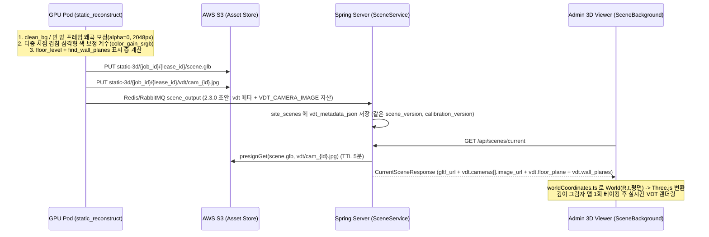

# 관제 3D 뷰어 시점 의존 텍스처(VDT) 운영 데이터 경로 설계 (S15P31A101-534)

## 1. 목적 및 배경

S15P31A101-527 실험을 통해 TSDF/texrecon 단일 구운 텍스처(`MeshBasicMaterial` + 아틀라스 UV)만으로는 해결하기 어려웠던 세 가지 시각 품질 문제—① 다중 시점 정합 경계의 다리·사물 잔상, ② TSDF 형상 구멍(hole)의 검은 빈자리와 톱니 모양 테두리, ③ 비스듬한 시점에서의 아틀라스 해상도 저하—가 다음 조합으로 크게 개선됨을 확인했다.

1. **시점 의존 텍스처(View-Dependent Texture, VDT)**: 카메라 4대의 왜곡 보정된(undistorted) 실제 배경 사진을 현재 뷰어 카메라 시점 각도·거리·표면 법선·카메라별 깊이 그림자 맵(5-tap 가림 검사)에 따라 실시간 가중 블렌딩.
2. **바닥·벽 미관측 표시 층(Indicator Layers)**: TSDF 메시 뒤쪽(바닥 `World Z = z0 - 0.015 m`, 수용된 방 경계 벽 `d_render = d_orig - 0.018 m`)에 평면을 두고, 카메라 깊이 그림자 맵에 실제 형상이 존재하며 중심 깊이가 **5 cm(`0.05 m`) 이내**로 일치하는 영역에만 사진을 투영하고 나머지는 차분한 단색 + 1 m / 0.5 m 격자로 정직하게 표시.
3. **열린 구멍 경계 섞기(Boundary Feathering)**: 1 mm 정점 용접 기준 공유 삼각형이 1개인 열린 경계 간선으로부터의 정점 거리 `aBoundaryDist`(최대 11 cm 대역)를 계산해 구멍 테두리의 톱니 경계를 하부 표시 층 톤과 부드럽게 섞음.
4. **5차 카메라 간 사진 일치(완화된 $\sigma$ · 소프트 감쇠 · 공간 매끄러움) 및 미관측 TSDF 면 투영 기본 끔**:
   - 미관측 TSDF 면(`unobserved_neutral`)에는 사진 투영을 기본 비활성화(`projectUnobserved = false`)하고, 켰을 때도 5 cm 깊이 일치 게이트를 강제해 회색 바닥 위 반투명 탁자·의자 잔상을 원천 차단.
   - 관측 면에서는 후보 카메라들을 5-tap 저역 통과 샘플링(`readCamPhotoLowPass`, 반경 3.5 px)으로 읽은 뒤 Oklab 색 공간에서 구운 텍스처 3번째 표(`tieW = 0.65 / 0.25`)를 포함한 연속 소프트 메도이드(`refLab`)를 구하고, 완화된 $\sigma_5$ (`바닥 0.095`, `비바닥 0.220`), 인라이어 데드존(`0.042 / 0.065`), 소프트 감쇠 하한(`minWeightFactor = 0.08`)으로 카메라 간 색 불일치(바닥에 찍힌 스툴·탁자 다리 잔상 등)를 공간적 얼룩 없이 매끄럽게 감쇠.

본 문서는 이 VDT 렌더 모듈을 관제 3D 뷰어(`front/apps/admin/src/features/viewer3d/scene/`)에 통합할 때, **세팅/재생성 단계에서 사람 없는 왜곡 보정 배경 사진과 `K·R·t`·색 보정 계수·바닥/벽 평면 메타를 장면 GLB 와 같은 `scene_version` 으로 업로드하고 서버를 거쳐 뷰어가 수신하는 운영 데이터 경로**를 설계한다.

---

## 2. 기존 경로 분석 및 한계 (근거 문서)

### 2.1 현행 보정 상태 및 카메라 포즈 경로 (`GET /api/calibrations/current`)
- 근거: `docs/design/server-calibration-status.md`, `contracts/messages/calibration_status.schema.json` (1.1.0), `server/src/main/java/com/ssafy/simai/domain/calibration/CalibrationViews.java`
- 현재 `GET /api/calibrations/current` 가 반환하는 `camera_poses` 배열의 각 항목은 카메라 마커 표시(S15P31A101-522)를 위한 요약 정보만 담고 있다:
  - `camera_id`, `position_xyz` (World m), `forward_xyz` (World 단위벡터), `hfov_rad`, `reprojection_error_px`
- **VDT 에 바로 쓸 수 없는 이유**:
  1. 핀홀 내부 행렬 $K$ (`fx`, `fy`, `cx`, `cy`)와 이미지 해상도(`width`, `height`)가 없다 (`hfov_rad` 만으로는 비대칭 주점 `cx, cy` 와 세로 초점거리 `fy` 를 복원할 수 없다).
  2. 카메라 광축 회전(roll)을 포함한 전체 회전 행렬 $R_{\text{w2c}} \in \mathbb{R}^{3\times 3}$ 및 이동 벡터 $\mathbf{t}_{\text{w2c}} \in \mathbb{R}^3$ (`OPENCV_WORLD_TO_CAMERA`)가 없다 (`forward_xyz` 만으로는 광축 둘레 회전각이 결정되지 않는다).
  3. 렌즈 왜곡(`OPENCV_PINHOLE`, $k_1 \approx -0.29$)이 펴진 사람 없는 배경 사진 URL 과 다중 시점 노출 보정 계수(`color_gain_srgb`), 그리고 `glb_fill.find_wall_planes` 가 추출한 바닥·벽 표시 층 평면 정의가 없다.

### 2.2 현행 장면 GLB 생성·업로드·서빙 경로 (`scene_output` → `SceneService` → `GET /api/scenes/current`)
- 근거:
  - `docs/design/server-site-scene-register.md` (수동 장면 등록 및 S3 스테이징·커밋)
  - `docs/design/scene-version-from-job.md` (GPU 워커가 `scene_version` 결정 후 S3 업로드)
  - `docs/design/scene-regenerate.md` (`clean_bg_job.py` → `static_reconstruct` 장면 재생성 흐름)
  - `docs/design/server-rules-scenes.md` (`GET /api/scenes/current` 응답 계약 및 5분 서명 URL 발급)
  - `contracts/experiments/scene_output.schema.json` (2.2.0)
  - `server/src/main/java/com/ssafy/simai/domain/scene/SceneJobListener.java`, `SceneService.java`
- 현재 흐름:
  1. GPU Pod 워커(`static_reconstruct`)가 깨끗한 배경 프레임(`clean_frames/cam_*.jpg` 또는 세팅 빈 방 프레임)과 고정 `calibration.json` 으로 TSDF/texrecon GLB 를 만든다.
  2. 워커가 S3 `static-3d/{job_id}/{lease_id}/scene.glb` 및 `surface_source_{index}.png` 를 업로드하고 `simai.jobs.events` 로 `scene_output` 완료 이벤트를 발행한다.
  3. 서버 `SceneJobListener` / `SceneService` 가 `site_scenes` 테이블에 `scene_version`, `calibration_version`, `s3_gltf_key`, `surface_source_map_keys_json` 등을 저장한다.
  4. 관제 뷰어가 `GET /api/scenes/current` 를 호출하면 `SceneService.currentScene()` 이 S3 서명 URL(만료 5분, `PRESIGN_TTL = 5 min`)을 발급해 `gltf_url`, `gltf_expires_at_ms`, `surface_source_map_urls` 로 내려준다.

---

## 3. 운영 데이터 경로 설계 (End-to-End)

VDT 의 핵심 전제는 **"장면 GLB 기하(`scene_version`), 카메라 내·외부 파라미터(`calibration_version`), 그리고 투영할 배경 사진이 정확히 같은 시점·같은 보정 버전으로 묶여 있어야 한다"** 는 것이다. 따라서 VDT 입력 자산은 별도 API 가 아니라 **장면(`scene_version`)의 부속 자산**으로 함께 생성·업로드·서빙한다.



### 3.1 1단계: 세팅 / 장면 재생성 워커 (`ai` — `static_reconstruct`)
장면 생성(`static_reconstruct`) 또는 깨끗한 배경 기반 장면 재생성(`scene_regenerate`) 시점에 워커는 이미 다음 두 가지를 메모리에 갖고 있다:
- **정합된 보정 번들 (`calibration.json`)**: 각 카메라의 원본 `K`, `dist_coeffs` (`OPENCV_PINHOLE`), World $\to$ OpenCV 카메라 `R`, `t` (`OPENCV_WORLD_TO_CAMERA`).
- **사람 없는 배경 프레임 (`cam_{A..D}.jpg`)**:
  - 초기 세팅 시에는 빈 방에서 촬영한 프레임, 운영 중 재생성(`scene-regenerate.md`) 시에는 `clean_bg_job.py` 가 사람 검출/세그멘테이션 마스크 바깥 픽셀들의 시간 중앙값으로 합성한 **사람이 완전히 제거된 배경 프레임**이다.

워커는 GLB 후처리(`glb_enhance` / `glb_fill`) 직후 `prepare.py` 와 동일한 절차를 수행한다:
1. **왜곡 보정 및 리사이즈**:
   - `cv2.getOptimalNewCameraMatrix(K, dist_coeffs, (w0, h0), alpha=0, centerPrincipalPoint=True)` + `cv2.initUndistortRectifyMap` 으로 렌즈 왜곡을 펴고, 웹 전송·텍스처 메모리 예산에 맞춰 긴 변 `2048 px` (`2048x1152`, JPEG 품질 92, 약 350~480 KB/장)로 리사이즈한다.
   - 리사이즈 배율 $(s_x, s_y)$ 를 반영한 핀홀 행렬 $K_{\text{scaled}}$ 를 산출한다.
2. **다중 시점 노출/색온도 보정 계수 (`color_gain_srgb`) 및 색 차 분포 계산**:
   - 2대 이상 카메라에 동시에 가림 없이 관측되는 메시 삼각형 중심 색상의 평균 비율을 반복 최적화해 카메라별 `color_gain_srgb: [gR, gG, gB]` 와 Oklab 색 거리 $\sigma$ (`color_sigma_oklab`, 기본 `0.056`)를 구한다.
3. **바닥·벽 미관측 표시 층 평면 추출 (`floor_plane`, `wall_planes`)**:
   - `simai_ai.scene.glb_fill.floor_level` 과 `find_wall_planes` 로 바닥 평면(`z_world_m = z0 - 0.015`)과 수용된 방 경계 벽 평면(최대 4면, 각 `d_render_world_m = d_world_m - 0.018`)의 **World 좌표 꼭짓점 4개(`corners_world`)**, **World 법선(`normal_world`)**, **벽 수평 접선(`t_world_xy`)**, **관측 중앙 톤(`observed_median_srgb`)** 및 **차분한 표시 톤(`calm_indicator_srgb`)** 을 계산한다.
4. **S3 업로드 경로**:
   - 작업 리스 경로(`static-3d/{job_id}/{lease_id}/`):
     - `static-3d/{job_id}/{lease_id}/vdt/cam_A.jpg`
     - `static-3d/{job_id}/{lease_id}/vdt/cam_B.jpg`
     - `static-3d/{job_id}/{lease_id}/vdt/cam_C.jpg`
     - `static-3d/{job_id}/{lease_id}/vdt/cam_D.jpg`
   - 수동 장면 등록(`POST /api/sites/{siteId}/scenes/upload-url`, `server-site-scene-register.md`)의 경우에도 동일하게 `scenes/{siteId}/{sceneVersion}/staging/{uploadToken}/vdt/cam_{cameraId}.jpg` 로 스테이징 후 커밋 시 `scenes/{siteId}/{sceneVersion}/vdt/cam_{cameraId}.jpg` 로 복사한다.

### 3.2 2단계: 계약 변경 초안 (문서 초안 — `contracts/` 미수정)

> **주의**: 본 티켓(S15P31A101-534)에서는 규칙에 따라 `contracts/` 실제 파일을 수정하지 않고 본 설계 문서에 변경 초안만 기록한다. 선택(optional) 필드 및 `enum` 값 추가이므로 계약 버전 규칙상 **마이너(MINOR) 버전 증가** 대상이다.

#### (A) `contracts/experiments/scene_output.schema.json` (현행 `2.2.0` $\to$ 초안 `2.3.0`)
1. `assets[].kind` 열거형에 `"VDT_CAMERA_IMAGE"` 추가:
   ```json
   {
     "kind": "VDT_CAMERA_IMAGE",
     "camera_id": "cam_A",
     "s3_key": "static-3d/job-123/lease-1/vdt/cam_A.jpg",
     "sha256": "sha256:...",
     "size_bytes": 412300
   }
   ```
2. 최상위 선택 필드 `vdt` (`object`) 추가 (모든 기하·외부 파라미터는 **정본 World 좌표계 (`WORLD`, m, +Z 상방)** 기준):
   ```json
   "vdt": {
     "format_version": "1.0.0",
     "coordinate_system": "WORLD",
     "extrinsics_convention": "OPENCV_WORLD_TO_CAMERA",
     "color_sigma_oklab": 0.056,
     "near_m": 0.1,
     "far_m": 25.0,
     "cameras": [
       {
         "camera_id": "cam_A",
         "image_s3_key": "static-3d/job-123/lease-1/vdt/cam_A.jpg",
         "image_size": [2048, 1152],
         "K": [
           [1059.3547, 0.0, 1024.0],
           [0.0, 1058.7866, 576.0],
           [0.0, 0.0, 1.0]
         ],
         "R": [
           [-0.68452315, 0.72894132, -0.00851999],
           [0.24497942, 0.24075126, 0.93905586],
           [0.68660553, 0.64087003, -0.3436662]
         ],
         "t": [-0.30549093, -3.41391754, 1.88346767],
         "color_gain_srgb": [1.0121, 1.0085, 1.0033]
       }
     ],
     "floor_plane": {
       "z_world_m": -0.015,
       "normal_world": [0.0, 0.0, 1.0],
       "corners_world": [
         [0.0882, -0.1757, -0.015],
         [8.2571, -0.1795, -0.015],
         [8.2611, 8.9531, -0.015],
         [0.0683, 8.9569, -0.015]
       ],
       "observed_median_srgb": [0.4095, 0.4404, 0.489],
       "calm_indicator_srgb": [0.3603, 0.3876, 0.4303]
     },
     "wall_planes": [
       {
         "wall_id": "wall_0",
         "normal_world": [0.999998, 0.002195, 0.0],
         "t_world_xy": [-0.002195, 0.999998],
         "d_world_m": 0.0706,
         "d_render_world_m": 0.0526,
         "corners_world": [
           [0.0522, 0.1948, -0.015],
           [0.0329, 8.9531, -0.015],
           [0.0329, 8.9531, 2.785],
           [0.0522, 0.1948, 2.785]
         ],
         "observed_median_srgb": [0.6542, 0.6054, 0.3475],
         "calm_indicator_srgb": [0.5561, 0.5146, 0.2954]
       }
     ]
   }
   ```

#### (B) 서버 저장 및 `GET /api/scenes/current` 응답 확장 초안
1. **DB (`site_scenes` 테이블)**:
   - `vdt_metadata_json TEXT NULL` 컬럼 추가 (Flyway 마이그레이션).
   - `vdt_metadata_json` 에는 위 `vdt` 객체를 저장하되 각 카메라의 이미지는 `image_s3_key` 로 보관한다.
2. **서명 URL 발급 (`SceneService.currentScene`)**:
   - `s3_gltf_key` 와 동일한 만료 시각(`gltf_expires_at_ms`, `Instant.now().plus(Duration.ofMinutes(5))`)으로 각 `cameras[].image_s3_key` 에 대해 `s3Storage.presignGet(key, PRESIGN_TTL)` 을 호출해 `image_url` 및 `image_expires_at_ms` 를 채워 응답한다.
   - `DEFAULT` 폴백 장면이거나 `vdt_metadata_json` 이 없는 이전 장면 버전일 때는 `vdt: null` (또는 생략)을 반환해 하위 호환성을 유지한다.
3. **`GET /api/scenes/current` 의 `vdt` 응답 필드 초안**:
   ```json
   "vdt": {
     "format_version": "1.0.0",
     "coordinate_system": "WORLD",
     "extrinsics_convention": "OPENCV_WORLD_TO_CAMERA",
     "color_sigma_oklab": 0.056,
     "near_m": 0.1,
     "far_m": 25.0,
     "cameras": [
       {
         "camera_id": "cam_A",
         "image_url": "https://s3.../vdt/cam_A.jpg?X-Amz-Signature=...",
         "image_expires_at_ms": 1776321900000,
         "image_size": [2048, 1152],
         "K": [[1059.3547, 0.0, 1024.0], [0.0, 1058.7866, 576.0], [0.0, 0.0, 1.0]],
         "R": [[-0.68452315, 0.72894132, -0.00851999], [0.24497942, 0.24075126, 0.93905586], [0.68660553, 0.64087003, -0.3436662]],
         "t": [-0.30549093, -3.41391754, 1.88346767],
         "color_gain_srgb": [1.0121, 1.0085, 1.0033]
       }
     ],
     "floor_plane": { ... },
     "wall_planes": [ ... ]
   }
   ```

### 3.3 3단계: 관제 뷰어 수신 및 렌더링 (`front/apps/admin/src/features/viewer3d/scene/`)
1. **계약 파서 (`sceneContract.ts`)**:
   - `readCurrentScene(raw)` 에서 선택 필드 `vdt` 가 있으면 `readSceneVdtConfig(raw.vdt)` 로 검증하여 `CurrentScene.vdt` (`SceneVdtConfig | null`)에 담는다.
   - `earliestExpiryMs()` 계산 시 `gltf_expires_at_ms` 뿐 아니라 `vdt.cameras[].image_expires_at_ms` 도 함께 고려해 서명 URL 만료 30초 전 자동 재조회(`needsRefetch`)가 동작하게 한다.
2. **좌표 변환 경계 준수 (AGENTS 규칙 3)**:
   - 계약으로 들어온 `R`, `t` (`WORLD` $\to$ `OPENCV_CAMERA`), `floor_plane.corners_world`, `wall_planes[].corners_world`, `normal_world` 는 **오직 `front/apps/admin/src/features/viewer3d/worldCoordinates.ts` 의 변환 행렬/함수(`THREE_TO_WORLD_MATRIX`, `WORLD_TO_THREE_MATRIX`, `worldToThree`, `worldDirectionToThree`, `toWorldPoint`, `toWorldVector`)를 통해서만** Three.js 공간(`GLTF_Y_UP`) 행렬·좌표로 변환한다.
   - 구체적으로 World 점 $\mathbf{p}_{\text{world}} = G^T \mathbf{p}_{\text{three}}$ (`G^T = THREE_TO_WORLD_3x3`) 이므로:
     $$R_{\text{three}\to\text{cv}} = R_{\text{w2c}} \cdot G^T, \qquad \mathbf{t}_{\text{three}\to\text{cv}} = \mathbf{t}_{\text{w2c}}$$
     $$\mathbf{C}_{\text{world}} = -R_{\text{w2c}}^T \mathbf{t}_{\text{w2c}}, \qquad \mathbf{C}_{\text{three}} = \text{worldToThree}(\mathbf{C}_{\text{world}})$$
3. **정적 깊이 그림자 맵 1회 베이킹 및 재질 교체 (`SceneBackground.tsx` + `vdt/`)**:
   - 기능 플래그(`vdt` 옵션, **기본값 끔 `false`**)가 켜져 있고 장면 데이터에 유효한 `vdt` 설정이 있을 때만 VDT 파이프라인을 가동한다.
   - 플래그가 꺼져 있을 때(기본)는 기존 `prepareSceneRoot` (`MeshBasicMaterial` + `SURFACE_SOURCE_MAP` `attachPhotoShader`) 경로가 한 줄도 바뀌지 않고 그대로 실행된다.
   - 플래그가 켜져 있을 때는:
     - TSDF 메시들의 용접 부드러운 법선(`computeWeldedSmoothNormals`)과 열린 구멍 경계 거리 속성(`computeOpenBoundaryDistances` $\to$ `aBoundaryDist`)을 1회 계산한다.
     - 4대 카메라 시점의 선형 깊이 그림자 맵(`WebGLRenderTarget`, 기본 긴 변 `1536 px`)을 **장면 GLB 또는 카메라 파라미터가 바뀔 때만 1회 렌더링**하고, 이후 매 프레임에서는 텍스처 조회만 수행한다.
     - `PersonLayer`(사람/아바타), `ZoneLayer`(구역), `GroundShadowLayer`(접지 그림자), `WorkSurfaceLayer`(작업면), `CameraLayer`(카메라 마커)의 재질은 일절 변경하지 않는다.

---

## 4. 프로젝트 핵심 규칙 준수 검증

| 규칙 | 요구 사항 | 본 설계 및 모듈에서의 준수 방식 |
|---|---|---|
| **규칙 2 & 7** | 사진이 없는 곳을 지어내지 않음 (관측 vs 추정/미관측 정직한 구분) | - 미관측 TSDF 면(`unobserved_neutral`)에 대한 사진 투영은 기본 **끔(`projectUnobserved = false`)**.<br/>- 바닥·벽 미관측 표시 층에는 카메라 깊이 그림자 맵에 실제 형상이 존재하고 중심 깊이가 **5 cm(`0.05 m`) 이내**로 일치하는 곳에만 사진을 투영하며, 기하가 비어 있는 구멍 영역은 차분한 단색 + 1 m / 0.5 m 격자로 표시해 관측 면과 명확히 구분. |
| **규칙 3** | Three.js 변환 $(x, z, -y)$ 은 뷰어 어댑터(`worldCoordinates.ts`) 한 곳에서만 수행 | - 계약(`scene_output`, `GET /api/scenes/current`)의 모든 카메라 외부 파라미터(`R`, `t`)와 평면 꼭짓점(`corners_world`, `normal_world`)은 정본 `WORLD` 좌표계로 정의.<br/>- 뷰어 VDT 모듈은 `worldCoordinates.ts` 의 `THREE_TO_WORLD_MATRIX`, `WORLD_TO_THREE_MATRIX`, `worldToThree`, `worldDirectionToThree` 만 호출해 Three.js 공간으로 변환. |
| **규칙 8** | 얼굴 정책 (관측 얼굴 픽셀은 아바타 외형에만 허용, 가짜 얼굴 생성 금지) | - 아바타 외형(`PersonLayer` `MeshBody`)은 기존 규칙대로 관측 픽셀을 표시.<br/>- **VDT 배경 사진(`vdt/cam_{id}.jpg`)은 세팅 시 빈 방 촬영본이거나 `clean_bg_job.py` 로 사람 영역을 완전히 마스크·제거한 시간 중앙값 배경 프레임만 사용**하므로, 배경 텍스처에 보행자나 작업자의 얼굴/신체 잔상이 박히지 않는다. |

---

## 5. 남은 일 및 위험 요소 (Risks & Follow-ups)

1. **워커(`ai`) 및 서버(`server`) 실제 배선 후속 티켓**:
   - 본 티켓(-534)에서는 뷰어 VDT 모듈 구현, `dev-harness` 12차 데이터 검증, 그리고 운영 경로 설계까지 완료한다.
   - 후속 티켓에서 ① `contracts/experiments/scene_output.schema.json` 2.3.0 반영, ② `static_reconstruct` 워커에 `prepare.py` 의 왜곡 보정 이미지·`vdt` 메타 출력 통합, ③ `server` `site_scenes.vdt_metadata_json` 컬럼 추가 및 `SceneService.currentScene()` 서명 URL 발급을 연결하면 운영 환경에서도 즉시 활성화할 수 있다.
2. **보정 및 TSDF 기하 정합 오차 민감도**:
   - VDT 는 카메라 `K·R·t` 와 TSDF 메시 정점의 3차원 정합에 의존한다. 보정 오차가 크거나 얇은 기둥·의자 다리처럼 TSDF 에 복원되지 않은 형상이 카메라 시선 앞에 있으면 바닥에 가짜 그림자/잔상이 투영될 수 있다.
   - 본 모듈에서는 **5 cm 깊이 일치 게이트**와 **5차 카메라 간 Oklab 소프트 메도이드 외톨이 제거(`outlierRemoval = true`)** 로 스툴·탁자 다리 잔상을 억제했으나, 카메라 1대만 관측하는 사각지대 가장자리에서는 구운 텍스처 폴백 품질에 영향을 받는다.
3. **S3 서명 URL 만료 및 네트워크 오류 복구**:
   - GLB 와 카메라 사진 4장의 서명 URL 만료 시각(`5분`)이 같으므로, 뷰어 초기 로드 이후 탭을 오래 켜 둔 상태에서 VDT 를 뒤늦게 켜면 이미지 URL 이 만료될 수 있다.
   - `sceneContract.ts` 의 `earliestExpiryMs` 에 `vdt.cameras[].image_expires_at_ms` 를 포함하고, 텍스처 로드 실패 시 `sceneStore.reportGltfHttpStatus(403)` 과 동일한 재조회 경로를 타거나 구운 텍스처(`MeshBasicMaterial`)로 안전하게 폴백하도록 처리한다.
4. **GPU 메모리 및 저사양 노트북 그림자 맵 해상도 예산**:
   - `2048x1152` RGBA 텍스처 4장(약 38 MB VRAM) + `1536x864` RGBA 깊이 렌더 타깃 4장(약 21 MB VRAM)으로 총 약 60 MB 내외의 GPU 메모리를 사용한다.
   - 깊이 그림자 맵은 정적 장면 로드 시 1회만 렌더링하므로 프레임당 비용은 평균 `0.15~0.20 ms` 에 불과하지만, 내장 그래픽 노트북을 위해 `shadowMapSize` 옵션(`1024` / `1536` / `2048`, 기본 `1536`)을 설정 가능하게 열어 둔다.
