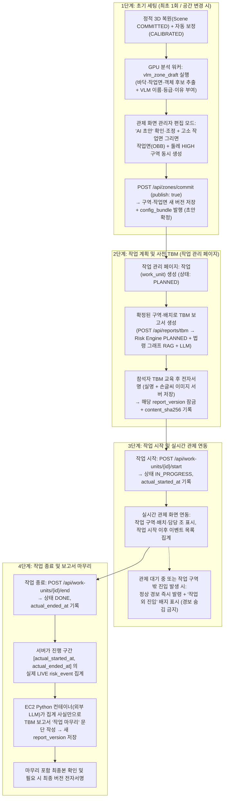
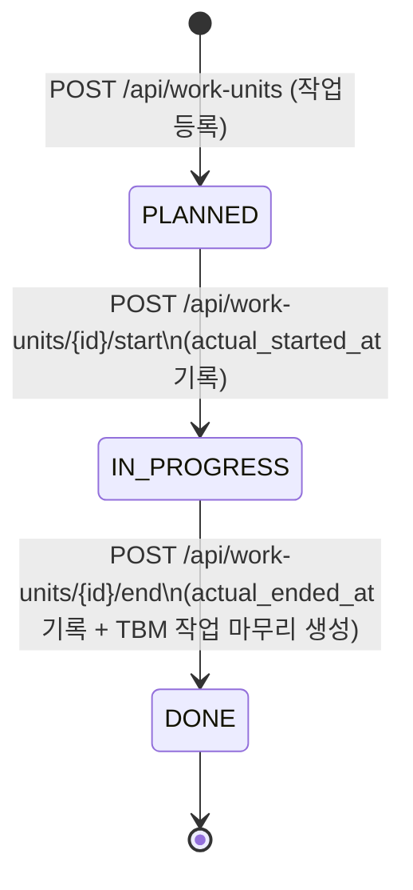

# 관제·작업 관리 사용자 흐름 개편 설계 (S15P31A101-426)

2026-11-03 사용자 결정으로 초기 세팅부터 작업 계획(TBM), 실시간 관제, 작업 종료 후 보고서 마무리·전자서명까지 이어지는 현장 운영 흐름을 하나로 묶는다. 이 문서는 명세 `v1.3 수정 52` 의 근거 설계 문서이며, 화면·서버·AI 워커의 후속 구현 티켓이 참조하는 기준을 정한다.

---

## 1. 관련 명세 절과 요구사항

| 구분 | 절 / ID | 반영 내용 |
|---|---|---|
| 시스템·아키텍처 | 3.1, 3.2 | 초기 세팅 VLM 위험구역 초안(`vlm_zone_draft`), 관제 화면 관리자 편집 모드에서 구역·작업면 편집 후 구성 묶음 발행, 작업 세션(`PLANNED` → `IN_PROGRESS` → `DONE`) 연동, 작업 종료 시 TBM 보고서 마무리 문단 생성(EC2 Python 컨테이너) |
| AI 역할 | 5.3, 5.4 | VLM 역할에 **초기 세팅 위험구역 초안 제안(`vlm_zone_draft`)** 과 **작업 중 새 물체 감지 시 이름·이유·둘레 구역 초안 제안**(제안만, 관리자 등록·발행 전 판정 미사용) 추가, 정적 3D 에 **수동 맵 재생성(`scene_regenerate`, `POST /api/scenes/regenerate`)** 추가, LLM 역할에 **작업 종료 시 실제 LIVE 이벤트 집계 사실 기반 마무리 문단 작성** 추가 |
| 위험 규칙·작업면 | 7.2, 7.3, 7.5 | 구역 심각도 선택지 2종(`CRITICAL` 빨강·`HIGH` 주황)과 이벤트 등급(`CRITICAL`·`HIGH`·`CAUTION`·`INFO`) 분리 명시, 고소 작업면 화면 표현(`HIGH` 위험구역과 동일)과 내부 작업면 OBB(`static_object` `WORK_SURFACE`, `top_height_m`) 유지 및 둘레 `HIGH` 구역 동시 생성, 7.3 반장 PWA·조치 티켓 취소(-411) 정합성 반영 |
| 기능 명세 | 8.1, 8.2, 8.3, 8.4 | 별도 구역 편집 페이지 폐지 → 실시간 관제 화면의 관리자 편집 모드, VLM 구역 초안, TBM 페이지 → 작업 관리 페이지 승격(`PLANNED` → `IN_PROGRESS` → `DONE`), 관제 화면 작업 세션 연동 및 "작업 외 진입" 표시, 작업 종료 시 TBM 보고서 "작업 마무리" 자동 채움, 참석자 전자서명·버전 잠금·내용 해시 |
| 데이터·보안 | 11.1, 11.3, 11.4-5, 11.5, 14장 | `zone` 심각도 제약(`CRITICAL`·`HIGH`), `work_unit` 상태·실제 시작/종료 시각, `report` 마무리 요약·잠금·내용 해시(`content_sha256`), `report_signature`(참석자 실명·손글씨 서명 이미지, 관리자 전용, 외부 LLM 미전송, NFR-14 예외), 보관 주기 |
| 인터페이스·뷰어 | 12.2, 12.5, 12.6, 13.1, 13.2, 13.4 | I5 `vlm_zone_draft`(마이너 제안)·`scene_regenerate`(수동 맵 재생성, S15P31A101-427·-428), REST `POST /api/zones/commit`, `POST /api/scenes/regenerate`, `POST /api/work-units/{id}/start`·`/end`, `POST /api/reports/tbm/{reportId}/signatures`, 뷰어 화면 구성을 실시간 관제(관리자 편집 모드·새 물체 안내·맵 재생성 버튼 포함)·작업 관리(TBM)·이벤트 상세/리플레이·시스템 상태로 정리 |
| 의사결정·위험·일정·시연 | 16장, 17장, 18.1, 19.1, 부록 E.2 | "작업 전 이벤트 숨김" 안전상 기각 기록, VLM 구역 초안 오추정·전자서명 개인정보 위험 및 완화, 11차 GPU 세션 GLB 로 VLM 위험구역 초안 시험, 시연 시나리오(작업 시작 → 경보 → 작업 종료 → 마무리 자동 채움·전자서명) |
| 요구사항 | `docs/requirements.md` | FR-3, FR-4, FR-14~17, FR-18~21, FR-112, NFR-12, NFR-14(서명 실명 예외), NFR-16, NFR-33 |

---

## 2. 결정 요약 (9개 항목)

1. **별도 구역 편집 페이지 폐지 → 실시간 관제의 관리자 편집 모드**
   - 뷰어의 별도 구역 편집 페이지(`/zones`)를 없애고, **3D 실시간 관제 화면 안에서 `ADMIN` 만 편집 모드를 켜** 위험구역(`zone`)과 작업면(`static_object`)을 만들고 고친다.
   - 저장은 새 버전을 더하고(덮어쓰기 금지), `POST /api/zones/commit`(`publish: true`, S15P31A101-397·-410)으로 구역·작업면 저장과 Tier 0 `config_bundle` 발행을 한 트랜잭션으로 처리한다.
2. **위험구역 색·등급 선택지는 두 가지 (`CRITICAL` 빨강, `HIGH` 주황)**
   - 구역을 만들거나 고칠 때 고를 수 있는 구역 심각도는 **`CRITICAL`(빨강, 위험)** 과 **`HIGH`(주황, 경고)** 두 가지뿐이다. 화면에서 "작업구역"(별도 안내용 구역 종류)과 구역 `CAUTION`·`INFO` 선택지는 제거한다.
   - **구역 심각도와 이벤트 심각도는 별개다.** 이벤트 등급 `CAUTION`(R5 진입 예측, R7 감시 저하 등 — 관제 화면 표시만)과 `INFO` 는 그대로 유지한다.
   - 계약(`contracts/messages/risk_plan_request.schema.json` 등)의 `zone.severity` 스키마 enum 은 메이저 변경을 피하고 기존 저장 행·벡터 호환을 유지하기 위해 그대로 두되, 화면 선택지와 서버 신규 구역 생성 검사에서 `CRITICAL`·`HIGH` 만 허용한다.
3. **고소 작업면: 화면은 `HIGH` 구역처럼, 내부는 작업면 OBB + 둘레 `HIGH` 구역 동시 생성**
   - 고소 작업면(단상·가설 비계 발판 등)은 화면에서 **`HIGH` 위험구역(주황)과 같은 시각 스타일**로 그린다.
   - 내부 데이터는 작업면(`static_object` `kind='WORK_SURFACE'`, OBB `center`·`size`·`yaw`, `top_height_m`, `top_height_sigma_m`)을 그대로 유지한다. R2(가장자리 접근), R3(고소 위치), `ContactEstimator` 의 `ground_anchor_xyz` 접지 높이 근거에 필수이기 때문이다.
   - 관리자가 관제 화면 편집 모드에서 **고소 작업면을 하나 그리면**, 작업면(`static_object` `WORK_SURFACE`)과 그 바닥 투영(또는 둘레 여유를 둔) **`HIGH` 위험구역(`zone`)이 함께 만들어져** `zone_id` 로 연결되고 `POST /api/zones/commit` 한 번으로 저장·발행된다. Tier 0 규칙(R1·R2·R3)과 위치 정본 규칙은 바뀌지 않는다.
4. **초기 세팅 VLM 위험구역 초안 (`vlm_zone_draft`)**
   - 최초 설치·초기 세팅 때 정적 3D 배경(GLB/점군)과 보정(`CALIBRATED`), 카메라 대표 프레임에서 바닥·단상·개구부·장비 후보 기하를 뽑고, GPU 분석 워커의 VLM(Cosmos3-Nano 16B)이 각 후보에 이름(개구부·가장자리·장비 등), 추천 심각도(`CRITICAL` 또는 `HIGH`), 제안 이유 한 줄을 붙여 **위험구역·작업면 초안**을 채워 둔다.
   - 관제 화면의 관리자 편집 모드에 **"AI 초안"**(점선 테두리·배지)으로 표시하며, 사람이 꼭짓점·높이·등급을 조정한 뒤 **저장·발행(`POST /api/zones/commit`, `config_bundle` 발행)하는 것이 곧 확정**이다(별도 승인 단계 없음).
   - **발행 전 초안은 Tier 0 위험 판정에 절대 쓰지 않는다**(AGENTS.md 규칙 4: AI 는 제안만 한다). 확정된 구역은 이어서 작업 관리(TBM)에서 보고서를 만들 때 그대로 쓴다.
   - 11차 GPU 세션에서 확보한 교실 GLB 로 먼저 시험한다.
5. **TBM 페이지 → 작업 관리 페이지로 승격**
   - 기존 TBM 페이지를 **작업 관리 페이지**로 승격한다.
   - 작업(`work_unit`)은 **`PLANNED`(계획) → `IN_PROGRESS`(진행, "작업 시작") → `DONE`(종료, "작업 종료")** 상태를 가지며, 계획 시각(`starts_at`·`ends_at`)과 별도로 **실제 시작·종료 시각(`actual_started_at`·`actual_ended_at`)** 을 기록한다.
   - TBM 보고서(회의록)는 작업 관리 안의 문서로 두며, 작업 시작(`POST /api/work-units/{id}/start`)과 작업 종료(`POST /api/work-units/{id}/end`) API 를 둔다.
6. **관제 화면과 작업 세션 연동 (경보 불변 원칙 포함)**
   - **진행 중인 작업(`IN_PROGRESS`)이 없을 때:** 관제 화면 상단·작업 배너에 **"진행 중인 작업 없음 · 관제 대기"** 를 표시하고, 현재 작업 이벤트 목록은 비운다(지난 작업의 이벤트는 히스토리/작업 기록으로 이동).
   - **작업이 시작(`IN_PROGRESS`)되면:** 해당 작업의 대상 구역(`zone_id`), 가상/계획 배치(`layout_id`), 담당 조(`lead_team`), 실제 시작 시각을 관제 화면에 올리고, 활성 작업 이벤트 목록에는 **그 작업 시작(`actual_started_at`) 이후 이벤트**를 모아 보여 준다.
   - **경보는 작업 상태로 숨기지 않는다(핵심 안전 원칙):** 작업이 `IN_PROGRESS` 가 아닐 때(관제 대기 중)나 진행 중인 작업의 대상 구역 밖에서 사람이 위험구역에 들어가도 **Tier 0 판정·노트북 로컬 경보·관제 화면 경보는 평소와 100% 똑같이 울린다**(AGENTS.md 규칙 1·5). 관제 화면에는 경보를 그대로 띄우되 **"작업 외 진입"** 배지를 함께 표시해 계획되지 않은 구역 진입임을 즉시 알린다.
7. **작업 종료 시 TBM 보고서 "작업 마무리" 자동 채움**
   - 관리자가 "작업 종료"(`POST /api/work-units/{id}/end`)를 누르면, 서버가 해당 작업의 실제 진행 구간(`[actual_started_at, actual_ended_at]`)과 대상 구역(및 현장 전체 작업 외 진입)에서 발생한 **실제 LIVE `risk_event` 집계 사실**(등급별·규칙별 건수, 최대 등급, 운영자 확인/종료 건수, 작업 외 진입 유무)을 조회한다.
   - EC2 옆 Python 컨테이너(`deploy/risk-engine`)가 이 집계 사실만으로 TBM 보고서의 **"작업 마무리"** 문단(`wrap_up_summary`)을 작성해 **새 `report_version`** 으로 저장한다(외부 LLM 에 실명·얼굴·영상 미전송, 집계 숫자와 본문 일치 검증은 `-415` 와 동일).
8. **참석자 전자서명과 버전 잠금·내용 해시 (NFR-14 개정)**
   - 작업 관리의 TBM 보고서(회의록)에 참석자 전자서명 기능을 둔다.
   - 서명자 **실명(`signer_name`)과 손글씨 서명 이미지**는 **서버(DB `report_signature` 및 객체 저장소 비공개 키)에만 저장**하고 관리자(`ADMIN`)만 조회할 수 있으며, **외부 LLM 에는 절대 보내지 않는다**.
   - 서명이 등록되면 해당 보고서 버전(`report_version`)을 **잠그고(`locked_at`)** 보고서 본문의 정규화 해시(**`content_sha256`**)를 기록한다. 이후 보고서를 고치거나 작업 종료로 "작업 마무리"가 붙으면 **새 버전(`report_version + 1`)** 이 만들어지며, 새 버전에는 다시 서명해야 한다.
   - 화면과 인쇄본에는 **`"공인 전자서명 아님, 내부 기록용 전자 서명"`** 문구를 명시한다.
   - **NFR-14 개정:** 작업(`work_unit`)의 작업명·담당 조(`lead_team`)·추적 ID(`world_id`)·외부 LLM 입력에는 여전히 사람 이름을 넣지 않되, **TBM 보고서 참석자 전자서명(`report_signature.signer_name`)에 한해 내부 기록용 실명 저장을 허용**한다.
9. **작업 중 새 물체 감지·위험구역 즉시 반영 및 수동 "맵 재생성" 버튼 (`scene_regenerate`)**
   - **작업 중 새 물체 감지 (설계·명세 확정, 구현은 후속):** 작업 중 철근·자재 같은 물체가 새로 들어와 CCTV 와 3D 정적 배경이 어긋날 때, 사람 지운 배경(`clean-background`) 비교로 **"새 물체"**(사람이 아니고 일정 시간 유지된 변화 영역)를 감지해 3D 뷰어에 **추정 상자(OBB)** 와 **"새 물체 감지 · 위험 검토 필요"** 안내(`CAUTION`)를 띄운다. VLM 이 물체 이름·위험 이유와 둘레 위험구역 초안을 붙일 수 있으며, 관리자가 클릭으로 장애물 등록·위험구역 발행(`POST /api/zones/commit`)을 확정하면 **진행 중인 작업의 판정에 즉시 반영**(Tier 0 `config_bundle`)된다. 관리자 확정 전 추정 상자·초안은 판정에 절대 들어가지 않는다(AGENTS 규칙 1·7). 10/30 결정("움직이는 물체 실시간 추적 안 함, 옮기면 관리자 재등록")은 그대로 유지·보완한다(물체를 실시간 추적하지 않고 정지해 유지된 바뀜 알림·추정 상자만 표시, 등록 주체는 사람).
   - **"맵 재생성" 버튼(수동, `POST /api/scenes/regenerate` · I5 `scene_regenerate`):** 관리자가 관제 화면에서 **"맵 재생성"** 버튼을 누르면 그때까지 쌓인 사람 지운 배경으로 정적 3D 배경 전체를 재구성(I5 `job_type`: `scene_regenerate`)해 새 Scene `CANDIDATE` 를 만들고, 관리자가 확인 후 활성화(`commit`)한다. 부분(바뀐 곳만) 재구성은 입력이 원래 카메라 4장이라 연산 절약이 작고 이음새(seam) 위험이 커서 기각했다. 구현은 `S15P31A101-427`(AI)·`S15P31A101-428`(서버·관제 앱)에서 진행 중이다.
   - **LIVE 관제 중 맵 재생성 예외 여부 (11차 측정 뒤 결정, 19.1 미결):** LIVE 중 무거운 배치 작업 금지 규칙에서 상시 아바타 스트림에 이은 두 번째 예외로 `scene_regenerate`(Tier 0 우선 접수 게이트 `-412` 아래 실행)를 허용할지는 **11차 GPU 세션 측정(관제 중 재생성 시 Tier 0 지연 영향·재구성 소요 시간)** 뒤에 결정한다.

---

## 3. 전체 사용자 흐름도



---

## 4. 작업(`work_unit`) 상태 전이와 이벤트 귀속 규칙

### 4.1 상태 전이도



| 상태 | 의미 | `actual_started_at` | `actual_ended_at` | 허용 동작 |
|---|---|---|---|---|
| `PLANNED` | 작업 전 계획·TBM 준비 단계(기본값) | `null` | `null` | 작업 정보 수정(`PUT`), 삭제(`DELETE`), TBM 보고서 생성·사전 전자서명, **작업 시작(`POST /start`)** |
| `IN_PROGRESS` | 현장 작업 진행 중 | 시작 시각(epoch ms) | `null` | 관제 화면 활성 세션 표시, **작업 종료(`POST /end`)**. 삭제 불가(기록 보존) |
| `DONE` | 작업 종료 및 마무리 완료 | 시작 시각(epoch ms) | 종료 시각(epoch ms) | 히스토리·리플레이 조회, TBM 보고서(작업 마무리 포함) 열람·서명·인쇄. 재시작 불가(새 작업으로 등록) |

- **동시 진행 제약:** 한 현장(`site_id`)에서 한 시점에 `IN_PROGRESS` 인 작업은 **최대 1개**로 둔다(MVP 교실 1개 기준). 이미 다른 작업이 `IN_PROGRESS` 인데 새 작업을 시작하려고 하면 서버는 `409 Conflict`(`WORK_ALREADY_IN_PROGRESS`)를 반환해 이전 작업을 먼저 종료하거나 확인하게 한다.
- **시각 기록:** 계획 구간(`starts_at`·`ends_at`, API 필드 `from_ms`·`to_ms`)은 작업 등록 시 입력한 예정 시각으로 그대로 보존하고, 실제 시작·종료 버튼을 누른 서버 시각(UTC epoch ms)을 `actual_started_at`·`actual_ended_at` 에 따로 적는다.

### 4.2 이벤트를 작업 세션에 묶는 기준과 "작업 외 진입"

| 구분 | 판정 기준 | 관제 화면 표시 | 경보 동작 (노트북 로컬 + 관제 화면) |
|---|---|---|---|
| **작업 중 이벤트 (귀속 이벤트)** | 현재 `IN_PROGRESS` 작업이 있고, `event.origin = 'LIVE'` 이며 `event.raised_at >= work.actual_started_at` 이고, 작업에 `zone_id` 가 지정된 경우 `event.zone_id = work.zone_id`(작업에 `zone_id` 가 없으면 현장 전체) | 활성 작업 이벤트 목록에 표시 | 정상 경보 발령 (CRITICAL·HIGH 소리·점멸, CAUTION 화면 표시) |
| **작업 중 · 다른 구역 진입 ("작업 외 진입")** | 현재 `IN_PROGRESS` 작업에 `zone_id` 가 지정돼 있는데, `event.zone_id != work.zone_id` 인 위험구역에서 LIVE 이벤트 발생 | 경보 배너·이벤트 카드에 **"작업 외 진입"** 배지 표시 + 활성 경보로 함께 노출 | **정상 경보 100% 동일 발령** (절대 숨기거나 낮추지 않음) |
| **관제 대기 중 진입 ("작업 외 진입")** | 현재 `IN_PROGRESS` 작업이 없을 때(`PLANNED` 만 있거나 모두 `DONE`) 위험구역에서 LIVE 이벤트 발생 | 상단 상태는 "진행 중인 작업 없음 · 관제 대기"를 유지하되, 즉시 경보 배너·긴급 이벤트 카드를 띄우고 **"작업 외 진입"** 배지 표시 | **정상 경보 100% 동일 발령** (절대 숨기거나 낮추지 않음) |
| **과거 작업 이벤트** | `DONE` 인 작업의 `[actual_started_at, actual_ended_at]`(실제 시각이 없는 옛 작업은 `[starts_at, ends_at]`) 구간 이벤트 | 현재 관제 화면의 작업 이벤트 목록에서는 비우고, 히스토리/리플레이 및 해당 작업의 TBM 보고서에서 조회 | 이미 지나간 이벤트(해소됨) |

> **불변 안전 원칙:** 작업 관리 상태(`PLANNED`·`IN_PROGRESS`·`DONE`)는 운영자가 현장 문맥을 파악하고 보고서를 묶기 위한 메타데이터일 뿐이며, **Tier 0 의 위험 판정이나 경보 발령 여부를 게이트하지 않는다.** Tier 0 는 작업 시작 여부와 무관하게 발행된 `config_bundle` 의 모든 활성 구역·작업면·규칙을 상시 판정한다.

---

## 5. 관제 화면 상태표 및 관리자 편집 모드

### 5.1 관제 화면 운영 상태표

| 화면 영역 | ① 관제 대기 (`IN_PROGRESS` 작업 없음) | ② 작업 진행 중 (`IN_PROGRESS` 작업 있음) | ③ 관리자 편집 모드 (`ADMIN` 전용 토글 ON) |
|---|---|---|---|
| **상단 작업 세션 바** | `진행 중인 작업 없음 · 관제 대기` + 「작업 관리로 이동」 바로가기 | `진행 중: {작업명} ({담당 조} · {구역/장소} · 시작 {HH:mm})` + (`ADMIN` 전용) 「작업 종료」 버튼 | `구역·작업면 편집 모드 (발행 전 초안은 판정에 반영되지 않음)` + 「저장·발행」 / 「편집 닫기」 |
| **3D 뷰어 공간 표시** | COMMITTED 배경 + 현재 `config_bundle` 의 활성 위험구역(`CRITICAL` 빨강, `HIGH` 주황) 및 고소 작업면(`HIGH` 주황 스타일) + 실시간 아바타 | ①과 동일하되 현재 작업의 대상 구역(`zone_id`)과 계획 배치(`layout_id`)를 강조 테두리로 표시 | 현재 구역·작업면 꼭짓점/OBB 핸들 + **VLM "AI 초안" 구역**(점선 테두리) + 도구 막대(위험구역 추가 `CRITICAL`/`HIGH`, 고소 작업면 추가) |
| **우측 이벤트 패널** | 기본 목록은 비움(`현재 작업 이벤트 없음`). 단, **관제 대기 중 LIVE 경보 발생 시 즉시 경보 카드 표시 + `작업 외 진입` 배지** | `actual_started_at` 이후 발생한 LIVE 이벤트만 표시(다른 구역 진입은 `작업 외 진입` 배지 부착). 이전 작업 이벤트는 히스토리에서 조회 | 편집 속성 패널(구역 이름, 등급 `CRITICAL`\|`HIGH`, 판정 유형, 고소 작업면 높이 `top_height_m` 등)로 전환. **편집 중에도 상단 경보 배너·소리는 멈추지 않음** |
| **권한(`VIEWER` / `FOREMAN` vs `ADMIN`)** | 열람 가능 | 열람 가능 (`ADMIN` 만 작업 시작/종료·운영자 종료·상향 승인 가능) | **`ADMIN` 만 진입·저장·발행 가능** (비관리자에게는 편집 토글 숨김, API 403) |

### 5.2 위험구역 2색(`CRITICAL`·`HIGH`)과 고소 작업면 동시 생성 규칙

1. **위험구역 심각도 2종:**
   - 관제 화면 편집 모드에서 선택 가능한 구역 심각도는 **`CRITICAL`(빨강, `#EF4444` 계열 — 개구부·양중 하부 등 즉시 위험)** 과 **`HIGH`(주황, `#F97316` 계열 — 고소 작업면·장비 작업 반경 등 경고)** 두 가지다.
   - 과거 "작업구역"(단순 표시용 구역)과 구역 `CAUTION`·`INFO` 선택지는 편집 UI 에서 두지 않는다.
   - 이벤트 등급 `CAUTION`(R5 진입 예측, R7 감시 저하)은 구역 색이 아니라 **이벤트 카드·아바타 배지(노란색 주의 표시)** 로만 나타낸다.
2. **고소 작업면(단상·가설 비계 등) 그리기와 저장:**
   - 관리자가 편집 모드에서 **「고소 작업면 추가」** 로 직사각형(OBB: 중심 `center_xy`, 가로·세로 `size_xy`, 회전 `yaw_rad`)과 상판 높이(`top_height_m`, 예: `0.40` m)를 입력하면, 화면 모델은 다음 두 엔티티를 한 쌍으로 만든다:
     1. **작업면(`static_object`):** `kind = 'WORK_SURFACE'`, OBB `center = [cx, cy, top_height_m / 2]`, `size = [sx, sy, top_height_m]`, `yaw = yaw_rad`, `top_height_m`, `top_height_sigma_m`(기본 `0.02` m).
     2. **둘레 `HIGH` 위험구역(`zone`):** 작업면 OBB 의 바닥 투영 네 꼭짓점을 바깥쪽으로 기본 여유 폭(`surface_zone_margin_m`, 초기값 **`0.30` m**, 편집 모드에서 꼭짓점 미세 조정 가능)만큼 넓힌 4각형 `polygon_xy`, `judge_type = 'GROUND_FOOTPRINT'`, `severity = 'HIGH'`, `zone_type = 'ELEVATED_WORK_SURFACE'`.
   - 화면 렌더링에서는 고소 작업면과 그 둘레 구역을 **`HIGH`(주황) 위험구역 시각 스타일**(반투명 주황 기둥/상판 + 주황 외곽선 + 상판 높이 라벨)로 통일해 보여 준다.
   -「저장·발행」을 누르면 `POST /api/zones/commit` 요청 한 번(`zone: {op: CREATE|UPDATE, severity: HIGH, ...}`, `surface: {op: CREATE|UPDATE, ...}`, `publish: true`)으로 서버에 저장하고 새 `config_bundle` 을 발행한다.
   - Tier 0 는 발행된 `config_bundle` 에서 `zone`(`HIGH`)으로 R1/R5 를, `static_object`(`WORK_SURFACE`)로 `ContactEstimator` 접지 높이(`ground_anchor_xyz.z = top_height_m`)와 R2(가장자리 접근)·R3(고소 위치)를 그대로 판정한다.

---

## 6. 초기 세팅 VLM 위험구역 초안 (`vlm_zone_draft`) 설계 초안

### 6.1 목적과 원칙

- 최초 설치 때 빈 교실/현장 3D 배경 위에 관리자가 바닥부터 다각형을 하나씩 찍는 수고를 줄이기 위해, 정적 3D 복원(`Scene` `COMMITTED`)과 자동 보정(`CALIBRATED`)이 끝난 직후 GPU 분석 워커가 **위험구역·고소 작업면 초안(`vlm_zone_draft`)** 을 자동으로 만들어 둔다.
- **불변 원칙(AGENTS.md 규칙 1·4):**
  - VLM 은 **후보 이름·등급(`CRITICAL`|`HIGH`)·제안 이유**만 붙이며, World 좌표 기하는 보정된 카메라 투영과 정적 3D 점군/메시 평면 분할에서 구한다(VLM 이 임의의 미터 좌표를 지어내지 않게 함).
  - 초안은 `zone` 본표나 `config_bundle` 에 바로 들어가지 않고 **초안 상태(`zone_draft`)** 로만 저장된다.
  - 관리자가 관제 화면 편집 모드에서 **"AI 초안"** 을 불러와 확인·수정한 뒤 **`POST /api/zones/commit` 으로 저장·발행(`config_bundle`)하는 것이 곧 확정**이며, 발행 전까지 Tier 0 위험 판정에는 일절 쓰이지 않는다.

### 6.2 처리 파이프라인 (11차 GPU 세션 GLB 시험 대상)

1. **기하 후보 추출 (분석 워커 전처리):**
   - 입력: COMMITTED `Scene` 자산(GLB/점군 `asset_uri`), `calibration.json`(`calibration_ref`·`calibration_hash`), 카메라 4대 대표 프레임(`frames[]`).
   - 바닥 평면($Z = 0$)에서 높이 차가 있는 평평한 상판 후보($Z \in [0.20, 3.0]\text{ m}$, 면적 $\ge 0.25\text{ m}^2$)를 OBB 로 적합해 **고소 작업면 후보(`WORK_SURFACE`)** 를 뽑고, 각 후보를 카메라 화면에 재투영한 크롭/박스를 만든다. 또한 카메라 프레임에서 바닥 표시(테이프·라바콘·개구부 표시·장비) 후보 영역을 바닥 평면($Z = 0$) 다각형으로 역투영한다.
2. **VLM 의미 분류 및 이유 작성 (Cosmos3-Nano 16B):**
   - 각 기하 후보의 카메라 크롭 이미지와 World 치수 요약(가로·세로·높이 m)을 VLM 에 넣어 다음 구조화 JSON 을 받는다:
     - `label`: 구역/작업면 이름 초안 (예: `"중앙 단상 고소 작업면"`, `"동측 개구부 위험구역"`)
     - `zone_type`: `"OPENING"` | `"ELEVATED_WORK_SURFACE"` | `"EQUIPMENT_PARKING"` | `"LIFTING"` | `"GENERAL_HAZARD"`
     - `recommended_severity`: `"CRITICAL"` | `"HIGH"` (개구부·양중 하부는 `CRITICAL`, 단상·고소 작업면·장비 주변은 `HIGH`)
     - `rationale`: 제안 이유 한 줄 (예: `"바닥 대비 약 0.40m 높이의 단상이 관측되어 가장자리 추락 주의 구역(HIGH)으로 제안함"`)
     - `keep`: `true` | `false` (벽·천장·일반 배경 오검출 후보 제외)
3. **EC2 저장 및 편집 모드 표시:**
   - 워커가 I5 `job_callback` 으로 초안 목록(`drafts[]`)을 제출하면, EC2 는 이를 초안으로 저장한다.
   - 관제 화면에서 `ADMIN` 이 편집 모드를 켜면 "AI 초안 N건"이 점선 다각형으로 표시된다. 관리자는 각 초안을 클릭해 (a) 꼭짓점·높이·등급을 다듬어 **「저장·발행」**(`POST /api/zones/commit` → 정식 `zone`/`static_object` 생성 및 초안 `APPLIED` 표시)하거나, (b) **「초안 버리기」**(`DISMISSED`)를 누른다.

### 6.3 I5 `vlm_zone_draft` 입출력 계약 초안 (마이너 제안)

이번 티켓에서는 설계 문서와 `contracts/messages/job_request.schema.json` 설명에 초안을 정의하고, 실제 워커 핸들러 구현 티켓에서 `vlm_zone_draft.schema.json` 추가 및 `job_request` 3.6.0 / `job_callback` 2.5.0 마이너 범프를 수행한다.

```json
// I5 job_request (job_type: "vlm_zone_draft", priority: "BACKGROUND") input 초안
{
  "site_id": "classroom-a",
  "scene_version": "scn-3",
  "scene_asset_uri": "s3://simai- scenes/classroom-a/scn-3/scene.glb",
  "calibration_ref": "s3://simai-calib/classroom-a/cal-7/calibration.json",
  "calibration_hash": "sha256:0123456789abcdef0123456789abcdef0123456789abcdef0123456789abcdef",
  "frames": [
    { "camera_id": "cam-1", "image_uri": "s3://simai-frames/classroom-a/cal-7/cam-1.jpg" }
  ],
  "face_policy": "BLURRED"
}
```

```json
// I5 job_callback (job_type: "vlm_zone_draft") result 초안
{
  "scene_version": "scn-3",
  "calibration_version": "cal-7",
  "model_version": "cosmos3-nano-16b",
  "drafts": [
    {
      "draft_id": "zd-01",
      "kind": "ELEVATED_WORK_SURFACE",
      "label": "교실 단상 고소 작업면",
      "recommended_severity": "HIGH",
      "judge_type": "GROUND_FOOTPRINT",
      "polygon_xy": [[1.2, 0.8], [3.6, 0.8], [3.6, 2.2], [1.2, 2.2]],
      "z_range": null,
      "work_surface": {
        "center_xy": [2.4, 1.5],
        "size_xy": [1.8, 0.8],
        "yaw_rad": 0.0,
        "top_height_m": 0.40,
        "top_height_sigma_m": 0.02
      },
      "rationale": "바닥 대비 약 0.40m 높이의 직사각형 단상 상판이 복원 메시에 확인되어 고소 작업면 및 둘레 HIGH 구역으로 제안함",
      "source_camera_ids": ["cam-1", "cam-2"]
    }
  ]
}
```

---

## 7. 작업 종료 시 TBM 보고서 "작업 마무리" 자동 채움 설계

### 7.1 실행 흐름

1. 관리자가 작업 관리 페이지 또는 관제 화면 상단 바에서 **「작업 종료」**(`POST /api/work-units/{id}/end`)를 호출한다.
2. 서버(`WorkUnitService`)는:
   - 대상 작업이 `IN_PROGRESS` 인지 확인한다(아니면 `409 INVALID_WORK_STATE`).
   - `status = 'DONE'`, `actual_ended_at = now_ms` 로 갱신한다.
   - 해당 작업(`work_id`)에 연결된 최신 TBM 보고서(`report` 표, `report_type = 'TBM'`)가 있는지 확인한다.
3. 연결된 TBM 보고서가 있으면 서버는 해당 작업의 실제 진행 구간 `[actual_started_at, actual_ended_at]` 동안 발생한 **LIVE `risk_event` 집계 사실(`wrap_up_facts`)** 을 DB 에서 계산한다:
   - 대상 작업 구역(`work.zone_id`)에서 발생한 이벤트 수(등급별 `CRITICAL`·`HIGH`·`CAUTION`, 규칙별 `rule_id` 건수)
   - 운영자 확인(`operator_ack`) 건수, 운영자 종료(`operator_resolution`) 건수, VLM 상향 승인(`operator_escalation`) 건수, 종료 시점 미해소 건수
   - 같은 시간 구간 동안 현장 다른 구역에서 발생한 **"작업 외 진입"(`out_of_work_count`)** 건수
4. 서버는 EC2 옆 Python 컨테이너(`POST /v1/reports/tbm/wrap-up` 또는 기존 보고서 생성 엔드포인트 확장)에 `wrap_up_facts` 와 기존 보고서의 핵심 위험 항목 요약을 보내 **2~4문장의 "작업 마무리" 요약문(`wrap_up_text`)** 을 생성한다.
   - **외부 LLM 경계:** 집계 숫자와 구역 이름·규칙 이름(텍스트)만 보내며, 영상·이미지·얼굴·서명자 실명은 절대 보내지 않는다.
   - **사실 일치 검증:** LLM 이 출력한 숫자가 `wrap_up_facts` 의 건수와 어긋나거나 요청 시간이 초과(기본 15 s)되면, 컨테이너는 결정론적 템플릿 문장(예: `"작업 진행 구간(HH:mm~HH:mm) 동안 대상 구역에서 위험(CRITICAL) N건, 경고(HIGH) M건이 발생하였으며 모두 확인·해소되었습니다."`)으로 즉시 폴백해 작업 종료 API 가 실패하지 않게 한다.
5. 서버는 기존 보고서를 덮어쓰지 않고 **`report` 표에 `report_version + 1` 행을 추가**하며, 새 버전의 `wrap_up_summary`(집계 사실 JSON + 마무리 문단)를 채운다.

---

## 8. 참석자 전자서명·버전 잠금·내용 해시 및 개인정보 경계

### 8.1 서명 절차와 버전 잠금 규칙

1. **서명 입력:** 작업 관리 페이지의 TBM 보고서 화면에서 참석자(작업자·반장·관리자)가 **실명(`signer_name`)** 을 적고 서명 패드(마우스·터치)에 **손글씨 서명**을 그린 뒤 제출(`POST /api/reports/tbm/{reportId}/signatures`)한다.
2. **서버 전용 저장:**
   - 손글씨 서명 이미지는 PNG(투명 배경, 최대 `600×240` px, `256 KiB` 이하)로 서버를 거쳐 비공개 객체 저장소 키(`signatures/{site_id}/{report_id}/v{report_version}/{signature_id}.png`) 또는 서버 DB 에 저장하고, `report_signature` 표에 메타데이터를 기록한다.
   - 브라우저에는 관리자(`ADMIN`)가 보고서를 열람·인쇄할 때만 서명 목록과 이미지를 내려준다.
3. **버전 잠금(`locked_at`)과 내용 해시(`content_sha256`):**
   - 한 보고서 버전(`(report_id, report_version)`)에 **첫 번째 전자서명이 등록되는 순간**, 서버는 그 보고서 버전의 본문(작업 정보, 계획 위험 항목, 법령 인용, 대책 본문, 작업 마무리 문단)을 키 정렬된 정규화 JSON 으로 직렬화해 **`content_sha256` (`sha256:<64hex>`)** 을 계산·고정하고 `locked_at` 시각을 기록한다.
   - 각 `report_signature` 행도 서명 시점의 `report_content_sha256` 을 함께 기록해, 서명한 문서 내용이 무엇이었는지 감사 추적이 가능하게 한다.
   - **잠긴 버전은 절대 수정할 수 없다.** 보고서를 다시 생성하거나 작업 종료로 "작업 마무리"가 추가되면 반드시 **새 버전(`report_version + 1`)** 이 만들어지며, 새 버전은 `locked_at = null` 로 시작해 재서명을 받는다(이전 버전과 그 서명은 감사 기록으로 그대로 남는다).
4. **고지 문구:**
   - 서명 입력 모달, 보고서 상세 화면, 인쇄용 뷰 하단에 다음 문구를 고정 표시한다:
     > **`공인 전자서명 아님, 내부 기록용 전자 서명`**

### 8.2 개인정보·보안 경계 (NFR-14 개정)

| 항목 | 규칙 |
|---|---|
| **NFR-14 개정 (실명 허용 범위 한정)** | 기존 NFR-14("작업에 사람 이름을 넣지 않는다")를 개정한다. **`work_unit` 의 작업명·담당 조(`lead_team`), `world_track_state`(`world_id`), 이벤트·알림 본문에는 기존대로 사람 이름을 넣지 않는다.** 단, **TBM 보고서 참석자 전자서명(`report_signature.signer_name` 및 서명 이미지)에 한해 내부 안전 교육 참석 기록 목적으로 실명과 손글씨 서명 저장을 허용**한다 |
| **외부 LLM 전송 금지** | `report_signature` 의 `signer_name` 과 서명 이미지는 외부 LLM API(GPT 6.1 sol 등)나 RunPod 분석 워커 입력에 **절대 포함하지 않는다**(D-G7-04 회귀 시험 유지) |
| **접근 권한** | 서명 등록·목록 조회·서명 이미지 조회는 모두 **`ADMIN` 역할 전용**이다(`VIEWER`·미인증 요청은 `403`/`401` 거부). 공개 URL 이나 서명 없는 S3 직접 경로로 노출하지 않는다 |
| **보관 주기 및 파기** | 서명 기록과 서명 이미지는 11.5·18.4 데이터 삭제 정책에 따라 **프로젝트 발표 후 30일 이내 전체 파기**(및 참여자 삭제 요청 시 즉시 삭제) 대상에 포함한다. *(실제 산업 현장 운영 시 법정 안전보건교육·TBM 기록 보존 기간 적용 여부는 **Lead 확인 필요**)* |

---

## 9. 명세에 없어 정한 수치와 근거

| 항목 | 정한 값 | 근거 |
|---|---|---|
| 고소 작업면 둘레 `HIGH` 구역 기본 여유 폭 (`surface_zone_margin_m`) | **`0.30` m** (상판 OBB 바닥 투영에서 사방 0.30 m 확장) | Tier 0 사람 점유 반경(`0.30` m, 명세 7.2)과 같아, 작업면 바로 옆에 붙어 서거나 올라서기 직전부터 `HIGH` 구역(R1/R5)과 작업면 가장자리(R2, `0.50` m) 판정이 빈틈없이 이어진다 |
| VLM 구역 초안 상판 후보 최소 면적·높이 | 높이 **`0.20` ~ `3.0` m**, 면적 **`0.25` m² 이상** | 교실 시연 단상(높이 약 `0.40` m, `1.8 × 0.8` m = `1.44` m²)을 안정적으로 포함하면서 바닥 요철(`0.20` m 미만)이나 작은 의자 다리 노이즈를 걸러 낸다 |
| 한 시점 `IN_PROGRESS` 작업 수 | 현장당 **최대 1개** | MVP 범위는 단일 교실 현장(4카메라)이며, 관제 화면 상단 세션 바와 이벤트 목록이 현재 진행 중인 작업 하나를 기준으로 연동되므로 동시 다중 진행으로 화면 문맥이 섞이는 것을 막는다 |
| 전자서명 이미지 규격 | PNG, 최대 **`600×240` px**, 최대 **`256 KiB`**, 보고서 버전당 최대 **50명** | 손글씨 획 식별과 인쇄 품질에 충분하면서 DB/객체 저장소 용량과 전송 지연을 무시할 수준으로 제한한다 |
| 작업 마무리 LLM 생성 타임아웃 및 폴백 | 타임아웃 **`15` s**, 실패·숫자 불일치 시 **결정론적 요약 템플릿 폴백** | 외부 LLM 장애나 지연 때문에 현장 관리자의 「작업 종료」 처리가 막히지 않게 한다 |

---

## 10. 버린 대안

1. **작업 시작 전(`PLANNED` / 관제 대기)에는 위험구역 진입 이벤트를 숨기거나 알림을 끄는 방안 (안전상 기각)**
   - **기각 사유:** 실제 현장에서 작업 시작 버튼을 누르기 전이나 휴식·비작업 시간에 사람이 개구부·단상 위험구역에 들어가는 사고가 발생할 수 있다. 작업 관리 상태 때문에 경보를 숨기면 **AGENTS.md 규칙 1·5("Tier 0 가 위치·RiskEvent 의 정본", "LIVE 만 실제 알림")** 와 현장 안전 원칙을 정면으로 위배한다. 따라서 경보는 언제나 100% 동일하게 울리고, 화면에 **"작업 외 진입"** 배지를 붙여 문맥만 구분하기로 확정했다(16장 반영).
2. **별도 구역 편집 페이지(`/zones`)를 유지하고 관제 화면과 이원화하는 방안**
   - **기각 사유:** 관리자가 실시간 아바타와 3D 배경을 보면서 구역·작업면을 바로 다듬는 편이 직관적이며, 두 화면에서 3D 뷰어와 편집 상태를 따로 유지하면 화면 전환 비용과 상태 불일치가 커진다.
3. **위험구역 심각도를 이벤트 등급과 똑같이 4단계(`CRITICAL`·`HIGH`·`CAUTION`·`INFO`)로 두고 "작업구역"을 따로 두는 방안**
   - **기각 사유:** 구역 색이 4가지 + 작업구역까지 나뉘면 3D 화면에서 위험구역과 단순 작업 영역, 예측 배지가 시각적으로 뒤섞인다. 구역은 **`CRITICAL`(빨강)·`HIGH`(주황) 2가지**로 단순화하고, `CAUTION`·`INFO` 는 이벤트 등급으로만 두며, 작업 범위는 작업 세션(`work_unit`)이 가리키는 구역으로 표현한다.
4. **고소 작업면을 구역(`zone`)으로만 바꾸고 `static_object`(`WORK_SURFACE`)를 없애는 방안**
   - **기각 사유:** `WORK_SURFACE` OBB 와 `top_height_m` 이 없으면 Tier 0 `ContactEstimator` 가 단상 위 사람의 접지 높이(`ground_anchor_xyz.z = 0.40` m)를 알 수 없고, R2(작업면 가장자리 접근)·R3(고소 위치) 규칙이 동작하지 않는다. 따라서 화면 표현만 `HIGH` 구역과 같게 통일하고, 내부 데이터는 `WORK_SURFACE` OBB + 둘레 `HIGH` 구역을 함께 생성해 보존한다.
5. **VLM 위험구역 초안에 별도 "초안 승인" 결재 단계를 두는 방안**
   - **기각 사유:** 현장에서 관리자가 초안을 고친 뒤 승인 버튼을 따로 누르고 또 발행 버튼을 누르는 것은 불필요한 중복이다. 편집 모드에서 초안을 조정하고 **저장·발행(`config_bundle` 발행)하는 것 자체를 확정**으로 삼는다.
6. **전자서명을 받으면 기존 보고서 행에 덮어쓰거나, 보고서 수정 시 서명을 그대로 유지하는 방안**
   - **기각 사유:** 서명 뒤 보고서 본문이 바뀌는데 기존 서명이 그대로 붙어 있으면 기록 무결성이 깨진다(AGENTS.md 규칙 6: 덮어쓰지 않는다). 서명 시 해당 `report_version` 을 잠그고 `content_sha256` 을 남기며, 수정·작업 마무리는 새 `report_version` 으로 저장해 재서명받는다.
7. **작업 중 배경이 바뀔 때 바뀐 영역만 부분(patch) 3D 재구성하거나 움직이는 물체를 실시간 3D 추적하는 방안**
   - **기각 사유:** 정적 3D 복원(MapAnything + TSDF + `texrecon`)의 입력이 어차피 카메라 4대 전체 프레임이라 부분 재구성의 연산 절약 효과가 작고, 기존 메시와 새 메시를 이어 붙일 때 기하·텍스처 이음새(seam) 결함 위험이 크다. 따라서 수동 **"맵 재생성"**(`POST /api/scenes/regenerate`, I5 `scene_regenerate`)은 그때까지 누적된 사람 지운 배경으로 전체 재구성 후 새 `CANDIDATE` 를 내는 방식으로 일원화하고, 빠른 안전 반영은 사람 지운 배경 차이 기반 **"새 물체 감지"** 추정 상자(`CAUTION`) + 관리자 클릭 장애물/위험구역 즉시 발행(`config_bundle`)으로 해결한다(10/30 결정 "움직이는 물체 실시간 추적 안 함" 유지·보완).

---

## 11. 잔여 위험과 완화

| 위험 | 영향 | 완화 |
|---|---|---|
| **VLM 위험구역 초안(`vlm_zone_draft`)의 오검출·누락** | 책상·그림자를 작업면이나 개구부로 잘못 제안하거나 실제 위험 구역을 빠뜨릴 수 있음 | 초안은 발행 전까지 Tier 0 판정에 절대 반영하지 않으며, 관제 화면 편집 모드에서 관리자가 3D 장면 위에서 확인·수정한 뒤 `config_bundle` 로 발행해야만 확정됨. 11차 GPU 세션 GLB 로 사전 검증 |
| **관리자가 작업 시작(`start`)을 누르지 않고 현장에 투입** | 작업 이벤트 목록에는 안 묶이지만 안전 경보가 누락되면 치명적 | 경보는 작업 상태와 무관하게 100% 발령되며, **"작업 외 진입"** 배지로 관제 화면에 즉시 경고해 관리자가 작업 시작 누락이나 무단 진입을 바로 인지하게 함 |
| **전자서명 실명·손글씨 이미지의 개인정보 노출 위험** | 참석자 실명과 필적이 외부 API 나 일반 열람 계정에 노출될 위험 | `report_signature` 조회를 `ADMIN` 역할로만 제한하고, 외부 LLM API 입력에서는 스키마·코드 수준에서 서명 필드를 원천 배제(D-G7-04). 발표 후 30일 이내 일괄 파기 |
| **작업 종료 시 외부 LLM 지연·오류** | 작업 종료 버튼 응답 지연 또는 마무리 문단 누락 | LLM 호출 타임아웃(15 s) 및 숫자 검증 실패 시 결정론적 집계 템플릿 문장으로 즉시 폴백해 작업 종료와 새 `report_version` 저장을 보장 |

---

## 12. 넘긴 일 (후속 구현 티켓)

1. **FE (관제 앱 `front/apps/admin`):**
   - 별도 구역 편집 페이지(`/zones`) 라우트 제거 및 실시간 관제 화면 안 `ADMIN` 전용 구역·작업면 편집 모드 통합
   - 구역 심각도 선택지 2종(`CRITICAL` 빨강, `HIGH` 주황) 제한, "작업구역" 제거, 고소 작업면 그리기 시 작업면 OBB + 둘레 `HIGH` 구역 동시 생성(`POST /api/zones/commit` 연동) 및 `HIGH` 스타일 렌더링
   - VLM "AI 초안" 목록 표시·편집·발행 확정 UI
   - TBM 페이지 → 작업 관리 페이지 개편(`PLANNED` → `IN_PROGRESS` → `DONE`, 작업 시작/종료 버튼, 참석자 전자서명 패드·`"공인 전자서명 아님, 내부 기록용 전자 서명"` 표기, 버전 잠금 표시)
   - 관제 화면 상단 작업 세션 바("진행 중인 작업 없음 · 관제 대기" / 진행 중 작업 정보), 작업 시작 이후 이벤트 필터링, **"작업 외 진입"** 배지 표시
2. **BE (`server/` 및 `deploy/risk-engine`):**
   - Flyway 마이그레이션: `work_unit`(`status`, `actual_started_at`, `actual_ended_at`), `zone`(`severity` 신규 생성 `CRITICAL`·`HIGH` 검사, `zone_draft` 또는 초안 저장), `report`(`wrap_up_summary`, `locked_at`, `content_sha256`), `report_signature` 신설
   - `POST /api/work-units/{id}/start`, `POST /api/work-units/{id}/end`(LIVE 이벤트 집계 + EC2 Python 컨테이너 마무리 문단 생성 + 새 `report_version` 저장)
   - `POST /api/reports/tbm/{reportId}/signatures`, `GET /api/reports/tbm/{reportId}/signatures`(`ADMIN` 전용, 첫 서명 시 버전 잠금 및 `content_sha256` 고정)
3. **AI (`ai/` 분석 워커 및 계약):**
   - `contracts/messages/vlm_zone_draft.schema.json` 신설 및 `job_request`·`job_callback` 마이너 버전 갱신(생성 모델 재생성 포함)
   - 정적 3D GLB + 보정 기반 기하 후보 추출 및 Cosmos3-Nano `vlm_zone_draft` 워커 핸들러 구현, **11차 GPU 세션 교실 GLB 로 시험**
   - 수동 맵 재생성(`POST /api/scenes/regenerate`, I5 `scene_regenerate`) 구현(`S15P31A101-427` AI · `S15P31A101-428` 서버·관제 앱 진행 중) 및 11차 GPU 세션에서 LIVE 관제 중 재생성 시 Tier 0 지연·재구성 소요 시간 실측(LIVE 두 번째 예외 채택 여부 결정)
   - 작업 중 사람 지운 배경 비교 기반 "새 물체 감지" 추정 상자(`CAUTION`)·VLM 초안 제안 및 관리자 클릭 즉시 구역 발행(후속 티켓)
