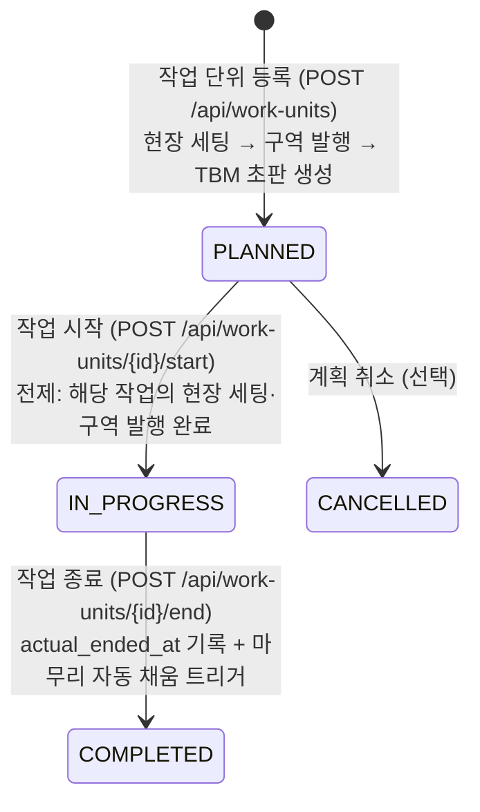

# 단일 작업 생명주기 및 관제·TBM·서명 흐름 설계

- **관련 명세**: `docs/spec/04-coordinates.md`(4.1, 4.3, 4.4, 4.5), `docs/spec/08-features.md`(8.1, 8.2, 8.3), `docs/spec/11-data.md`(11.1, 11.3, 11.5, 11.7), `docs/spec/12-interfaces.md`(12.6), `docs/spec/13-viewer.md`(13.1, 13.4), `docs/spec/14-security.md`, `docs/spec/appendix-e-demo.md`
- **관련 요구사항**: FR-3, FR-14, FR-18, FR-20, FR-21, FR-23~27, FR-40, FR-41, FR-42, FR-112, FR-132, FR-142, NFR-12, NFR-14, NFR-16, NFR-33
- **연관 설계 문서**: `docs/design/site-setup-pipeline.md`(작업별 현장 세팅·보정·World 자동 정의 및 운영 중 회전 복구 파이프라인)
- **티켓**: `S15P31A101-426` (명세 v1.3 수정 52) → `S15P31A101-438` (명세 v1.3 수정 54: 현장 세팅 선행 및 7단계 통합)

---

## 1. 배경 및 설계 목적

기존 명세(v1.3 수정 51 이전)에서는 위험 구역 편집 화면이 별도로 분리되어 있었고, 작업 단위(`work_unit`)는 계획된 시작·종료 시각(`start_at`, `end_at`)만 가진 정적 엔티티였으며, TBM 보고서는 작업 시작 전에 한 번 생성하고 끝나는 단발성 문서였다. 이후 수정 52(`S15P31A101-426`)에서 구역 편집의 관제 화면 통합, 명시적 작업 시작·종료 세션, 작업 종료 시 마무리 자동 채움, 참석자 자필 전자서명을 도입하였다.

여기에 **작업마다 카메라 위치·각도와 작업 공간이 달라지므로 매 작업 시작 시 현장 세팅(보정·World 자동 정의·정적 3D 배경·초기 위험 구역)을 먼저 수행해야 한다**는 현장 운용 결정(2026-11-03, `S15P31A101-438`, 세부 파이프라인은 `docs/design/site-setup-pipeline.md` 참조)을 결합하여, 한 번의 작업 생명주기를 다음 **7단계 단일 흐름**으로 완성한다:

> **세팅 → 구역 → TBM → 시작(관제) → 종료 → 마무리 → 서명(참석자 서명 → 관리자 결재)**

1. **작업마다 현장 세팅 (`setup_session`)**: 이전 작업의 보정값을 그대로 믿지 않고, 현장 세팅 화면에서 깨끗한 배경 누적·무마커 내부 파라미터 확인·MapAnything 초기 복원·World 자동 정의(바닥 $Z=0$, 경계 벽 $+X$, 모서리 원점, 카메라 실측 높이 스케일)·배경 특징점 공동 BA(V2)·빠른 3D 미리보기 맵 생성과 VLM 위험 구역 초안(`vlm_zone_draft`) 추론을 수행한다(목표 **약 1분 30초** 안쪽, 확인 필요).
2. **세팅된 공간 위에서 위험 구역 설정·발행 (`POST /api/zones/commit`)**: 빠른 미리보기 맵 위에 VLM 초안이 올라오면 관리자가 구역과 고소 작업면을 조정·발행한다. 구역·작업면·가상 배치도는 그 세팅/작업 단위에 귀속되며, 구역을 그리는 동안 뒤에서 정밀 텍스처 입히기(`texrecon`)가 완료되어 정식 Scene 으로 교체된다.
3. **세팅·구역 확정 후 TBM 가상 배치도 및 TBM 보고서 생성**: 세팅과 구역 발행이 끝나야 그 작업 공간의 World·구역 배치가 확정되므로, **TBM 가상 배치도와 TBM 요약 보고서는 반드시 세팅·구역 발행 뒤에 생성**한다(수정 52의 순서 조정).
4. **명시적 작업 시작(LIVE 관제) 및 운영 중 미세 회전 자동 복구**: 관리자가 작업 시작(`POST /api/work-units/{id}/start`)을 누르면 세팅이 끝난 상태로 LIVE 관제가 켜진다. 관제 중 카메라가 살짝 돌아간 경우에는 깨끗한 배경 비교로 감지하여 카메라 중심 고정 회전 복구(`rotfix`)를 자동 반영하고(Scene 재생성 불필요), 위치 이동이나 큰 회전은 **"현장 세팅 다시 하기"**로 알린다.
5. **작업 종료 → 마무리 자동 채움 → 참석자 전자서명 → 관리자 최종 결재**: 작업 종료(`POST /api/work-units/{id}/end`) 시 관제 중 발생한 위험 이벤트 요약으로 TBM 보고서 마무리 섹션을 자동 채워 새 `report_version` 을 만들고, 참석자들이 태블릿·모바일에서 자필 전자서명을 남긴다.

---

## 2. 종단간(End-to-End) 사용자 흐름 (7단계)

```mermaid
sequenceDiagram
    autonumber
    actor Admin as 안전관리자 (관제 화면 / 태블릿)
    actor Worker as 참석 작업자 / 반장
    participant Viewer as 웹 뷰어 (Three.js + 서명 패드)
    participant API as EC2 백엔드 (Spring Boot + risk-engine)
    participant Tier0 as GPU Pod (세팅·Tier 0·분석 워커)

    Note over Admin,Tier0: [1단계] 작업 선택 및 현장 세팅 (~1분 30초 목표)
    Admin->>Viewer: 작업 단위(work_unit) 선택 및 "현장 세팅 시작" 클릭 (카메라 높이 기본 채움 확인)
    Viewer->>API: POST /api/setup-sessions (work_unit_id, camera_heights_m)
    API->>Tier0: 세팅 파이프라인 시작 (배경 누적 → MapAnything·World → V2 배경 BA → 미리보기 맵 + VLM 초안)
    Tier0-->>API: calibration_version + preview_scene + zone_drafts 준비 완료
    API-->>Viewer: 세팅 1차 완료 (빠른 미리보기 맵 + VLM 구역 초안 표시)
    Note over Tier0: 백그라운드에서 texrecon 정밀 텍스처 완성 계속 진행

    Note over Admin,Tier0: [2단계] 관제 화면 내 위험 구역·작업면 설정 및 발행
    Admin->>Viewer: 미리보기 맵 위에서 VLM 초안 확인·다각형 조정·발행 클릭
    Viewer->>API: POST /api/zones/commit (새 configuration_bundle 발행, setup_session 연결)
    API->>Tier0: 새 구성 묶음 적용
    Tier0-->>Viewer: (백그라운드 완료 시) 정식 텍스처 Scene(scene_version)으로 자동 교체

    Note over Admin,Tier0: [3단계] TBM 가상 배치도 및 TBM 보고서(초판) 생성
    Admin->>Viewer: TBM 가상 배치도 배치 확인 및 TBM 보고서 생성 요청
    Viewer->>API: POST /api/reports/tbm/generate (work_unit_id)
    API->>API: 규칙 위험도 + 법령 그래프 + 외부 LLM 요약 → report_version (초판) 저장
    API-->>Viewer: TBM 보고서(점검표 + 가상 배치도 + 빈 마무리 섹션) 표시

    Note over Admin,Tier0: [4단계] 작업 시작 및 실시간(LIVE) 안전 관제
    Admin->>Viewer: "작업 시작" 클릭
    Viewer->>API: POST /api/work-units/{id}/start
    API->>API: work_unit 상태 PLANNED → IN_PROGRESS, actual_started_at 기록
    API->>Tier0: 활성 작업 세션 전환 및 LIVE 관제 게시
    loop 작업 진행 중 (IN_PROGRESS)
        Tier0->>API: 실시간 위치·RiskEvent 전달 (I1) + 롤링 배경 기반 미세 회전 감시(rotfix)
        API->>Viewer: 관제 화면 3D 표시·경보 (위치 이동/큰 회전 감지 시 "현장 세팅 다시 하기" 경고)
    end

    Note over Admin,Tier0: [5·6단계] 작업 종료 및 TBM 마무리 자동 채움
    Admin->>Viewer: "작업 종료" 클릭
    Viewer->>API: POST /api/work-units/{id}/end
        B3["참석자 TBM 교육 후 전자서명 (실명 + 손글씨 이미지 서버 저장)\n→ 해당 report_version 잠금 + content_sha256 기록 → 관리자 본인 계정 최종 결재 (S15P31A101-442)"]
    API->>API: [actual_started_at, actual_ended_at] 구간 RiskEvent 집계 → 마무리 섹션 자동 채움(새 report_version)
    API-->>Viewer: 마무리 섹션이 채워진 최신 TBM 보고서 반환

    Note over Admin,Worker: [7단계] 참석자 자필 전자서명
    Admin->>Viewer: 참석자 서명 화면 열기
    loop 참석자별 서명
        Worker->>Viewer: 이름(signer_name) 입력 + 캔버스에 손글씨 서명 후 저장
        Viewer->>API: POST /api/reports/tbm/{reportId}/signatures
        API->>API: report_signature 저장 (내부 기록용 전자서명 고지 포함)
        API-->>Viewer: 서명 목록 갱신
    end
```

---

## 3. 단계별 상세 설계

### 3.1 [1·2단계] 현장 세팅 화면과 관제 화면 내 위험 구역 편집 통합

- **현장 세팅 대기 및 전환 (`setup_session`)**:
  - 관리자가 작업 단위를 선택하고 세팅을 시작하면(`POST /api/setup-sessions`), 화면에 단계별 진행 상태(`배경 수집 중` → `3D 공간·좌표계 계산 중` → `카메라 정밀 보정 중` → `미리보기 맵·위험 구역 초안 생성 중`)와 진행률, 실패 시 원인·재시도 버튼(`POST /api/setup-sessions/{id}/retry`)을 표시한다.
  - 카메라 실측 높이 입력란은 직전 세팅의 카메라별 높이 값을 기본으로 채워 두어, 높이가 그대로이면 바로 시작할 수 있게 한다.
  - 목표 **약 1분 30초**(확인 필요) 안에 빠른 3D 미리보기 맵과 VLM 위험 구역 초안(`vlm_zone_draft`)이 준비되면 곧바로 구역 편집 모드로 전환된다(세부 알고리즘은 `docs/design/site-setup-pipeline.md` 참조).
- **관제 화면(3D 뷰어 + BEV 보조 평면도) 안에서의 편집 모드**:
  - 별도의 분리된 구역 관리 페이지로 이동하지 않고, 메인 관제 화면 안에서 `구역·작업면 편집 모드` 토글을 제공한다(관리자 `ADMIN` 전용).
  - 편집 모드를 켜면:
    1. 세팅 단계에서 생성된 VLM 위험 구역 초안(`vlm_zone_draft`, 후보 다각형과 추천 규칙·이유)이 빠른 3D 미리보기 맵(이후 백그라운드 `texrecon` 이 끝나면 정밀 텍스처 Scene 으로 자동 전환)과 2D BEV 평면도 위에 점선 초안으로 겹쳐 표시된다.
    2. 관리자는 초안을 수락·수정하거나 3D 바닥/작업면 위에 다각형 꼭짓점을 직접 찍어 위험 구역(`zone`: 바닥 높이·천장 높이·연결 위험 규칙·무단 출입 등급)과 고소 작업면(`work_surface`: 바닥 다각형·높이 $z_s$·가장자리 폭)을 추가·편집·삭제한다.
    3. 편집 중인 변경 사항은 로컬 초안(draft) 상태로 화면에 미리보기로만 보이며, Tier 0 실시간 판정에는 즉시 반영되지 않는다.
    4. 관리자가 **"구성 발행"** 버튼을 누르면 `POST /api/zones/commit` 이 호출되어 그 세팅(`setup_session_id`, `calibration_version`, `scene_version`)과 묶인 새 `configuration_bundle` 버전이 원자적으로 생성된다.
- **세팅별 귀속과 과거 작업 조회**:
  - 구역(`zone`), 고소 작업면(`work_surface`), TBM 가상 배치도(`virtual_layout`)는 해당 작업/세팅 묶음에 귀속된다.
  - 과거 작업의 이벤트나 리플레이를 조회할 때는 그 작업이 수행될 당시의 보정(`calibration_version`)·정적 배경(`scene_version`)·구성 묶음(`configuration_bundle`) 계보를 그대로 불러와 표시한다.

### 3.2 [3·4·5단계] TBM 생성 및 작업 단위(`work_unit`) 세션 상태 전이

#### (1) 세팅·구역 확정 후 TBM 생성
- 세팅과 구역 발행(`POST /api/zones/commit`)이 완료되면, 확정된 World 좌표계와 위험 구역 다각형을 바탕으로 TBM 가상 배치도(`PUT /api/work-units/{id}/layout`)와 TBM 보고서 초판(`POST /api/reports/tbm/generate`)을 생성한다.
- 현장에서 반장·작업자와 함께 가상 배치도와 TBM 점검표를 보며 작업 전 안전점검회의(TBM)를 진행한 뒤 **작업 시작**을 누른다.

#### (2) 작업 단위(`work_unit`) 상태 모델



| 상태 | 의미 | 전이 조건 및 부수 효과 |
| --- | --- | --- |
| `PLANNED` | 작업 예정 (세팅·TBM 준비 단계) | 작업 단위 생성 직후 초기 상태. 이 상태에서 **현장 세팅(`POST /api/setup-sessions`) → 위험 구역 발행(`POST /api/zones/commit`) → TBM 가상 배치도·보고서 초판 생성(`POST /api/reports/tbm/generate`)**을 순서대로 수행한다. |
| `IN_PROGRESS` | 작업 진행 중 (LIVE 관제) | 관리자가 `POST /api/work-units/{id}/start` 호출 시 전이(**세팅이 완료되지 않았으면 409 거부**). `actual_started_at`(UTC ms)과 활성 `setup_session_id` / `configuration_bundle` 을 기록하고 LIVE 관제를 시작한다. 관제 중 미세 회전은 자동 복구(`rotfix`)하고, 큰 회전·위치 이동은 "현장 세팅 다시 하기" 경고를 띄운다. |
| `COMPLETED` | 작업 종료 | 관리자가 `POST /api/work-units/{id}/end` 호출 시 전이. `actual_ended_at`(UTC ms)을 기록하고, 해당 작업 구간의 이벤트 집계를 바탕으로 **TBM 보고서 마무리 섹션 자동 채움(새 `report_version` 생성)**을 실행한다. |
| `CANCELLED` | 작업 취소 | 시작 전 계획이 취소된 경우(이미 `IN_PROGRESS` 또는 `COMPLETED` 인 작업은 취소 불가). |

- **동시 활성 작업 제약**: 한 공사장(교실 테스트베드)에서는 한 시점에 최대 1개의 주요 활성 작업 세션(`IN_PROGRESS`)을 두는 것을 기본으로 하며, 이미 진행 중인 작업이 있을 때 새 작업을 시작하려면 기존 작업을 먼저 종료하도록 안내한다(동시 다중 작업 단위가 필요한 경우 작업 구역별로 구분 가능하나, 시연 기준은 단일 활성 작업 세션으로 단순화).
- **작업 중 재세팅**: 작업(`IN_PROGRESS`) 도중 카메라 삼각대가 옮겨지거나 크게 돌아가 **"현장 세팅 다시 하기"** 경고가 뜬 경우, 관리자는 현장 세팅 화면을 다시 열어 새 세팅(`setup_session`)과 구역 확인을 수행한 뒤 관제를 이어갈 수 있다.

#### (3) 데이터 필드 (`work_unit` 및 `setup_session` 연계)

- `setup_session` 테이블(신규, `docs/spec/11-data.md` 11.1절 참조):
  - `setup_session_id` (`UUIDv7`): 현장 세팅 세션 식별자.
  - `work_unit_id` (`UUIDv7`): 대상 작업 단위.
  - `status`: `COLLECTING_BACKGROUND` / `INITIAL_POSE_AND_WORLD` / `JOINT_BA_AND_VERIFY` / `PREVIEW_AND_VLM_DRAFT` / `READY_FOR_ZONES` / `BAKING_TEXTURE` / `COMPLETED` / `FAILED`.
  - `camera_heights_m` (`JSONB`): 세팅에 사용한 카메라별 실측 높이(다음 세팅 시 기본 채움 원본).
  - `calibration_version`, `preview_scene_version`, `scene_version`: 이 세팅이 생성한 보정 및 정적 3D 배경 버전.
  - `failure_code`, `failure_message`, `started_at`, `ready_at`, `completed_at`.
- `work_unit` 테이블 추가/보강 필드:
  - `status`: `PLANNED` / `IN_PROGRESS` / `COMPLETED` / `CANCELLED` (기본값 `PLANNED`).
  - `active_setup_session_id`: 현재 작업에 적용된 현장 세팅 세션 ID (`nullable`).
  - `actual_started_at`: 실제 작업 시작 시각 (`TIMESTAMPTZ` / UTC ms, `nullable`).
  - `actual_ended_at`: 실제 작업 종료 시각 (`TIMESTAMPTZ` / UTC ms, `nullable`).
  - `started_by`, `ended_by`: 시작·종료를 누른 관리자 계정 식별자 (`nullable`).

### 3.3 [6단계] 작업 종료 시 TBM 보고서 마무리 자동 채움

- **기존 불변 이력 원칙 유지**:
  - `tbm_report` 본문은 여전히 `report_version` 단위로 **불변(append-only)**이다.
  - 세팅·구역 발행 직후(작업 시작 전) 생성된 초판(`report_version = 1`, `phase = PRE_WORK`)에서는 마무리 섹션(`wrap_up` 블록)이 `"작업 종료 후 자동 채움 예정"` 상태로 비어 있다.
- **종료 시 새 `report_version` 자동 생성 (`phase = POST_WORK`)**:
  - `POST /api/work-units/{id}/end` 가 호출되면 서버는 `[actual_started_at, actual_ended_at]` 구간 동안 발생한 해당 작업 연관 `risk_event` 및 시스템 상태를 집계한다:
    - 실제 작업 시간(`actual_started_at` ~ `actual_ended_at`)
    - 등급별(`CRITICAL`, `WARNING`, `CAUTION`) 이벤트 발생 건수 및 주요 규칙(`R1`~`R9`) 요약
    - 미해소·지속 경보 유무 및 관리자 조치(`ACKNOWLEDGED`, `RESOLVED`) 요약
    - 작업 중 카메라 회전 자동 복구(`rotfix`) 또는 재세팅 발생 여부
    - 후속 작업 시 주의 권고 한 줄 요약(규칙 집계 템플릿 기본, 필요 시 외부 LLM 4단계 검증 파이프라인으로 문장 다듬기 선택 가능)
  - 서버는 기존 초판의 사전 점검 내용·법령 인용·가상 배치도 스냅샷을 유지한 채 **마무리(`wrap_up`) 섹션을 채운 새 `report_version`** 을 생성하고 이를 해당 `tbm_report` 의 최신 버전으로 가리킨다.
  - 외부 LLM API 를 호출하더라도 기존 개인정보 보호 원칙(NFR-33: 실명·작업명·담당 조·반장 이름·영상·서명 전송 0건)을 엄격히 지킨다.

### 3.4 [7단계] TBM 보고서 참석자 자필 전자서명

- **역할과 관리자 최종 결재(S15P31A101-442)**: 서명마다 역할 `signer_role`(`PARTICIPANT` 기본 / `APPROVER`)을 둔다. 참석자 서명 뒤 관리자가 본인 계정으로 최종 결재(버전당 1회, `report.approved_at`·`approved_by`)하면 그 버전은 서명을 더 받지 않는다(409 `REPORT_APPROVED`). 작업 종료로 생긴 새 버전은 다시 서명·결재한다. 자세한 규칙은 이 문서 끝 "S15P31A101-442 구현" 절.

- **기능 요구**:
  - TBM 회의(또는 작업 종료 후 마무리 확인)에 참석한 작업자·반장들이 태블릿·모바일·PC 브라우저의 서명 패드(HTML5 Canvas / Pointer Events)에 손글씨로 서명하고 자신의 이름을 입력해 제출한다.
- **데이터 모델 (`report_signature`)**:
  - `signature_id` (`UUIDv7`, PK)
  - `report_id` (`UUIDv7`, FK → `tbm_report`)
  - `report_version` (`INT` 또는 `UUIDv7` — 서명 시점의 `report_version` 고정 기록)
  - `signer_name` (`TEXT`, 참석자 이름)
  - `role_label` (`TEXT`, 선택: 예 `반장`, `작업자`, `안전관리자`)
  - `signature_png` (`BYTEA` 또는 객체 저장소 비공개 키 `signature_object_key` + SHA-256 해시 `signature_sha256` — 서명 PNG 데이터는 소용량(보통 10~30 KB)이므로 DB `BYTEA` 또는 비공개 객체 저장소에 저장하고 본문 해시를 함께 남김)
  - `signed_at` (`TIMESTAMPTZ`, UTC ms)
  - `disclaimer_ack` (`BOOLEAN`, `"공인 전자서명 아님, 내부 기록용 전자 서명"` 고지 확인 여부)
- **개인정보·보안·법적 효력 경계 (중요)**:
  1. **내부 기록용 전자서명 명시**: 화면 서명란과 생성된 보고서 출력물 하단에 **"본 서명은 법적 공인전자서명이 아니며, 현장 TBM 참석 및 안전 수칙 숙지 확인을 위한 내부 기록용 전자서명입니다."** 문구를 고정 표시한다.
  2. **익명 원칙(NFR-14)의 명시적 예외**: Tier 0 실시간 추적·World ID·위험 이벤트·외부 LLM 입력에서는 여전히 실명을 절대 다루지 않는다. 오직 `report_signature` 테이블의 `signer_name` 과 서명 이미지에 한해서만 TBM 참석 확인 기록 목적으로 실명·자필 서명 저장을 허용한다.
  3. **외부 LLM 전송 금지(NFR-33)**: `signer_name` 과 서명 이미지는 외부 LLM API 로 절대 전송하지 않으며, 서버가 보고서 화면·인쇄용 뷰를 조합할 때만 붙인다.
  4. **권한 및 파기(NFR-12, NFR-16, NFR-32)**: 서명 등록·조회는 로그인한 관리자(`ADMIN`, 현장에서 관리자 태블릿으로 참석자가 돌아가며 서명)만 호출할 수 있고, 발표 후 30일 이내 전체 파기 대상에 포함한다.

---

## 4. REST API 명세 요약

`docs/spec/12-interfaces.md` 12.6절에 반영되는 작업 생명주기 API 요약은 다음과 같다:

| 단계 | 메서드 | 경로 | 권한 | 설명 |
| --- | --- | --- | --- | --- |
| 1. 세팅 | `POST` | `/api/setup-sessions` | `ADMIN` | 선택한 `work_unit_id` 의 현장 세팅 시작(카메라 높이 입력, 직전 값 기본 채움) |
| 1. 세팅 | `GET` | `/api/setup-sessions/{setupSessionId}` | `ADMIN`, `VIEWER` | 세팅 단계·진행률·검증 요약·미리보기/정식 Scene·구역 초안·실패 사유 조회 |
| 1. 세팅 | `POST` | `/api/setup-sessions/{setupSessionId}/retry` | `ADMIN` | 실패 또는 현장 조정 후 세팅 재시도 |
| 2. 구역 | `POST` | `/api/zones/commit` | `ADMIN` | 세팅된 공간 위에서 편집한 위험 구역·작업면 묶음을 새 `configuration_bundle` 로 발행 |
| 3. TBM | `PUT` | `/api/work-units/{id}/layout` | `ADMIN` | 확정된 구역 위에서 TBM 가상 배치도 저장 |
| 3. TBM | `POST` | `/api/reports/tbm/generate` | `ADMIN` | 세팅·구역 확정 후 TBM 요약 보고서 초판(`report_version`) 생성 |
| 4. 시작 | `POST` | `/api/work-units/{id}/start` | `ADMIN` | 작업 시작(`PLANNED` → `IN_PROGRESS`), `actual_started_at` 기록 및 LIVE 관제 게시 |
| 5·6. 종료·마무리 | `POST` | `/api/work-units/{id}/end` | `ADMIN` | 작업 종료(`IN_PROGRESS` → `COMPLETED`), `actual_ended_at` 기록 및 마무리 섹션이 채워진 새 `report_version` 자동 생성 |
| 7. 서명 | `POST` | `/api/reports/tbm/{reportId}/signatures` | `ADMIN` | TBM 보고서의 특정 `report_version` 에 참석자 자필 전자서명(`signer_name`, 서명 PNG) 등록 |
| 7. 서명 | `GET` | `/api/reports/tbm/{reportId}/signatures` | `ADMIN` | 해당 TBM 보고서에 등록된 참석자 전자서명 목록 조회 |

---

## 5. 시연 시나리오(부록 E)와의 정합

이 7단계 흐름은 `docs/spec/appendix-e-demo.md` 의 라이브 시연 장면 순서와 1:1 로 대응한다:

1. **장면 1 (현장 세팅 → 위험 구역 설정 → TBM 생성 → 작업 시작)**: 작업 단위를 선택해 현장 세팅 화면에서 세팅을 완료(~1분 30초 목표, 시연 시간 제약 시 직전 세팅 완료 상태 또는 빠른 진행 시연 병행 가능)하고, 빠른 미리보기 맵 위의 VLM 위험 구역 초안을 조정·발행(`POST /api/zones/commit`)한 뒤, TBM 가상 배치도와 TBM 보고서를 생성하고 **"작업 시작"**(`POST /api/work-units/{id}/start`)을 눌러 LIVE 관제를 켠다.
2. **장면 2~5 (실시간 위험 감지 및 대응 + 미세 회전 복구)**: 작업 진행 중(`IN_PROGRESS`) R1 무단 진입, R3 개구부/가장자리 접근, R5 낙하물/전도, R8 사다리, 카메라 미세 회전 자동 복구(`rotfix`) 또는 카메라 분리·가림(R7) 및 PWA 푸시·현장 경보·최소 리플레이를 시연한다.
3. **장면 6 (작업 종료 → 마무리 자동 채움 → 참석자 전자서명)**: **"작업 종료"**(`POST /api/work-units/{id}/end`)를 눌러 방금 시연 중 발생한 이벤트들이 TBM 보고서 마무리 섹션에 자동으로 채워지는 것을 보여주고, 참석자가 화면 서명 패드에 자필 서명(`POST /api/reports/tbm/{reportId}/signatures`)을 남겨 안전 관리 사이클을 완결한다.

### S15P31A101-442 구현: 서명 역할과 관리자 최종 결재

- 사용자 결정 C안: 참석자 서명 후 관리자 최종 결재로 일지를 확정한다. 승인자는 실명·손글씨 이미지를 입력하되 계정은 요청 인증 관리자 본인으로 고정한다(`recorded_by = report.approved_by`). 버전당 `APPROVER`는 1개이며 부분 유일 인덱스로도 막는다. (S15P31A101-442)
- 참석자 서명이 0명이어도 현장 판단으로 결재할 수 있다. 화면은 "참석자 서명 0명" 경고와 별도 관리자 결재 버튼·확인 대화상자를 제공하고, 결재 완료 배지·계정 표시명·시각을 표시한다. 결재 후 입력을 닫고 서버는 참석자·승인자 요청 모두 409 `REPORT_APPROVED`로 거절한다(과거 결재 버전도 동일). (S15P31A101-442)
- 첫 서명의 잠금·내용 해시는 기존 구현(`sections`, `citations`, `wrap_up_summary`의 키 정렬 정규화 JSON)을 그대로 유지하고 결재 시에도 같은 값을 쓴다. 서명·결재 정보는 해시 입력과 외부 LLM 입력에 포함하지 않는다. 인쇄본은 보고서 버전, 참석자 서명과 별도 결재란을 포함한다. (S15P31A101-442)
- 참석자 상한은 버전당 50명이며 승인자 1명은 별도다. 50명 참석 후에도 결재할 수 있어야 하므로 승인자는 참석자 상한에서 제외한다. 계정 표시명은 `app_user.display_label`이며 없으면 `login_id`를 사용하고 서명 실명으로 대체하지 않는다. (S15P31A101-442)
- 구현 위치: Flyway V31, `ReportSignatureController`, `TbmReportRepository`, 관제 앱 `SignaturePanel`·`useSignatureSubmission`·`TbmDocument`·`usePrint`, MSW `mocks/tbm.ts`. 통합 시험은 `ReportSignatureIntegrationTest`, 화면·MSW 시험은 `TbmPage.test.tsx`에서 기본 역할, 결재 계정, 해시 유지, 중복/결재 후 거절, 0명 결재, 새 버전 재결재와 인쇄를 검증한다. (S15P31A101-442)
- 잔여 검증: 이 실행 환경에서 서버 Gradle 실행은 지시서에 따라 생략하고 Lead에게 V31 적용 및 서버 통합 시험을 넘긴다. 새 버전에 이전 결재를 복사하는 대안은 본문 변경 후 재결재 원칙에 어긋나 채택하지 않는다. (S15P31A101-442)
