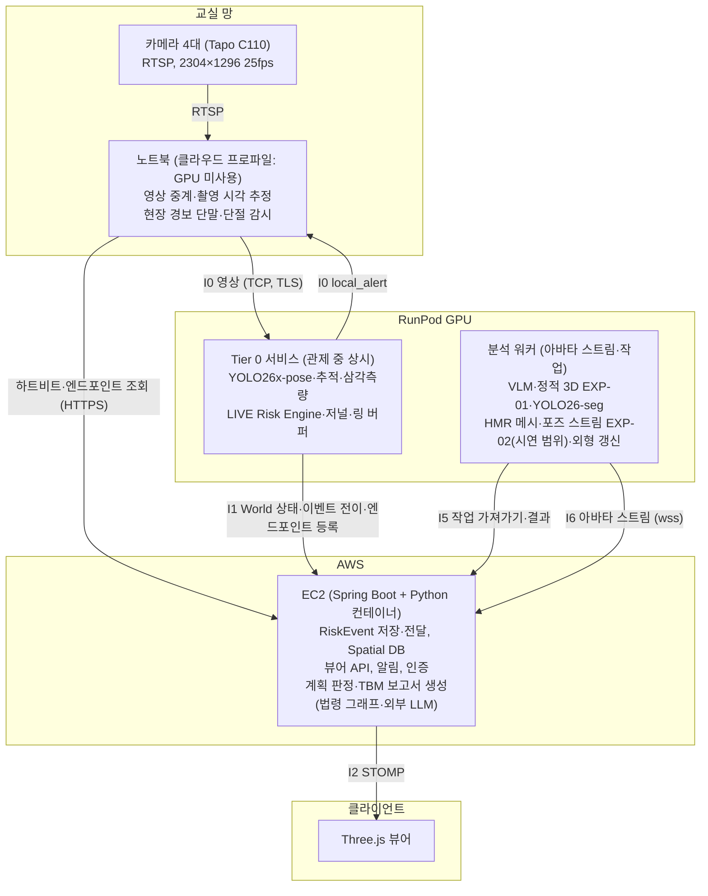
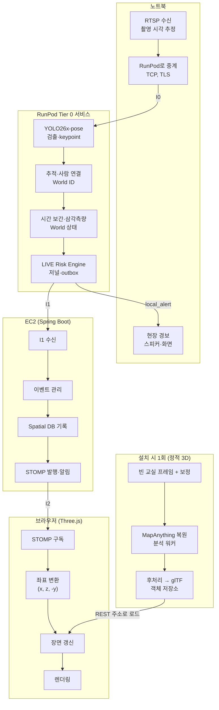

# 3. 시스템 구성과 배치

시스템은 현장 노트북(중계·현장 경보 단말), RunPod(Tier 0 실시간 처리와 무거운 분석), EC2(본부: 이벤트·기록·전달) 세 곳으로 나뉜다. v1.2부터 Tier 0 전체를 RunPod에서 처리한다. GPU 제약을 없애고 노트북을 단순하게 하는 대신, 인터넷과 클라우드에 의존하는 구성임을 명시한다(3.2, 17장).

## 3.1 구성 요소와 역할

| 구성 요소 | 실행 환경 | 역할 |
|---|---|---|
| 카메라 4대 | Tapo C110, 교실 Wi-Fi망 | RTSP 영상 송출 |
| 노트북 | 교실망, Python. 노트북 GPU 는 쓰지 않음(3.12) | RTSP 수신, 촬영 시각 추정(3.9), RunPod로 영상 중계(TLS), 현장 경보 단말(스피커·화면), 이중 하트비트 감시. 교실망 NTP 서버 역할은 보류(3.9) |
| RunPod Tier 0 서비스 | GPU Pod 하나(관제 중 상시, 실행 사이트·GPU 는 3.12), Python. 분석 워커와 같은 Pod·GPU를 쓰되 별도 프로세스 | YOLO26x-pose 검출·추적·2D keypoint, 카메라 간 연결·시간 보간·삼각측량·World 상태, LIVE Risk Engine·이벤트 저널, 이벤트 클립·CRITICAL 이벤트 프레임 링 버퍼, 사람 지운 정적 배경 누적(5.1, 5.3), 기동 시 엔드포인트 등록(3.12). PPE 검출은 확장(부록 C) |
| RunPod 분석 워커 | Tier 0와 같은 GPU Pod 안의 별도 프로세스(자원 상한 적용, 3.2), Python. 관제가 없는 개발 시간에는 같은 Pod에서 단독 실행(실행 사이트·GPU 는 3.12) | EC2에서 작업을 가져가(12.5) 실행: VLM 근거·사고 구간 요약(Cosmos3-Nano Reasoner, VLM 입력 얼굴 흐림·위험 구역·대상 인물 오버레이 포함, 5.4), 정적 3D 배경 복원·텍스처 메시 굽기(MapAnything Native + Open3D TSDF + `texrecon` / EXP-01, `static_reconstruct`, 5.3), BEV 평면도 생성(4.1), YOLO26-seg 마스크, 보정 번들 조정, 비동기 HMR 아바타 포즈 스트림·관측 기반 UV 텍스처 외형 갱신(Fast SAM 3D Body + YOLO26x-seg 마스크 / EXP-02, 시연 범위, 5.6) |
| 외부 LLM API | 외부 서비스(“GPT 6.1 sol”, SSAFY GMS 를 거쳐 OpenAI, 5.4) | TBM 보고서·일일 일지 문장 생성. 텍스트만 보낸다. EC2 의 Python 컨테이너(`deploy/risk-engine`) 안에서만 호출한다(API 키는 EC2 `.env`, GPU·Pod 없이 언제든 생성, v1.3 수정 49) |
| EC2 | AWS(EC2 또는 Lightsail 중 지급 서비스로 정함, 확인 필요), Spring Boot 4·Java 21 | RiskEvent 저장·생명주기·알림 라우팅, 규칙·구성 묶음 배포, Risk Engine·보고서 생성 컨테이너(계획·리플레이·What-if 판정 및 법령 지식 그래프 기반 TBM·일일 보고서 생성), Spatial DB, 뷰어 API·실시간 스트림, Tier 0 엔드포인트 중계, 인증 |
| 객체 저장소 | S3 또는 Lightsail 버킷 | 이벤트 클립, 정적 3D 자산(glTF). 클립은 EC2 삭제 작업이 지운다(보존 표시 확인, 11.5) |
| 클라이언트 | 브라우저 | Three.js 뷰어(관제 화면). 워치 앱은 확장(부록 C) |

데이터 흐름의 원칙: 카메라 영상은 관제 중 RunPod Tier 0 서비스로 상시 전송되고, Tier 0 가 카메라별 상시 영상 조각으로 잘라 객체 저장소에 올린다(14일 보관, 5.1·11.5, v1.3 수정 36). 상시 영상 조각 바이트는 EC2를 거치지 않고(EC2 는 조각 기록 `video_segment` 만 받는다), EC2에는 World 상태·이벤트 같은 결과만 간다. 다만 관제 화면 CCTV 원격 시청(v1.3 수정 46)을 위해 로그인한 관리자가 보고 있는 동안에만 노트북 중계가 같은 압축 영상을 EC2 수신 WebSocket 으로 보내고, EC2 는 저장 없이 메모리에서 시청 브라우저로만 넘긴다(3.3, 이전의 ‘관제 미리보기 영상은 EC2 를 거치지 않음’은 대체됨). 2D 관측 원본도 Tier 0 저장 위치(3.12)에 두고 EC2 로 보내지 않는다(11.2).

## 3.2 배치 결정

- Tier 0(정의는 5장 첫머리)는 RunPod의 한 서비스에서 관측부터 LIVE 판정까지 끝까지 처리한다. 검출 결과를 다른 곳으로 보내 융합하지 않으므로 중간 왕복이 없다.
- 노트북은 GPU 작업을 하지 않는다. 영상 중계, 촬영 시각 추정, 현장 경보, 감시만 맡는다.
- Tier 0와 분석 워커는 **GPU Pod 하나**에서 별도 프로세스로 실행한다(World Track Manager 하나, LIVE Risk Engine 정본 하나). GPU를 나눠 쓰므로 다음 규칙을 둔다.
  - Tier 0 프로세스가 GPU 메모리를 먼저 확보한다. 분석 워커는 남은 메모리 안에서 상한을 두고 실행한다(예: vLLM `gpu_memory_utilization` 제한, 동시 요청 수 제한). 아래 GPU 메모리 예산표를 따른다.
  - Tier 0 지연이 목표를 넘거나 모르면 분석 워커의 새 작업을 멈추고 대기열에 둔다. Tier 0 는 1초 간격으로 지연 표본을 모아 GPU 상태 표시 파일을 쓸 때마다(초기값 5초) 그 사이 창으로 집계한다. 멈춤 기준은 그 창의 최댓값(p95 보다 엄격)이 `capture_to_risk` 목표(6.6, 600ms)를 넘음(한 창·한 표본이라도 즉시), 지연을 모르는 표본이 있음, 표본이 없음, 표시 파일이 오래됨·없음·형식 오류(모름)이다. 창 안에 추론 대기 상한(5.1, `queue_wait_ms` 150ms)을 넘겨 버린 프레임은 한 창에 2건(초기값) 이하면 통과로 넘기고, 그보다 많으면 멈춘다(지연 초과·모름과 함께면 위 기준으로 이미 멈춤). 멈춘 뒤 다시 받으려면 통과 상태가 10초(초기값) 이어져야 한다. 분석 워커(VLM 빠른 경로 포함)와 아래 상시 아바타 루프는 같은 접수 규칙을 쓰고, LIVE 관제 중 오프라인·배치 EXP 차단은 이 규칙과 따로 늘 걸린다. 이 규칙이나 LIVE 관제 시작 때문에 분석 워커가 받은 작업을 시작하지 않았거나 멈췄으면 시도 횟수를 쓰지 않고 반납한다(12.5). 우선순위는 Tier 0 > VLM 빠른 경로 > 보고서·사후 요약 > 그 밖의 작업이다.
  - EXP-01 등 오프라인·배치 EXP Job(I5 배치 `hmr_*`·`static_reconstruct` 작업 포함)은 LIVE 관제 시간에 실행하지 않는다(AdmissionGate 가 대여에서 빼고, 실행 전 LIVE 진입 시 시도 횟수를 쓰지 않고 반납, 5.3·12.5). 예외로 시연 범위인 EXP-02 아바타 포즈 스트림(상시 HMR 루프 `services/avatar`, 5.6·12.2)은 LIVE 관제 중에도 분석 워커 GPU 상한 안에서 실행하되, Tier 0 가 공유 파일(`$SIMAI_ROOT/state/avatar-input.npz`)로 내보낸 최신 왜곡 보정 영상·트랙을 읽고 추론 전마다 Tier 0 지연 감시 표시 파일(`$SIMAI_ROOT/state/tier0.live`)을 확인해 위 접수 규칙에 걸리면(지연 초과·모름은 즉시) 추론을 멈추며(그때 뷰어는 0.5 s 뒤 캡슐 아바타로 돌아감, 13.2) 통과 상태가 10초(초기값) 이어지면 다시 시작한다(`docs/design/hmr-avatar-loop.md`, `docs/design/tier0-gpu-priority.md`).
  - 분석 워커 프로세스가 죽거나 메모리 부족이 나도 Tier 0 프로세스는 계속 동작해야 한다(프로세스 분리, 6.5).
  - GPU가 부족하면 같은 Pod의 GPU 등급을 올리고, 그다음 VLM 처리 주기와 동시 요청 수를 조정한다(VLM 모델은 5.4 로 고정). GPU Pod를 2개로 늘리는 구성은 쓰지 않는다. Tier 0 분산(샤딩, 중앙 Fusion, 리더 선출, 장애 전환)은 MVP 범위 밖이다.
- 이중 감시: 노트북은 끊긴 대상에 따라 현장 표시를 달리한다(RunPod Tier 0나 영상이 끊기면 “관제 중단”, EC2만 끊기면 “원격 관제 장애”, 3.10). EC2는 RunPod Tier 0나 노트북 하트비트가 끊기면 System Health를 UNSAFE_UNKNOWN으로 바꾸고 관리자 화면에 알린다. 노트북은 EC2에도 1초마다 HTTPS 하트비트(`laptop_heartbeat`, 기기 토큰)를 보내며 Tier 0 연결 상태를 함께 알린다. 그래서 EC2는 Tier 0 하트비트가 끊겨도 노트북이 Tier 0 정상을 알리면 “원격 전달 단절(현장 경보 동작 중)”, 노트북도 Tier 0 끊김을 알리면 “관제 정지”로 구분해 표시한다. 두 경우 모두 System Health는 UNSAFE_UNKNOWN이다. ‘Tier 0 정상’은 연결(`tier0.control`)과 노트북 현장 표시(`site_display`)를 함께 본다: 노트북은 Tier 0 health 를 받고 있으면 처리 정체·판정 불가·영상 단절이어도 `tier0.control`=CONNECTED 로 두고 그 판단을 `site_display`=CONTROL_HALTED 로 알리므로, CONNECTED 여도 CONTROL_HALTED 이면 “관제 정지”다(3.10).
- **하트비트 장애 판정.** 받는 쪽의 단조 시계로 재고, 1초 주기 하트비트가 3회 연속 오지 않으면 장애로 본다. Tier 0 정상 여부는 소켓이 살아 있는지가 아니라 처리가 진행되는지(`t_latest_global`이 증가하는지)로 판정한다. 반쯤 열린 TCP 연결은 운영체제가 알려주지 않으므로 애플리케이션 하트비트로 끊는다(6.5).
- 이 구성은 DeploymentProfile의 “클라우드” 프로파일이다. 인터넷이나 RunPod가 멈추면 위치 추적과 판정이 함께 멈춘다(17장). 엣지에서 독립 동작하는 “현장” 프로파일(현장 GPU에서 Tier 0 실행)은 같은 코드로 전환할 수 있게 유지한다. 노트북 GPU 로 Tier 0 를 돌리는 대체 경로는 만들지 않는다(3.12).

클라우드 프로파일은 연구·교육용 시연 구성이다. 지연 목표(6.6)는 시험 목표이며, 현장에서 안전 경로가 독립적으로 동작한다는 주장은 현장 프로파일을 별도로 실증해야 할 수 있다.

**GPU 메모리 예산표.** 같은 GPU 에 올리는 프로세스별 상한이다. Tier 0 와 분석 워커가 함께 쓰는 GPU 는 48GB 이상(80GB 권장)이고, 그보다 작은 GPU 에는 분석 부하를 올리지 않는다(3.12). 값은 G0 에서 실측해 채운다.

| 프로세스 | 내용 | 메모리 상한 |
|---|---|---|
| Tier 0 | YOLO26x-pose TensorRT 엔진(디코딩은 기본 CPU, NVDEC 을 고르면 하드웨어 디코더 4개 추가) | 초기값 0.20(80GB 에서 16GB, 그중 torch 선확보 8GB). G0 실측으로 고침 |
| 분석 워커 전체 | 아래 VLM·마스크·HMR 을 합친 워커 프로세스 상한(상시 아바타 루프를 함께 띄울 때는 VLM 0.55 + HMR·아바타 seg 0.10 + I5 워커 0.05 로 분할) | 초기값 0.70. G0 실측으로 고침 |
| VLM | Cosmos3-Nano(16B) 가중치 + KV 캐시(vLLM `gpu_memory_utilization`) | 초기값 0.55, 동시 요청 4(분석 워커 상한 안). G0 실측으로 고침. 3차 GPU 세션(H100 80GB, 감시 프로세스와 같은 인자) 실측: 가중치 16.79 GiB·KV 캐시 23.99 GiB 가 0.55 안에 들고, G7 빠른 경로 p95 2.1 s, VLM 동시 4 지속 중 Tier 0 `frame_age` p95 60 → 76 ms 라 값은 그대로 둔다(48GB급의 0.55 는 19.1 미결, `docs/design/unified-env.md`) |
| 임베딩(GPU 에 둘 때만) | `Qwen/Qwen3-Embedding-0.6B`(1024차원, v1.3 수정 49). GPU 에 두지 않는다(법령 지식 그래프 노드·표준 질의 템플릿은 사전 임베딩해 두고, 실시간 질의는 EC2 Python 컨테이너 CPU 에서 처리, 5.4·11장) | 해당 없음 |
| 마스크 | YOLO26-seg(아바타 루프 `YOLO26x-seg` 는 아래 HMR 상한 안) | 분석 워커 상한 안. G0 실측 |
| HMR(EXP-02, 시연 범위) | Fast SAM 3D Body(상시 아바타 스트림 루프 `services/avatar`, `YOLO26x-seg` 마스크·UV 텍스처 누적 포함) | 분석 워커 상한 안(초기값 0.10, `SIMAI_AVATAR_GPU_FRACTION`). G0 실측(상한) |
| MapAnything | 설치·비관제 시간 실행(일회성 `simai-bootstrap scene` 또는 분석 워커 I5 `static_reconstruct` 자식 프로세스, 관제 중 실행 안 함, 5.3) | — |

비율은 GPU 전체 메모리 대비다. 분석 워커는 시작할 때 Tier 0 + 분석 워커 ≤ 0.95, VLM ≤ 분석 워커를 검사하고 틀리면 시작하지 않는다.

**Risk Engine 배치.** Risk Engine은 Python 라이브러리 하나로 구현하고 두 곳에 배포한다. 같은 규칙을 Java로 다시 구현하지 않는다.

- RunPod Tier 0 서비스: LIVE 판정. 판정 직후 노트북으로 `local_alert`를 보내 현장 경보를 울리고(EC2를 거치지 않는 가장 짧은 경로), 이벤트는 outbox를 거쳐 EC2로 보낸다. EC2가 끊겨도 RunPod가 살아 있으면 판정과 현장 경보는 계속된다.
- EC2 옆 Python 컨테이너: PLANNED·REPLAY·WHAT_IF 계산과 TBM·일일 보고서 생성(PostgreSQL 건설안전 법령 지식 그래프 하이브리드 검색 + 참조 엣지 1단계 확장 + 외부 LLM 호출 + 코드 4단계 검증, 5.4·12.2, v1.3 수정 49). 같은 코드, 같은 규칙 버전. MVP 의 내부 API 는 PLANNED 판정과 보고서 생성을 받고(12.2), 운영 REPLAY·WHAT_IF 재계산은 이 컨테이너가 맡는 확장이다(부록 C). 녹화 영상을 Tier 0 파일 입력으로 다시 돌리는 재생은 이 배치가 아니라 개발·시험용 시나리오 재생 도구다(21.3).
- Spring Boot: 규칙·구성 묶음 배포, RiskEvent 저장·생명주기, 알림 라우팅, API.
- 두 배포의 동일성은 같은 규칙 버전과 공통 테스트 벡터(입력과 기대 출력 세트)로 CI에서 검증한다.
- 규칙 입력은 World 상태 외에 판정 문맥(같은 판정 시각의 감시 상태, 활성 보정 상태 4.4)을 함께 받는다. 판정 문맥은 `world_state` 계약에 싣지 않는다. Tier 0 는 판정마다 health 와 같은 활성 보정 상태를 넘기고, PLANNED 계획 위치에는 보정 상태가 적용되지 않는다(7.1).

**이벤트 소유권과 outbox.** LIVE RiskEvent의 생명주기 정본은 RunPod Tier 0 서비스다.

- Tier 0 서비스: RAISED → UPDATED → RESOLVED 전이를 확정한다. 전이마다 `risk_event_transition`(I1)을 이벤트 저널(Tier 0 저장 위치(3.12)에 추가만 하는 내구성 로그)에 기록하고 EC2로 보낸다. outbox는 별도 저장소가 아니라 저널에서 acked_offset 이후 구간이다(아래 저널 계약).
- EC2: 영속 저장, 조회, 알림 전달, 운영자 조치(ACK), 화면용 projection을 맡고 전이를 새로 만들지 않는다. `(event_id, event_sequence)`로 중복을 제거하고 순서를 검증하며, 낮은 sequence가 늦게 오면 기록만 한다.
- 운영자 ACK는 EC2 → Tier 0 서비스 → 노트북으로 전달해 현장 경보의 반복 소리를 멈춘다. 관리자(관제 화면)·현장 확인 버튼 중 누가 확인해도 소리를 멈추고, 점멸 표시는 해소까지 유지한다. 누가 확인했는지와 확인한 사람이 본 이벤트 상태(`event_sequence`, 확인 대상)는 저널에 남긴다. 확인 대상보다 뒤에 등급이 오른 경보는 그 확인으로 멈추지 않는다(3.10).
- **재동기화 알림 규칙:** 원칙은 최종 상태를 확인한 뒤에만 알린다는 것이다. EC2 연결이 복구되면 EC2는 동기화 모드로 들어가 outbox 전이를 sequence 순서대로 받아 기록만 하고 실시간 알림은 보류한다. 빈 구간은 다시 요청한다(`journal_ack`). 재전송이 끝나면 Tier 0 서비스가 `event_state_snapshot`을 보내고, EC2는 이를 받은 뒤에만 동기화 완료로 전환한다. 그 시점에 여전히 활성이고 최근 유효 관측 근거가 있는 이벤트만 DELAYED_ACTIVE로 알리고, 해소된 이벤트는 감사 기록으로만 복원한다. 경과 시간만으로 알림을 억제하지 않는다.
- **스냅샷 만들기.** 스냅샷은 연결마다 한 번, 그 연결에서 outbox 재전송을 마친 직후 같은 연결로 보낸다. 활성 목록은 추적기의 지금 상태가 아니라 이미 보낸 전이를 저널 순서로 접은 결과이고, `journal_offset` 은 그 연결에서 보낸 마지막 offset 이다. 만드는 사이 새 전이가 붙으면 싣지 않고 스냅샷 뒤에 실시간 전이로 보낸다. 재요청(`journal_ack`)으로 재전송 구간이 물러나면 만든 스냅샷을 버리고 재전송을 마친 뒤 다시 보낸다. 저널에 기록이 한 번도 없으면 `journal_offset` 을 null(‘아직 저널 기록이 없음’, offset 0 기록 하나를 반영한 0 과 다름)로, 활성 이벤트 없이 보낸다. 그래서 EC2 는 첫 위험 전에도 연결마다 동기화를 마친다. 저널에 보내지 않은 기록이 있으면 그 기록을 보낸 뒤 offset 이 있는 스냅샷을 만든다. 근거를 모르는 값(구성 버전, 활성 이벤트의 발생 시각)이 있으면 지어내지 않고 스냅샷을 미룬다(EC2 는 동기화 모드로 남는다).
- 노트북 쪽 현장 경보의 재동기화는 3.10 을 따른다.

**식별자 규칙.** `event_id`는 UUIDv7(시간 순서, 재시작·여러 현장에서도 충돌 없음)로 만들고 Tier 0 인스턴스 식별자 `gateway_id`를 함께 싣는다. `event_sequence`는 이벤트별 단조 증가값이며 이벤트 저널과 함께 **Tier 0 저장 위치**(3.12)에 저장해 Tier 0 재시작·교체 후에도 이어진다(저장 위치가 남아 있는 동안. 컨테이너 디스크는 인스턴스를 지우면 사라진다, 3.12). 새 Pod는 시작 시 저널의 acked_offset 이후 전이부터 재전송한다.

**재시작 복구.** outbox는 보내지 못한 메시지만 살린다. 이벤트 상태는 따로 체크포인트한다.

- Tier 0 서비스는 활성 RiskEvent(상태·sequence), 해소 기록(tombstone), `config_version`, 마지막으로 처리한 촬영 시각, `last_applied_journal_offset`(과 그 기록의 msg_id), World Track 을 Tier 0 저장 위치에 주기적으로(초기값 1초) 체크포인트한다. 체크포인트는 저널 기록을 적용한 결과로 만들고, 세대별 파일에 형식 버전과 해시를 붙여 원자적으로 쓴다.
- 해소 기록은 해소된 이벤트의 마지막 sequence 와 판정 시각이다(최근 1024개 초기값, 밀려난 것은 그 판정 시각의 최댓값만). 체크포인트 전에 해소된 이벤트의 과거 전이가 저널에서 다시 적용돼도 그 이벤트를 되살리지 않게 거른다. 밀려난 이벤트는 그 판정 시각 이하의 기록을 오래된 기록으로 보고 건너뛴다(Tier 0 판정 시계가 그보다 크게 뒤로 가지 않는다는 전제).
- World Track 은 체크포인트에 저장한다(Track 별 위치·σ·속도·생명주기·`identity_revision`·별칭. 꺼낸 Track 의 관측 상태는 늘 UNKNOWN). 재시작하면 World Track Manager 는 Track 없이 시작하고 모든 사람은 재관측으로 새 World ID 를 받는다(복원 ID·revision·별칭을 물려받지 않는다). 저장한 Track 은 재관측과 맞출 후보일 뿐 위치·신원의 정본이 아니며, `world_state`·연결 비용·필터·판정에 넣지 않는다.
  - 재관측 매칭: 재시작 뒤 첫 프레임이 체크포인트 Track 시각보다 30초(초기값) 넘게 뒤거나 시각이 거꾸로 가면(또는 시각을 모르면) 복원 Track 을 버린다. 받은 복원 Track 도 마지막 관측부터 30초가 지나면 후보에서 뺀다. 나이는 촬영 시각으로 잰다.
  - 새 World ID 의 첫 위치가 복원 Track 에서 갈 수 있는 거리(0.5 m + 2 m/s × 공백) 안이면 그 Track 을 후보로, 밖이면 제외로 정하고 바꾸지 않는다. 후보가 있는 새 ID 에는 그 복원 Track 이 남아 있는 동안 `IDENTITY_UNCERTAIN`(`RESTORED_TRACK_CANDIDATE`)을 붙인다. 위치만으로는 같은 ID 로 잇지 않는다(5.2 늦은 재연결의 2대 근거가 재시작 뒤에는 없다).
- 복원한 활성 이벤트는 검증 상태를 UNVERIFIABLE로 바꾸고 자동 해소하지 않으며 운영자 확인을 요청한다. 확인 기록과 현장 경보 단계는 그대로 이어 현장 경보를 끄지 않는다. 복원은 판정이 아닌 전이(RESTORED)로 저널에 기록하고 새 이벤트나 현장 경보 신호를 만들지 않는다. 재관측된 사람에게 같은 위험이 다시 걸려 새 이벤트가 생기면 이전 이벤트와의 연결(`related_event_id`)을 남긴다. 같은 규칙의 사람 대상 복원 이벤트 중에서 고른다: 이전 이벤트 대상의 복원 Track 이 새 ID 의 후보면 구역과 상관없이 잇고(여럿이면 가까운 쪽), 새 ID 가 처음 보일 때 그 복원 Track 이 없었으면(체크포인트에 없음·30초 지남·이미 빠짐) 같은 구역일 때만 잇는다. 제외로 정한 Track 의 이벤트와는 잇지 않는다. 30초는 재시작 뒤 첫 프레임부터 연결을 정하는 창이다. 창 안의 위험 판정에서 정한 연결은 발생 지속 조건을 채우는 동안 기억했다가 발생(RAISED)이 창 뒤에 나도 싣고, 이벤트 없이 끝나면 버린다. 복원 이벤트를 새 ID 로 옮기지 않는다(새 ID 가 다른 사람이면 그 관측으로 이전 경보가 잘못 꺼진다).
- 복구 중 System Health는 재관측·시간 동기화가 확보되기 전 UNSAFE_UNKNOWN, 일부 유효 관측이 확보된 뒤 DEGRADED, 커버리지·보정·지연이 정상으로 돌아오면 NOMINAL이다. 재관측 확보는 재시작 뒤 처음 본 값보다 큰 `t_latest_global`(촬영 시각이 실제로 앞으로 간 새 프레임)과 동기화 유효 카메라 1대 이상, 시간 동기화 확보는 노트북–Pod 시계 차이 추정값이 있는 것이다. 두 조건이 한 보고에서 함께 확인될 때까지 UNSAFE_UNKNOWN 이고, 한 번 풀리면 다시 묶지 않는다(그 뒤 저하는 원인별로 판정).

**복구 순서.** 이벤트 전이는 이벤트 저널이 정본이고, 체크포인트는 그 시점까지의 요약일 뿐이다. outbox는 전송 대기열이라 복구에 쓰지 않는다.

1. 마지막 체크포인트를 복원한다. 최신 세대부터 보고, 믿을 수 없는 세대(깨짐·부분 쓰기·해시·형식 버전 불일치·다른 Tier 0)나 이어 읽을 저널 구간이 정리된 세대는 버리고 직전 세대로 물러선다. 쓸 세대가 없으면 저널 처음부터 적용한다.
2. 이벤트 저널에서 체크포인트의 last_applied_journal_offset 이후 전이를 sequence 순서대로 다시 적용한다(체크포인트에 RAISED, 로그에 그 뒤의 RESOLVED가 있으면 RESOLVED가 최종). 이벤트별 sequence 로 멱등이고, 해소 기록으로 해소된 이벤트의 과거 전이를 거른다.
3. 그 결과 활성인 이벤트를 UNVERIFIABLE로 두고 운영자 확인을 요청한다. World Track 은 새로 시작하고 저장한 Track 은 재관측 매칭 후보로만 넘긴다.

복구는 활성 이벤트를 추측하지 않는다. 아래 경우에는 Tier 0 를 시작하지 않는다(노트북은 “관제 중단”). 활성 이벤트를 모르는데 ‘없음’으로 시작하면 진행 중인 위험을 조용히 끄게 되기 때문이다. 어느 경우든 저널을 지워 정상 복구로 삼지 않는다(운영 절차 18.5).

- 이전 형식 저널: 전이 기록에 이벤트 상태(`meta.state`)가 없어 되살릴 수 없다. 운영 배포 전이라 변환 경로는 두지 않는다.
- 체크포인트 불일치: 체크포인트가 저널보다 앞서거나(저널이 fsync 된 기록을 잃음) 같은 offset 의 msg_id 가 다르다(다른 저널). 정본이 없다. 체크포인트가 저널보다 뒤처진 것은 정상이다(그만큼 더 적용한다).
- 정리된 저널: 쓸 체크포인트가 없고 저널 앞부분이 이미 정리돼 처음부터 적용할 수도 없다.
- 저널 재적용 실패: 기록의 이벤트 상태 손상, payload 와 불일치, 다른 Tier 0·LIVE 가 아닌 기록.

**저널 계약.** 기록은 한 곳(이벤트 저널)뿐이고 전송 대기열은 그 저널의 한 구간이다. 그래서 “저널에는 있는데 전송 대기열에는 없는” 상태가 생기지 않는다.

- 저널의 모든 기록에 전역 단조 증가 `journal_offset`을 붙인다. 이벤트별 `event_sequence`와는 다른 값이다.
- outbox = `acked_offset` 이후의 저널 구간. 전송은 늘 이 구간을 읽어 보내고, EC2 ACK(`journal_ack`)마다 `acked_offset`을 영속 저장한다.
- 체크포인트에는 `last_applied_journal_offset`을 저장한다. 저널은 `min(acked_offset, last_applied_journal_offset)` 이전 구간만 정리한다. 직전 체크포인트 세대로 물러설 구간을 남기려고 last_applied_journal_offset 대신 남은 온전한 체크포인트 세대 중 가장 작은 offset 을 쓴다(더 보수적).
- 전이 기록마다 전이 뒤 이벤트 상태 전체를 내부 메타(`meta.state`)로 함께 남겨 복구에 쓴다. I1 로는 보내지 않는다.
- 저장 방식: 단일 작성자의 추가 전용 파일 + 기록마다 fsync를 기본안으로 한다. SQLite는 네트워크 파일시스템 사용이 권장되지 않고 WAL 모드는 같은 호스트의 공유 메모리를 전제하므로 저장 위치가 네트워크 볼륨일 수 있는 저널에는 쓰지 않는다. 어느 방식이든 시연 환경의 저장 위치(디스크)에서 강제 종료 시험으로 영속성을 확인한다(G3, 3.12).
- 현장 경보(`local_alert`) 전송은 fsync 를 기다리지 않는다. EC2 로 보내는 전이만 fsync 가 끝난 뒤에 보낸다.
- 저널 쓰기는 판정 스레드와 분리한 별도 스레드에서 시간 제한을 두고 하며, 쓰기가 멈추는지 감시한다.
- 운영자 확인(EC2 ACK, 현장 확인 버튼)도 저널 이벤트로 기록한다.
- 전이의 판정 근거(`evidence_ref`, 판정에 쓴 `world_state` 의 msg_id)는 판정 전이(발생·해소·재개, 판정으로 등급·수치·구역·검증 상태가 바뀐 갱신)에 반드시 싣는다. 판정 전이의 근거를 모르면 지어내지 않고 기록 전에 거절한다. 판정이 아닌 전이(운영자 확인·재시작 복원·ID 교정)는 그 이벤트의 직전 판정 근거를 싣고, 모르면(체크포인트로만 복원돼 저널에 판정 기록이 없는 이벤트 등) null 로 보낸다. 근거가 null 이라는 이유로 outbox 전송을 멈추지 않는다.
- 이 계약은 Risk Engine 구현 태스크의 완료 조건이다.

**구성 묶음과 연결 단절 시 동작.** Tier 0 서비스가 판정하려면 판정 기준이 그 서비스 안에 있어야 한다.

- 구성 묶음(config bundle) = 구역, 규칙 버전, 보정 버전, Operational Geometry(바닥 평면·등록 정적 객체·작업면 OBB, 7.5), 각 버전 ID와 해시.
- EC2가 새 묶음을 발행하면 Tier 0 서비스가 내려받아 스키마·해시·참조 무결성을 검증하고 원자적으로 전환한 뒤, 적용 시각과 함께 ACK(`config_ack`)한다. EC2는 ACK 후에만 “현장 적용됨”으로 표시하고, 그 전에는 뷰어에 “적용 대기”를 표시한다.
- EC2와 연결이 끊기면 마지막 검증 묶음으로 계속 판정하고 Config Sync를 UNVERIFIED로 표시한다. EC2 는 I1 이 (재)연결될 때 최신 묶음 알림(`config_bundle`)을 다시 보내고, Tier 0 는 그 알림을 받기 전까지 UNVERIFIED 로 둔다. 알림의 묶음이 활성 묶음과 다르면 STALE(불일치가 확인됨)로 바꾸고 검증·전환(PENDING)을 거쳐 CURRENT 가 된다(6.2). STALE 은 EC2 가 알린 묶음과 다르다는 것이 확인된 상태이며 경과 시간만으로 STALE 로 바꾸지 않는다. 검증에서 거부한 묶음이 마지막 알림이면 STALE 로 남는다. 어느 상태든 판정은 멈추지 않는다.
- 판정 한 번(tick)은 한 묶음으로만 한다(tick 도중에 전환하지 않는다). 모든 이벤트와 `world_state` 에 그 tick 의 `config_version`을 기록하고(`world_state` 는 선택 필드), 리플레이·What-if는 그 시각에 적용돼 있던 버전을 쓴다.

**확장 가능한 계약.** 실제 운용은 C110 4대로 확정하되, 내부 인터페이스는 `camera_id` 기반 N-camera 구조로 둔다. 위치 추정은 PositionEstimator 인터페이스의 구현체(바닥 투영, 삼각측량, HMR 보강)로, 배치는 DeploymentProfile(클라우드, 현장)로 분리한다.

## 3.3 카메라 사양

Tapo C110 4대, 동일 하드웨어 버전. 해상도·fps 는 2026-10-16 실측값(S15P31A101-9, LTE 핫스팟 1차 측정), stream1 키프레임·비트레이트와 수신 안정성·도착 간격·RTCP 는 공유기 환경(ipTIME, 2.4GHz) cam_A 10분 측정(2026-10-23), 동시 접속은 열린 세션이 없는 상태의 재측정(2026-10-26)이고 렌즈는 제조사 사양이다.

| 항목 | 값 |
|---|---|
| 해상도 | stream1 2304×1296(3MP), stream2 1280×720. H.264 High |
| 프레임률 | 앱 설정값이 RTSP에 그대로 적용된다(기본 15). 운영은 25 fps 고정(프레임 간격 40ms) |
| 키프레임 주기 | stream1 약 2초(공유기 10분 측정 p50 1.94 s·최대 2.75 s), stream2 3초 |
| 비트레이트 | stream1 약 860 kbps(공유기 10분 측정, 수업 중 교실. 1차 핫스팟 측정은 약 1.1 Mbps), stream2 약 0.3 Mbps(25 fps) |
| RTSP 동시 접속 | 카메라당 최대 2세션. 3번째는 거부된다(재측정에서 1·2번째 세션 성공, 3번째 접속 거부). 운영 수집기가 1세션을 쓰면 남는 자리는 1개다 |
| 수신 안정성(공유기) | cam_A 10분 동안 끊김·재접속 없음. 도착 간격 p95 78 ms·p99 156 ms·최대 266 ms. 약 1초 주기로 도착이 멈추는 현상은 망을 바꿔도(핫스팟·공유기) 4대 모두 같은 주기라 카메라 쪽 동작으로 본다. 150 ms 넘게 늦는 프레임은 약 1%(p99 156 ms)로, Tier 0 융합 시각 기준(최신 촬영 시각이 `t_latest_global` 보다 150 ms 넘게 뒤처진 카메라는 그 tick 에서 뺀다, 빼고 남는 카메라가 2대 미만이면 빼지 않음, `docs/design/tier0-fusion-time.md`, S15P31A101-219)과 맞는다 |
| 카메라 시각(RTCP) | Sender Report는 약 0.5초마다 온다. 공유기 10분 측정에서 카메라 시각과 RTP 시계의 대응이 일관돼 촬영 시각 출처 `CAMERA_STREAM` 후보다(확정은 G0 LED 시험, 3.9). 1차 측정(2026-10-16)에서 본 약 ±400ms 흔들림은 이 측정에서 나타나지 않았다 |
| 렌즈 | 3.3mm F2.0(제조사). 가로 화각 약 105°(판매처 정보, 미확인 — G1 보정에서 측정). 4대가 같은 렌즈이므로 내부 파라미터 초기값을 공유한다(4.3) |
| 네트워크 | 2.4GHz Wi-Fi 전용, 유선 포트 없음 |
| 프로토콜 | RTSP, ONVIF, NTP |
| 전원 | 9V DC, 3m 케이블 |

**카메라 설정(필수).** RTSP용 카메라 계정 생성, 4대 동일 fps 고정 25(펌웨어 업데이트·초기화 후 기본값 15로 돌아가는지 확인), 워터마크(로고·시각) 끄기, UPnP 끄기, 소리·조명 경보 끄기, 야간 자동 전환 끄기, 사생활 보호 모드·동작 감지 알림 끄기, 펌웨어 자동 업데이트 끄기(버전 기록), 화면 반전 설정 4대 동일, Tapo 클라우드 외부 접속 차단(18.1).

**RTSP 접속 규칙.** 게이트웨이는 카메라당 RTSP 세션을 하나만 연다. 동시 접속이 2세션으로 제한되어 여유는 1세션뿐이므로, 운영 중 Tapo 앱 실시간 화면이나 VLC로 카메라에 직접 접속하지 않는다. 설치·점검 때는 노트북 현장 앱이 이미 받고 있는 스트림으로 미리보기를 본다(세션을 더 열지 않음). 운영 중 확인은 관제 화면의 카메라 상태 패널, 이벤트 클립, 관제 화면 실시간 영상(현장 노트북 로컬 미리보기와 로그인한 관리자 전용 EC2 경유 원격 시청, v1.3 수정 46)으로 한다(이전의 ‘원격 관제 화면 실시간 영상 제외(v1.2 r4)’와 ‘관제 미리보기 영상은 EC2 를 거치지 않음(v1.3 수정 34)’은 대체됨). 두 경로 모두 카메라 RTSP 세션을 더 열지 않고 노트북 영상 중계가 이미 받은 압축 스트림을 디코딩·재인코딩 없이 그대로 넘기며 브라우저가 WebCodecs 로 푼다. 현장 노트북에서는 루프백(`127.0.0.1:47032`) WebSocket 으로 바로 받고, 원격에서는 중계가 기기 토큰으로 상시 연결한 `wss://<EC2>/ws/devices/cctv` 에서 EC2 의 수요 신호(`contracts/messages/cctv_remote_control`, 보는 사람이 있을 때만 `active: true`, 마지막 시청자 이탈 15 s 뒤 `false`)를 받아 전송하며, 로그인한 관리자는 일회용 입장권(`POST /api/cctv/remote/tickets`, 유효 60 s)으로 `wss://<EC2>/ws/cctv/view?ticket=…` 에 붙어 받는다. EC2 는 영상을 저장하지 않고 동시 시청 5명·월 송출 80 GB(1분 단위 추가 전용 기록)·10분 무입력·30분 연속 시청·탭 비가시 차단 상한을 둔다. 실시간 영상은 알림·위험 판정에 쓰지 않는다(형식 `contracts/messages/cctv_preview` 1.1.0·`cctv_remote_control` 1.0.0, 설계 `docs/design/cctv-local-preview.md`·`docs/design/cctv-remote-view.md`).

## 3.4 설치

| 항목 | 값 |
|---|---|
| 위치 | 교실 네 모서리, 교실 중앙(대각선 방향)을 향함 |
| 높이 | 2.6\~2.8m (천장 약 3m), 4대 동일 |
| 기울기 | 아래로 25\~28° (30° 이상이면 먼 쪽 머리가 화면 위로 잘릴 수 있음) |
| 거치 | 조명 스탠드, 다리에 무게 주머니, 통행로에서 벗어나 벽 쪽 |
| 사각 | 각 카메라 앞 약 2m는 그 카메라의 사각이며 다른 카메라가 덮음 |

## 3.5 네트워크

카메라는 Wi-Fi 전용이라 노트북과 같은 무선망에 있어야 한다. 아래 순서로 정한다.

1. 싸피 Wi-Fi 시험: 카메라 1대가 접속되고 노트북이 RTSP를 받을 수 있는지 확인(기기 간 통신 차단, 로그인 페이지 여부).
2. 실패 시 소형 공유기(권장): 카메라 4대를 공유기 Wi-Fi 에 붙이고, 노트북은 공유기에 유선 LAN 또는 USB 로 연결한다. 인터넷은 노트북의 싸피 Wi-Fi 로만 나간다(공유기 DHCP 는 기본 게이트웨이를 주지 않음, 18.1).
3. 공유기가 어려우면 노트북 핫스팟 + USB Wi-Fi 동글.

외부 연결은 노트북 → RunPod Tier 0(프레임 헤더를 붙인 압축 영상을 카메라별 TLS 연결로, 제어는 WebSocket. 12.7), 노트북 → EC2(하트비트·엔드포인트 조회 HTTPS, 관제 화면 원격 CCTV 송출 WebSocket `wss://<EC2>/ws/devices/cctv` — 보는 관리자가 있을 때만 프레임 전송, v1.3 수정 46), RunPod Tier 0 → EC2(WebSocket), RunPod 분석 워커 → EC2(작업 가져가기, 12.5), EC2 → 클라이언트(HTTPS·WebSocket)다. RunPod Pod는 UDP를 지원하지 않으므로 영상은 TCP로 보낸다. 모든 연결은 노트북·RunPod·EC2가 먼저 거는 방향이라 교실망으로 들어오는 연결은 없고, RunPod 로 들어오는 연결은 Tier 0 영상·제어 포트뿐이다. 업로드는 카메라 4대 고화질 Tier 0 상시 전송이 약 4.5 Mbps(실측 stream1 0.86\~1.1 Mbps/대)이고, LIVE 관제 중 원격 CCTV 시청(약 4 Mbps)을 동시에 켜면 합산 약 9 Mbps가 되므로 10 Mbps 이상을 확보하며 원격 송출 큐는 Tier 0 전송과 분리한다(3.3, 3.12).

## 3.6 구성도

노트북은 영상을 중계하고 현장 경보를 울리며, RunPod Tier 0 서비스가 관측부터 판정까지 처리해 결과만 EC2로 보낸다. 분석 워커는 EC2에서 무거운 분석 작업을 가져가 처리하고(I5) 아바타 포즈·자산 스트림을 별도 연결로 보내며(I6), EC2는 결과를 뷰어로 전달한다. 워치(I4)는 확장이다(부록 C).

## 3.7 데이터 흐름: 카메라에서 Three.js까지

실시간 경로는 노트북 → RunPod Tier 0 → EC2 → 브라우저 순서이고, 현장 경보는 Tier 0에서 노트북으로 바로 간다. 정적 배경은 설치 시 한 번 만들어 같은 장면에 합친다.

1. 노트북은 RTSP 프레임에 추정 촬영 시각(3.9)을 붙여 RunPod Tier 0 서비스로 중계한다. 노트북은 GPU 작업을 하지 않는다.
2. Tier 0 서비스는 YOLO26x-pose로 사람과 2D keypoint를 찾고, 카메라별 트랙을 World ID로 묶은 뒤 시간 보간과 삼각측량으로 World XYZ와 3D 골격을 만든다. 이 값이 위험 판단의 위치 정본이다.
3. 같은 서비스의 LIVE Risk Engine이 규칙을 판정하고, 현장 경보는 `local_alert`로 노트북에 바로 보낸다. 이벤트 전이는 저널·outbox를 거쳐 EC2로 간다.
4. EC2는 `world_state`와 이벤트 전이를 받아 생명주기를 갱신하고 Spatial DB에 기록한 뒤 STOMP 토픽 `/topic/world`, `/topic/events`, `/topic/health`(12.4)로 발행한다.
5. 브라우저는 토픽을 구독해 World 좌표를 Three.js 좌표 (x, z, −y)로 바꾼 뒤 아바타·구역·경보를 갱신해 렌더링한다. 변환은 뷰어 어댑터 한 곳에서만 한다.
6. 정적 배경은 설치 시 EC2가 빈 교실 프레임과 보정 버전으로 정적 3D 작업을 만들고, 분석 워커가 그 작업을 가져가 MapAnything으로 복원한 뒤 glTF를 객체 저장소에 둔다. 뷰어는 REST로 COMMITTED Scene 주소를 받아 로드한다. 이 경로의 모델·후처리·품질은 EXP-01에서 선행 검증한다.
7. 인체 메시/외형은 EXP-02에서 Fast SAM 3D Body 기반 비동기 파이프라인으로 검증한다. World ID·timestamp·calibration_version·scene_version을 기준으로 Tier 0 상태에 맞춰 렌더링만 보강하며, 안전 판정 좌표·이벤트를 수정하지 않는다.

## 3.8 MVP 기술 스택

확정은 논의로 정한 것, 기본안은 팀 합의로 바꿀 수 있는 것, 후보는 게이트 측정으로 고를 것이다. 바꾸면 이 표와 부록 B를 함께 고친다.

| 위치 | 영역 | 기술 | 상태 |
|---|---|---|---|
| 교실 | 카메라·전송 | Tapo C110 4대, RTSP | 확정 |
| 노트북 | 수신·중계 | Python 3, PyAV(디코딩 없이 압축 프레임 단위로 읽기), 프레임 헤더 + 카메라별 TLS 연결(12.7) | 기본안 |
| 노트북 | 현장 경보·감시 | 소리·화면 경보 앱, 하트비트. 교실망 NTP 서버는 보류(3.9) | 기본안 |
| RunPod Tier 0 | 검출·keypoint | YOLO26x-pose(E2E, NMS-free), TensorRT FP16, imgsz 1280. COCO 17관절 + 발 6점 미세조정(15.4 A1) | 확정(크기 비교 안 함) |
| RunPod Tier 0 | 카메라별 추적 | 카메라별 독립 TrackTrack(Ultralytics `tracktrack.yaml`, 카메라 움직임 보정 `gmc_method: none`). ByteTrack·BoT-SORT + ReID 는 설정으로 전환 | 기본안 |
| RunPod Tier 0 | 사람 연결·삼각측량 | NumPy, OpenCV, SciPy(헝가리안 배정) | 기본안 |
| RunPod Tier 0 | LIVE 판정 | Risk Engine Python 라이브러리, 이벤트 저널·outbox(Tier 0 저장 위치, 3.12) | 확정 |
| RunPod Tier 0 | World 추적 | MV3DT 원칙의 Python Global Tracker, World 칼만 필터, 늦은 재연결·ID 교정 | 기본안 |
| RunPod Tier 0 | 접지 추정 | ContactEstimator(발뒤꿈치·발끝 keypoint, 발목 높이·정지 여부·다시점 Z·등록 작업면) | 기본안 |
| RunPod 분석 | VLM | NVIDIA Cosmos3-Nano(16B) Reasoner 모드, vLLM 0.21.0 + `vllm-cosmos3`(커밋 고정), Tier 0 와 같은 가상환경의 별도 프로세스(3.12) | 확정(G7 합격 판정) |
| 외부 | LLM | 외부 API “GPT 6.1 sol”(SSAFY GMS 를 거쳐 OpenAI, 텍스트만, EC2 Python 컨테이너에서 호출, 5.4·19.1) | 확정 |
| RunPod 분석 | 마스크 | YOLO26-seg(정적 3D 사람 제거·아바타 루프 인물 마스크 `yolo26x-seg.pt`), 새 물체·실측 정물은 YOLOE-26 | 기본안 |
| RunPod 분석 | 정적 3D | MapAnything Native, Open3D TSDF + mvs-texturing(`texrecon`) 텍스처 메시·표면 출처 지도(`SURFACE_SOURCE_MAP`) glTF(미설치 시 정점색 폴백, `static_reconstruct`, 5.3) (EXP-01) | 기본안·선행 실험 |
| RunPod 분석 | 인체 메시·외형 | Fast SAM 3D Body, MHR 리깅 메시·포즈 스트림, YOLO26x-seg 마스크, 관측 픽셀 UV 텍스처 누적(`torch`/`numpy` z-buffer 래스터화, 품질 가중·카메라 색 맞춤, CUDA 기본 `auto`, EXP-02, 5.6·20.3) | 시연 범위(E-GATE-0\~3 검증, 20.6) |
| RunPod 분석 | 자동 보정 | 무마커 내부 파라미터 추정(AnyCalib 기본, GeoCalib 예비, 교실 직선 고전 기준 plumb-line·소실점은 가중치 없는 예비·직선성 확인, 4.3·부록 B), 사람 keypoint 번들 조정(HumanCalib 원리를 따른 자체 구현, 4.3), OpenCV solvePnP, SciPy least_squares | 기본안 |
| RunPod 분석 | 작업 워커(I5) | Python, EC2 작업 가져가기(HTTPS long-poll 기본, WebSocket 대안, 12.5) | 기본안 |
| EC2 | 백엔드 | Java 21, Spring Boot 4(`server/`) | 확정 |
| EC2 | 실시간·API | Spring WebSocket(STOMP), Spring Web(REST) | 기본안 |
| EC2 | 인증 | Spring Security + JWT | 기본안 |
| EC2 | DB | PostgreSQL + TimescaleDB + PostGIS(이미지 `timescale/timescaledb-ha` -all 태그), Spring Data JPA | 확정(DB), 기본안(JPA) |
| EC2 | RAG 색인·지식 그래프 | PostgreSQL(`rag_node`·`rag_edge` 건설안전 법령 지식 그래프, `pgvector` 벡터 색인 + `pg_trgm` 키워드 색인, 5.4·11.3, v1.3 수정 49) | 확정 |
| 자체 호스팅 | 임베딩 | `Qwen/Qwen3-Embedding-0.6B` dense 1024차원, float32, L2 정규화, cosine. 문서·질의에 같은 고정 revision·설정을 쓰고, 문서 임베딩 입력은 `"[법령명 조문(제목)] 본문"` 형식. 법령 그래프 노드(`rag_node`)와 표준 질의 템플릿(`rag_query_template`)은 시드 적재 시 사전 임베딩하고, 비정형 실시간 질의는 EC2 Python 컨테이너 CPU 에서 처리(v1.3 수정 49, 이전 `BAAI/bge-m3` 대체) | 확정 |
| EC2 | 계획·리플레이 판정·보고서 | Risk Engine Python 컨테이너(`deploy/risk-engine`), FastAPI 내부 API(compose 내부망 HTTP/JSON, 공개 포트 없음, PLANNED 판정 및 TBM·일일 보고서 생성, 5.4·12.2) | 확정(컨테이너), 기본안(FastAPI) |
| EC2 | 배포 | Docker Compose, Nginx + Let’s Encrypt | 기본안 |
| 저장소 | 객체 저장소 | S3 또는 Lightsail 버킷. 클립 삭제는 EC2 삭제 작업(수명 주기 규칙은 클립에 쓰지 않음, 11.5) | 기본안 |
| 브라우저 | 뷰어 | React + Three.js(React Three Fiber), STOMP 클라이언트 | 기본안 |

## 3.9 시계 동기화

시간 모델(6.1) 전체가 공통 시계를 전제하므로 기준 시계를 하나로 정한다.

- 노트북과 EC2는 인터넷 NTP로 UTC에 맞춘다.
- 노트북을 교실망의 NTP 서버로 두어 카메라 4대가 노트북을 시각 기준으로 쓰게 하는 구성은, G0 에서 `CAMERA_STREAM`을 쓰기로 정할 때까지 보류한다. 기본값 `RECEIVE_ESTIMATED`는 카메라 자체 시계를 쓰지 않기 때문이다.
- 촬영 시각은 카메라 스트림의 시각이 신뢰할 만하면 그것을, 아니면 노트북 수신 시각에서 추정한 값을 쓴다. C110은 공유기 10분 측정에서 RTCP Sender Report 의 카메라 시각과 RTP 시계의 대응이 일관돼 `CAMERA_STREAM` 후보지만(3.3), 실제 노출 시각과의 차이를 확인하기 전까지 기본값은 `RECEIVE_ESTIMATED`다. `CAMERA_STREAM`으로 쓸 수 있는지는 G0 LED 시험으로 판단한다. 카메라 간 오프셋은 `health`의 `sync_offset_ms`로 계속 측정한다.
- 뷰어의 시각은 EC2 기준으로 표시한다.

**촬영 시각 추정(RECEIVE_ESTIMATED).** 수신 시각을 그대로 쓰면 Wi-Fi 도착 흔들림이 그대로 들어가므로 다음처럼 추정한다.

- 카메라 PTS(RTP 시계)의 간격을 믿고, 원점과 표류만 노트북 수신 시각으로 맞춘다. 맞추는 기준은 수신 시각의 하한 포락선(가장 덜 늦게 도착한 프레임들)이다.
- 하한은 긴 창에서 직선으로 맞춰, 추정 촬영 시각이 계단처럼 뛰거나 거꾸로 가지 않게 한다.
- 카메라별 고정 지연(노출 → 노트북 수신, G0 LED 시험으로 측정)을 뺀다.
- PTS 가 없으면 수신 시각 − 고정 지연을 쓰고 불확실성을 더 크게 둔다.
- 원본 수신 시각과 PTS 를 함께 기록해, 고정 지연이 정해지면 다시 계산할 수 있게 한다.
- PTS 가 멀쩡한 카메라는 창(30 s) 안 최솟값으로 원점을 맞춘다(`gateway/recorder` 의 `capture_time.py`).
- 깨진 PTS(C110 은 13장 묶음마다 PTS 가 약 0.4 s 앞뒤로 뛴다): 이웃 PTS 간격이 공칭에서 150 ms 넘게 벗어난 걸음이 뒤로 한 번, 또는 최근 250장(10 s) 안에 두 번 나오면 그 프레임부터 그 stream epoch 끝까지 프레임 시계(이웃 간격이 공칭의 0.5\~2.5배면 그 간격, 아니면 공칭 한 장)로 매긴다. 수신 간격도 함께 벌어진 앞으로 뜀은 카메라 멈춤으로 보고 세지 않는다. 이 경로의 하한은 1 s 칸 최솟값의 하한 직선(5 s 부터, 기울기 상한 5000 ppm)이고 불확실성은 직선 전 45 ms·뒤 20 ms 다. 전환은 `pts_timeline_broken` 으로 epoch 마다 한 번 남긴다.
- 어느 경로든 한 epoch 안의 촬영 시각은 앞으로만 간다: 직전 값 + 1 ms 보다 작으면 그 값으로 올리고 올린 만큼 `timestamp_uncertainty_ms` 를 키운다(`capture_time_raised`). `timestamp_source` 는 그대로 `RECEIVE_ESTIMATED` 이고 원본 `source_pts`·수신 시각은 헤더에 남는다. 녹화 재생은 헤더의 원본 값으로 같은 규칙을 다시 적용한다(녹화 파일은 고치지 않음)(S15P31A101-315·-316).

**노트북–Pod 시계 차이.** Tier 0 는 I0 제어 채널에서 NTP 식 4-타임스탬프 교환(요청 송신·수신, 응답 송신·수신 시각)으로 노트북 시계와 자기 시계의 차이와 그 불확실성을 추정하고 `health` 로 보고한다. 왕복 시간이 가장 짧은 표본을 쓴다. 6.1 의 T_lag 계산은 이 값으로 노트북이 붙인 촬영 시각을 Tier 0 시계로 옮겨 쓴다.

- 계약: Tier 0 가 `clock_sync_request`(t1)를 보내면 노트북은 `clock_sync_response`(t1 그대로, 노트북 시계의 t2·t3)로 바로 답하고, Tier 0 는 응답 수신 시각 t4 를 자기 시계로 적는다. 결과는 `health.laptop_clock_offset`(`offset_ms` = 노트북 시계 − Tier 0 시계, `uncertainty_ms` ≥ 왕복/2, `round_trip_ms`, `sample_count`, `estimated_at`)이다.
- 제어 채널은 살아 있는데 교환만 늦으면 마지막 표본 뒤 최대 60초(초기값)까지 마지막 추정을 쓰고, 불확실성을 두 시계의 표류 한도(초기값 100ppm) × 경과만큼 키운다(`estimated_at` 은 그 표본 그대로).
- 교환에 성공한 표본이 없거나, 유지 시간이 지났거나, 노트북 제어 채널이 끊기면 `laptop_clock_offset` 은 null 이다. 0 으로 채우지 않고 이전 추정도 유지하지 않는다. 이때의 판정·System Health 처리는 6.1 을 따른다.

**촬영 시각 계약.** NTP로 시계가 맞아도 카메라마다 노출 순간은 다르다(25 fps에서 프레임 간격 40ms). 그래서 다음을 규칙으로 둔다.

- 모든 프레임·관측에 `timestamp_source`(CAMERA_STREAM / RECEIVE_ESTIMATED / FILE / SIM), `estimated_capture_time`, `timestamp_uncertainty_ms`를 붙인다(I1 포함).
- 삼각측량 전에 각 카메라의 2D keypoint를 공통 시각으로 시간 보간한다.
- 불확실성이 기준(초기값 25ms)을 넘는 카메라는 그 시각의 삼각측량에서 뺀다. 남은 카메라가 2대 미만이면 바닥 투영 대체(접지 표면이 검증된 경우만, 5.2)와 넓은 불확실성을 쓴다.
- 동기화가 유효하지 않으면 다시점 3D 위치를 안전용으로 확정하지 않는다(관측 상태와 System Health에 반영).

## 3.10 경보 장치 (MVP)

MVP의 현장 경보는 노트북 로컬 경보(1차)와 관제 화면 경보(2차)로 한다. 별도 사이렌 장치는 두지 않는다.

- 노트북 로컬 경보: RunPod Tier 0 서비스가 CRITICAL·HIGH를 판정하면 `local_alert`를 노트북으로 바로 보내고, 노트북 스피커·화면이 울린다. EC2를 거치지 않는 가장 짧은 경로다.
- 관제 화면 경보: Three.js 뷰어와 2D 비상 화면에서 소리·점멸. EC2를 거쳐 오는 두 번째 채널이다.
- 소리는 확인(ACKNOWLEDGED)될 때까지 반복하고, 표시는 해소(RESOLVED)될 때까지 유지한다.
- 노트북 표시는 장애 종류별로 나눈다(아래 표). 현장 경보가 살아 있는데 멈춘 것처럼 표시하지 않는다.
- 보내는 채널의 정본은 7.3 표다.

**현장 경보 재동기화.** 노트북이 재접속하거나 `local_alert`·`alarm_stop`을 놓쳐도 현장 경보가 실제 상태와 어긋나지 않게 한다.

- Tier 0 는 노트북이 (재)접속한 직후와 1Hz `health` 마다 활성 현장 경보 목록(`event_id`, `event_sequence`, `acknowledged`)을 노트북에 보낸다.
- 노트북은 이 목록에 맞춰 소리·표시를 켜고 끈다. 목록에 있으면 표시하고, `acknowledged`이면 소리만 멈추며, 목록에서 빠지면(해소) 표시를 내린다.
- 중복 판단은 `(event_id, event_sequence)`로 한다. 노트북은 같은 `event_id` 에서 이미 반영한 것보다 낮은 `event_sequence` 로 화면을 되돌리지 않고, 목록에서 빠져 해소로 내린 경보는 늦게 온 목록으로 되살리지 않는다.
- 목록은 보내기 직전에 만들고 `local_alert`·`alarm_stop` 과 같은 제어 채널 송신 순서로 보낸다. 목록을 만든 시각(`active_site_alerts_as_of`, Tier 0 시계)보다 뒤에 보낸 `local_alert` 로 켠 경보는 목록에 없어도 끄지 않는다(다음 목록에서 다시 판단).
- 목록은 지금 등급 기준이다. CAUTION 이하로 내려간 활성 이벤트는 목록에서 빠지고 노트북 표시도 내린다.
- Tier 0 가 재시작하면 활성 이벤트를 복원하기 전에는 목록을 보내지 않는다. 복원 전 빈 목록은 실제 경보를 모두 내리기 때문이다.
- 계약: `health.active_site_alerts`(항목은 `event_id`, `event_sequence`, `source`=LIVE, `acknowledged`, `severity`=CRITICAL·HIGH, `summary`)와 목록을 만든 시각 `active_site_alerts_as_of`. 노트북 제어 채널이 (재)접속되면 Tier 0 는 1Hz 주기를 기다리지 않고 바로 `health` 를 보낸다. 빈 배열은 ‘활성 현장 경보 없음’이고, 이 필드가 없는 `health`(이전 버전 송신 측)로는 경보를 끄지 않는다. 노트북은 자기 소리·표시 상태를 `laptop_heartbeat.alarm` 으로 다시 알린다.

**시험 알림.** 시작 절차의 소리 확인(18.1·18.2)은 RiskEvent 를 만들지 않는 별도 경로로 한다. 노트북은 로컬 시험음을 재생한다. 모든 시험 알림에는 “시험”을 표시한다. LIVE 출처만 실제 알림으로 나간다는 규칙(2장 원칙 10)을 지키기 위해서다.

**점검·리허설.** 위험 이벤트를 만드는 점검·리허설 동작(구역 진입·단상 등 장면 연습)은 녹화한 뒤 REPLAY 로 돌리고, LIVE 판정은 실제 관제와 라이브 시연(시험 프로파일, 부록 E.1)에만 쓴다. 망·접속·경보 재동기화 같은 연결 점검과 보정용 걷기 촬영은 LIVE 연결로 하되 소리 확인은 위 시험 알림 경로로 한다. 운영 규칙으로 LIVE 를 돌리며 장면을 연습하면 점검 이벤트가 진짜 이벤트와 구별되지 않고 실제 알림 채널(노트북 로컬 경보)로도 나가기 때문이다(2장 원칙 10, 11.4). 시연 높이 규칙은 시험 프로파일(규칙 버전 +1000, 7.4)을 쓴다(시연·리허설 시나리오는 부록 E.1·E.4).

| 상황 | LIVE 판정 | 현장 경보 | 노트북 표시 |
|---|---|---|---|
| EC2만 단절 | 계속 | 정상 | “원격 관제 장애” (관제 화면 전달 지연) |
| RunPod Tier 0 중단 | 중단 | 불가 | “관제 중단” (위험 감시 중단) |
| 노트북 → RunPod 영상 단절 | 유효 관측 중단 | 불가 | “관제 중단” (위험 감시 불가) |
| 분석 워커 중단 | 계속 | 정상 | “AI 분석 지연” (작게 표시) |

**노트북 장애 판단.** 노트북은 장애 판단을 한 곳에서 하고, 현장 표시와 하트비트(`laptop_heartbeat`)가 같은 결과를 쓴다.

- 모든 하트비트·상태 보고는 노트북(받는 쪽) 단조 시계로 잰다. 1초 주기 3회 연속 누락(3초)을 장애로 본다(3.2). 벽시계는 수신 시각 기록에만 쓰고 판단에 쓰지 않는다.
- “관제 중단”(RunPod Tier 0 중단·영상 단절): 제어 채널이 끊김, 연결은 있는데 Tier 0 `health` 3회 연속 누락, 처리 정체(`health` 의 `t_latest_global` 이 늘지 않음. 값이 줄면 기준만 새 값으로 옮기고 진행으로 세지 않는다), `health` 의 `system_health` 가 UNSAFE_UNKNOWN 이거나 없음(판정 불가), 영상 중계가 Tier 0 영상 연결이 하나도 없다고 보고, 영상 중계의 상태 보고 3회 연속 누락. 영상 상태는 노트북의 영상 중계가 1초마다 보고한 값으로만 본다. 보고가 끊기면 영상 연결이 살아 있다고 하지 않는다.
- “원격 관제 장애”(EC2만 단절): 노트북 → EC2 하트비트에 3초 동안 2xx 응답이 없음.
- 모르면 정상으로 보지 않는다. 노트북 앱이 시작해 아무것도 받기 전은 “관제 중단”, EC2 응답을 받기 전은 원격 장애로 본다.
- 장애로는 바로 바꾸고, 정상으로는 정상 조건이 2초 이어질 때만 되돌린다(깜빡이는 연결에서 ‘정상’이 잠깐씩 보이지 않게). 제어 채널이 끊기면 그 연결에서 받은 `health`·처리 진행 기록을 버리고, 다시 연결한 뒤 새로 받아야 정상이다.
- 두 장애가 겹치면 “관제 중단”이 먼저이고 화면에는 원인을 모두 쓴다.
- 노트북 운영체제의 일시적인 소켓 오류(Windows `WinError 10014`, 보안 프로그램 네트워크 필터가 원인 후보)는 소켓을 여는 호출 지점에서 새 소켓으로 짧게 다시 시도한다. 기다림 합계는 하트비트·중계 상태 보고 주기(1초)와 재접속 첫 대기보다 짧게(초기값 0.3초) 두고, 넘기면 기존 재접속에 맡긴다. 그 오류만 다시 시도하고 다른 오류는 바로 실패로 처리한다. 다시 시도하는 동안과 실패 뒤에도 연결이 살아 있다고 보지 않는다(모르면 정상으로 보지 않음). 앱이 이 오류로 멈추면 안 된다(제어 채널을 다시 만들지 못하면 “관제 중단”으로 두고 재접속 간격마다 다시 만든다).
- 하트비트의 `tier0.control` 은 제어 채널 연결과 `health` 수신만 뜻한다. 처리 정체·판정 불가·영상 단절은 `site_display`=CONTROL_HALTED 로 알리므로, EC2 는 `tier0.control`=CONNECTED 여도 CONTROL_HALTED 이면 “관제 정지”로 본다(3.2 이중 감시).
- 이 판단은 현장 경보(소리·표시)에 관여하지 않는다. EC2·영상이 끊겨도 현장 경보는 그대로 동작한다.

**현장 확인.** EC2가 끊기면 운영자 ACK가 노트북에 닿지 않으므로 노트북에 현장 확인 버튼을 둔다. 누르면 반복 소리를 멈추고(표시는 해소 전까지 유지), 확인 사실을 I0 제어 채널(`site_ack`)로 Tier 0에 보내 저널 이벤트로 기록한다. EC2가 복구되면 재동기화로 반영된다.

**확인 대상과 경보 단계.** 확인은 확인한 사람이 그때 본 이벤트 상태에 대한 것이다. 등급이 오른 뒤 늦게 도착한 옛 확인이 올라간 경보를 끄지 않게 다음을 규칙으로 둔다.

- 경보 단계는 그 이벤트의 마지막 발생·등급 상향·해소 후 재개가 연다. 현장 경보의 반복 소리는 지금 경보 단계를 연 상태 이후를 대상으로 한 확인으로만 멈춘다.
- `site_ack`·`event_ack` 는 누를 때 화면에 보이던 이벤트의 `event_sequence`(확인 대상)를 싣는다. EC2 는 관리자 확인을 Tier 0 로 보낼 때 그 사람이 본 sequence(EC2 가 받은 마지막 전이의 sequence)를 채운다. 확인 대상이 없는 `event_ack`(이전 EC2)는 받되 기록하는 시점의 상태를 대상으로 보고 경고를 남긴다. 노트북이 보낸 대상이 지금 sequence 보다 크면 Tier 0 는 지금 값으로 줄인다.
- Tier 0 는 확인을 대상과 함께 저널에 남기고, `alarm_stop.event_sequence` 에 확인 전이 자신의 sequence 가 아니라 확인 대상을 돌려준다. 노트북은 경보마다 지금 경보 단계를 연 sequence 를 기억하고, 대상이 그보다 앞인 `alarm_stop` 으로는 소리를 멈추지 않는다.
- `local_alert.acknowledged` 와 `health.active_site_alerts[].acknowledged` 도 같은 기준이다: 지금 경보 단계 이후 상태를 대상으로 한 확인만 센다. 상향 전 상태에 대한 확인은 저널에 남지만 이 값은 false 다.
- 등급이 오르거나 해소 후 재개되면 이전 확인과 상관없이 다시 울린다(재경보). 재동기화 목록으로 확인을 풀 때 노트북은 경보 단계 시작을 그 목록의 sequence 로 올린다(애매하면 소리를 내는 쪽).

## 3.11 시스템 지표

노트북·EC2·RunPod는 구간별 처리 지연(타임스탬프), FPS, 큐 길이, GPU 사용률, 프레임 손실을 `system_metric`에 기록하고, 관제 화면의 상태 패널에서 본다. G0·G6의 지연 측정은 이 기록을 근거로 한다. 기본안은 EC2에 Spring Boot Actuator + Micrometer(외부 비공개, 14장), 노트북은 `health`·`laptop_heartbeat` 메시지로 전송이다.

## 3.12 GPU 실행 환경·저장소

GPU 를 쓰는 곳(실행 사이트)과 지역은 고정하지 않는다(2026-10-20 결정). 한 시점에는 GPU 하나만 쓰고 Tier 0 와 분석 워커가 함께 쓴다(3.2). 2026-10-16 의 ‘개발·실험·시연 모두 일본 AP-JP-1 H100 + 같은 데이터센터 Network Volume’ 결정은 폐기했다(16장). 그전 캐나다 ca-mtl-1(A40) 볼륨과 일본 볼륨은 쓰지 않는다.

| 단계 | 실행 사이트·GPU | Tier 0 저장 위치 |
|---|---|---|
| 개발·시험 | RunPod 에서 그때그때 남은 GPU·지역(아래 최소 사양 이상) | 볼륨 없음. 컨테이너 디스크(100GB 이상) |
| 개발·시험 예비 | Vast.ai | 컨테이너 디스크 |
| 시연 준비·리허설·시연 | 시연 기준 GPU 는 80GB(H100 급). 실행 사이트는 미정(엘리스 클라우드 GPU VM 등이 후보, 19.1) | 인스턴스를 다시 켜도 남는 디스크(블록 스토리지 등) |

**최소 사양.**

- Tier 0 만 돌릴 때 VRAM 24GB급(RTX 4090 이상), Tier 0 와 분석 워커·실험을 함께 돌릴 때 48GB 이상(80GB 권장). 시연 기준 GPU 는 80GB(H100)이고, 48GB 는 Tier 0 와 분석(VLM·HMR 스트림) 동시 실행에 모자랄 수 있다(3.2 예산표의 VLM 0.55 는 3차 GPU 세션 H100 실측에서 가중치·KV 캐시가 그 안에 들어 그대로 두었고, 48GB급에서 0.55 가 맞는지는 19.1 미결이다). 48GB 미만 GPU 에는 분석 부하를 같은 GPU 에 올리지 않는다.
- Ampere(compute capability 8.0) 이후 GPU, 드라이버가 지원하는 최대 CUDA 13.0 이상(아래 이미지와 CUDA). Blackwell(sm_100·sm_120)도 대상이다: Tier 0 이미지는 CUDA 13, 실험 이미지는 Blackwell 커널이 든 CUDA 12.8 판으로 만든다. Blackwell GPU 에서 실제로 돌려 본 것은 아직 없다(19.1).
- GPU 가 없거나 사양을 읽지 못하거나 사양 미만이면 Tier 0 를 띄우지 않는다(시작 절차가 가중치를 받기 전에 멈춘다).
- CPU: 컨테이너가 받는 vCPU(cgroup 할당량, 호스트 코어 수가 아님) 8개 이상(초기값). Tier 0 기본 디코더가 CPU 라 카메라 4대 디코딩·색 변환(실측 약 코어 1개 이하)과 검출 전후처리·기하·판정·수신이 이 몫을 나눠 쓴다. 시작 절차는 아직 vCPU 로 멈추지 않고 검증 큐가 기록만 하며, 기록으로 값을 고친다(19.1).

**GPU 사용 원칙.** GPU 는 시간당 비용이 크다. 코드·설치 스크립트·실험 큐는 노트북에서 미리 완성하고, GPU 인스턴스는 준비된 큐를 실행해 검증할 때만 켠 뒤 바로 멈춘다. 볼륨이 없으면 결과 묶음을 노트북으로 가져온 뒤 지운다. 시연 당일은 예외로, 아침에 인스턴스를 확보해 끝까지 유지한다(18.2).

**시작 절차(`simai-bootstrap`).** 이미지 기본 진입점이 실행 사이트와 상관없이 같은 순서로 준비한다. 세부 명령은 `deploy/README.md` 에 있다.

1. GPU 감지: 세대(`sm_XX`)·메모리·드라이버를 기록하고, 최소 사양 미만이면 멈춘다.
2. 저장 위치 선택: 지정값(`SIMAI_ROOT`) → 볼륨·블록 스토리지 → 컨테이너 디스크. 남은 용량 하한을 확인한다.
3. 가중치: 저장소의 가중치 목록(`deploy/weights.json`, 원본·sha256)에서 실행 모드·이미지가 정한 묶음(Tier 0 `tier0`, VLM `vlm`, 아바타 루프 `avatar`, HMR 실험 `exp02`, MapAnything·사람 분할 `static`)대로 받고 sha256 이 맞을 때만 제자리에 둔다(대형 파일은 이어받기와 항목별 잠금을 쓰고, `tier0` 밖 묶음은 검증 스탬프로 재시작 때 재해시를 건너뛴다). 목록에 해시가 없거나 받은 파일·있던 파일의 해시가 다르면 시작하지 않는다(있던 파일은 지우거나 덮어쓰지 않는다). 묶음에 해시가 빈 항목이 하나라도 있으면 아무것도 받기 전에 멈춘다.
4. Tier 0 실행과 감시: Tier 0 시작 경로는 시작 잠금을 쥐고, 실행 중인 장면 준비 작업이 있으면 멈추기를 기다려 남은 장면 프로세스 그룹을 직접 회수(최악 약 40초)한 뒤 TensorRT 엔진 준비(아래 GPU별 엔진) → Tier 0 로 넘어간다. 회수하지 못하거나 신원을 확인하지 못한 장면 작업이 남아도 Tier 0 가용성을 우선해 막지 않고 경고 로그와 부트스트랩 기록(종료 코드 75)을 남긴 뒤 시작한다(의도된 정책). 통합 이미지의 기본 감시 모드(`SIMAI_SERVICES=tier0,vllm,worker`, 아바타 루프를 함께 띄울 때는 `tier0,vllm,worker,avatar`)는 `tier0` 가중치만 먼저 확인해 Tier 0 를 띄우고, 이번에 띄운 Tier 0 의 표시 파일(`phase=running`·`reserve.state=OK`)이 확인된 뒤에 워커 가중치(`vlm`, `avatar` 선택 시 `avatar`) → vLLM 서버(`/health` 200) → 분석 워커 → (선택 시) 상시 아바타 루프(`services/avatar`) 순서로 각각 새 프로세스 그룹으로 띄워 감시한다(GPU 가 48GB급 미만이면 Tier 0 단독, 죽은 vLLM·워커·아바타는 그룹 SIGKILL 정리 후 백오프 재기동하며 Tier 0 는 감시자가 재기동하지 않음, 종료는 아바타 → 워커 → vLLM → Tier 0 순서). 감시 프로세스가 띄우는 vLLM 의 기본값은 `--max-model-len 32768`(`SIMAI_WORKER_VLLM_MAX_MODEL_LEN`. 모델 기본 262,144 토큰은 한 요청에 KV 36 GiB 가 필요해 0.55 에서 남는 KV 23.99 GiB 를 넘어 기동하지 못한다)과 `VLLM_USE_FLASHINFER_SAMPLER=0`(runtime 이미지에 nvcc 가 없어 FlashInfer 샘플러 JIT 컴파일이 실패한다, 샘플러만 PyTorch 구현으로 바뀜)이다. vLLM·워커·아바타의 CPU 묶기(`SIMAI_SIDECAR_CPUS=auto`)는 쓸 수 있는 vCPU 수 n = min(affinity 개수, cgroup CPU 할당량의 올림)을 기준으로, n 이 8 이상이면 affinity 목록의 뒤쪽 n//2 개에 묶고 8 미만이면 묶지 않는다(3차 GPU 세션 Pod 는 affinity 224개·cgroup 상한 23.8 vCPU 였고, affinity 개수만 보고 뒤쪽 112개에 묶었을 때 제한 효과가 없었다). Tier 0 는 묶지 않는다(`docs/design/unified-env.md`, `docs/design/hmr-avatar-loop.md`, `deploy/README.md`). 검증 큐 실행은 엔진을 미리 만들지 않고 바로 큐로 넘긴다(큐의 엔진 항목이 첫 빌드 시간을 재기 때문이다. 미리 만들면 캐시 재사용 측정이 된다).
5. 장면 준비 모드(`simai-bootstrap scene <명령...>`)와 워커 배경 복원(`static_reconstruct`): 일회성 초기 추정(`simai-bootstrap scene`)은 상시 서비스(`SIMAI_SERVICES`)와 섞지 않고 이 모드로 실행하며(`SIMAI_SERVICES` 에 `scene` 을 섞으면 사용법 오류 종료 코드 64), `static` 가중치를 받기 전과 명령 실행 직전에 Tier 0 LIVE 표시 파일(30초 안에 갱신 또는 확인 불가)이나 GPU 사용 중 메모리(1024 MiB 초과 또는 실행 직전 조회 실패)가 있으면 종료 코드 75 로 거부하고, 통과하면 새 프로세스 그룹 자식으로 실행하며 실행 중 Tier 0 가 시작하면 장면 프로세스 그룹을 종료(SIGTERM → 10초 → SIGKILL, 종료 코드 75)한다. 정적 3D 배경 복원과 텍스처 메시 굽기(5.3)는 분석 워커의 I5 `static_reconstruct` 작업으로도 실행하며, LIVE 관제가 아닐 때만 대여해 별도 자식 프로세스 그룹에서 돌리고 실행 전 LIVE 진입 시 반납한다(`docs/design/unified-env.md`, `docs/design/worker-static-reconstruct.md`, `deploy/README.md`).

- SSH 는 키 인증만 받는다. 공개키는 세 방식(RunPod 계정 키, Vast 계정 키, 키 파일 지정) 중 하나로 받고, VM 처럼 호스트 SSH 로 들어가는 곳에서는 컨테이너 SSH 를 끈다.
- HF 토큰은 환경 변수 `HF_TOKEN` 으로만 받는다. 시작 절차가 가중치를 받을 때만 쓰고 Tier 0·워커·장면 명령·큐 어느 자식에도 넘기지 않고 환경에서 지운다. 기록에는 있는지 여부만 남긴다.

**연결.** 노트북(게이트웨이)과 GPU 인스턴스 사이는 Tailscale을 쓰지 않는다. SSAFY망은 SSH·임의 포트·UDP를 막아 Tailscale이 DERP 중계(토론토)를 탔고, 업로드가 약 2.4 Mbps로 막혔다.

- 영상(I0): 인스턴스 공개 TCP 포트로 Direct TCP. Tier 0가 TLS를 직접 종료하고 노트북 기기 토큰으로 인증하며, 노트북은 Tier 0 공개키를 고정해 서버를 확인한다(12.7). 카메라마다 연결을 따로 연다. 한 연결을 카메라 4대가 공유하면 한 카메라의 지연이 다른 카메라까지 막으므로 Pod 까지 이어지는 단일 SSH 터널로 보내지 않는다.
  - SSAFY 망(시연장 포함) 기본 = EC2(`simai.live:22`) SSH 경유 + Pod 공개 포트 Direct TCP: 노트북에서 `ssh -N -o ExitOnForwardFailure=yes -o ServerAliveInterval=15 simai-ec2 -L 127.0.0.1:17000:<Pod IP>:<17000 매핑> -L 127.0.0.1:17001:<Pod IP>:<17001 매핑>` 으로 로컬 포워드를 연다. 노트북→EC2 구간(짧음, 약 5 ms)만 SSH 연결 하나를 같이 쓰고 EC2→Pod 구간(약 41 ms)은 포워드된 연결마다 별도 TCP 연결이 열리므로 12.2 “카메라별 독립 연결”의 목적(긴 구간에서 한 카메라 손실이 다른 카메라를 막지 않음)을 지킨다. TLS 는 Tier 0 가 직접 종료하고 기기 토큰·공개키 고정(12.7, 14)도 그대로라 EC2 는 영상 내용을 볼 수 없다. RunPod 템플릿에는 TCP 17000·17001 을 노출하고(매핑된 바깥 포트는 콘솔 또는 Pod 의 `RUNPOD_TCP_PORT_17000`·`RUNPOD_TCP_PORT_17001`), Tier 0 는 기본 `0.0.0.0` 에서 듣는다(`SIMAI_TIER0_CONTROL_LISTEN_HOST`). Tier 0 가 EC2 에 알리는 엔드포인트 host 는 `127.0.0.1`(노트북 로컬 포워드)이고 relay·현장 경보 단말은 그 값을 그대로 쓴다. 집 등 막히지 않은 망은 EC2 를 빼고 Pod 공개 IP·포트로 바로 붙어도 된다.
- 개발·운영 접속: 인스턴스 공개 IP:포트로 SSH 직접 연결(키 인증만). SSAFY 망(시연장 포함) 기본은 `ssh -J simai-ec2 -p <22 매핑> root@<Pod IP>` 로 EC2 를 거쳐 접속하며(설치·파일 올리기·실험 큐 실행·로그 확인), **I0 를 이 Pod SSH 하나에 묶지 않는다**(긴 구간 TCP 하나에 제어+4대가 묶여 12.2·16장 “SSH 터널은 접속용”과 어긋남). 집 등 막히지 않은 망에서는 직접 붙는다. EC2 접속 키(팀 EC2 pem)는 저장소 밖(`~/.ssh/`)에만 둔다.
- 최후 예비(막힌 망에서 EC2 경유·LTE 테더링이 모두 안 될 때, RunPod 에서만): RunPod HTTPS 프록시(`https://<POD_ID>-<포트>.proxy.runpod.net`, 443) 위 WebSocket + wstunnel. 토큰·경로 비밀값 인증 필수(주소가 공개). 중간 서버를 거쳐 지연이 크고(요청당 약 0.58 s 추가, 9차 세션), RunPod 문서상 프록시 연결은 최대 100초로 끊기므로 최후 예비로만 둔다(개발 접속 SSH 와 I0 모두 wstunnel 로 전달 가능, `deploy/README.md`). LTE 테더링은 두 번째 업링크로 유지한다.

**엔드포인트 등록.** RunPod 문서에 따르면 Pod 가 재설정될 때마다 외부 포트 매핑이 바뀐다(“External port mappings change whenever your Pod resets”, https://docs.runpod.io/pods/configuration/expose-ports). 다른 사이트도 인스턴스를 다시 만들면 주소가 바뀔 수 있다. 그래서 노트북에 주소를 고정해 두지 않는다.

- Tier 0 는 공개 IP·포트를 환경 변수로 얻는다. 사이트와 상관없는 이름 `SIMAI_PUBLIC_HOST`(공개 IPv4)·`SIMAI_PUBLIC_PORT_<번호>`(요청한 포트 번호별 공개 포트)를 먼저 읽고, 없으면 RunPod 이 넣는 `RUNPOD_PUBLIC_IP`·`RUNPOD_TCP_PORT_<번호>` 를 읽는다(포트는 70000 이상 번호로 요청하는 대칭 매핑). 값이 있는 첫 이름만 쓰고 그 값이 틀리면 다음 이름으로 넘어가지 않고 오류다. 둘 다 없으면 엔드포인트 등록·기동 오류다. RunPod 밖의 사이트에서는 사람이 사이트 무관 이름으로 넣는다(Vast 가 넣는 이름은 문서로 확인하지 못해 읽지 않는다).
- Tier 0 는 기동할 때(그리고 I1 이 다시 연결될 때) 공개 IP, 공개 포트, TLS 공개키 지문(`tls_public_key_sha256`)을 I1 `tier0_endpoint` 로 EC2 에 등록한다. EC2 는 등록을 추가만 하고 가장 최근 것을 현재 엔드포인트로 본다. 메시지에는 비밀 값(기기·워커 토큰, TLS 비밀 키, 사이트 API 키)을 넣지 않는다.
- 노트북은 EC2 REST(`GET /api/endpoints/tier0`, 기기 토큰, 12.6)로 같은 `tier0_endpoint` 형식의 현재 엔드포인트를 받아 접속한다. 공개키 지문이 노트북에 미리 고정한 값과 다르면 접속하지 않는다.

**시연장 망 위험.** 시연장도 SSAFY 망이다. SSAFY 망에서는 외부 임의 포트 Direct TCP 가 막히므로 팀 EC2(`simai.live:22`) SSH 경유 + Pod 공개 포트 Direct TCP 를 기본으로 쓰고, 시연장 망에서 이 EC2 경유 경로(보안 그룹 인바운드 22 허용 포함)를 10분 이상 연속 시험하며 LTE 테더링을 두 번째 업링크로, RunPod HTTPS 프록시(443 + wstunnel, 최대 100초 끊김·지연 큼)를 최후 예비로 준비한다(18.1, 부록 E).

- SSAFY 망 실측(3차 GPU 세션 2026-10-26, 2026-11-02 추가 실측): 일반 외부(`portquiz.net`)로는 나가는 포트 80·443·8000·8080 만 열리고 22·17000·30022 및 RunPod Direct TCP SSH(임의 높은 포트)는 막혔으나, 팀 EC2(`simai.live:22`)는 열린다(SSH 배너·로그인 확인, SSAFY 가 지급 EC2 로의 22 허용). EC2 에서 밖으로는 22·17000·30022 가 모두 열리고 EC2 `sshd` 에 포워딩 제한 설정이 없다. TCP 연결 시간은 노트북→EC2 약 5 ms(가끔 25 ms), EC2→일본 RunPod(이전 Pod IP) 약 41 ms 다(비교: RunPod 443 프록시는 9차 세션에서 요청당 약 0.58 s 추가, 집에서 직접 SSH ping 48 ms).
- EC2 경유 경로의 위험과 운영 규칙:
  - EC2 가 I0 경로에 들어오므로 EC2 호스트가 멈추면 현장 경보도 함께 멈춘다(전에는 뷰어만). 대응: LTE 테더링·443 프록시로 전환. EC2 배포는 컨테이너만 재시작하므로 호스트 `sshd` 와 I0 중계는 끊기지 않는다.
  - EC2 CPU 를 Jenkins CI 와 같이 쓴다(`t3.xlarge` 4 vCPU, 버스트형) → LIVE 관제·GPU 세션 중에는 CI 빌드를 피한다.
  - EC2 보안 그룹 인바운드 22 는 팀 IP 대역만 허용하므로 시연장 SSAFY 망의 바깥 IP 가 다르면 막힐 수 있다 → 시연장 망 시험(NFR-35)에 이 경로를 넣는다.
- I0 영상을 EC2 경유 경로로 보낼 때의 10분 연속 안정성은 시연장 망 시험과 다음 GPU 세션에서 확인한다(LTE 테더링과 비교).

| 실측(2026-10-16, 노트북 웹캠 → HMR 라이브) | 왕복 | 업로드 | 종단 지연 p50 |
|---|---|---|---|
| 캐나다 A40, Tailscale(DERP 중계) | 185 ms | 약 2.4 Mbps | 1,379 ms |
| 캐나다 A40, HTTPS 프록시 443 | — | 약 9.6 Mbps | 942 ms |
| 일본 H100, SSH 직접 | 43 ms | 약 39 Mbps | 450 ms (GPU 처리 150~280 ms 포함) |

이 표는 지역을 고를 때의 참고다(어느 망에서 쟀는지 기록이 없다). 시연 사이트가 정해지면 그 사이트에서 같은 항목을 다시 재고, 측정한 망을 함께 기록한다.

**저장소 규칙.**

- Tier 0 저장 위치(`$SIMAI_ROOT`)는 시작 절차가 고른다. 이벤트 저널, 체크포인트, `acked_offset`, 구성 묶음 보관본, 2D 관측 Parquet(11.2), 사람 지운 배경 묶음(`state/clean-background/`, 5.3), 아바타 루프 입력 공유 파일(`state/avatar-input.npz`, 5.6), TensorRT 엔진 캐시가 그 아래에 있고, 비공개 폴더 `.simai-private/` 는 그 옆(`$SIMAI_ROOT/../.simai-private/`, 볼륨이면 `/workspace/.simai-private/`)에 둔다(구조는 19.1).
- 재시작 복구(3.2)는 저장 위치가 남아 있는 동안만 성립한다. 컨테이너 디스크는 프로세스 재시작에는 남지만 인스턴스를 멈추거나 지우거나 재설정하면 사라진다. 그래서 LIVE 관제(시연 준비·리허설·시연)는 인스턴스를 다시 켜도 남는 디스크에서 한다. 컨테이너 디스크 위의 저널·2D 관측은 시험 데이터다.
- 저장 위치는 저널 계약(3.2)이 쓰는 기능(추가 전용 쓰기 + fsync, 원자적 rename, 파일 잠금)을 지켜야 한다. 시연 저장 위치에서 강제 종료 복구 시험(G3)으로 확인한다. RunPod 글로벌 볼륨(베타)은 쓰지 않는다(16장).
- Python·CUDA·Torch 환경은 모델별 Docker 이미지로 만들고 저장 위치에 설치하지 않는다. 저장 위치에는 가중치, 데이터, 실험 산출물, TensorRT 엔진 캐시만 둔다. E-GATE-0 때 만든 볼륨 환경은 예외였고 새로 만들지 않는다.
- 가중치 목록(원본·sha256)과 Run 요약은 GitLab에 남겨, 저장 위치가 비어 있어도 무엇을 다시 받아야 하는지 알 수 있게 한다.
- 비밀 값(HF 토큰, Tier 0 TLS 개인키, 기기·워커 토큰)은 실행 사이트의 비밀 환경 변수나 저장 위치 옆 비공개 폴더(`$SIMAI_ROOT/../.simai-private/`)에만 둔다. 이미지·저장소·로그·결과 묶음에 넣지 않는다. 볼륨은 파일 권한(chmod)이 적용되지 않을 수 있으므로 팀 GPU 인스턴스에만 붙인다.
- 볼륨이 없으면 결과 묶음은 인스턴스를 지우기 전에 노트북으로 가져온다.

**사이트를 바꿀 때.** 환경은 이미지 다이제스트로, 가중치는 목록으로 다시 받으므로 옮길 것은 필요한 실험 산출물과 데이터셋(동의 범위 안의 것만)뿐이다. 개발 중의 저널·체크포인트는 시험용이므로 옮기지 않는다. 새 사이트에서 시작 절차로 기동을 시험하고, 그 GPU 에서 TensorRT 엔진을 만들고 G0의 지연 항목을 다시 잰다. 개인정보가 담긴 데이터를 새 사이트로 보내기 전에 국외 이전 고지(11.5)에 그 사이트가 있는지 확인한다.

**시연 GPU 가용성.**

- 시연 사이트·GPU 는 아직 정하지 않았다(19.1). 고를 때 최소 사양, 인스턴스를 다시 켜도 남는 디스크, I0 Direct TCP 용 공개 포트, 드라이버·Container Toolkit, 노트북에서 잰 왕복·업로드, 국외 이전 여부(11.5)를 확인한다.
- 클라우드 GPU 재고는 보장되지 않는다. 인스턴스를 멈추거나 지우면 같은 GPU를 다시 못 잡을 수 있다.
- 리허설 전(초기값 시연 D-14)에 시연 사이트의 GPU 확보와 `capture_to_site_alert` 실측을 확인한다. 리허설과 시연은 같은 사이트, 같은 GPU 등급으로 한다. 시연이 아예 안 되는 것보다 지연이 큰 편이 낫다.
- 사이트나 GPU가 바뀌면 G0의 지연 항목을 다시 잰다. 다른 GPU에서 잰 수치를 시연 성능으로 보고하지 않는다.

**GPU별 엔진.** TensorRT 엔진은 GPU 아키텍처마다 다르다(A100 sm_80, A40 sm_86, RTX 4090·L40S sm_89, H100·H200 sm_90, B200 sm_100, RTX 5090·RTX PRO 6000 sm_120). ONNX와 빌드 설정을 정본으로 두고, 엔진은 `{model}/{gpu_arch}/{tensorrt_version}` 경로의 산출물로 관리하며 저장 위치에 캐시한다. 시연 GPU가 정해지면 그 GPU에서 빌드하고 G0을 다시 잰다.

- 엔진은 이미지에 넣지 않는다. Tier 0 이미지의 진입점이 첫 기동 때(Tier 0 시작 전) 그 GPU 에서 엔진을 만들어 저장 위치(`$SIMAI_ROOT/engines/`)에 캐시하고, 다음 기동부터는 캐시를 쓴다. 엔진 옆 메타데이터의 키(가중치 해시, GPU 아키텍처, TensorRT·ultralytics·torch·ModelOpt 버전, 입력 설정, 프로파일)가 지금 것과 모두 같고 엔진 해시가 맞을 때만 쓴다(같은 경로의 확인·빌드·게시는 잠금 파일로 직렬화). 다른 GPU 의 엔진은 경로부터 달라 고르지 않는다. 컨테이너 디스크에서는 인스턴스마다 처음부터 만든다.
- 같은 경로에 키가 다른 파일이나 메타데이터 없는 엔진(빌드 도중 종료)이 있으면 쓰지 않고, 옆으로 옮겨 둔 뒤(지우지 않음) 다시 만든다.
- 저장 위치·가중치가 없거나 가중치 해시가 지정값과 다르면, GPU·TensorRT 가 없거나 빌드가 실패하면 Tier 0 를 띄우지 않는다.

**이미지와 CUDA.** Python·CUDA·Torch 환경은 모델별 Docker 이미지로 고정한다(위 저장소 규칙).

- Tier 0 이미지는 CUDA 13 이다. Tier 0 의존성 잠금의 torch 가 CUDA 13.0 런타임 휠을 가져오므로 베이스도 같은 판의 CUDA 13.0 이미지, TensorRT 도 CUDA 13 판을 쓴다.
- Tier 0 이미지의 의존성은 잠금에서 뽑은 큰 휠 묶음별 층(CUDA 13 휠·torch·TensorRT·큰 일반 휠), 작은 패키지 층, 코드 층으로 나눈다. 작은 패키지나 코드만 바뀌면 그 위 층만 다시 올린다. 층 재사용은 같은 빌드 기계의 빌드 캐시가 남아 있을 때만 된다(`docs/design/exp-images.md`).
- 의존성 잠금(`ai/uv.lock`)은 하나다. Tier 0, VLM 서빙(vLLM 0.21.0 + `vllm-cosmos3` 커밋 고정), HMR, MapAnything(`map-anything` 커밋 고정 휠 + 잠금 `scene` 묶음 + `open3d` 0.19.0(0.20.0 은 텍스처 굽기의 TSDF 추출이 비어 고정, S15P31A101-374) + DINOv2 허브 코드 사본)이 같은 판(torch 2.11.0, Linux 는 CUDA 13.0 `cu130` 휠)을 쓰는 한 가상환경이고, 상시 프로세스는 Tier 0 / vLLM 서버 / 분석 워커 / (선택) 아바타 루프로 나누며(3.2 장애 격리) 정적 배경은 `simai-bootstrap scene` 일회성 모드 또는 분석 워커 `static_reconstruct` 자식 프로세스로 돌린다. 한 가상환경이라 워커·장면 스택(`vllm`·`transformers`·`detectron2`·`mapanything`·`uniception`·`open3d`·`rerun` 등)이 설치돼 있어도 Tier 0 코드가 import 하지 못하게 import 규칙(`tier0-no-worker-stack`)으로 막는다. 통합 이미지(`unified`, `deploy/tier0/Dockerfile` 의 `unified` 타깃)는 `tier0` 타깃과 큰 층을 공유하며 위 가상환경과 Fast-SAM-3D-Body·DINOv3·MapAnything·DINOv2 사본 및 정적 배경 텍스처 굽기용 `mvs-texturing`(`texrecon`, 커밋 고정 빌드)과 Open3D 런타임 라이브러리(`libusb-1.0-0`)를 담고, SSAFY 망의 HTTP 프록시 apt 400 오류를 피하기 위해 Ubuntu apt 저장소를 HTTPS 로 전환하고 재시도(`Acquire::Retries=8`)를 적용한다(시연 HMR 보정 K 경로가 쓰지 않는 잠금 밖 휠 Detectron2·MoGe·chumpy 는 통합 이미지에 넣지 않고 `exp02-fs3db` 실험 이미지에만 둔다, S15P31A101-246·-250·-364·-366). 근거는 `docs/design/unified-env.md`, `docs/design/worker-static-reconstruct.md`, `deploy/README.md`.
- 실험 이미지: EXP-02 HMR `exp02-fs3db`, EXP-01 MapAnything `mapanything`. 둘 다 위 잠금과 별도인 torch 2.7.1+cu128 이다(cu128 은 Blackwell 커널이 든 첫 CUDA 빌드이고, MapAnything 은 E-GATE-0 볼륨 환경과 같은 torch 판, HMR 은 2.5.1 에서 가장 가까운 판). `exp02-fs3db` 는 E-GATE-0 재현·렌더 패널·K 없는 그림의 MoGe 예비 경로용으로 두고(Detectron2 는 설정 읽기 `LazyConfig` 만 쓰므로 CUDA 확장 없는 CPU 전용 빌드 `FORCE_CUDA=0`, S15P31A101-238), `mapanything` 은 통합 이미지(torch 2.11.0+cu130) 장면 준비 모드와의 결과 동등성 비교(3차 GPU 세션 u3·u4 ↔ m1·m2, `compare_envs.py`)가 끝날 때까지 유지한다(S15P31A101-250). 실험 이미지는 Tier 0 와 다른 인스턴스로 띄운다(인스턴스 하나에 이미지 하나, LIVE 관제 시간에는 띄우지 않음, 20.5).
- CUDA 13.0 은 NVIDIA 드라이버 580 이상이 필요하다. 베이스 이미지의 순방향 호환 라이브러리로 데이터센터 GPU(H100 등)는 535·550·565·570·575 계열 드라이버에서도 돌 수 있다. 인스턴스를 고를 때 드라이버 최대 CUDA 13.0 이상으로 거른다(RunPod·Vast 의 CUDA 필터). 실제 동작은 검증 큐 첫 단계에서 확인한다.
- 이미지는 노트북에서 빌드해 Docker Hub 비공개 저장소에 올린다(SSAFY GitLab 컨테이너 레지스트리는 구성되지 않음. 인스턴스 안에서는 Docker 를 쓰지 않는다). 무료 플랜은 비공개 저장소가 하나라 Tier 0·통합·실험 이미지를 같은 저장소에 올리고 태그 접두(`unified-`, `exp02-fs3db-`, `mapanything-`)로 구분한다. 실행 사이트는 태그가 아니라 이미지 다이제스트로 가리키고, 그 다이제스트가 Run 기록의 `env_hash` 다(20.5, 21.5). 레지스트리 읽기 자격 증명은 사이트의 레지스트리 자격 증명 기능에 두고 환경 변수에 넣지 않는다. 이미지에는 가중치·엔진·비밀 값·SSH 호스트 키를 넣지 않는다.

**노트북 GPU.** 노트북 GPU 는 쓰지 않는다. 인터넷·GPU 사이트 장애 때 노트북 GPU 로 Tier 0 를 돌리는 대체 경로는 만들지 않기로 했다(2026-10-20, S15P31A101-94 닫음). 그때 노트북은 “관제 중단”을 표시한다(3.10). 현장 프로파일(3.2)은 코드 구조로만 유지한다. EXP-01·02 같은 대형 모델은 노트북에서 돌리지 않는다.
