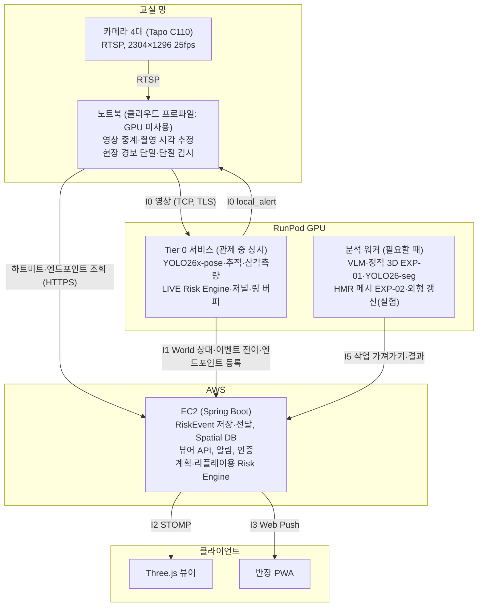
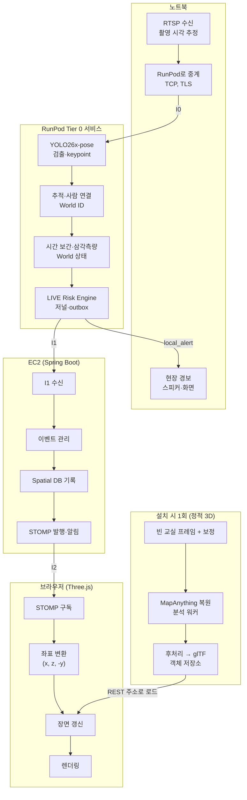

# 3. 시스템 구성과 배치

시스템은 현장 노트북(중계·현장 경보 단말), RunPod(Tier 0 실시간 처리와 무거운 분석), EC2(본부: 이벤트·기록·전달) 세 곳으로 나뉜다. v1.2부터 Tier 0 전체를 RunPod에서 처리한다. GPU 제약을 없애고 노트북을 단순하게 하는 대신, 인터넷과 클라우드에 의존하는 구성임을 명시한다(3.2, 17장).

## 3.1 구성 요소와 역할

| 구성 요소 | 실행 환경 | 역할 |
|---|---|---|
| 카메라 4대 | Tapo C110, 교실 Wi-Fi망 | RTSP 영상 송출 |
| 노트북 | 교실망, Python. GPU(RTX 4070 Laptop, 8GB 예상)는 클라우드 프로파일에서 쓰지 않음 | RTSP 수신, 촬영 시각 추정(3.9), RunPod로 영상 중계(TLS), 현장 경보 단말(스피커·화면), 이중 하트비트 감시. 교실망 NTP 서버 역할은 보류(3.9). 현장 프로파일 대체 경로 후보(3.12) |
| RunPod Tier 0 서비스 | GPU Pod 하나(관제 중 상시, 운영 리전은 3.12), Python. 분석 워커와 같은 Pod·GPU를 쓰되 별도 프로세스 | YOLO26x-pose 검출·추적·2D keypoint, 카메라 간 연결·시간 보간·삼각측량·World 상태, LIVE Risk Engine·이벤트 저널, 이벤트 클립 링 버퍼, 기동 시 엔드포인트 등록(3.12). PPE 검출은 확장(부록 C) |
| RunPod 분석 워커 | Tier 0와 같은 GPU Pod 안의 별도 프로세스(자원 상한 적용, 3.2), Python. 관제가 없는 개발 시간에는 같은 Pod에서 단독 실행(개발·시연: 일본 AP-JP-1 H100, 3.12) | EC2에서 작업을 가져가(12.5) 실행: VLM 근거(Cosmos3-Nano Reasoner, 5.4), 정적 3D(MapAnything Native / EXP-01), YOLO26-seg 마스크, 보정 번들 조정, 비동기 HMR(Fast SAM 3D Body / EXP-02), 관측 기반 외형 갱신 실험 |
| 외부 LLM API | 외부 서비스(“GPT 6.1 sol”, 5.4) | TBM 보고서 문장, RAG 답변 등 텍스트 생성. 텍스트만 보낸다. 호출 위치(분석 워커의 `tbm_report` 작업 또는 EC2)는 확인 필요 |
| EC2 | AWS(EC2 또는 Lightsail 중 지급 서비스로 정함, 확인 필요), Spring Boot 4·Java 21 | RiskEvent 저장·생명주기·알림 라우팅, 규칙·구성 묶음 배포, Risk Engine 컨테이너(계획·리플레이·What-if), Spatial DB, 뷰어 API·실시간 스트림, PWA 알림, Tier 0 엔드포인트 중계, 인증 |
| 객체 저장소 | S3 또는 Lightsail 버킷 | 이벤트 클립, 조치 사진, 정적 3D 자산(glTF). 수명 주기 규칙으로 자동 삭제 |
| 클라이언트 | 브라우저, 휴대폰 | Three.js 뷰어, 반장 PWA. 워치 앱은 확장(부록 C) |

데이터 흐름의 원칙: 카메라 영상은 관제 중 RunPod Tier 0 서비스로 상시 전송되지만 저장하지 않는다(링 버퍼만, 11.5). 영상은 EC2를 거치지 않고, EC2에는 World 상태·이벤트 같은 결과만 간다. 2D 관측 원본도 RunPod Network Volume 에 두고 EC2 로 보내지 않는다(11.2).

## 3.2 배치 결정

- Tier 0(정의는 5장 첫머리)는 RunPod의 한 서비스에서 관측부터 LIVE 판정까지 끝까지 처리한다. 검출 결과를 다른 곳으로 보내 융합하지 않으므로 중간 왕복이 없다.
- 노트북은 GPU 작업을 하지 않는다. 영상 중계, 촬영 시각 추정, 현장 경보, 감시만 맡는다.
- Tier 0와 분석 워커는 **GPU Pod 하나**에서 별도 프로세스로 실행한다(World Track Manager 하나, LIVE Risk Engine 정본 하나). GPU를 나눠 쓰므로 다음 규칙을 둔다.
  - Tier 0 프로세스가 GPU 메모리를 먼저 확보한다. 분석 워커는 남은 메모리 안에서 상한을 두고 실행한다(예: vLLM `gpu_memory_utilization` 제한, 동시 요청 수 제한). 아래 GPU 메모리 예산표를 따른다.
  - Tier 0 지연(`capture_to_risk`, `queue_wait_ms`)이 6.6 목표를 넘으면 분석 워커의 새 작업을 멈추고 대기열에 둔다. 우선순위는 Tier 0 > VLM 빠른 경로 > 보고서·사후 요약 > 그 밖의 작업이다.
  - EXP-01·02 같은 대형 오프라인 Job은 LIVE 관제 시간에 실행하지 않는다.
  - 분석 워커 프로세스가 죽거나 메모리 부족이 나도 Tier 0 프로세스는 계속 동작해야 한다(프로세스 분리, 6.5).
  - GPU가 부족하면 같은 Pod의 GPU 등급을 올리고, 그다음 VLM 처리 주기와 동시 요청 수를 조정한다(VLM 모델은 5.4 로 고정). GPU Pod를 2개로 늘리는 구성은 쓰지 않는다. Tier 0 분산(샤딩, 중앙 Fusion, 리더 선출, 장애 전환)은 MVP 범위 밖이다.
- 이중 감시: 노트북은 끊긴 대상에 따라 현장 표시를 달리한다(RunPod Tier 0나 영상이 끊기면 “관제 중단”, EC2만 끊기면 “원격 관제 장애”, 3.10). EC2는 RunPod Tier 0나 노트북 하트비트가 끊기면 System Health를 UNSAFE_UNKNOWN으로 바꾸고 PWA·관리자 화면에 알린다. 노트북은 EC2에도 1초마다 HTTPS 하트비트(`laptop_heartbeat`, 기기 토큰)를 보내며 Tier 0 연결 상태를 함께 알린다. 그래서 EC2는 Tier 0 하트비트가 끊겨도 노트북이 Tier 0 정상을 알리면 “원격 전달 단절(현장 경보 동작 중)”, 노트북도 Tier 0 끊김을 알리면 “관제 정지”로 구분해 표시한다. 두 경우 모두 System Health는 UNSAFE_UNKNOWN이다.
- **하트비트 장애 판정.** 받는 쪽의 단조 시계로 재고, 1초 주기 하트비트가 3회 연속 오지 않으면 장애로 본다. Tier 0 정상 여부는 소켓이 살아 있는지가 아니라 처리가 진행되는지(`t_latest_global`이 증가하는지)로 판정한다. 반쯤 열린 TCP 연결은 운영체제가 알려주지 않으므로 애플리케이션 하트비트로 끊는다(6.5).
- 이 구성은 DeploymentProfile의 “클라우드” 프로파일이다. 인터넷이나 RunPod가 멈추면 위치 추적과 판정이 함께 멈춘다(17장). 엣지에서 독립 동작하는 “현장” 프로파일(노트북이나 현장 GPU에서 Tier 0 실행)은 같은 코드로 전환할 수 있게 유지한다.

클라우드 프로파일은 연구·교육용 시연 구성이다. 지연 목표(6.6)는 시험 목표이며, 현장에서 안전 경로가 독립적으로 동작한다는 주장은 현장 프로파일을 별도로 실증해야 할 수 있다.

**GPU 메모리 예산표.** 같은 H100 80GB 에 올리는 프로세스별 상한이다. 값은 G0 에서 실측해 채운다.

| 프로세스 | 내용 | 메모리 상한 |
|---|---|---|
| Tier 0 | YOLO26x-pose TensorRT 엔진 + 하드웨어 디코더 4개 | G0 실측 |
| VLM | Cosmos3-Nano(16B) 가중치 + KV 캐시(vLLM `gpu_memory_utilization`) | G0 실측 |
| 마스크 | YOLO26-seg | G0 실측 |
| HMR(EXP-02 채택 시) | Fast SAM 3D Body | G0 실측(상한) |
| MapAnything | 설치 때 단독 실행(관제 중 실행 안 함) | — |

**Risk Engine 배치.** Risk Engine은 Python 라이브러리 하나로 구현하고 두 곳에 배포한다. 같은 규칙을 Java로 다시 구현하지 않는다.

- RunPod Tier 0 서비스: LIVE 판정. 판정 직후 노트북으로 `local_alert`를 보내 현장 경보를 울리고(EC2를 거치지 않는 가장 짧은 경로), 이벤트는 outbox를 거쳐 EC2로 보낸다. EC2가 끊겨도 RunPod가 살아 있으면 판정과 현장 경보는 계속된다.
- EC2 옆 Python 컨테이너: PLANNED·REPLAY·WHAT_IF 계산. 같은 코드, 같은 규칙 버전.
- Spring Boot: 규칙·구성 묶음 배포, RiskEvent 저장·생명주기, 알림 라우팅, API.
- 두 배포의 동일성은 같은 규칙 버전과 공통 테스트 벡터(입력과 기대 출력 세트)로 CI에서 검증한다.

**이벤트 소유권과 outbox.** LIVE RiskEvent의 생명주기 정본은 RunPod Tier 0 서비스다.

- Tier 0 서비스: RAISED → UPDATED → RESOLVED 전이를 확정한다. 전이마다 `risk_event_transition`(I1)을 이벤트 저널(Network Volume에 추가만 하는 내구성 로그)에 기록하고 EC2로 보낸다. outbox는 별도 저장소가 아니라 저널에서 acked_offset 이후 구간이다(아래 저널 계약).
- EC2: 영속 저장, 조회, 알림 전달, 운영자 조치(ACK·티켓), 화면용 projection을 맡고 전이를 새로 만들지 않는다. `(event_id, event_sequence)`로 중복을 제거하고 순서를 검증하며, 낮은 sequence가 늦게 오면 기록만 한다.
- 운영자 ACK는 EC2 → Tier 0 서비스 → 노트북으로 전달해 현장 경보의 반복 소리를 멈춘다. 관리자(관제 화면)·반장(PWA)·현장 확인 버튼 중 누가 확인해도 소리를 멈추고, 점멸 표시는 해소까지 유지한다. 누가 확인했는지는 저널에 남긴다.
- **재동기화 알림 규칙:** 원칙은 최종 상태를 확인한 뒤에만 알린다는 것이다. EC2 연결이 복구되면 EC2는 동기화 모드로 들어가 outbox 전이를 sequence 순서대로 받아 기록만 하고 실시간 알림은 보류한다. 빈 구간은 다시 요청한다(`journal_ack`). 재전송이 끝나면 Tier 0 서비스가 `event_state_snapshot`을 보내고, EC2는 이를 받은 뒤에만 동기화 완료로 전환한다. 그 시점에 여전히 활성이고 최근 유효 관측 근거가 있는 이벤트만 DELAYED_ACTIVE로 알리고, 해소된 이벤트는 감사 기록으로만 복원한다. 경과 시간만으로 알림을 억제하지 않는다.
- 노트북 쪽 현장 경보의 재동기화는 3.10 을 따른다.

**식별자 규칙.** `event_id`는 UUIDv7(시간 순서, 재시작·여러 현장에서도 충돌 없음)로 만들고 Tier 0 인스턴스 식별자 `gateway_id`를 함께 싣는다. `event_sequence`는 이벤트별 단조 증가값이며 이벤트 저널과 함께 **Tier 0 Pod와 같은 데이터센터의 Network Volume**(3.12)에 저장해 Pod 교체 후에도 이어진다. 새 Pod는 시작 시 저널의 acked_offset 이후 전이부터 재전송한다.

**재시작 복구.** outbox는 보내지 못한 메시지만 살린다. 이벤트 상태는 따로 체크포인트한다.

- Tier 0 서비스는 활성 RiskEvent(상태·sequence), `config_version`, 마지막으로 처리한 촬영 시각, `last_applied_journal_offset`을 Network Volume에 주기적으로(초기값 1초) 체크포인트한다.
- MVP 는 World Track 을 체크포인트하지 않는다. 재시작하면 Track 없이 새로 시작하고 모든 사람은 재관측으로 새 World ID 를 받는다. Track 체크포인트 복원과 재관측 매칭은 확장이다(부록 C).
- 복원한 활성 이벤트는 검증 상태를 UNVERIFIABLE로 바꾸고 자동 해소하지 않으며 운영자 확인을 요청한다. 재관측된 사람에게 같은 위험이 다시 걸려 새 이벤트가 생기면 이전 이벤트와의 연결(`related_event_id`)을 남긴다.
- 복구 중 System Health는 재관측·시간 동기화가 확보되기 전 UNSAFE_UNKNOWN, 일부 유효 관측이 확보된 뒤 DEGRADED, 커버리지·보정·지연이 정상으로 돌아오면 NOMINAL이다.

**복구 순서.** 이벤트 전이는 이벤트 저널이 정본이고, 체크포인트는 그 시점까지의 요약일 뿐이다. outbox는 전송 대기열이라 복구에 쓰지 않는다.

1. 마지막 체크포인트를 복원한다.
2. 이벤트 저널에서 체크포인트의 last_applied_journal_offset 이후 전이를 sequence 순서대로 다시 적용한다(체크포인트에 RAISED, 로그에 그 뒤의 RESOLVED가 있으면 RESOLVED가 최종).
3. 그 결과 활성인 이벤트를 UNVERIFIABLE로 두고 운영자 확인을 요청한다. World Track 은 새로 시작한다.

**저널 계약.** 기록은 한 곳(이벤트 저널)뿐이고 전송 대기열은 그 저널의 한 구간이다. 그래서 “저널에는 있는데 전송 대기열에는 없는” 상태가 생기지 않는다.

- 저널의 모든 기록에 전역 단조 증가 `journal_offset`을 붙인다. 이벤트별 `event_sequence`와는 다른 값이다.
- outbox = `acked_offset` 이후의 저널 구간. 전송은 늘 이 구간을 읽어 보내고, EC2 ACK(`journal_ack`)마다 `acked_offset`을 영속 저장한다.
- 체크포인트에는 `last_applied_journal_offset`을 저장한다. 저널은 `min(acked_offset, last_applied_journal_offset)` 이전 구간만 정리한다.
- 저장 방식: 단일 작성자의 추가 전용 파일 + 기록마다 fsync를 기본안으로 한다. SQLite는 네트워크 파일시스템 사용이 권장되지 않고 WAL 모드는 같은 호스트의 공유 메모리를 전제하므로 Network Volume에는 쓰지 않는다. 어느 방식이든 Network Volume에서 강제 종료 시험으로 영속성을 확인한다.
- 현장 경보(`local_alert`) 전송은 fsync 를 기다리지 않는다. EC2 로 보내는 전이만 fsync 가 끝난 뒤에 보낸다.
- 저널 쓰기는 판정 스레드와 분리한 별도 스레드에서 시간 제한을 두고 하며, 쓰기가 멈추는지 감시한다.
- 운영자 확인(EC2 ACK, 현장 확인 버튼)도 저널 이벤트로 기록한다.
- 이 계약은 Risk Engine 구현 태스크의 완료 조건이다.

**구성 묶음과 연결 단절 시 동작.** Tier 0 서비스가 판정하려면 판정 기준이 그 서비스 안에 있어야 한다.

- 구성 묶음(config bundle) = 구역, 규칙 버전, 보정 버전, Operational Geometry(바닥 평면·등록 정적 객체·작업면 OBB, 7.5), 각 버전 ID와 해시.
- EC2가 새 묶음을 발행하면 Tier 0 서비스가 내려받아 스키마·해시·참조 무결성을 검증하고 원자적으로 전환한 뒤, 적용 시각과 함께 ACK(`config_ack`)한다. EC2는 ACK 후에만 “현장 적용됨”으로 표시하고, 그 전에는 뷰어에 “적용 대기”를 표시한다.
- EC2와 연결이 끊기면 마지막 검증 묶음으로 계속 판정하고 Config Sync를 UNVERIFIED로 표시한다. 재접속 후 더 새 묶음이 있으면 STALE로 바꾸고 전환한다(6.2). 어느 상태든 판정은 멈추지 않는다.
- 모든 이벤트에 `config_version`을 기록하고, 리플레이·What-if는 그 시각에 적용돼 있던 버전을 쓴다.

**확장 가능한 계약.** 실제 운용은 C110 4대로 확정하되, 내부 인터페이스는 `camera_id` 기반 N-camera 구조로 둔다. 위치 추정은 PositionEstimator 인터페이스의 구현체(바닥 투영, 삼각측량, HMR 보강)로, 배치는 DeploymentProfile(클라우드, 현장)로 분리한다.

## 3.3 카메라 사양

Tapo C110 4대, 동일 하드웨어 버전. 해상도·fps·비트레이트·동시 접속·RTCP는 2026-10-16 실측값(S15P31A101-9, LTE 핫스팟 1차 측정, 공유기 환경 10분 측정 후 확정)이고 렌즈는 제조사 사양이다.

| 항목 | 값 |
|---|---|
| 해상도 | stream1 2304×1296(3MP), stream2 1280×720. H.264 High |
| 프레임률 | 앱 설정값이 RTSP에 그대로 적용된다(기본 15). 운영은 25 fps 고정(프레임 간격 40ms) |
| 키프레임 주기 | stream1 2초, stream2 3초 |
| 비트레이트 | stream1 약 1.1 Mbps, stream2 약 0.3 Mbps(25 fps) |
| RTSP 동시 접속 | 카메라당 최대 2세션. 3번째는 거부된다 |
| 카메라 시각(RTCP) | Sender Report는 약 0.5초마다 오지만, 연속 보고 사이 카메라 시각과 RTP 시계의 대응이 약 ±400ms 흔들려 그대로 쓸 수 없다(3.9) |
| 렌즈 | 3.3mm F2.0(제조사). 가로 화각 약 105°(판매처 정보, 미확인 — G1 보정에서 측정). 4대가 같은 렌즈이므로 내부 파라미터 초기값을 공유한다(4.3) |
| 네트워크 | 2.4GHz Wi-Fi 전용, 유선 포트 없음 |
| 프로토콜 | RTSP, ONVIF, NTP |
| 전원 | 9V DC, 3m 케이블 |

**카메라 설정(필수).** RTSP용 카메라 계정 생성, 4대 동일 fps 고정 25(펌웨어 업데이트·초기화 후 기본값 15로 돌아가는지 확인), 워터마크(로고·시각) 끄기, UPnP 끄기, 소리·조명 경보 끄기, 야간 자동 전환 끄기, 사생활 보호 모드·동작 감지 알림 끄기, 펌웨어 자동 업데이트 끄기(버전 기록), 화면 반전 설정 4대 동일, Tapo 클라우드 외부 접속 차단(18.1).

**RTSP 접속 규칙.** 게이트웨이는 카메라당 RTSP 세션을 하나만 연다. 동시 접속이 2세션으로 제한되므로, 운영 중 Tapo 앱 실시간 화면이나 VLC로 카메라에 직접 접속하지 않는다. 설치·점검 때는 노트북 현장 앱이 이미 받고 있는 스트림으로 미리보기를 본다(세션을 더 열지 않음). 운영 중 확인은 관제 화면의 카메라 상태 패널과 이벤트 클립으로 한다. 관제 화면에는 실시간 영상을 두지 않는다(영상은 EC2를 거치지 않음).

## 3.4 설치

| 항목 | 값 |
|---|---|
| 위치 | 교실 네 모서리, 교실 중앙(대각선 방향)을 향함 |
| 높이 | 2.6\~2.8m (천장 약 3m), 4대 동일 |
| 기울기 | 아래로 25\~28° (30° 이상이면 먼 쪽 머리가 화면 위로 잘릴 수 있음) |
| 거치 | 조명 스탠드, 다리에 무게 주머니, 통행로에서 벗어나 벽 쪽 |
| 사각 | 각 카메라 앞 약 2m는 그 카메라의 사각이며 다른 카메라가 덮음 |

## 3.5 네트워크

카메라는 Wi-Fi 전용이라 노트북과 같은 무선망에 있어야 한다. 아래 순서로 정한다.

1. 싸피 Wi-Fi 시험: 카메라 1대가 접속되고 노트북이 RTSP를 받을 수 있는지 확인(기기 간 통신 차단, 로그인 페이지 여부).
2. 실패 시 소형 공유기(권장): 카메라 4대를 공유기 Wi-Fi 에 붙이고, 노트북은 공유기에 유선 LAN 또는 USB 로 연결한다. 인터넷은 노트북의 싸피 Wi-Fi 로만 나간다(공유기 DHCP 는 기본 게이트웨이를 주지 않음, 18.1).
3. 공유기가 어려우면 노트북 핫스팟 + USB Wi-Fi 동글.

외부 연결은 노트북 → RunPod Tier 0(프레임 헤더를 붙인 압축 영상을 카메라별 TLS 연결로, 제어는 WebSocket. 12.7), 노트북 → EC2(하트비트·엔드포인트 조회, HTTPS), RunPod Tier 0 → EC2(WebSocket), RunPod 분석 워커 → EC2(작업 가져가기, 12.5), EC2 → 클라이언트(HTTPS·WebSocket·Web Push)다. RunPod Pod는 UDP를 지원하지 않으므로 영상은 TCP로 보낸다. 모든 연결은 노트북·RunPod·EC2가 먼저 거는 방향이라 교실망으로 들어오는 연결은 없고, RunPod 로 들어오는 연결은 Tier 0 영상·제어 포트뿐이다. 업로드는 카메라 4대 고화질 상시 전송으로 약 4.5 Mbps(실측 약 1.1 Mbps/대)이며, 재전송·흔들림 여유를 두어 10 Mbps 이상을 확보한다.

## 3.6 구성도

노트북은 영상을 중계하고 현장 경보를 울리며, RunPod Tier 0 서비스가 관측부터 판정까지 처리해 결과만 EC2로 보낸다. 분석 워커는 EC2에서 무거운 분석 작업을 가져가 처리하고, EC2는 결과를 뷰어·PWA로 전달한다. 워치(I4)는 확장이다(부록 C).

## 3.7 데이터 흐름: 카메라에서 Three.js까지

실시간 경로는 노트북 → RunPod Tier 0 → EC2 → 브라우저 순서이고, 현장 경보는 Tier 0에서 노트북으로 바로 간다. 정적 배경은 설치 시 한 번 만들어 같은 장면에 합친다.

1. 노트북은 RTSP 프레임에 추정 촬영 시각(3.9)을 붙여 RunPod Tier 0 서비스로 중계한다. 노트북은 GPU 작업을 하지 않는다.
2. Tier 0 서비스는 YOLO26x-pose로 사람과 2D keypoint를 찾고, 카메라별 트랙을 World ID로 묶은 뒤 시간 보간과 삼각측량으로 World XYZ와 3D 골격을 만든다. 이 값이 위험 판단의 위치 정본이다.
3. 같은 서비스의 LIVE Risk Engine이 규칙을 판정하고, 현장 경보는 `local_alert`로 노트북에 바로 보낸다. 이벤트 전이는 저널·outbox를 거쳐 EC2로 간다.
4. EC2는 `world_state`와 이벤트 전이를 받아 생명주기를 갱신하고 Spatial DB에 기록한 뒤 STOMP 토픽 `/topic/world`, `/topic/events`, `/topic/health`로 발행한다. PWA 알림도 이때 나간다.
5. 브라우저는 토픽을 구독해 World 좌표를 Three.js 좌표 (x, z, −y)로 바꾼 뒤 아바타·구역·경보를 갱신해 렌더링한다. 변환은 뷰어 어댑터 한 곳에서만 한다.
6. 정적 배경은 설치 시 EC2가 빈 교실 프레임과 보정 버전으로 정적 3D 작업을 만들고, 분석 워커가 그 작업을 가져가 MapAnything으로 복원한 뒤 glTF를 객체 저장소에 둔다. 뷰어는 REST로 COMMITTED Scene 주소를 받아 로드한다. 이 경로의 모델·후처리·품질은 EXP-01에서 선행 검증한다.
7. 인체 메시/외형은 EXP-02에서 Fast SAM 3D Body 기반 비동기 파이프라인으로 검증한다. World ID·timestamp·calibration_version·scene_version을 기준으로 Tier 0 상태에 맞춰 렌더링만 보강하며, 안전 판정 좌표·이벤트를 수정하지 않는다.

## 3.8 MVP 기술 스택

확정은 논의로 정한 것, 기본안은 팀 합의로 바꿀 수 있는 것, 후보는 게이트 측정으로 고를 것이다. 바꾸면 이 표와 부록 B를 함께 고친다.

| 위치 | 영역 | 기술 | 상태 |
|---|---|---|---|
| 교실 | 카메라·전송 | Tapo C110 4대, RTSP | 확정 |
| 노트북 | 수신·중계 | Python 3, PyAV(디코딩 없이 압축 프레임 단위로 읽기), 프레임 헤더 + 카메라별 TLS 연결(12.7) | 기본안 |
| 노트북 | 현장 경보·감시 | 소리·화면 경보 앱, 하트비트. 교실망 NTP 서버는 보류(3.9) | 기본안 |
| RunPod Tier 0 | 검출·keypoint | YOLO26x-pose(E2E, NMS-free), TensorRT FP16, imgsz 1280. COCO 17관절 + 발 6점 미세조정(15.4 A1) | 확정(크기 비교 안 함) |
| RunPod Tier 0 | 카메라별 추적 | 카메라별 독립 TrackTrack(Ultralytics `tracktrack.yaml`, 카메라 움직임 보정 `gmc_method: none`). ByteTrack·BoT-SORT + ReID 는 설정으로 전환 | 기본안 |
| RunPod Tier 0 | 사람 연결·삼각측량 | NumPy, OpenCV, SciPy(헝가리안 배정) | 기본안 |
| RunPod Tier 0 | LIVE 판정 | Risk Engine Python 라이브러리, 이벤트 저널·outbox(Network Volume) | 확정 |
| RunPod Tier 0 | World 추적 | MV3DT 원칙의 Python Global Tracker, World 칼만 필터, 늦은 재연결·ID 교정 | 기본안 |
| RunPod Tier 0 | 접지 추정 | ContactEstimator(발뒤꿈치·발끝 keypoint, 발목 높이·정지 여부·다시점 Z·등록 작업면) | 기본안 |
| RunPod 분석 | VLM | NVIDIA Cosmos3-Nano(16B) Reasoner 모드, vLLM 0.19.1 이상(`vllm-cosmos3`) | 확정(G7 합격 판정) |
| 외부 | LLM | 외부 API “GPT 6.1 sol”(텍스트만, 5.4) | 확정 |
| RunPod 분석 | 마스크 | YOLO26-seg, 새 물체·실측 정물은 YOLOE-26 | 기본안 |
| RunPod 분석 | 정적 3D | MapAnything Native, trimesh로 glTF (EXP-01) | 기본안·선행 실험 |
| RunPod 분석 | 인체 메시·외형 | Fast SAM 3D Body, MHR 메시, 연속 관측 기반 외형 갱신 (EXP-02) | 실험 후보·확장 채택 별도 승인 |
| RunPod 분석 | 자동 보정 | 단일 이미지 내부 파라미터 추정(GeoCalib·AnyCalib 류, 라이선스 확인 필요), HumanCalib, OpenCV solvePnP, SciPy least_squares | 기본안 |
| RunPod 분석 | 작업 워커(I5) | Python, EC2 작업 가져가기(long-poll 또는 WebSocket) | 기본안 |
| EC2 | 백엔드 | Java 21, Spring Boot 4(`server/`) | 확정 |
| EC2 | 실시간·API | Spring WebSocket(STOMP), Spring Web(REST) | 기본안 |
| EC2 | 인증 | Spring Security + JWT | 기본안 |
| EC2 | DB | PostgreSQL + TimescaleDB + PostGIS(이미지 `timescale/timescaledb-ha` -all 태그), Spring Data JPA | 확정(DB), 기본안(JPA) |
| EC2 | RAG 색인 | pgvector(같은 PostgreSQL) | 기본안 |
| EC2 | 계획·리플레이 판정 | Risk Engine Python 컨테이너 | 확정 |
| EC2 | 알림 | Web Push(VAPID) | 확정 |
| EC2 | 배포 | Docker Compose, Nginx + Let’s Encrypt | 기본안 |
| 저장소 | 객체 저장소 | S3 또는 Lightsail 버킷, 수명 주기 규칙 | 기본안 |
| 브라우저 | 뷰어 | React + Three.js(React Three Fiber), STOMP 클라이언트 | 기본안 |
| 휴대폰 | 반장 PWA | React PWA, Service Worker, Web Push | 기본안 |

## 3.9 시계 동기화

시간 모델(6.1) 전체가 공통 시계를 전제하므로 기준 시계를 하나로 정한다.

- 노트북과 EC2는 인터넷 NTP로 UTC에 맞춘다.
- 노트북을 교실망의 NTP 서버로 두어 카메라 4대가 노트북을 시각 기준으로 쓰게 하는 구성은, G0 에서 `CAMERA_STREAM`을 쓰기로 정할 때까지 보류한다. 기본값 `RECEIVE_ESTIMATED`는 카메라 자체 시계를 쓰지 않기 때문이다.
- 촬영 시각은 카메라 스트림의 시각이 신뢰할 만하면 그것을, 아니면 노트북 수신 시각에서 추정한 값을 쓴다. C110은 RTCP Sender Report의 카메라 시각이 연속 보고 사이 약 ±400ms 흔들리므로(3.3), 기본값은 `RECEIVE_ESTIMATED`다. 긴 구간 회귀로 보정해 `CAMERA_STREAM`으로 쓸 수 있는지는 G0 LED 시험으로 판단한다. 카메라 간 오프셋은 `health`의 `sync_offset_ms`로 계속 측정한다.
- PWA·뷰어의 시각은 EC2 기준으로 표시한다.

**촬영 시각 추정(RECEIVE_ESTIMATED).** 수신 시각을 그대로 쓰면 Wi-Fi 도착 흔들림이 그대로 들어가므로 다음처럼 추정한다.

- 카메라 PTS(RTP 시계)의 간격을 믿고, 원점과 표류만 노트북 수신 시각으로 맞춘다. 맞추는 기준은 수신 시각의 하한 포락선(가장 덜 늦게 도착한 프레임들)이다.
- 하한은 긴 창에서 직선으로 맞춰, 추정 촬영 시각이 계단처럼 뛰거나 거꾸로 가지 않게 한다.
- 카메라별 고정 지연(노출 → 노트북 수신, G0 LED 시험으로 측정)을 뺀다.
- PTS 가 없으면 수신 시각 − 고정 지연을 쓰고 불확실성을 더 크게 둔다.
- 원본 수신 시각과 PTS 를 함께 기록해, 고정 지연이 정해지면 다시 계산할 수 있게 한다.
- 현재 구현(`gateway/recorder` 의 `capture_time.py`)은 창 안 최솟값으로 원점을 맞춘다. 긴 창 직선 맞춤 반영 여부는 확인 필요.

**노트북–Pod 시계 차이.** Tier 0 는 I0 제어 채널에서 NTP 식 4-타임스탬프 교환(요청 송신·수신, 응답 송신·수신 시각)으로 노트북 시계와 자기 시계의 차이와 그 불확실성을 추정하고 `health` 로 보고한다. 왕복 시간이 가장 짧은 표본을 쓴다. 6.1 의 T_lag 계산은 이 값으로 노트북이 붙인 촬영 시각을 Tier 0 시계로 옮겨 쓴다.

**촬영 시각 계약.** NTP로 시계가 맞아도 카메라마다 노출 순간은 다르다(25 fps에서 프레임 간격 40ms). 그래서 다음을 규칙으로 둔다.

- 모든 프레임·관측에 `timestamp_source`(CAMERA_STREAM / RECEIVE_ESTIMATED / FILE / SIM), `estimated_capture_time`, `timestamp_uncertainty_ms`를 붙인다(I1 포함).
- 삼각측량 전에 각 카메라의 2D keypoint를 공통 시각으로 시간 보간한다.
- 불확실성이 기준(초기값 25ms)을 넘는 카메라는 그 시각의 삼각측량에서 뺀다. 남은 카메라가 2대 미만이면 바닥 투영 대체(접지 표면이 검증된 경우만, 5.2)와 넓은 불확실성을 쓴다.
- 동기화가 유효하지 않으면 다시점 3D 위치를 안전용으로 확정하지 않는다(관측 상태와 System Health에 반영).

## 3.10 경보 장치 (MVP)

MVP의 현장 경보는 노트북 로컬 경보(1차)와 관제 화면 경보(2차)로 한다. 별도 사이렌 장치는 두지 않는다.

- 노트북 로컬 경보: RunPod Tier 0 서비스가 CRITICAL·HIGH를 판정하면 `local_alert`를 노트북으로 바로 보내고, 노트북 스피커·화면이 울린다. EC2를 거치지 않는 가장 짧은 경로다.
- 관제 화면 경보: Three.js 뷰어와 2D 비상 화면에서 소리·점멸. EC2를 거쳐 오는 두 번째 채널이다.
- 소리는 확인(ACKNOWLEDGED)될 때까지 반복하고, 표시는 해소(RESOLVED)될 때까지 유지한다.
- 노트북 표시는 장애 종류별로 나눈다(아래 표). 현장 경보가 살아 있는데 멈춘 것처럼 표시하지 않는다.
- 보내는 채널의 정본은 7.3 표다.

**현장 경보 재동기화.** 노트북이 재접속하거나 `local_alert`·`alarm_stop`을 놓쳐도 현장 경보가 실제 상태와 어긋나지 않게 한다.

- Tier 0 는 노트북이 (재)접속한 직후와 1Hz `health` 마다 활성 현장 경보 목록(`event_id`, `event_sequence`, `acknowledged`)을 노트북에 보낸다.
- 노트북은 이 목록에 맞춰 소리·표시를 켜고 끈다. 목록에 있으면 표시하고, `acknowledged`이면 소리만 멈추며, 목록에서 빠지면(해소) 표시를 내린다.
- 중복 판단은 `(event_id, event_sequence)`로 한다.
- 계약 반영(목록 필드)은 후속 계약 변경으로 한다.

**시험 알림.** 시작 절차의 소리·푸시 확인(18.1·18.2)은 RiskEvent 를 만들지 않는 별도 경로로 한다. 노트북은 로컬 시험음을 재생하고, 반장 PWA 는 `POST /api/push/test`로 시험 푸시를 받는다. 모든 시험 알림에는 “시험”을 표시한다. LIVE 출처만 실제 알림으로 나간다는 규칙(2장 원칙 10)을 지키기 위해서다.

| 상황 | LIVE 판정 | 현장 경보 | 노트북 표시 |
|---|---|---|---|
| EC2만 단절 | 계속 | 정상 | “원격 관제 장애” (PWA·관제 화면 전달 지연) |
| RunPod Tier 0 중단 | 중단 | 불가 | “관제 중단” (위험 감시 중단) |
| 노트북 → RunPod 영상 단절 | 유효 관측 중단 | 불가 | “관제 중단” (위험 감시 불가) |
| 분석 워커 중단 | 계속 | 정상 | “AI 분석 지연” (작게 표시) |

**현장 확인.** EC2가 끊기면 운영자 ACK가 노트북에 닿지 않으므로 노트북에 현장 확인 버튼을 둔다. 누르면 반복 소리를 멈추고(표시는 해소 전까지 유지), 확인 사실을 I0 제어 채널(`site_ack`)로 Tier 0에 보내 저널 이벤트로 기록한다. EC2가 복구되면 재동기화로 반영된다.

## 3.11 시스템 지표

노트북·EC2·RunPod는 구간별 처리 지연(타임스탬프), FPS, 큐 길이, GPU 사용률, 프레임 손실을 `system_metric`에 기록하고, 관제 화면의 상태 패널에서 본다. G0·G6의 지연 측정은 이 기록을 근거로 한다. 기본안은 EC2에 Spring Boot Actuator + Micrometer(외부 비공개, 14장), 노트북은 `health`·`laptop_heartbeat` 메시지로 전송이다.

## 3.12 RunPod 리전·GPU·저장소

크레딧 관리를 위해 한 시점에는 한 리전만 운영한다. 2026-10-16부터 개발·실험·시연을 모두 일본 리전(AP-JP-1)에서 한다. 그전 개발 데이터센터는 캐나다 ca-mtl-1(A40)이었고, 노트북에서 종단 지연이 커서(아래 실측) 시연 전 이전을 앞당겼다. 캐나다 볼륨은 삭제했다. GPU Pod는 하나이며 Tier 0와 분석 워커가 함께 쓴다(3.2).

| 단계 | GPU | 저장소 |
|---|---|---|
| 개발·실험·시연 준비·리허설·시연 | 일본 AP-JP-1 H100 80GB(SXM) | 같은 데이터센터(AP-JP-1)의 Network Volume |
| 현장 프로파일 대체 경로(후보) | 시연 노트북 RTX 4070 Laptop | 노트북 로컬 디스크 |

**GPU 사용 원칙.** H100은 시간당 비용이 크다. 코드·설치 스크립트·실험 큐는 노트북에서 미리 완성하고, GPU Pod는 준비된 큐를 실행해 검증할 때만 켠 뒤 바로 Stop 한다. 환경 설치는 가능하면 같은 데이터센터의 CPU Pod에서 한다(대상 GPU 아키텍처를 지정해 빌드). 시연 당일은 예외로, 아침에 Pod 를 확보해 끝까지 유지한다(18.2).

**연결.** 노트북(게이트웨이)과 RunPod Pod 사이는 Tailscale을 쓰지 않는다. SSAFY망은 SSH·임의 포트·UDP를 막아 Tailscale이 DERP 중계(토론토)를 탔고, 업로드가 약 2.4 Mbps로 막혔다.

- 영상(I0): Pod 공개 TCP 포트로 Direct TCP. Tier 0가 TLS를 직접 종료하고 노트북 기기 토큰으로 인증하며, 노트북은 Tier 0 공개키를 고정해 서버를 확인한다(12.7). 카메라마다 연결을 따로 연다. 한 연결을 카메라 4대가 공유하면 한 카메라의 지연이 다른 카메라까지 막으므로 SSH 터널로 보내지 않는다.
- 개발·운영 접속: Pod 공개 IP:포트로 SSH 직접 연결(키 인증만). 설치·실험 큐 실행·로그 확인에 쓴다. 공유기 망에서 SSH나 서비스 포트가 막히면 관리자 허락을 받는다.
- 예비(막힌 망): RunPod HTTPS 프록시(`https://<POD_ID>-<포트>.proxy.runpod.net`, 443) 위 WebSocket. 토큰 인증 필수(주소가 공개). 중간 서버를 거쳐 지연이 늘 수 있고, RunPod 문서상 프록시 연결은 최대 100초로 끊긴다.

**엔드포인트 등록.** RunPod 문서에 따르면 Pod 가 재설정될 때마다 외부 포트 매핑이 바뀐다(“External port mappings change whenever your Pod resets”, https://docs.runpod.io/pods/configuration/expose-ports). 그래서 노트북에 주소를 고정해 두지 않는다.

- 포트는 70000 이상 번호로 요청하는 대칭 매핑을 쓰고, 실제 공개 포트는 `RUNPOD_TCP_PORT_*` 환경 변수로 얻는다.
- Tier 0 는 기동할 때 공개 IP 와 `RUNPOD_TCP_PORT_*` 값을 I1 으로 EC2 에 등록한다(메시지 이름은 후속 계약).
- 노트북은 EC2 REST(기기 토큰, 12.6)로 현재 엔드포인트를 받아 접속한다.

**시연장 망 위험.** Direct TCP 는 임의 포트를 쓰므로 시연장 망에서 막힐 수 있고, 443 프록시는 연결이 최대 100초로 끊긴다. 시연장 망에서 Direct TCP 와 프록시를 각각 10분 이상 연속 시험하고, LTE 테더링을 두 번째 업링크로 준비한다(18.1, 부록 E).

| 실측(2026-10-16, 노트북 웹캠 → HMR 라이브) | 왕복 | 업로드 | 종단 지연 p50 |
|---|---|---|---|
| 캐나다 A40, Tailscale(DERP 중계) | 185 ms | 약 2.4 Mbps | 1,379 ms |
| 캐나다 A40, HTTPS 프록시 443 | — | 약 9.6 Mbps | 942 ms |
| 일본 H100, SSH 직접 | 43 ms | 약 39 Mbps | 450 ms (GPU 처리 150~280 ms 포함) |

일본 H100 실측을 어느 망에서 했는지는 확인 필요다(SSAFY망은 SSH 를 막는다). 다음 측정부터는 망을 함께 기록한다.

**저장소 규칙.**

- Network Volume은 데이터센터에 묶여 있다. Pod는 볼륨과 같은 데이터센터에서만 띄운다.
- 이벤트 저널, 체크포인트, `acked_offset`, 2D 관측 Parquet(11.2)은 Tier 0 Pod와 같은 데이터센터의 Network Volume에 둔다(3.2 저널 계약).
- RunPod 글로벌 볼륨(베타)은 쓰지 않는다(16장).
- Python·CUDA·Torch 환경은 모델별 Docker 이미지로 만들고 볼륨에 설치하지 않는다. 볼륨에는 가중치, 데이터, 실험 산출물, TensorRT 엔진 캐시만 둔다. 리전을 옮길 때 이미지는 다시 받기만 하면 된다. E-GATE-0은 예외로 볼륨 환경 + 잠금 파일(env_hash)을 쓰고, Docker 이미지는 E-GATE-1 전에 만든다.
- 가중치 해시 목록과 Run 요약은 GitLab에도 남겨, 볼륨을 잃어도 무엇을 다시 받아야 하는지 알 수 있게 한다.
- 비밀 값(HF 토큰, Tier 0 TLS 개인키 등)은 볼륨의 비공개 폴더에만 둔다. Network Volume은 파일 권한(chmod)이 적용되지 않으므로 볼륨을 다른 Pod에 붙일 때 주의한다.

**리전 이전 절차**(다시 옮겨야 할 때).

1. 옮길 목록을 정한다: 가중치, 설정, 필요한 실험 산출물, 데이터셋(동의 범위 안의 것만). 환경은 옮기지 않고 대상 GPU에서 설치 스크립트·Docker 이미지로 다시 만든다(GPU 아키텍처가 바뀌면 CUDA 확장 재빌드). 개발 중의 저널·체크포인트는 시험용이므로 옮기지 않는다.
2. 대상 데이터센터에 Network Volume을 만든다(그 데이터센터에서 원하는 GPU에 볼륨을 붙일 수 있는지 먼저 확인).
3. 원본 볼륨과 대상 볼륨에 각각 Pod를 띄우고 rsync over SSH(또는 runpodctl)로 복사한다.
4. 해시 목록을 비교하고, Tier 0를 띄워 기동을 시험한다.
5. 대상 GPU에서 TensorRT 엔진을 빌드하고 G0의 지연 항목을 다시 잰다.
6. 확인이 끝나면 원본 볼륨을 정리한다(크레딧).

**시연 GPU 가용성.**

- 일본 H100 재고는 보장되지 않는다. Pod를 Stop 하거나 Terminate 하면 같은 GPU를 다시 못 잡을 수 있다(볼륨은 남는다). Network Volume 을 붙인 Pod 를 Stop 할 수 있는지는 확인 필요다.
- 대체 순서(초기안): 일본 H100 → 일본의 다른 등급(H200 SXM 등) → 미국 리전. 시연이 아예 안 되는 것보다 지연이 큰 편이 낫다.
- 리허설 전(초기값 시연 D-14)에 일본 GPU 확보 가능성과 `capture_to_site_alert` 실측을 확인한다. 리허설과 시연은 같은 리전, 같은 GPU 등급으로 한다.
- 리전이나 GPU가 바뀌면 G0의 지연 항목을 다시 잰다. 다른 GPU에서 잰 수치를 시연 성능으로 보고하지 않는다.

**GPU별 엔진.** TensorRT 엔진은 GPU 아키텍처마다 다르다(A40 sm_86, RTX 4070 sm_89, H100·H200 sm_90). ONNX와 빌드 설정을 정본으로 두고, 엔진은 `{model}/{gpu_arch}/{tensorrt_version}` 경로의 산출물로 관리하며 볼륨에 캐시한다. 시연 GPU가 정해지면 그 GPU에서 빌드하고 G0을 다시 잰다.

**노트북 GPU.** 시연 노트북의 RTX 4070 Laptop(8GB 예상)은 클라우드 프로파일에서 쓰지 않는다. 인터넷이나 RunPod 장애 때 현장 프로파일 대체 경로(YOLO26-pose 기반 Tier 0)의 후보로 두고, 노트북에서 4대 동시 처리 FPS와 지연을 잰 뒤 채택 여부를 정한다. 모델은 x 를 먼저 재고, 노트북에서 카메라당 12 FPS 에 못 미치면 m·s 로 낮춘다(현장 프로파일만). EXP-01·02 같은 대형 모델은 노트북에서 돌리지 않는다.
