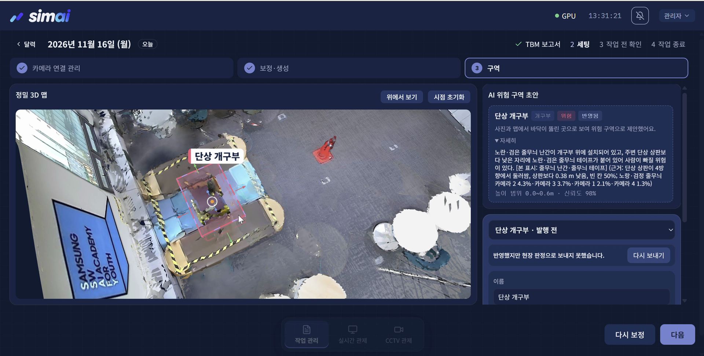
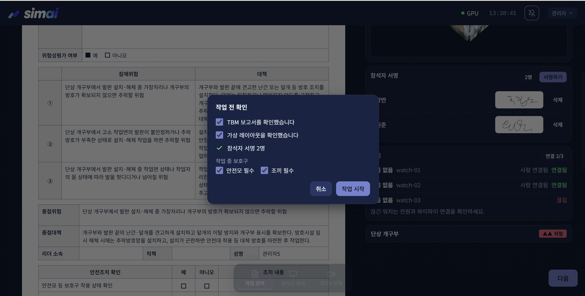
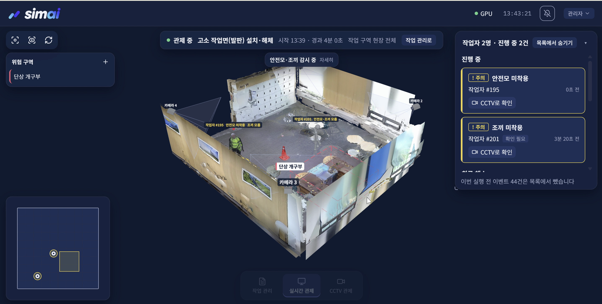
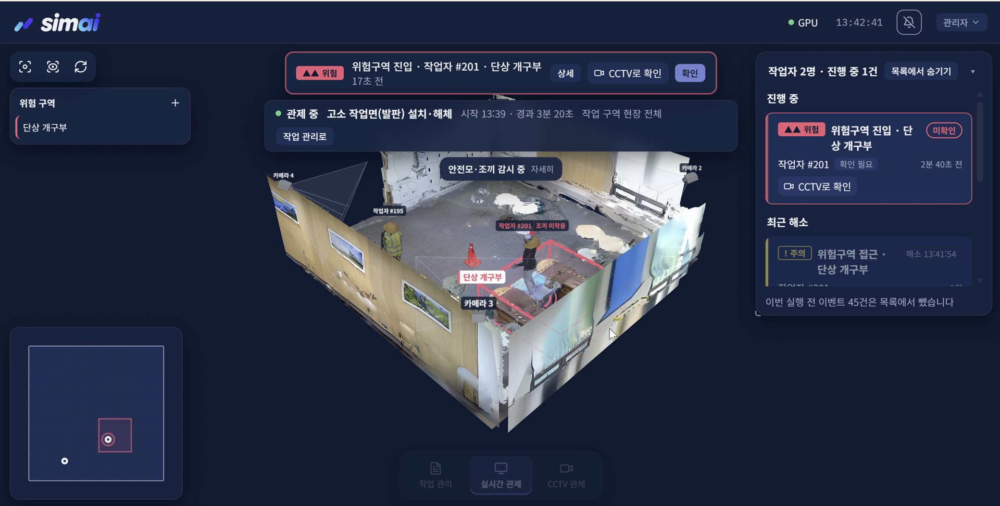
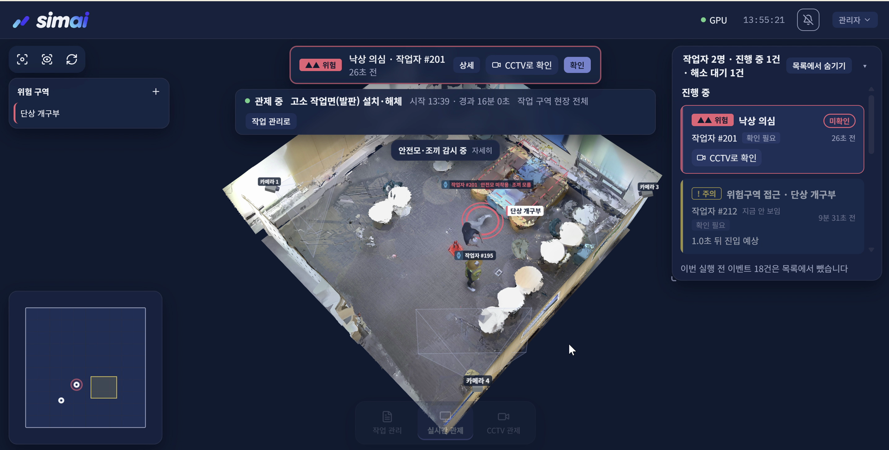
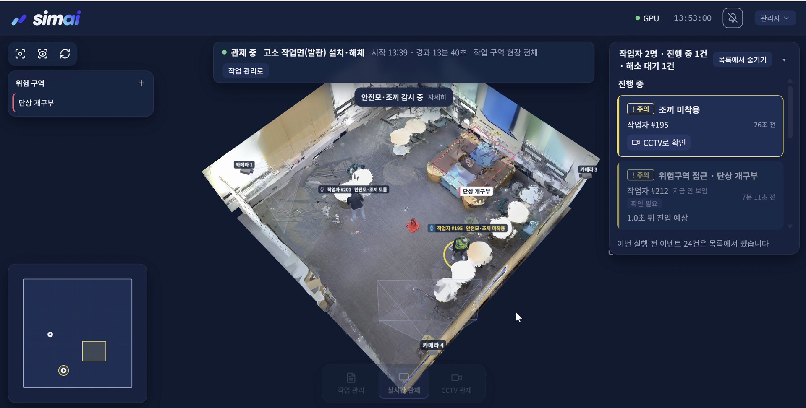
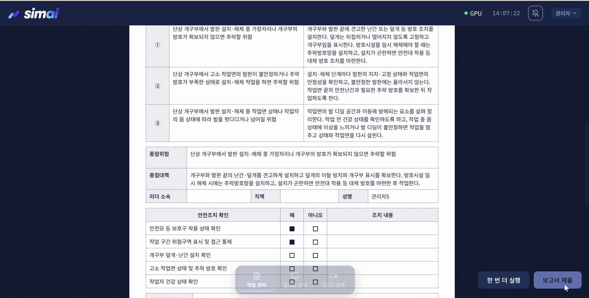
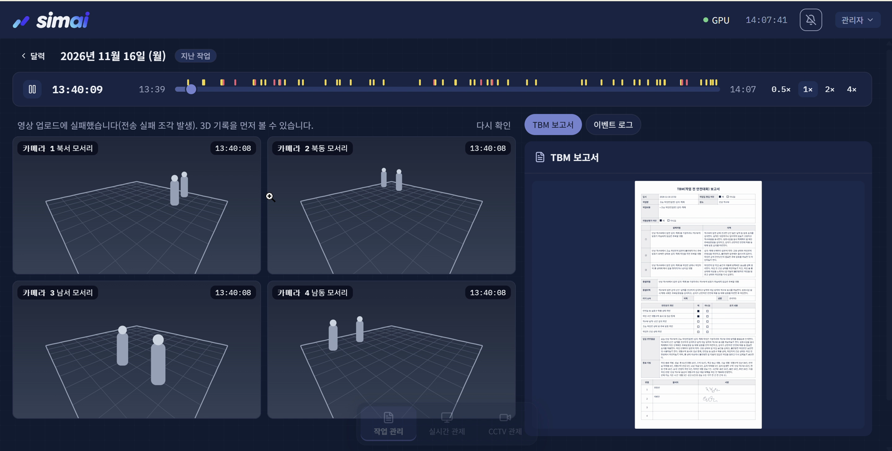

# simai 시연 시나리오 (2026.11.13 최종, 포팅 매뉴얼용 보강)

| 항목 | 내용 |
| --- | --- |
| **시연 일자** | 2026.11.13 기준 시나리오 |
| **총 소요 시간** | 약 8분 30초 |
| **전체 장면** | 8개 (장면 0~7) |
| **진행 순서** | **0 → 1 → 2 → 3 → 4 → 5 → 7 → 6** |
| **시연 장소** | 로비 테스트베드 |
| **현장 구성** | 단상 2개, 중앙 개구부, 노란·검은 난간, 추락주의 표지 |
| **참여 인원** | 연기자 2명(A·B), 각각 스마트워치 착용 |
| **심사위원 화면** | 관제 화면 및 현장 실시간 중계 |
| **사전 고지** | 교실 테스트베드 고소 기준 0.35m / 실제 운영 기준 2.0m |
| **핵심 시연 기능** | 3D 공간 인식, 고소·낙상 감지, PPE 감지, 위험구역 접근 경보, 워치 알림, 사후 분석 |

---

## 0. 시연용 테스트 계정 및 사전 준비

### 0.1 테스트 계정

| 용도 | 접속 위치 | 아이디 | 비밀번호 | 역할 | 비고 |
| --- | --- | --- | --- | --- | --- |
| 관제 관리자(시연 계정) | `https://<DOMAIN>/login` | `admin` | `<DEMO_PASSWORD>` | ADMIN | `user_id=1` 이어야 시연 맵·준비된 맵 동작이 켜진다(`SIMAI_DEMO_USER_IDS`, `front/apps/admin/src/features/demo/demoAccount.ts`) |
| 워치 A | 갤럭시워치 앱 | 기기 ID `<WATCH_A_ID>` (예: `watch-01`) | 기기 토큰 `<WATCH_A_TOKEN>` | WATCH | 연기자 A 착용 |
| 워치 B | 갤럭시워치 앱 | 기기 ID `<WATCH_B_ID>` (예: `watch-02`) | 기기 토큰 `<WATCH_B_TOKEN>` | WATCH | 연기자 B 착용 |
| gateway 노트북 | 루트 `.env` | `SIMAI_LAPTOP_ID=<LAPTOP_ID>` | `SIMAI_DEVICE_TOKEN=<DEVICE_TOKEN>` | LAPTOP | 경보 단말·영상 중계 |

계정 생성(EC2):

```sh
C="docker compose --env-file /opt/simai/.env -f /opt/simai/repo/deploy/ec2/compose.yaml"
$C run --rm server admin create-user --login admin --role ADMIN --label "<표시 이름>"
$C run --rm server admin device register --id <WATCH_A_ID> --kind WATCH     # 출력된 토큰을 워치에 넣는다
$C run --rm server admin device register --id <LAPTOP_ID> --kind LAPTOP
```

화면만 확인할 때는 FE 를 `VITE_API_MOCK=true` 로 띄우고 목업 계정(`front/apps/admin/src/mocks/accounts.ts`)으로 로그인한다.

### 0.2 시연 전 체크리스트

| # | 확인 항목 | 방법 | 기대 결과 |
| --- | --- | --- | --- |
| 1 | 재생 시험 스위치 꺼짐 | EC2 `/opt/simai/.env` `SIMAI_REPLAY_TEST_ALERTS=false`, `SIMAI_REPLAY_TEST_SKIP_CAMERA_CHECK=false` | 관제 화면에 「재생 시험 · 실제 알림 켜짐」 띠가 없다 |
| 2 | 배포 동결 | `deploy/README.md` 「EC2 배포 동결」 | 시연 중 자동 배포가 일어나지 않는다 |
| 3 | GPU 준비 | RunPod 에서 팀 템플릿으로 Pod Deploy (`01_포팅매뉴얼.md` 4.4) | 관제 화면 GPU 패널 READY |
| 4 | gateway 노트북 관제 시작 | `simai-gateway.cmd` → `3` (`01_포팅매뉴얼.md` 4.3) | 터널·경보 단말·영상 중계 창 3개 |
| 5 | 워치 연결 | 워치 A·B 앱 실행 | 연결됨 표시 |
| 6 | 카메라 4대 | 관제 화면 「CCTV 관제」 | cam_A~D 영상 표시 |

---

## 1. 전체 시연 시나리오

| 진행 순서 | 장면 | 소요 시간 | 현장 연기 | 발표장 화면 및 시연 내용 | 핵심 전달 메시지 | 사용 기능 |
| --- | --- | --- | --- | --- | --- | --- |
| 1 | **장면 0. 문제 제기** | 0:30 | 없음 | 문제 제기 슬라이드 1장 표시. 교실 테스트베드 기준 고지 | 추락은 높이의 문제인데, 기존 2D 비전 AI는 높이 차이를 파악하기 어렵다. | — |
| 2 | **장면 1. 작업 준비** | 2:00 | 시스템 세팅 중 1명이 30~60초 이동하며 카메라 확인 | ① 3D 맵 및 AI 개구부 초안 확인 → ② 관리자 위험구역 발행 → ③ TBM 진행(작업 「슬래브 개구부 덮개 설치」) → ④ 보호구 의무 확인 → ⑤ 작업 시작 | AI가 위험구역 초안을 제안하고 사람이 확정한다. 작업 시작부터 관제와 경보가 활성화된다. | 세팅, VLM 구역 초안, F-02, 계획 모드, RAG, 작업 시작 |
| 3 | **장면 2. 보호구를 벗으면 손목에** | 1:00 | B가 바닥에서 안전모·조끼를 차례로 벗고 다시 착용 | PPE 미착용 경보 표시 → B 워치 진동 및 알림 표시 → 보호구 재착용 후 경보 해소 | 관리자가 확인하기 전에 작업자 본인이 위험을 먼저 인지한다. | R9, R11, PPE 판정, 워치 알림 |
| 4 | **장면 3. 개구부 가장자리로** | 1:30 | A가 단상에 올라 중앙 개구부 가장자리로 접근 | 장면 1에서 발행한 위험구역 강조. R5 주의 → R2 위험 순서로 경보. 워치 진동 강도 변화 및 거리 배너 표시 | 위험구역에 접근하는 순간 미리 경고한다. | R5, R2, 위험구역, 현장 경보, 워치 |
| 5 | **장면 4. 떨어짐** | 1:00 | A가 단상 가장자리에서 개구부 내부로 빠르게 내려가 낮은 자세 유지 | CRITICAL 낙상 경보 발생 → 현장 경보음 → A 워치 강한 진동 → 관리자 ACK 처리 | 추락이 발생하면 즉시 감지하고 관리자에게 알린다. | R4, 낙상 판정, 현장·관제 경보, 워치, ACK |
| 6 | **장면 5. 안 보여도 놓치지 않음** | 1:00 | B가 쓰러진 A에게 접근하여 카메라 시야를 가림. 또는 카메라 1대를 손으로 가림 | 「확인 필요·감시 저하」 표시. 기존 위험 경보 유지 | 사람이 보이지 않는다고 안전한 상태로 판단하지 않는다. | R6, R7, 가림 감지, 장애 표시 |
| 7 | **장면 7. 작업 종료와 마무리** | 0:30 | 없음 | 작업 종료 → 경보 정리 → 보고서 자동 채움 → 참석자 서명 → 관리자 결재 → 다음 TBM 연계 | 오늘 발생한 위험 기록이 내일의 예방 자료가 된다. | 작업 종료, 보고서 자동 채움, 전자서명, 결재, DAILY 보고서 |
| 8 | **장면 6. 사후 분석** | 1:00 | 없음 | 지난 작업 다시 보기 → 장면 3·4 재생 → 실제 카메라 영상과 3D 동기화 → 이벤트 클립 및 VLM 근거 확인 | 위험이 발생한 순간과 판단 근거를 다시 확인할 수 있다. | 녹화 재생, 3D 동기화, 이벤트 클립, VLM 근거 |

**총 시연 시간: 약 8분 30초**

---

## 2. 장면별 상세 절차

형식: **화면명 → 클릭/입력 위치 → 입력값 → 기대 결과**. 화면명은 관제 앱 하단 메뉴(「작업 관리」 `/work`, 「실시간 관제」 `/live`, 「CCTV 관제」 `/cctv`)와 세팅(`/setup`)·TBM(`/tbm`) 경로 기준이다.

### 장면 0. 문제 제기 (0:30)

| # | 화면명 | 클릭/입력 위치 | 입력값 | 기대 결과 |
| --- | --- | --- | --- | --- |
| 0-1 | 발표 슬라이드 | 문제 제기 슬라이드 | — | 고소 기준(교실 0.35m / 운영 2.0m) 고지 |


### 장면 1. 작업 준비 (2:00)

| # | 화면명 | 클릭/입력 위치 | 입력값 | 기대 결과 |
| --- | --- | --- | --- | --- |
| 1-1 | 로그인 (`/login`) | 아이디·비밀번호 입력 → 로그인 | `admin` / `<DEMO_PASSWORD>` | 「작업 관리」 화면 진입 |
| 1-2 | 세팅 (`/setup`) 1단계 「카메라 연결 관리」 | 카메라 4대 상태 확인. 연기자 1명이 30~60초 이동 | — | 카메라 확인 걷기 완료 |
| 1-3 | 세팅 2단계 「보정·생성」 | 「새 맵 만들기」 또는 「이전 맵 재사용」 | 시연 계정은 준비된 맵 사용 | 3D 맵 표시 |
| 1-4 | 세팅 3단계 「구역」 | 「AI 초안 만들기」 → 개구부 초안 확인·수락 | — | 중앙 개구부가 AI 초안으로 표시 |
| 1-5 | 세팅 3단계 「구역」 | 「세팅 완료」 | — | 위험구역 발행, 「작업 관리」로 이동 |
| 1-6 | TBM (`/tbm`) / 작업 관리 | 작업 종류·체크리스트 선택 | 작업: 「슬래브 개구부 덮개 설치」 | RAG 법령 근거, PLANNED 위험 판정 표시 |
| 1-7 | 작업 관리 「작업 중 보호구」 | 보호구 의무 확인 | 안전모·조끼 | 보호구 감시 대상 지정 |
| 1-8 | 작업 관리 → 우측 아래 「다음」 → 「작업 전 확인」 창 | 보고서·레이아웃 확인 체크, 「서명하기」로 참석자 서명 1명 이상 | 참석자 A·B 서명 | 「작업 시작」 활성화 |
| 1-9 | 「작업 전 확인」 창 | 「작업 시작」 | — | 「실시간 관제」로 이동, 관제·경보 활성화 |




### 장면 2. 보호구를 벗으면 손목에 (1:00)

| # | 화면명 | 클릭/입력 위치 | 입력값 | 기대 결과 |
| --- | --- | --- | --- | --- |
| 2-1 | 실시간 관제 경보 배너 | — (B 바닥에서 안전모 벗음) | — | PPE 미착용(R9/R11) 경보, B 워치 진동·알림 |
| 2-2 | 실시간 관제 | — (B 재착용) | — | 경보 해소 |




### 장면 3. 개구부 가장자리로 (1:30)

| # | 화면명 | 클릭/입력 위치 | 입력값 | 기대 결과 |
| --- | --- | --- | --- | --- |
| 3-1 | 실시간 관제 3D 뷰어 | — (A 단상 위 이동) | — | 발행한 개구부 구역 강조 |
| 3-2 | 실시간 관제 경보 배너 | — (A 가장자리 접근) | — | R5 주의 → R2 위험 순서 경보, 거리 배너 |
| 3-3 | A 워치 | — | — | 접근 거리에 따라 진동 강도 변화 |



### 장면 4. 떨어짐 (1:00)

| # | 화면명 | 클릭/입력 위치 | 입력값 | 기대 결과 |
| --- | --- | --- | --- | --- |
| 4-1 | 실시간 관제 경보 배너 | — (A 개구부 안으로 내려가 낮은 자세) | — | R4 CRITICAL 낙상 경보 |
| 4-2 | 현장 경보 단말(gateway 노트북) | — | — | 경보음 |
| 4-3 | A 워치 | — | — | 강한 진동 |
| 4-4 | 실시간 관제 경보 패널 | 해당 경보의 「확인」(ACK) | — | 「확인 중…」 → 경보 확인 처리 |



### 장면 5. 안 보여도 놓치지 않음 (1:00)

| # | 화면명 | 클릭/입력 위치 | 입력값 | 기대 결과 |
| --- | --- | --- | --- | --- |
| 5-1 | 실시간 관제 | — (B 가 시야 가림 또는 카메라 1대 손으로 가림) | — | 「확인 필요·감시 저하」(R6/R7) 표시 |
| 5-2 | 실시간 관제 경보 목록 | — | — | 기존 R4 경보 유지(해소되지 않음) |



### 장면 7. 작업 종료와 마무리 (0:30, 장면 6 보다 먼저)

| # | 화면명 | 클릭/입력 위치 | 입력값 | 기대 결과 |
| --- | --- | --- | --- | --- |
| 7-1 | 작업 관리 (`/work`) 단계 「작업 종료」 | 우측 아래 「작업 종료」 | — | 작업 ENDED, 경보 정리 |
| 7-2 | 작업 관리 보고서 | 자동 채움 확인 | — | 오늘 이벤트로 보고서 채움 |
| 7-3 | 작업 관리 보고서 | 참석자 서명 → 「보고서 제출」 | 참석자 서명 | 제출 완료 |
| 7-4 | 작업 관리 보고서 | 「승인」(결재) | — | 결재 완료, DAILY 보고서·다음 TBM 연계 |



### 장면 6. 사후 분석 (1:00)

| # | 화면명 | 클릭/입력 위치 | 입력값 | 기대 결과 |
| --- | --- | --- | --- | --- |
| 6-1 | 작업 관리 달력 → 지난 작업 (`/history/<workId>`) | 오늘 작업 → 「다시 보기」 | — | 지난 작업 다시 보기 화면 |
| 6-2 | 다시 보기 | 장면 3·4 시각으로 이동 → 「재생」 | — | 실제 카메라 영상과 3D 동기 재생 |
| 6-3 | 다시 보기 「이벤트 클립」 | R4 이벤트 선택 | — | 클립 재생, 「규칙과 근거」·VLM 근거 표시 |



---

## 3. 역할 분담

| 구분 | 담당 장면 | 주요 역할 | 주의 사항 |
| --- | --- | --- | --- |
| **연기자 A** | 3, 4 | 개구부 접근, 낙상 상황 연출 | 장면 4에서 뛰어내리지 않고 빠르게 내려가기 |
| **연기자 B** | 2, 5 | 보호구 탈착, 카메라 가림 | 장면 2는 바닥에서 진행 |
| **A 스마트워치** | 3, 4 | 개구부 접근 경고, 낙상 의심 알림 | A에게 발생한 경보만 수신 |
| **B 스마트워치** | 2 | PPE 관련 알림 | B에게 발생한 경보만 수신 |
| **관제 관리자** | 1, 4, 7 | 위험구역 확정·발행, 경보 ACK, 보고서 결재 | 위험구역 발행 및 경보 처리 시점 확인 |
| **발표 담당** | 전체 | 장면 설명, 관제 화면 전환, 핵심 메시지 전달 | 현장 연기와 발표장 화면의 타이밍 동기화 |

---

## 4. 바뀐점

(팀 문서 261109 대비, 장면 번호는 이 문서 기준)

1. 장면 1: AI 초안이 단상 대신 개구부를 잡습니다. TBM에서는 개구부를 따로 배치하지 않습니다(같은 개구부 두 개 방지).
2. 장면 1: 「작업 시작」이 관제 시작입니다. 그 전에는 경보가 없습니다.
3. 장면 2: B가 바닥에서 보호구를 착탈합니다.
4. 장면 7을 6보다 먼저 진행합니다. 실제 영상을 다시 보기 위해서입니다.
5. 「같은 픽셀, 다른 높이」 장면을 삭제하고 이후 장면 번호를 앞당겼습니다.

## 5. 최종 목표

**15차에서는 실제 시연을 처음부터 끝까지 검증하고, 핵심 장면을 다양한 조건으로 반복 촬영하여 주말 개발 데이터와 시연 당일 사용할 예비 재생본을 확보한다.**

특히 다음 3가지를 우선 확인한다.

1. **공간 인식:** 2D에서 구분하기 어려운 높이 차이를 3D에서 정확히 판별하는가?
2. **위험 감지 및 대응:** PPE 미착용, 개구부 접근, 낙상, 가림 상황에서 경보가 의도한 순서대로 동작하는가?
3. **작업 기록의 연결:** 작업 준비부터 위험 감지, 보고서 작성, 사후 분석까지 하나의 작업 기록으로 연결되는가?

---

## 6. 스크린샷 목록 (`./images/`)

2026-11-16 리허설 화면 녹화에서 8장을 뽑았다. `scene0-problem.png`(발표 슬라이드)와 `scene2-watch.png`(워치 화면)는 화면 녹화에 없어 아직 없다. 같은 이름으로 넣으면 위 링크가 살아난다.

| 파일 | 장면 |
| --- | --- |
| `scene0-problem.png` | 장면 0 슬라이드 |
| `scene1-setup-zone.png` | 세팅 3단계 구역(AI 개구부 초안) |
| `scene1-preflight.png` | 작업 전 확인 창 |
| `scene2-ppe.png` | PPE 미착용 경보 |
| `scene2-watch.png` | 워치 알림 |
| `scene3-opening.png` | 개구부 접근 경보 |
| `scene4-fall.png` | 낙상 CRITICAL 경보·ACK |
| `scene5-occlusion.png` | 감시 저하 표시 |
| `scene7-report.png` | 보고서 자동 채움·결재 |
| `scene6-replay.png` | 다시 보기·이벤트 클립 |
